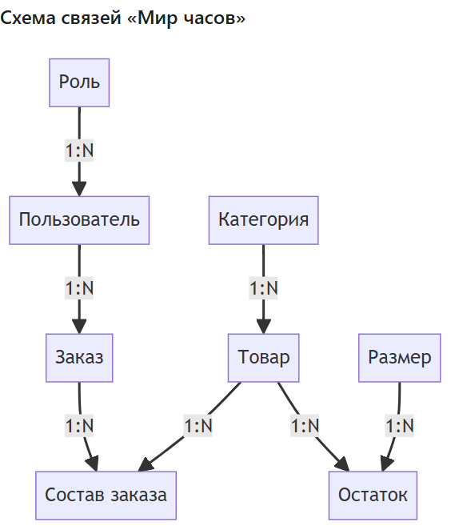

# Анализ предметной области «Парфюмерия»

**Студент:** Ермилов Даниил Евгеньевич, группа 3ИП-1-24  
**Тема:** Разработка базы данных и приложения «Парфюмерия» для автоматизации продаж

## Сущности

| № | Сущность | Что описывает |
|---|---|---|
| 1 | Категория | Вид продукции: парфюмерная вода, туалетная вода, духи, одеколон |
| 2 | Товар | Аромат: название, бренд, состав (ноты), цена, изображение |
| 3 | Объём | Объём флакона (30, 50, 100 мл) |
| 4 | Пользователь | Клиент, менеджер или администратор магазина |
| 5 | Заказ | Заказ клиента с датой и списком товаров |

## Атрибуты

### Категория

| Атрибут | Тип | Ограничение |
|---|---|---|
| id | SERIAL | PRIMARY KEY |
| name | VARCHAR(100) | NOT NULL, UNIQUE |
| description | TEXT | — |

### Товар

| Атрибут | Тип | Ограничение |
|---|---|---|
| id | SERIAL | PRIMARY KEY |
| name | VARCHAR(200) | NOT NULL |
| price | NUMERIC(10,2) | CHECK (price > 0) |

### Заказ

| Атрибут | Тип | Ограничение |
|---|---|---|
| id | SERIAL | PRIMARY KEY |
| order_date | DATE | DEFAULT CURRENT_DATE |
| user_id | INTEGER | REFERENCES users(id) |

## Связи

| Связь | Тип |
|---|---|
| Категория → Товар | 1:N |
| Пользователь → Заказ | 1:N |
| Заказ ↔ Товар (через Состав заказа) | M:N |

## Пример анализа «Мир часов» (учебный)

| № | Сущность | Что описывает |
|---|---|---|
| 1 | Категория | Тип часов (наручные, настенные и т.д.) |
| 2 | Товар | Модель часов |
| 3 | Размер | Размер корпуса |
| 4 | Остаток | Количество товара каждого размера на складе |
| 5 | Пользователь | Клиент или сотрудник |
| 6 | Роль | Роль пользователя (администратор, менеджер, клиент) |
| 7 | Заказ | Заказ клиента |
| 8 | Состав заказа | Позиции заказа (какой товар и сколько) |

| Связь | Тип | Пример |
|---|---|---|
| Категория → Товар | 1:N | Одна категория – много товаров |
| Товар → Остаток | 1:N | Один товар – много остатков (по размерам) |
| Размер → Остаток | 1:N | Один размер – много остатков разных товаров |
| Пользователь → Заказ | 1:N | Один пользователь – много заказов |
| Роль → Пользователь | 1:N | Одна роль – много пользователей |
| Заказ → Состав заказа | 1:N | Один заказ – много позиций |
| Товар → Состав заказа | 1:N | Один товар – много позиций в разных заказах |

