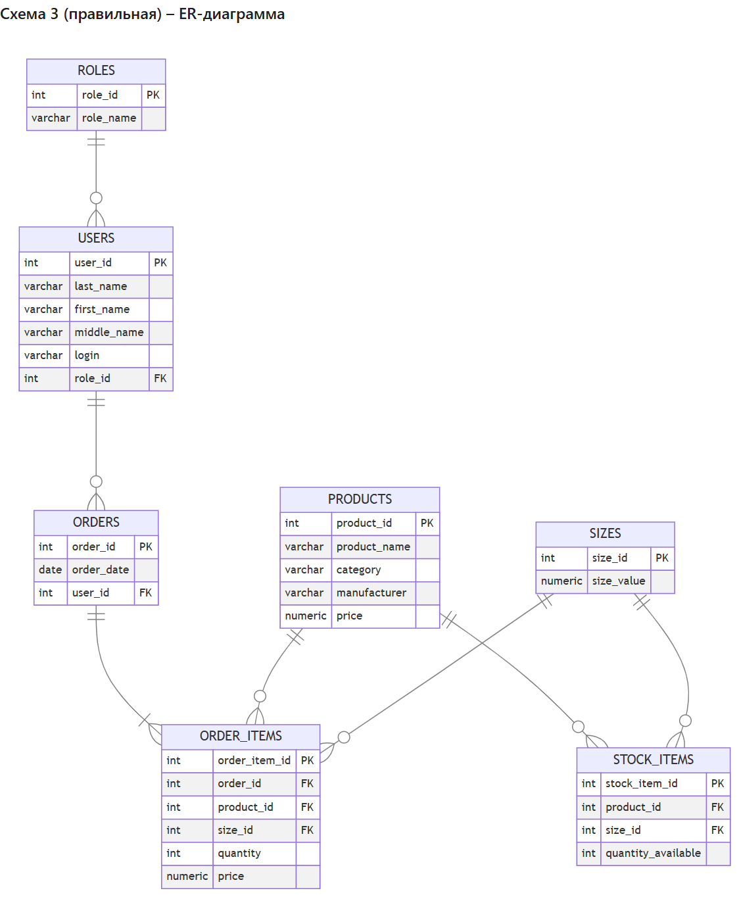

# Анализ схем данных на соответствие 3НФ (Упражнение 1.4)

**Студент:** Ермилов Даниил Евгеньевич, группа 3ИП-1-24  
**Вариант 27:** «Парфюмерия»

## Схема 1

```text
orders_full(order_id, order_date, client_full_name, client_login, role_name, product_name, size_value, image_path, price, quantity)
```

| № | Критерий | Результат | Почему |
|---|---|---|---|
| 1 | Атомарность | Да | В каждом поле одно значение |
| 2 | Частичные зависимости | Да | Ключ (order_id, product_name): order_date и данные клиента зависят только от order_id |
| 3 | Транзитивные зависимости | Да | client_login → role_name, product_name → image_path, price |
| 4 | Отдельные сущности | Нет | Клиенты, роли, товары, размеры и заказы в одной таблице |
| 5 | Ссылочная целостность | Нет | Нет отдельных таблиц, а значит нет PK и FK между ними |

**Вывод:** одна большая таблица, данные клиентов и товаров дублируются в каждой строке, есть частичные и транзитивные зависимости, нет ключей – нарушены 2НФ и 3НФ.  
**Итог:** ❌ Не подходит

## Схема 2

```text
users(user_id, full_name, login, role_name)
products(product_id, product_name, image_path, size_value, quantity_available, price)
orders(order_id, order_date, user_id, product_id, quantity)
```

| № | Критерий | Результат | Почему |
|---|---|---|---|
| 1 | Атомарность | Да | В каждом поле одно значение |
| 2 | Частичные зависимости | Нет | У таблиц простые ключи (user_id, product_id, order_id) |
| 3 | Транзитивные зависимости | Да | role_name хранится текстом у пользователя; размер и остаток лежат в товаре |
| 4 | Отдельные сущности | Нет | Нет отдельных таблиц ролей, размеров, остатков и состава заказа |
| 5 | Ссылочная целостность | Нет | role_name и size_value не связаны ключами со справочниками |

**Вывод:** роль хранится строкой в users, размер и остаток – в products, а в заказе может быть только один товар. Нет таблиц roles, sizes, stock_items, order_items.  
**Итог:** ❌ Не подходит

## Схема 3

```text
roles(role_id, role_name)
users(user_id, last_name, first_name, middle_name, login, role_id)
products(product_id, category, subcategory, image_path, product_name, manufacturer, description, composition, price)
sizes(size_id, size_value)
stock_items(stock_item_id, product_id, size_id, quantity_available)
orders(order_id, order_date, user_id)
order_items(order_item_id, order_id, product_id, size_id, quantity, price)
```

| № | Критерий | Результат | Почему |
|---|---|---|---|
| 1 | Атомарность | Да | ФИО разделено на фамилию, имя и отчество, в каждом поле одно значение |
| 2 | Частичные зависимости | Нет | Все неключевые поля зависят от всего ключа своей таблицы |
| 3 | Транзитивные зависимости | Нет | Роли, размеры, остатки и состав заказа вынесены в отдельные таблицы |
| 4 | Отдельные сущности | Да | Роли, пользователи, товары, размеры, остатки, заказы – отдельно |
| 5 | Ссылочная целостность | Да | Есть PK, связи через role_id, user_id, product_id, size_id, order_id |

**Вывод:** нарушений нет – схема в 3НФ, сущности разделены, есть первичные и внешние ключи.  
**Итог:** ✅ Подходит

## Схема 4

```text
roles(role_id, role_name)
users(user_id, full_name, login, role_id)
orders(order_id, order_date, user_id)
order_items(order_item_id, order_id, product_id, product_name, size_value, price, quantity)
```

| № | Критерий | Результат | Почему |
|---|---|---|---|
| 1 | Атомарность | Да | В каждом поле одно значение |
| 2 | Частичные зависимости | Нет | Ключи простые |
| 3 | Транзитивные зависимости | Да | В order_items: product_id → product_name, price; размер записан значением |
| 4 | Отдельные сущности | Нет | Нет таблиц товаров, размеров и остатков |
| 5 | Ссылочная целостность | Нет | product_id ни на что не ссылается – таблицы products нет |

**Вывод:** нет таблиц products, sizes и stock_items, поэтому название товара и размер дублируются в каждой позиции заказа (транзитивная зависимость).  
**Итог:** ❌ Не подходит

## Схема 5

```text
products(product_id, category, subcategory, image_path, product_name, manufacturer, description, composition, price)
orders(order_id, order_date, client_full_name, product_name, size_value, quantity, price)
```

| № | Критерий | Результат | Почему |
|---|---|---|---|
| 1 | Атомарность | Да | В каждом поле одно значение |
| 2 | Частичные зависимости | Нет | Ключи простые |
| 3 | Транзитивные зависимости | Да | В orders: product_name → price, клиент хранится строкой |
| 4 | Отдельные сущности | Нет | Нет пользователей, ролей, размеров, остатков и состава заказа |
| 5 | Ссылочная целостность | Нет | orders не связан с products и клиентами через FK |

**Вывод:** клиент и товар хранятся в заказе текстом, а не ссылками; в заказе только один товар; нет таблиц пользователей, ролей, размеров и состава заказа.  
**Итог:** ❌ Не подходит

## Схема 6

```text
users(user_id, last_name, first_name, middle_name, login)
products(product_id, product_name, price)
sizes(size_id, size_value)
orders(order_id, order_date, user_id)
order_items(order_item_id, order_id, product_id, size_id, quantity)
```

| № | Критерий | Результат | Почему |
|---|---|---|---|
| 1 | Атомарность | Да | ФИО разделено, в каждом поле одно значение |
| 2 | Частичные зависимости | Нет | Ключи простые |
| 3 | Транзитивные зависимости | Нет | Неключевые поля зависят только от ключа |
| 4 | Отдельные сущности | Нет | Нет ролей и складских остатков, у товара нет категории, производителя, изображения |
| 5 | Ссылочная целостность | Да | Есть PK и FK (user_id, order_id, product_id, size_id) |

**Вывод:** формально схема в 3НФ, но она неполная: нет таблиц roles и stock_items и части атрибутов товара, поэтому по заданию не подходит.  
**Итог:** ❌ Не подходит

## Итог

| № | Схема | Подходит? | Почему |
|---|---|---|---|
| 1 | Схема 1 | Нет | Одна таблица, дублирование, частичные и транзитивные зависимости |
| 2 | Схема 2 | Нет | Роль, размер и остаток не вынесены, в заказе один товар |
| 3 | Схема 3 | Да | 3НФ, все сущности отдельно, есть PK и FK |
| 4 | Схема 4 | Нет | Нет таблиц товаров, размеров и остатков |
| 5 | Схема 5 | Нет | Клиент и товар хранятся в заказе текстом, нет связей |
| 6 | Схема 6 | Нет | Нет ролей и складских остатков, схема неполная |

**Неподходящие схемы:** Схемы 1, 2, 4, 5, 6.

**Обоснование:** Подходит только схема 3: в ней каждая сущность (роли, пользователи, товары, размеры, остатки, заказы, состав заказа) вынесена в отдельную таблицу, нет повторов данных, нет частичных и транзитивных зависимостей, а связи сделаны через первичные и внешние ключи. В остальных схемах данные дублируются или не хватает нужных таблиц.



## Своя схема с нарушениями («Парфюмерия»)

```text
perfume_sales(sale_id, sale_date, buyer_full_name, buyer_phone, perfume_name,
              brand_name, brand_country, volume_ml, price)
perfumes(perfume_id, perfume_name, brand_name, brand_country, notes)
```

**Что нарушено:** Нарушены 1НФ, 2НФ и 3НФ: notes хранит несколько нот через запятую, данные покупателя и бренда повторяются в каждой продаже, brand_name → brand_country и perfume_name → price – транзитивные зависимости.

**Как исправить:** Покупателей, бренды, ароматы, объёмы и ноты нужно вынести в отдельные таблицы (buyers, brands, perfumes, volumes, perfume_notes), а в sales хранить только ссылки buyer_id и perfume_id.
