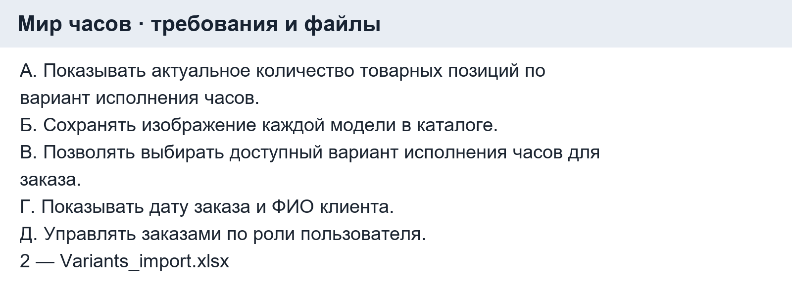
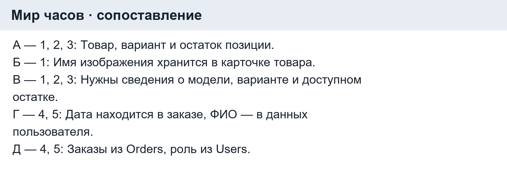
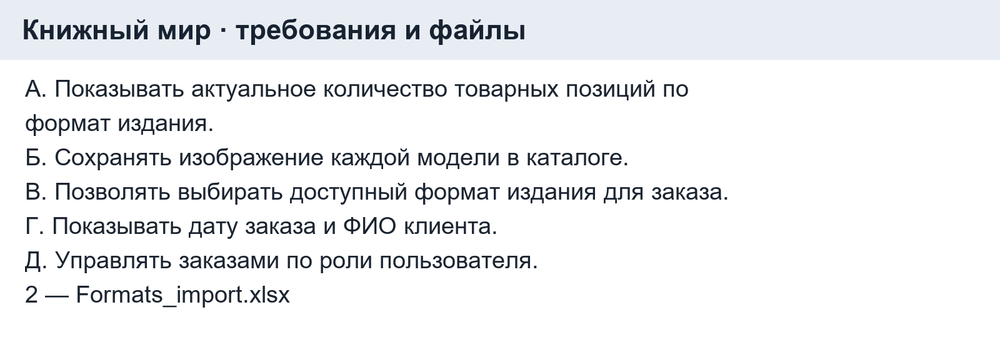
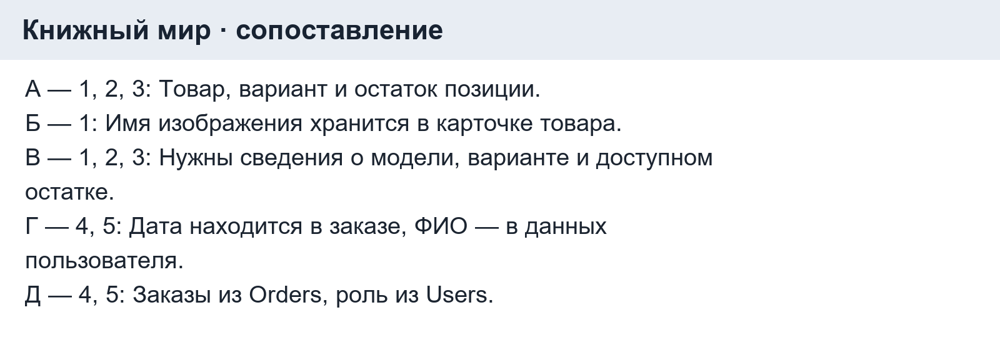
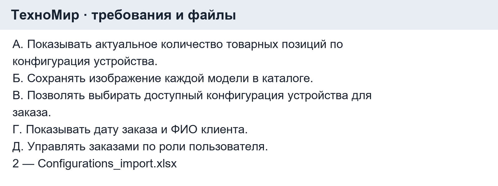
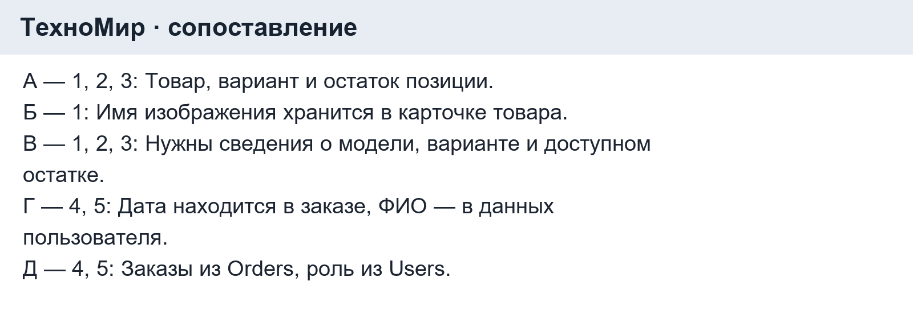

# Домашнее задание к паре 14

Ермилов Даниил Евгеньевич, 3ИП-1-24.

«Мир часов» — тема учебного примера. Для двух других тем ниже приведено учебное сопоставление по заданной структуре из пяти файлов.

## Мир часов

Файлы: 1 — `Products_import.xlsx`; 2 — `Variants_import.xlsx`; 3 — `Stock_Items_import.xlsx`; 4 — `Orders_import.xlsx`; 5 — `Users_import.xlsx`.

| Требование | Файлы | Почему |
|---|---|---|
| А. Показывать актуальное количество товарных позиций по вариант исполнения часов. | 1, 2, 3 | Товар, вариант и остаток позиции. |
| Б. Сохранять изображение каждой модели в каталоге. | 1 | Имя изображения хранится в карточке товара. |
| В. Позволять выбирать доступный вариант исполнения часов для заказа. | 1, 2, 3 | Нужны сведения о модели, варианте и доступном остатке. |
| Г. Показывать дату заказа и ФИО клиента. | 4, 5 | Дата находится в заказе, ФИО — в данных пользователя. |
| Д. Управлять заказами по роли пользователя. | 4, 5 | Заказы из Orders, роль из Users. |

Ответ: А-1, 2, 3; Б-1; В-1, 2, 3; Г-4, 5; Д-4, 5.

## Книжный мир

Файлы: 1 — `Products_import.xlsx`; 2 — `Formats_import.xlsx`; 3 — `Stock_Items_import.xlsx`; 4 — `Orders_import.xlsx`; 5 — `Users_import.xlsx`.

| Требование | Файлы | Почему |
|---|---|---|
| А. Показывать актуальное количество товарных позиций по формат издания. | 1, 2, 3 | Товар, вариант и остаток позиции. |
| Б. Сохранять изображение каждой модели в каталоге. | 1 | Имя изображения хранится в карточке товара. |
| В. Позволять выбирать доступный формат издания для заказа. | 1, 2, 3 | Нужны сведения о модели, варианте и доступном остатке. |
| Г. Показывать дату заказа и ФИО клиента. | 4, 5 | Дата находится в заказе, ФИО — в данных пользователя. |
| Д. Управлять заказами по роли пользователя. | 4, 5 | Заказы из Orders, роль из Users. |

Ответ: А-1, 2, 3; Б-1; В-1, 2, 3; Г-4, 5; Д-4, 5.

## ТехноМир

Файлы: 1 — `Products_import.xlsx`; 2 — `Configurations_import.xlsx`; 3 — `Stock_Items_import.xlsx`; 4 — `Orders_import.xlsx`; 5 — `Users_import.xlsx`.

| Требование | Файлы | Почему |
|---|---|---|
| А. Показывать актуальное количество товарных позиций по конфигурация устройства. | 1, 2, 3 | Товар, вариант и остаток позиции. |
| Б. Сохранять изображение каждой модели в каталоге. | 1 | Имя изображения хранится в карточке товара. |
| В. Позволять выбирать доступный конфигурация устройства для заказа. | 1, 2, 3 | Нужны сведения о модели, варианте и доступном остатке. |
| Г. Показывать дату заказа и ФИО клиента. | 4, 5 | Дата находится в заказе, ФИО — в данных пользователя. |
| Д. Управлять заказами по роли пользователя. | 4, 5 | Заказы из Orders, роль из Users. |

Ответ: А-1, 2, 3; Б-1; В-1, 2, 3; Г-4, 5; Д-4, 5.

