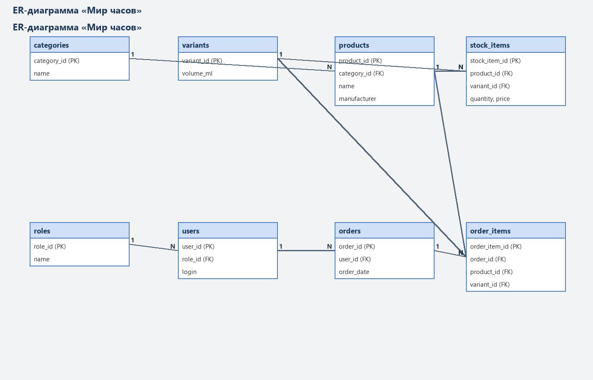
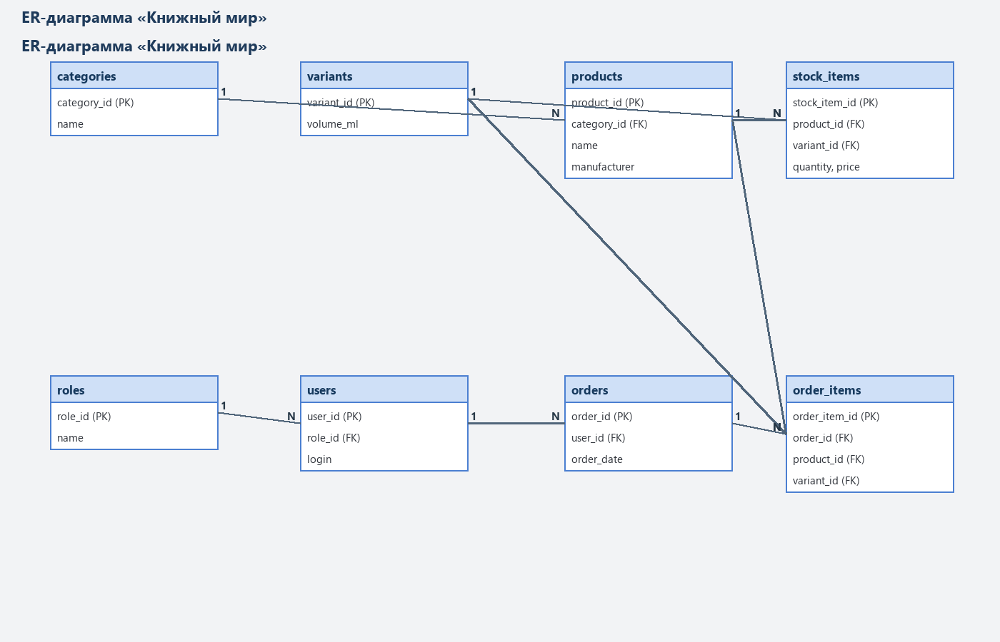
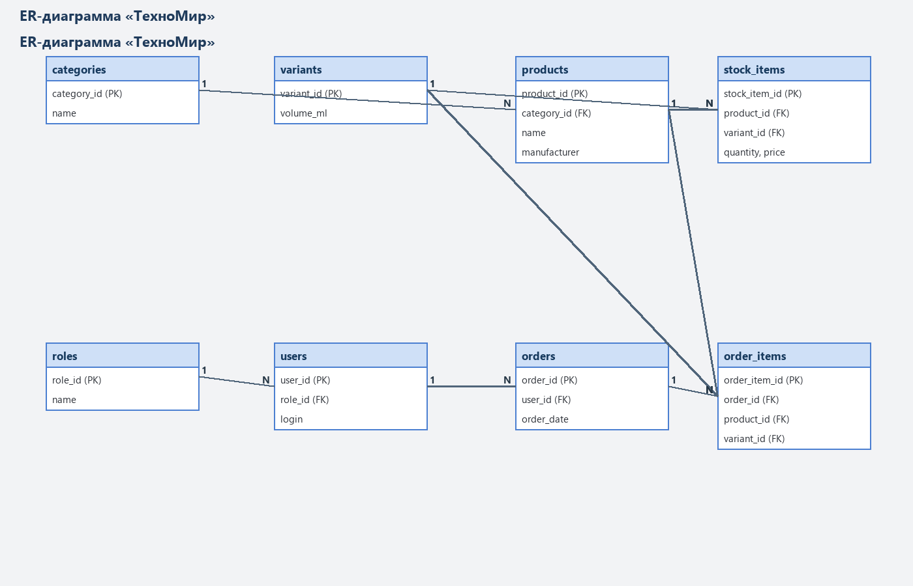
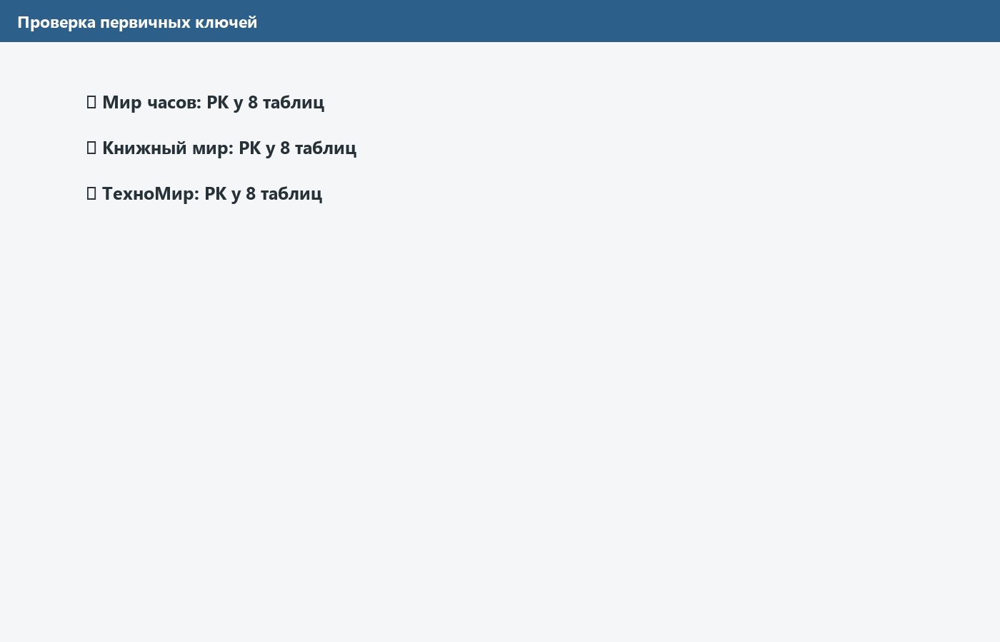
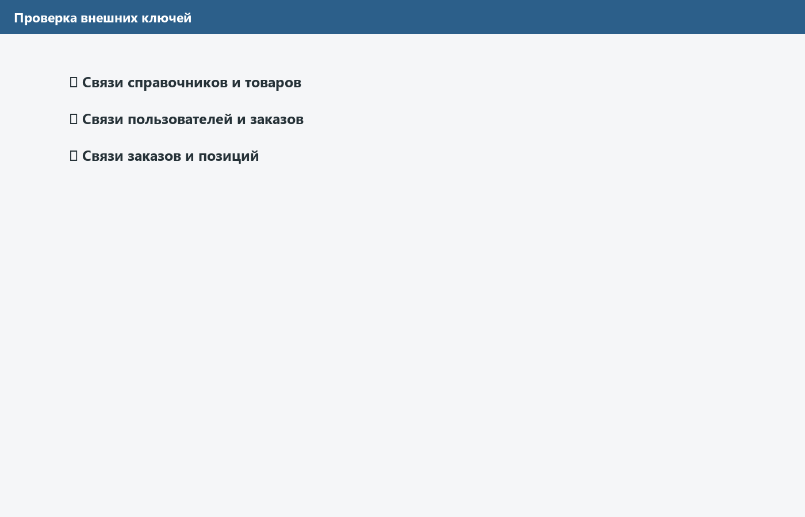
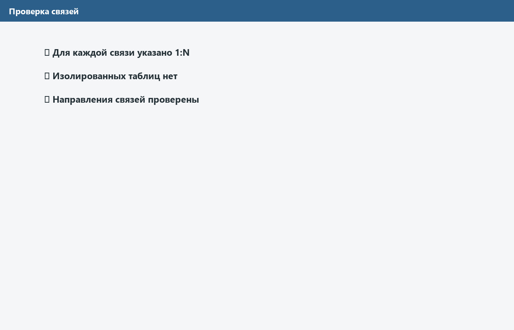
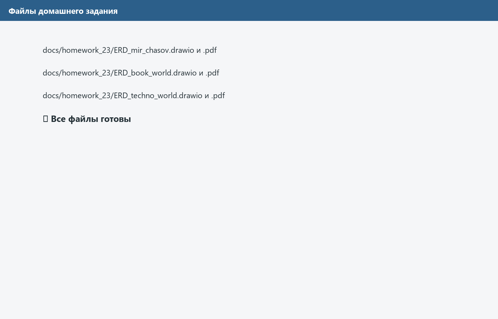

# Домашнее задание. Пара 23

Построены ER-диаграммы для трёх учебных тем:

- «Мир часов»;
- «Книжный мир»;
- «ТехноМир».

Для каждой темы сохранены исходный файл `.drawio` и экспорт в PDF. На диаграммах обозначены таблицы, PK, FK и связи 1:N.

