# Рабочая тетрадь. Пара № 5: «Типы данных: INTEGER, VARCHAR, DATE, NUMERIC, BOOLEAN»

**УП.11** «Разработка, администрирование и защита баз данных»  
**Студент:** Ермилов Даниил Евгеньевич  
**Вариант 27:** «Парфюмерия»  
**СУБД:** PostgreSQL + pgAdmin 4

## Практическая часть

### Задание 1: Подготовка базы данных

**Задание 1.1**

```sql
CREATE DATABASE types_db;
```

Результат: ☑

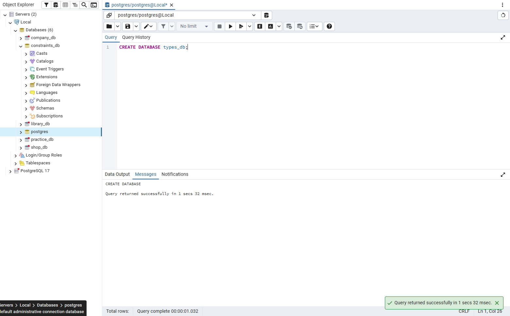

**Задание 1.2**

```sql
\c types_db
```

Результат: ☑

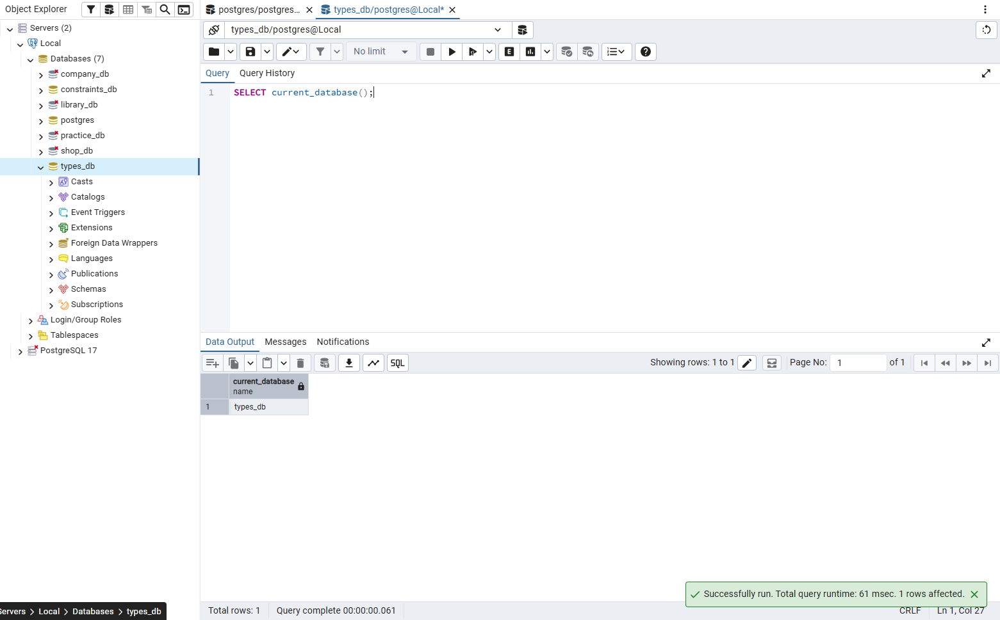

### Задание 2: INTEGER и SERIAL

**Задание 2.1**

```sql
CREATE TABLE students (
    id SERIAL PRIMARY KEY,
    name VARCHAR(100) NOT NULL,
    age INTEGER,
    course INTEGER
);
```

Результат: ☑

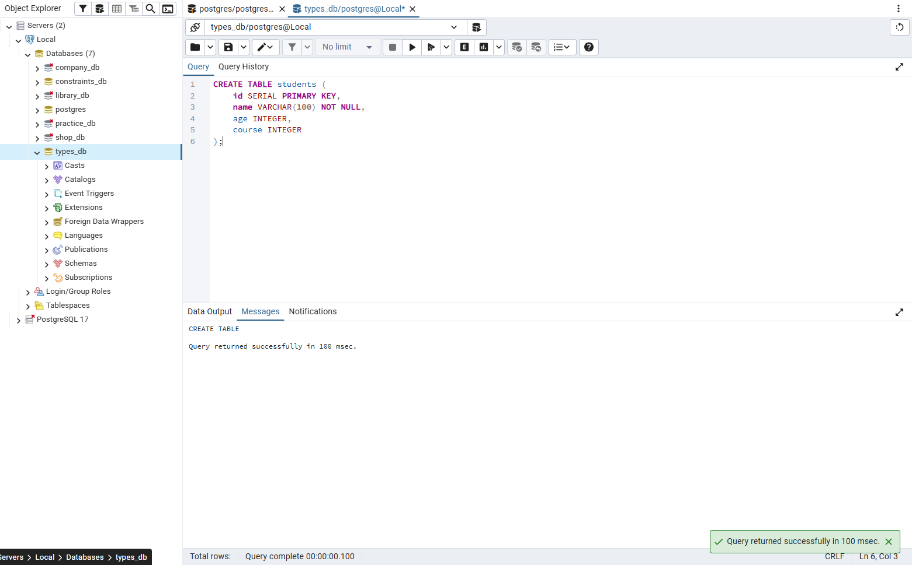

**Задание 2.2**

```sql
INSERT INTO students (name, age, course) VALUES
('Иванов Иван', 20, 2),
('Петров Пётр', 21, 3),
('Сидорова Анна', 19, 1);
```

Результат: ☑


### Задание 3: VARCHAR и TEXT

**Задание 3.1**

```sql
CREATE TABLE clients (
    id SERIAL PRIMARY KEY,
    name VARCHAR(100) NOT NULL,
    email VARCHAR(100) UNIQUE,
    phone VARCHAR(20),
    address TEXT
);
```

Результат: ☑

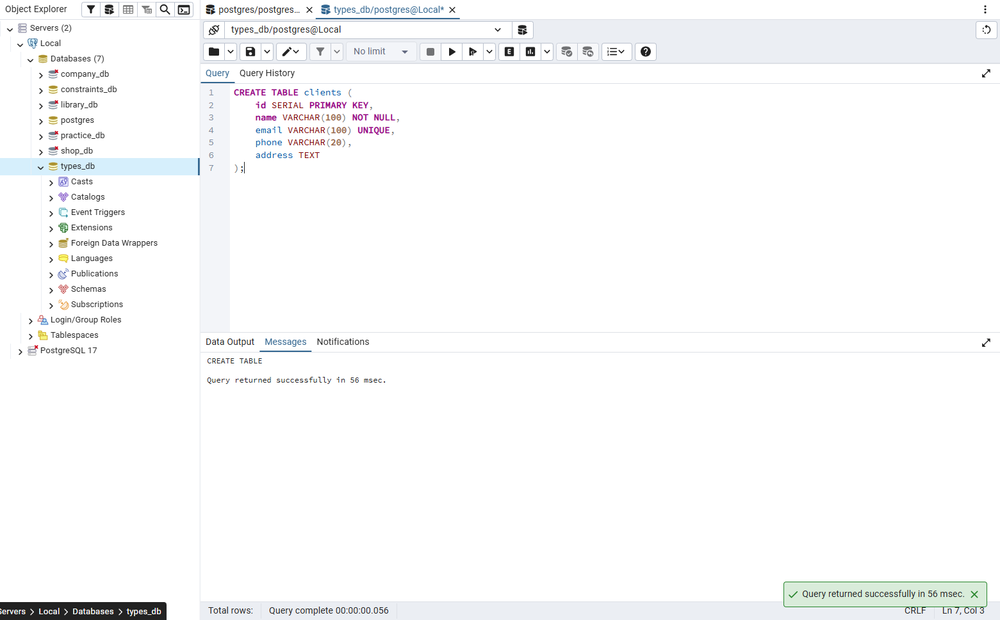

**Задание 3.2**

```sql
INSERT INTO clients (name, email, phone, address) VALUES
('Иванов Иван', 'ivanov@mail.ru', '+7 900 111-11-11', 'г. Москва, ул. Тверская, д. 1, кв. 10'),
('Петрова Мария', 'petrova@mail.ru', '+7 900 222-22-22', 'г. Санкт-Петербург, Невский пр., д. 25'),
('Сидоров Олег', 'sidorov@mail.ru', '+7 900 333-33-33', 'г. Казань, ул. Баумана, д. 7');
```

Результат: ☑

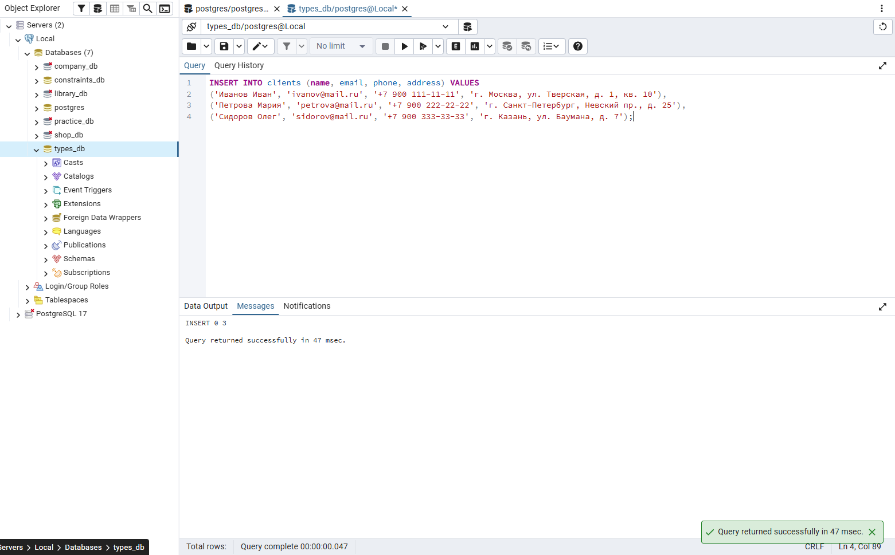

### Задание 4: DATE

**Задание 4.1**

```sql
CREATE TABLE orders (
    id SERIAL PRIMARY KEY,
    order_date DATE DEFAULT CURRENT_DATE,
    delivery_date DATE,
    status VARCHAR(20) DEFAULT 'новый'
);
```

Результат: ☑

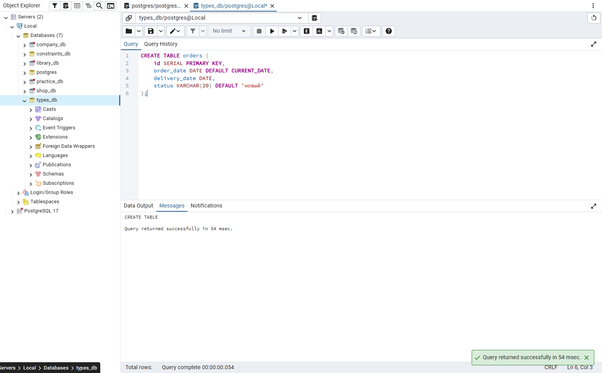

**Задание 4.2**

```sql
INSERT INTO orders (order_date, delivery_date, status) VALUES
('2026-10-10', '2026-10-14', 'доставлен'),
('2026-10-12', '2026-10-16', 'в пути'),
(DEFAULT, '2026-10-18', DEFAULT);
```

Результат: ☑

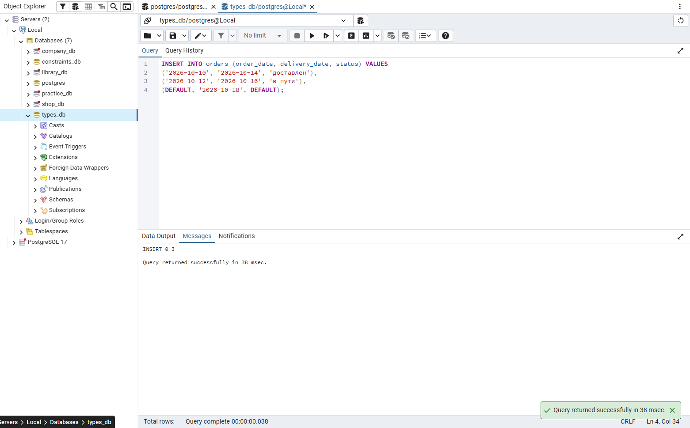

### Задание 5: NUMERIC

**Задание 5.1**

```sql
CREATE TABLE products (
    id SERIAL PRIMARY KEY,
    name VARCHAR(100) NOT NULL,
    price NUMERIC(10,2) CHECK (price > 0),
    quantity INTEGER CHECK (quantity >= 0)
);
```

Результат: ☑

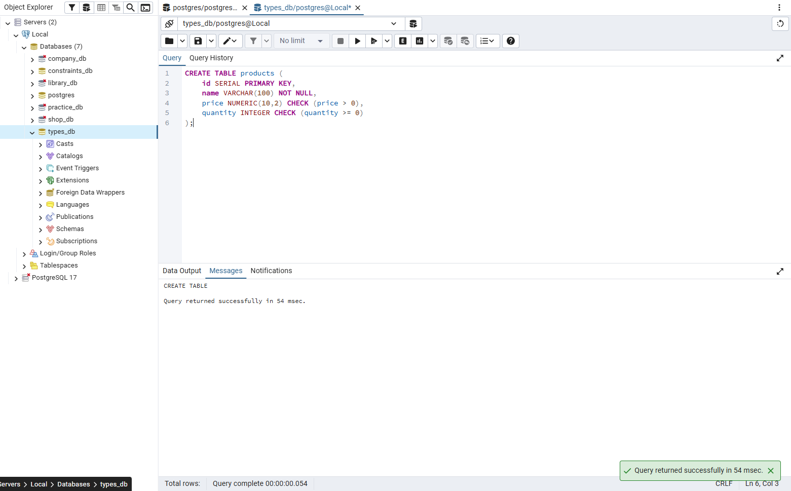

**Задание 5.2**

```sql
INSERT INTO products (name, price, quantity) VALUES
('Chanel No 5, 50 мл', 14500.00, 12),
('Dior Sauvage, 100 мл', 12900.50, 8),
('Lancome La Vie Est Belle, 75 мл', 11200.99, 5);
```

Результат: ☑


### Задание 6: BOOLEAN

**Задание 6.1**

```sql
CREATE TABLE users (
    id SERIAL PRIMARY KEY,
    login VARCHAR(50) UNIQUE NOT NULL,
    is_active BOOLEAN DEFAULT TRUE,
    is_admin BOOLEAN DEFAULT FALSE
);
```

Результат: ☑


**Задание 6.2**

```sql
INSERT INTO users (login, is_active, is_admin) VALUES
('admin', TRUE, TRUE),
('ivanov', DEFAULT, DEFAULT),
('petrova', FALSE, FALSE);
```

Результат: ☑

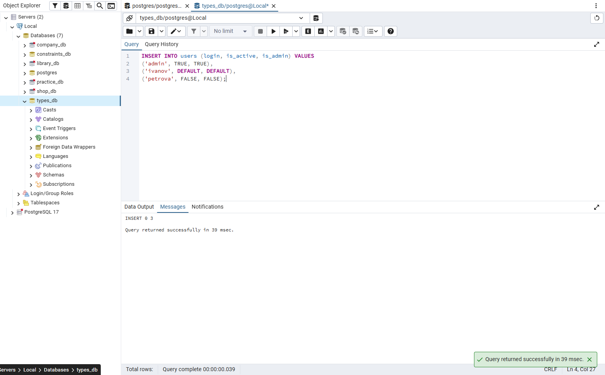

### Задание 7: Самостоятельная работа

**Задание 7.1**

```sql
CREATE TABLE books (
    id SERIAL PRIMARY KEY,
    title VARCHAR(200) NOT NULL,
    author VARCHAR(100) NOT NULL,
    year INTEGER CHECK (year > 1900),
    price NUMERIC(10,2) CHECK (price > 0),
    publish_date DATE,
    is_available BOOLEAN DEFAULT TRUE
);
```

Результат: ☑

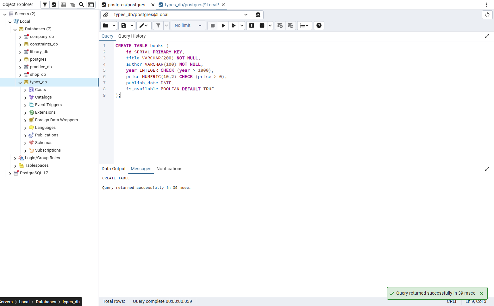

**Задание 7.2**

```sql
CREATE TABLE employees (
    id SERIAL PRIMARY KEY,
    name VARCHAR(100) NOT NULL,
    position VARCHAR(100) NOT NULL,
    salary NUMERIC(10,2) CHECK (salary > 0),
    hire_date DATE DEFAULT CURRENT_DATE,
    is_active BOOLEAN DEFAULT TRUE
);
```

Результат: ☑

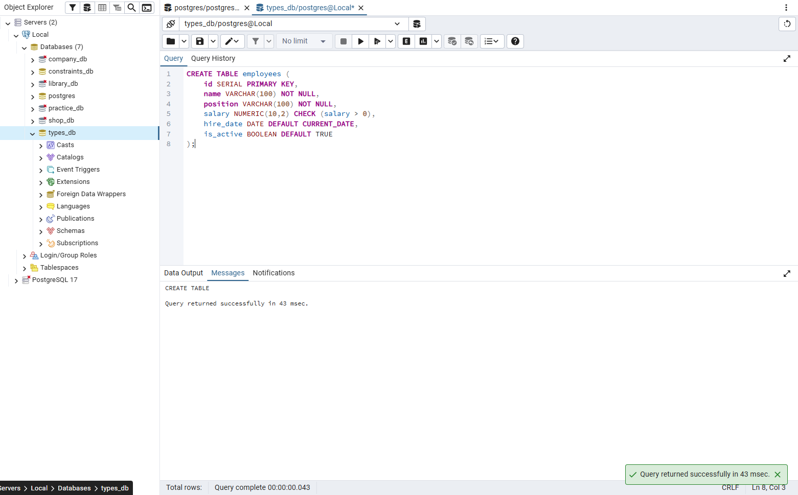

**Задание 7.3**

```sql
CREATE TABLE articles (
    id SERIAL PRIMARY KEY,
    title VARCHAR(200) NOT NULL,
    content TEXT,
    views INTEGER DEFAULT 0,
    rating NUMERIC(3,1) CHECK (rating >= 0 AND rating <= 5),
    publish_date DATE,
    is_published BOOLEAN DEFAULT FALSE
);
```

Результат: ☑

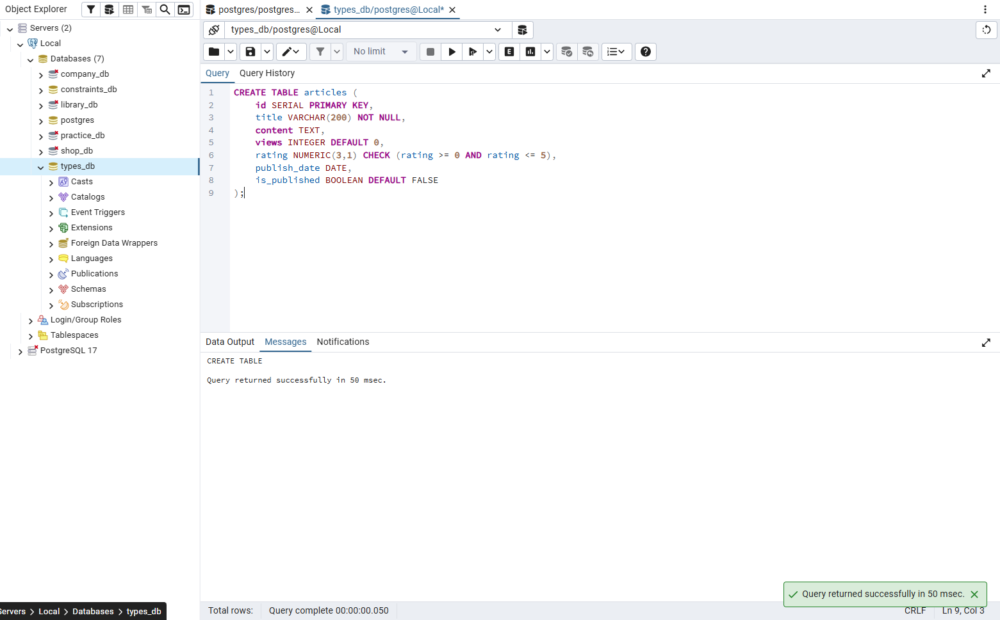

### Задание 8: Разноуровневые задания

#### Уровень 1 (базовый)

**Задание 1.1**

```sql
CREATE TABLE categories (
    id SERIAL PRIMARY KEY,
    name VARCHAR(100) NOT NULL
);
```

Результат: ☑


**Задание 1.2**

```sql
CREATE TABLE statuses (
    id SERIAL PRIMARY KEY,
    name VARCHAR(50) NOT NULL UNIQUE
);
```

Результат: ☑

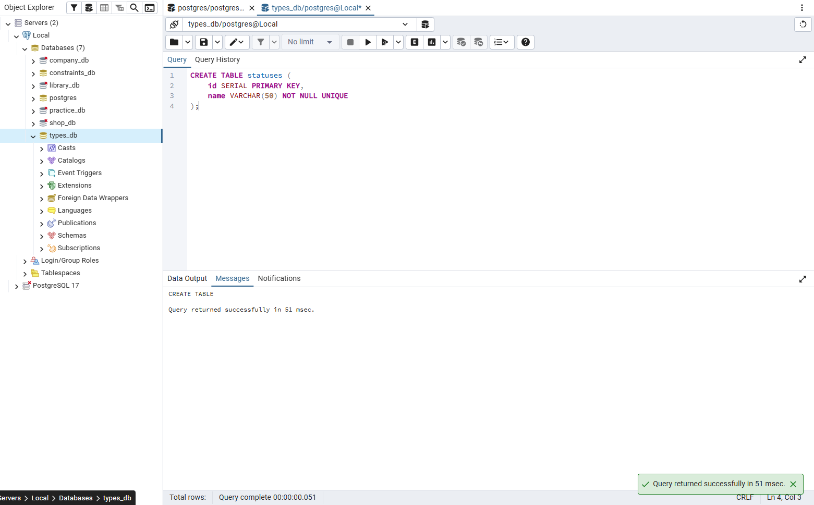

#### Уровень 2 (средний)

**Задание 2.1**

```sql
CREATE TABLE invoices (
    id SERIAL PRIMARY KEY,
    number VARCHAR(50) UNIQUE NOT NULL,
    invoice_date DATE DEFAULT CURRENT_DATE,
    amount NUMERIC(10,2) CHECK (amount > 0),
    is_paid BOOLEAN DEFAULT FALSE
);
```

Результат: ☑

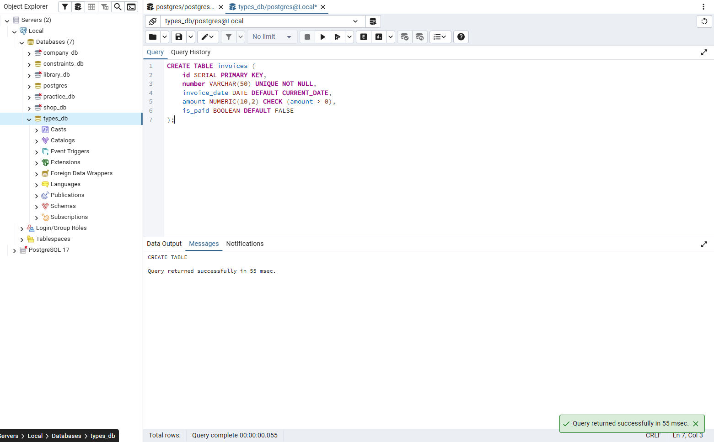

**Задание 2.2**

```sql
CREATE TABLE tasks (
    id SERIAL PRIMARY KEY,
    title VARCHAR(200) NOT NULL,
    description TEXT,
    priority INTEGER CHECK (priority BETWEEN 1 AND 5),
    due_date DATE,
    is_completed BOOLEAN DEFAULT FALSE
);
```

Результат: ☑

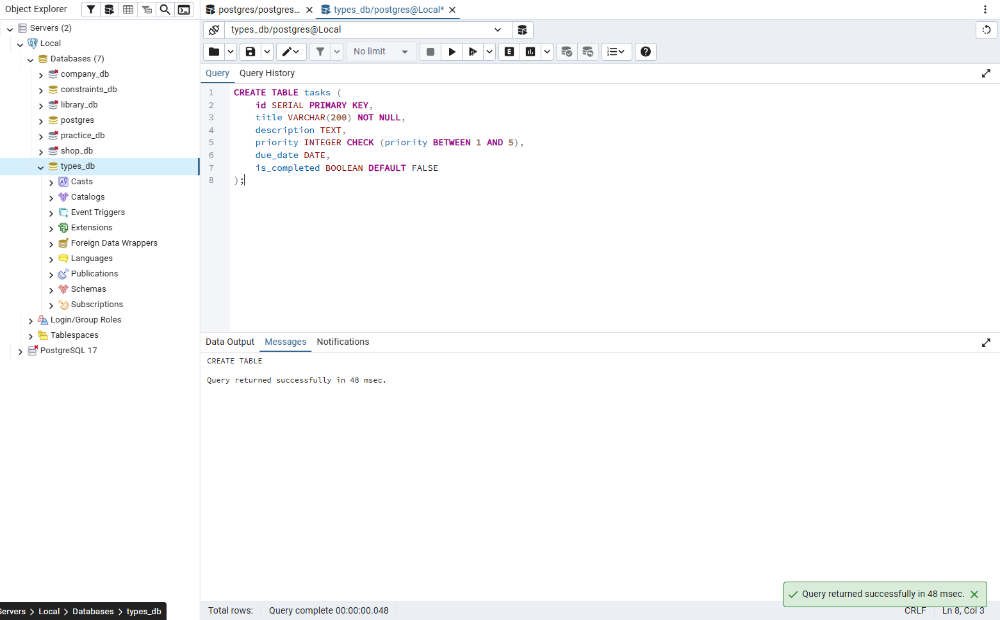

#### Уровень 3 (повышенный)

**Задание 3.1**

```sql
DROP TABLE IF EXISTS orders;

CREATE TABLE customers (
    id SERIAL PRIMARY KEY,
    name VARCHAR(100) NOT NULL,
    email VARCHAR(100) UNIQUE NOT NULL,
    registration_date DATE DEFAULT CURRENT_DATE,
    is_active BOOLEAN DEFAULT TRUE
);

CREATE TABLE orders (
    id SERIAL PRIMARY KEY,
    customer_id INTEGER REFERENCES customers(id),
    order_date DATE DEFAULT CURRENT_DATE,
    total NUMERIC(10,2) CHECK (total >= 0),
    is_paid BOOLEAN DEFAULT FALSE
);

CREATE TABLE order_items (
    id SERIAL PRIMARY KEY,
    order_id INTEGER REFERENCES orders(id),
    product_name VARCHAR(100) NOT NULL,
    quantity INTEGER CHECK (quantity > 0),
    price NUMERIC(10,2) CHECK (price > 0)
);
```

Результат: ☑

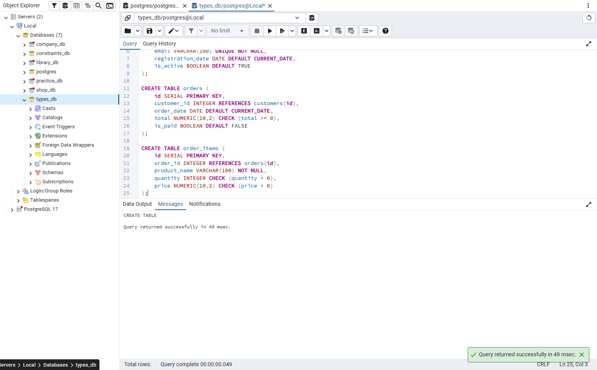

**Задание 3.2**

```sql
INSERT INTO customers (name, email) VALUES
('Иванов Иван', 'ivanov@mail.ru'),
('Петрова Мария', 'petrova@mail.ru'),
('Сидоров Олег', 'sidorov@mail.ru');

INSERT INTO orders (customer_id, total, is_paid) VALUES
(1, 27400.00, TRUE),
(2, 11200.00, FALSE),
(3, 9800.00, TRUE);

INSERT INTO order_items (order_id, product_name, quantity, price) VALUES
(1, 'Chanel No 5, 50 мл', 1, 14500.00),
(1, 'Dior Sauvage, 100 мл', 1, 12900.00),
(2, 'Lancome La Vie Est Belle, 75 мл', 1, 11200.00),
(3, 'Hugo Boss Bottled, 50 мл', 1, 9800.00);
```

Результат: ☑

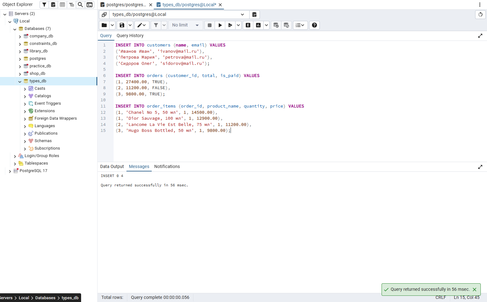

**Задание 3.3**

```sql
INSERT INTO orders (customer_id, order_date, total, is_paid)
VALUES (1, 'вчера', 'сто рублей', 'может быть');
```

**Что произошло?** Запись не добавилась, появилась ошибка: неверный синтаксис для типа date: "вчера". В поле типа DATE можно записать только дату в формате 'ГГГГ-ММ-ДД', а не произвольный текст. Так же не подойдут 'сто рублей' для NUMERIC и 'может быть' для BOOLEAN – PostgreSQL проверяет тип каждого значения и останавливается на первой ошибке.

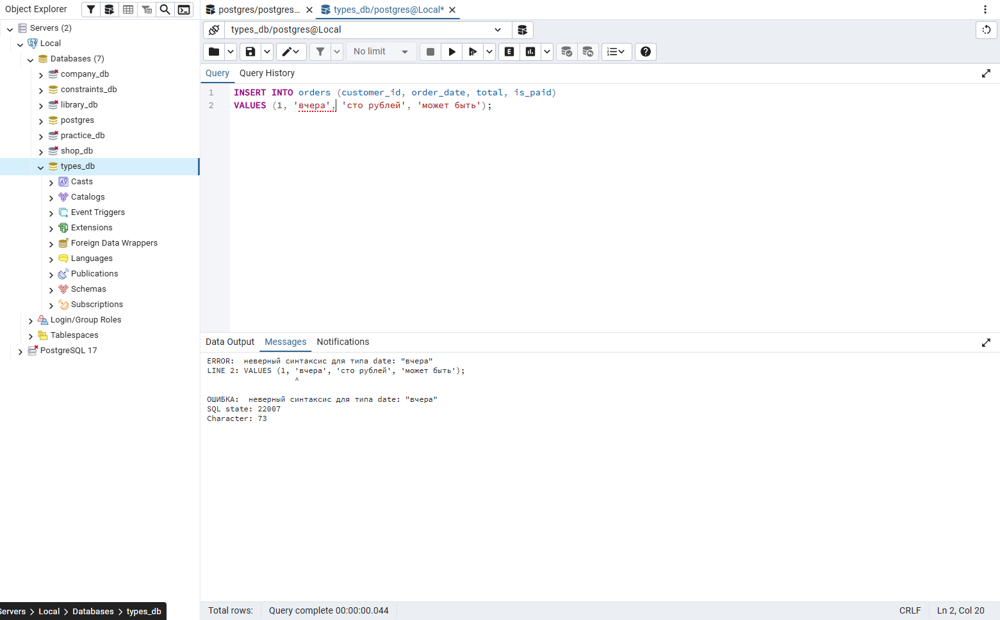

### Задание 9: Творческий уровень

**Задание 9.1**

```sql
CREATE TABLE brands (
    id SERIAL PRIMARY KEY,
    name VARCHAR(100) NOT NULL UNIQUE,
    country VARCHAR(50),
    founded_year INTEGER CHECK (founded_year > 1800),
    is_premium BOOLEAN DEFAULT FALSE
);

CREATE TABLE perfumes (
    id SERIAL PRIMARY KEY,
    brand_id INTEGER REFERENCES brands(id),
    name VARCHAR(100) NOT NULL,
    gender VARCHAR(10),
    volume_ml INTEGER CHECK (volume_ml > 0),
    price NUMERIC(10,2) CHECK (price > 0),
    release_date DATE,
    in_stock BOOLEAN DEFAULT TRUE
);

CREATE TABLE sales (
    id SERIAL PRIMARY KEY,
    perfume_id INTEGER REFERENCES perfumes(id),
    buyer_name VARCHAR(100) NOT NULL,
    quantity INTEGER CHECK (quantity > 0),
    sale_date DATE DEFAULT CURRENT_DATE,
    total NUMERIC(10,2) CHECK (total >= 0),
    is_paid BOOLEAN DEFAULT FALSE
);
```

Результат: ☑

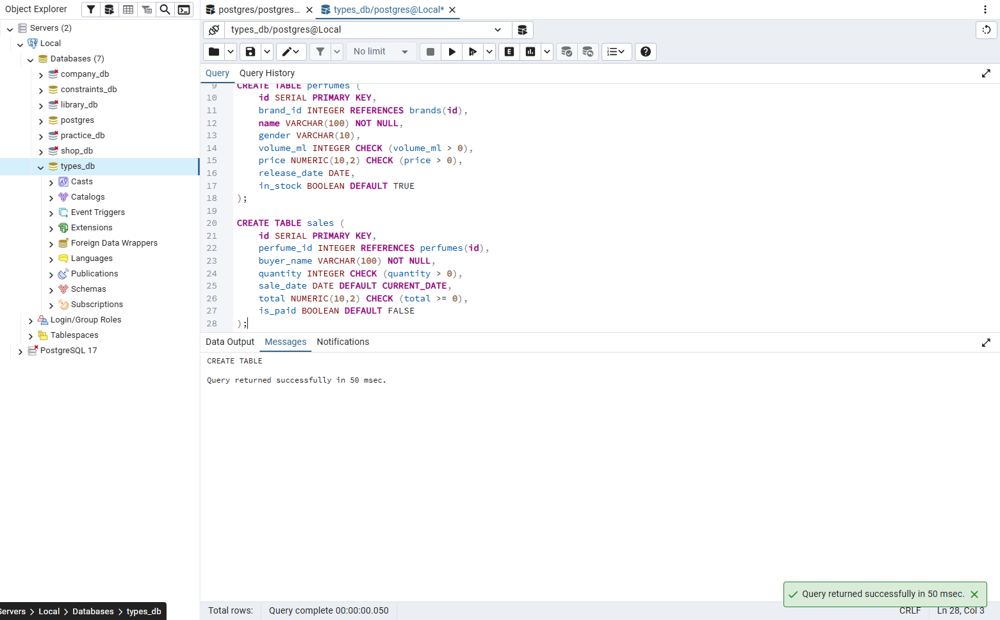

## Контрольные вопросы

**1. Что такое тип данных?**  
Тип данных – это характеристика поля, которая определяет, какие значения в нём можно хранить, сколько памяти они занимают и какие операции с ними можно делать.

**2. Какой тип данных хранит целые числа?**  
INTEGER (для автоматической нумерации – SERIAL).

**3. Какой тип данных хранит строки?**  
VARCHAR(n) – строки до n символов, TEXT – длинный текст без ограничения длины.

**4. Какой тип данных хранит дату?**  
DATE.

**5. Какой тип данных хранит точные дробные числа?**  
NUMERIC(p,s).

**6. Какой тип данных хранит логические значения?**  
BOOLEAN.

**7. Что означает NUMERIC(10,2)?**  
Всего 10 цифр, из них 2 после запятой, то есть максимум 99999999.99.

**8. Какой тип данных использовать для цены?**  
NUMERIC(10,2) – он хранит деньги точно, без ошибок округления.

**9. Какой тип данных использовать для возраста?**  
INTEGER.

**10. Какой тип данных использовать для флага?**  
BOOLEAN (TRUE или FALSE).
