# Рабочая тетрадь. Пара № 6: «Анализ предметной области. Выделение сущностей и атрибутов»

**УП.11** «Разработка, администрирование и защита баз данных»  
**Студент:** Ермилов Даниил Евгеньевич  
**Вариант 27:** «Парфюмерия»

## Задание 1. Анализ «Мир часов»

| № | Существительное | Сущность? |
|---|---|---|
| 1 | Компания | ☐ Нет – это сама фирма, а не объект учёта |
| 2 | Часы (модель) | ☑ Да – Товар |
| 3 | Каталог | ☐ Нет – это просто список товаров |
| 4 | Категория | ☑ Да – Категория |
| 5 | Производитель | ☐ Нет – атрибут товара |
| 6 | Клиент | ☑ Да – Пользователь |
| 7 | Заказ | ☑ Да – Заказ |
| 8 | Роль | ☑ Да – Роль |

| № | Сущность | Что описывает |
|---|---|---|
| 1 | Категория | Тип часов (наручные, настенные и т.д.) |
| 2 | Товар | Модель часов |
| 3 | Размер | Размер корпуса |
| 4 | Остаток | Количество товара каждого размера на складе |
| 5 | Пользователь | Клиент или сотрудник |
| 6 | Роль | Роль пользователя (администратор, менеджер, клиент) |
| 7 | Заказ | Заказ клиента |
| 8 | Состав заказа | Позиции заказа (какой товар и сколько) |

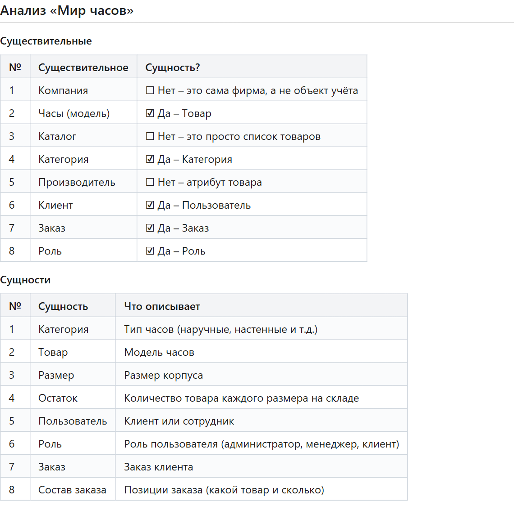

## Задание 2. Атрибуты сущностей

### 2.1. «Категория»

| Атрибут | Тип | Ограничение |
|---|---|---|
| id | SERIAL | PRIMARY KEY |
| name | VARCHAR(100) | NOT NULL |
| subcategory | VARCHAR(100) | — |

```sql
CREATE TABLE categories (
    id SERIAL PRIMARY KEY,
    name VARCHAR(100) NOT NULL,
    subcategory VARCHAR(100)
);
```

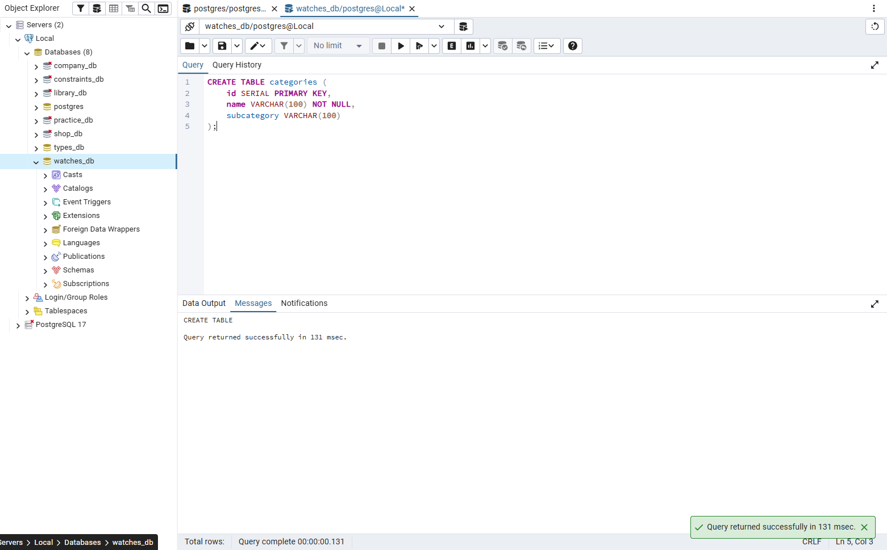

### 2.2. «Товар»

| Атрибут | Тип | Ограничение |
|---|---|---|
| id | SERIAL | PRIMARY KEY |
| category_id | INTEGER | REFERENCES categories(id) |
| name | VARCHAR(200) | NOT NULL |
| manufacturer | VARCHAR(100) | — |
| description | TEXT | — |
| composition | TEXT | — |
| price | NUMERIC(10,2) | CHECK (price > 0) |
| image_path | VARCHAR(255) | — |

```sql
CREATE TABLE products (
    id SERIAL PRIMARY KEY,
    category_id INTEGER REFERENCES categories(id),
    name VARCHAR(200) NOT NULL,
    manufacturer VARCHAR(100),
    description TEXT,
    composition TEXT,
    price NUMERIC(10,2) CHECK (price > 0),
    image_path VARCHAR(255)
);
```

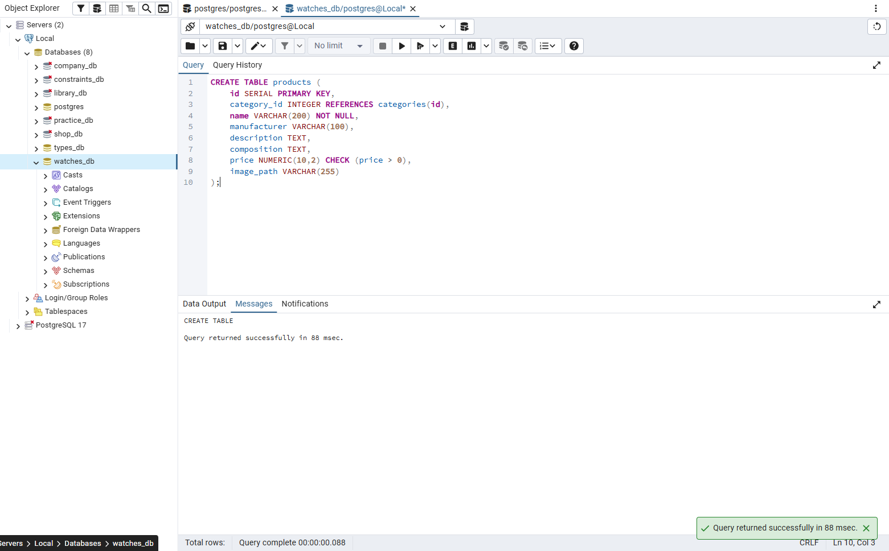

### 2.3. «Размер»

| Атрибут | Тип | Ограничение |
|---|---|---|
| id | SERIAL | PRIMARY KEY |
| value | NUMERIC(4,1) | NOT NULL, CHECK (value > 0) |

```sql
CREATE TABLE sizes (
    id SERIAL PRIMARY KEY,
    value NUMERIC(4,1) NOT NULL CHECK (value > 0)
);
```

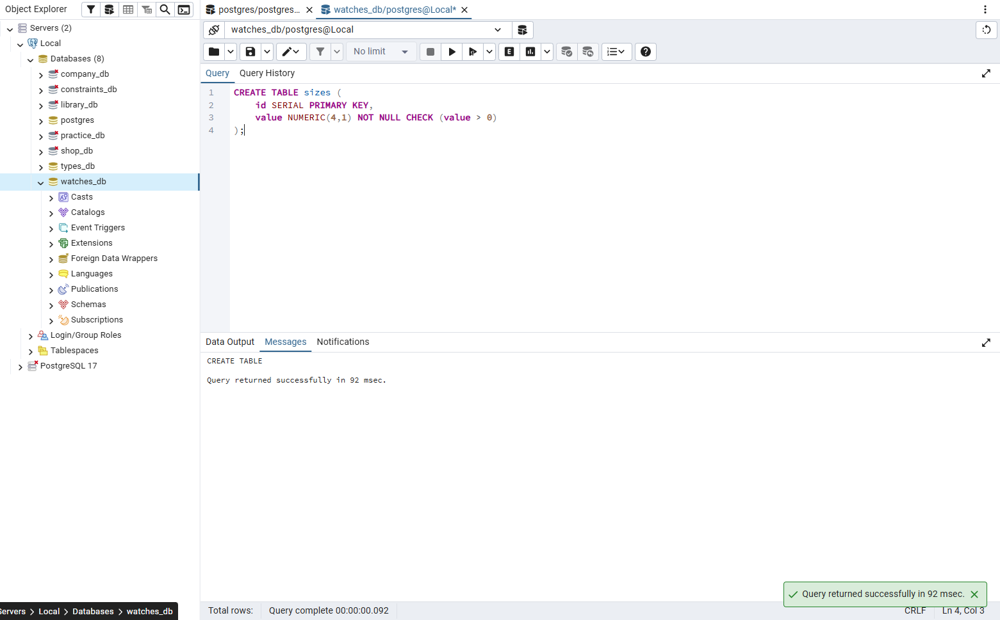

## Задание 3. Связи

| Связь | Тип | Пример |
|---|---|---|
| Категория → Товар | 1:N | Одна категория – много товаров |
| Товар → Остаток | 1:N | Один товар – много остатков (по размерам) |
| Размер → Остаток | 1:N | Один размер – много остатков разных товаров |
| Пользователь → Заказ | 1:N | Один пользователь – много заказов |
| Роль → Пользователь | 1:N | Одна роль – много пользователей |
| Заказ → Состав заказа | 1:N | Один заказ – много позиций |
| Товар → Состав заказа | 1:N | Один товар – много позиций в разных заказах |

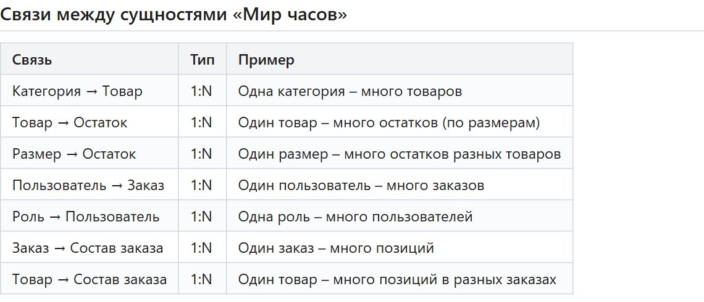


## Задание 4. Своя предметная область

Тема: Разработка базы данных и приложения «Парфюмерия» для автоматизации продаж

Подробно: [docs/05_analysis.md](../docs/05_analysis.md)

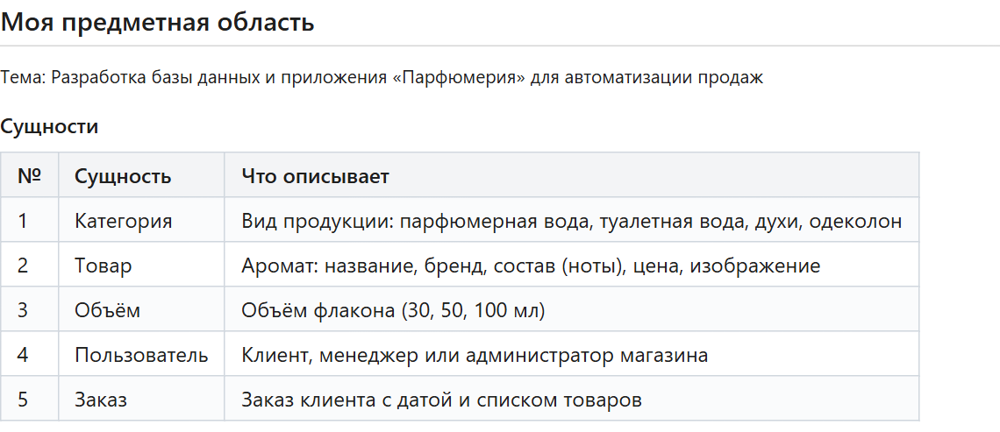

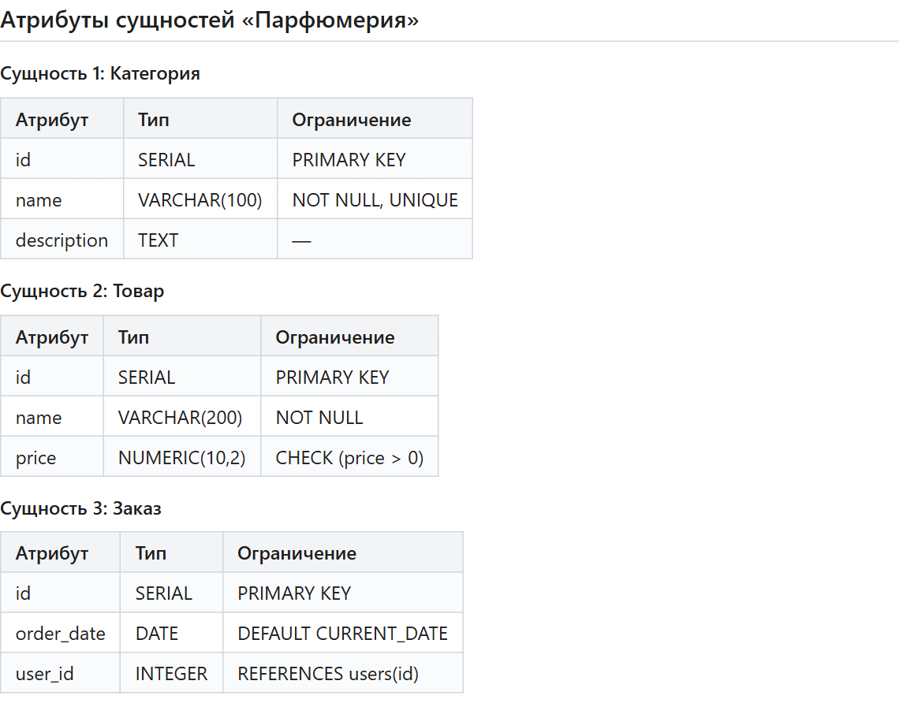

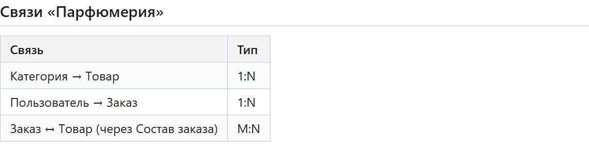

## Задание 5. Разноуровневые задания

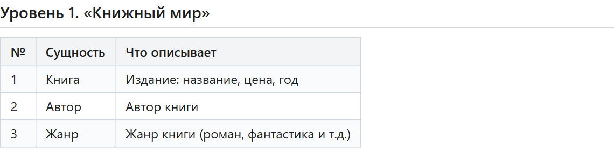

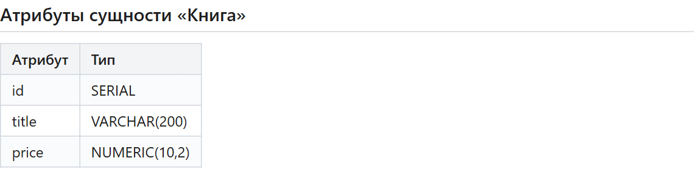

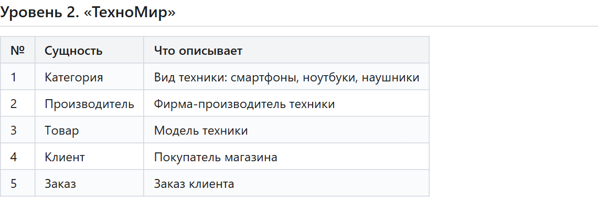

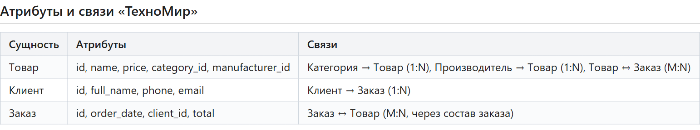

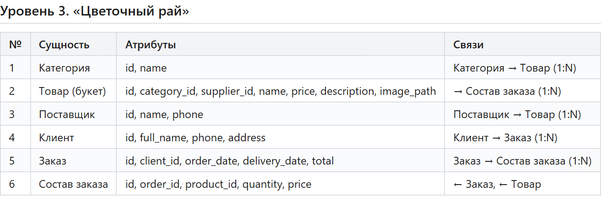

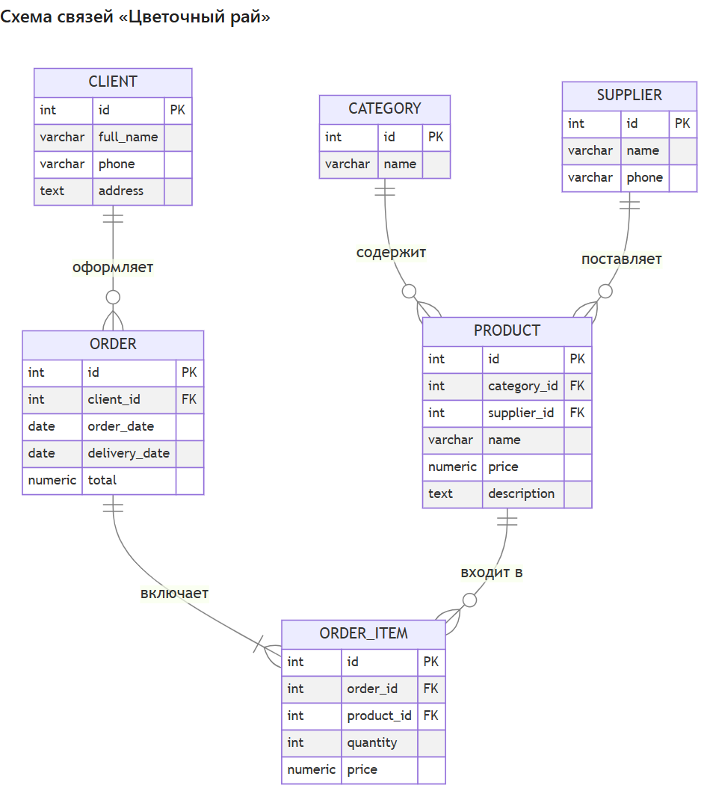

## Задание 6. Творческий уровень

Тема: Автосервис «Мотор»

| № | Сущность | Атрибуты | Связи |
|---|---|---|---|
| 1 | Клиент | id, full_name, phone | Клиент → Автомобиль (1:N) |
| 2 | Автомобиль | id, client_id, brand, model, gos_number | Автомобиль → Заказ-наряд (1:N) |
| 3 | Мастер | id, full_name, specialization | Мастер → Заказ-наряд (1:N) |
| 4 | Услуга | id, name, price | Услуга ↔ Заказ-наряд (M:N) |
| 5 | Заказ-наряд | id, car_id, master_id, open_date, total | ← Автомобиль, ← Мастер |

## Контрольные вопросы

**1. Что такое предметная область?**  
Предметная область – это часть реального мира, которую описывает база данных (например, продажа часов).

**2. Что такое сущность?**  
Сущность – это объект предметной области, о котором нужно хранить информацию (товар, заказ, клиент).

**3. Что такое атрибут?**  
Атрибут – это свойство сущности (например, у товара: название, цена, производитель).

**4. Что такое связь?**  
Связь – это отношение между сущностями (например, категория содержит товары).

**5. Какие типы связей бывают?**  
Один к одному (1:1), один ко многим (1:N) и многие ко многим (M:N).

**6. Как выделить сущности?**  
Прочитать описание предметной области и выписать существительные – это кандидаты в сущности.

**7. Как выделить атрибуты?**  
Найти свойства, которые описывают сущность (прилагательные, характеристики): название, цена, дата и т.п.

**8. Что означает связь 1:N?**  
Одной записи первой сущности соответствует много записей второй (одна категория – много товаров).

**9. Что означает связь M:N?**  
Много записей одной сущности связаны с многими записями другой (заказ – товары). Такая связь делается через промежуточную таблицу (Состав заказа).

**10. Зачем нужен анализ предметной области?**  
Чтобы понять, какие данные нужно хранить, правильно выделить таблицы и связи и не ошибиться при создании БД.
