# Рабочая тетрадь. Пара № 8: «Упражнение 1.4: анализ схем данных (6 вариантов)»

**УП.11** «Разработка, администрирование и защита баз данных»  
**Студент:** Ермилов Даниил Евгеньевич  
**Вариант 27:** «Парфюмерия»

Подробный анализ: [docs/07_analysis_schemas.md](../docs/07_analysis_schemas.md)

## Задание 1.1

```sql
CREATE DATABASE analysis_db;
```

Результат: ☑

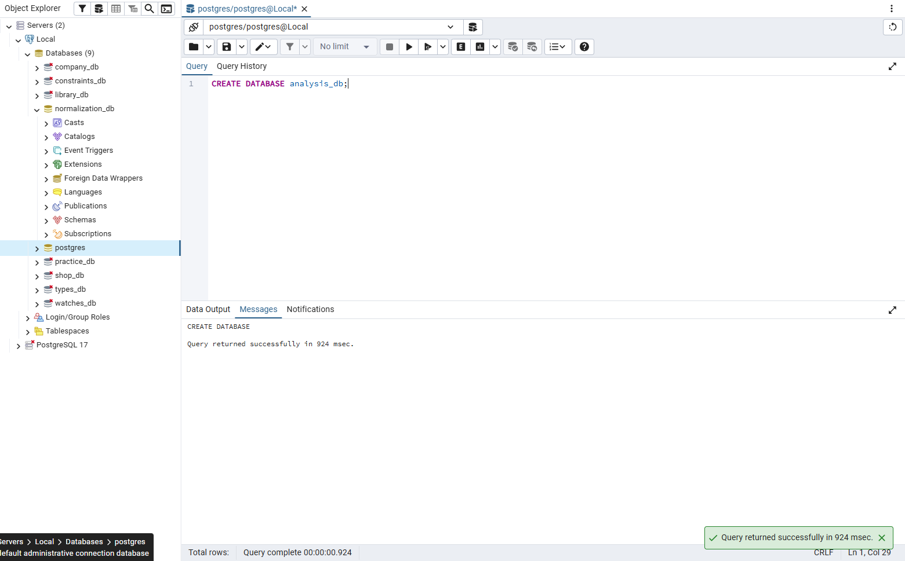

## Задание 1.2

```sql
\c analysis_db
```

Результат: ☑

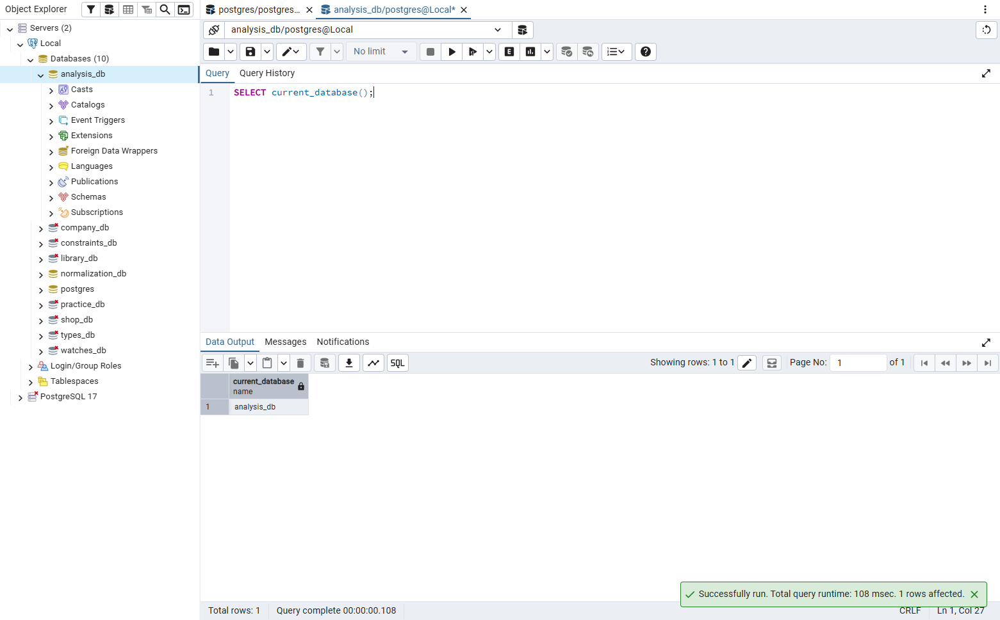

## Задание 2. Анализ схема 1

**Вывод:** одна большая таблица, данные клиентов и товаров дублируются в каждой строке, есть частичные и транзитивные зависимости, нет ключей – нарушены 2НФ и 3НФ.  
**Подходит:** нет

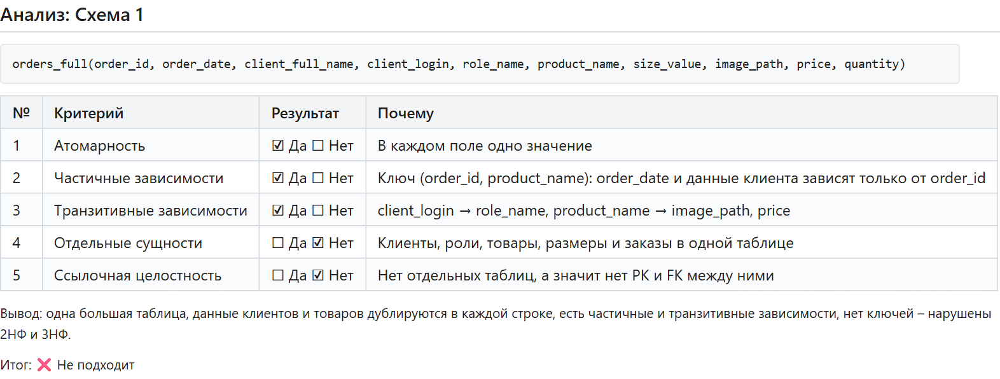

## Задание 3. Анализ схема 2

**Вывод:** роль хранится строкой в users, размер и остаток – в products, а в заказе может быть только один товар. Нет таблиц roles, sizes, stock_items, order_items.  
**Подходит:** нет

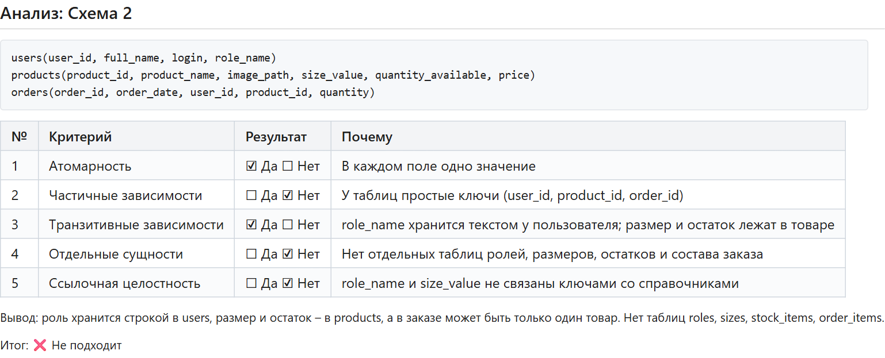

## Задание 4. Анализ схема 3

**Вывод:** нарушений нет – схема в 3НФ, сущности разделены, есть первичные и внешние ключи.  
**Подходит:** да

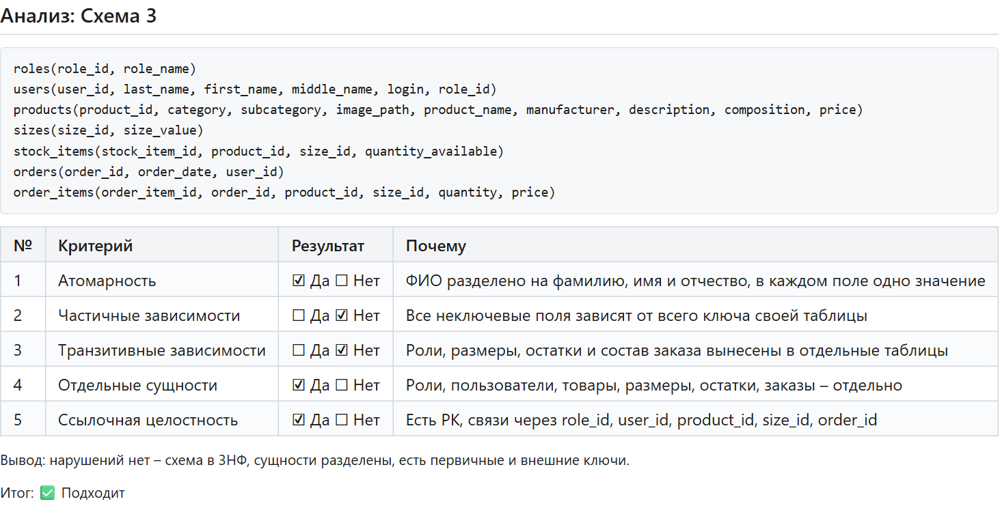

## Задание 5. Анализ схема 4

**Вывод:** нет таблиц products, sizes и stock_items, поэтому название товара и размер дублируются в каждой позиции заказа (транзитивная зависимость).  
**Подходит:** нет

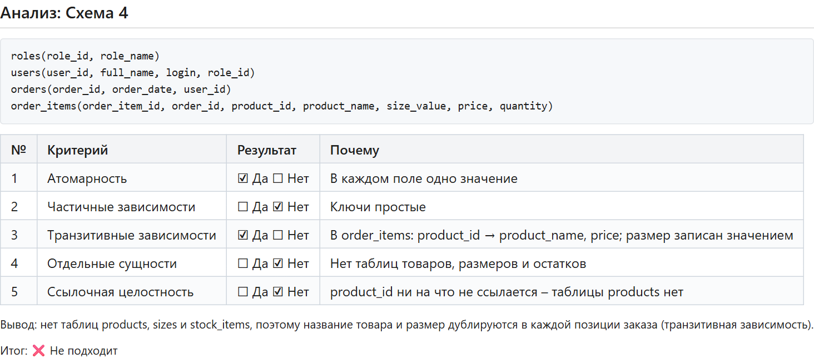

## Задание 6. Анализ схема 5

**Вывод:** клиент и товар хранятся в заказе текстом, а не ссылками; в заказе только один товар; нет таблиц пользователей, ролей, размеров и состава заказа.  
**Подходит:** нет

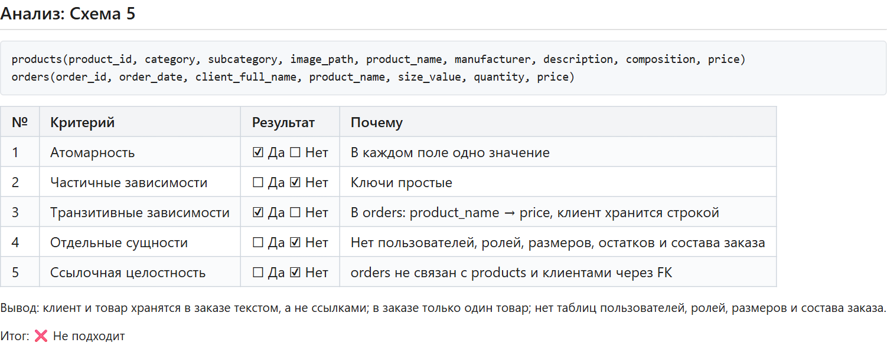

## Задание 7. Анализ схема 6

**Вывод:** формально схема в 3НФ, но она неполная: нет таблиц roles и stock_items и части атрибутов товара, поэтому по заданию не подходит.  
**Подходит:** нет

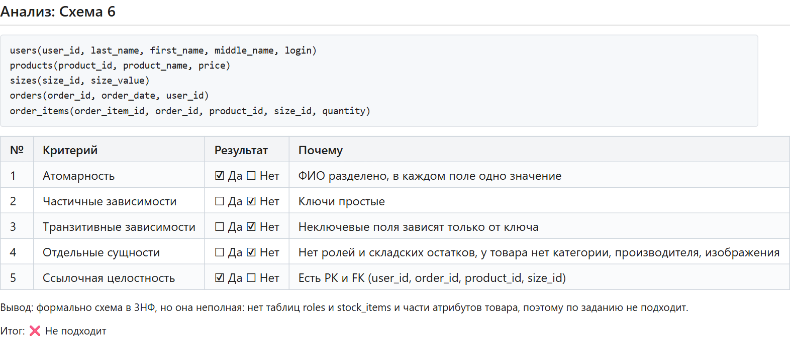

## Задание 8. Итоговый вывод

**Неподходящие схемы:** Схемы 1, 2, 4, 5, 6.

**Обоснование:** Подходит только схема 3: в ней каждая сущность (роли, пользователи, товары, размеры, остатки, заказы, состав заказа) вынесена в отдельную таблицу, нет повторов данных, нет частичных и транзитивных зависимостей, а связи сделаны через первичные и внешние ключи. В остальных схемах данные дублируются или не хватает нужных таблиц.

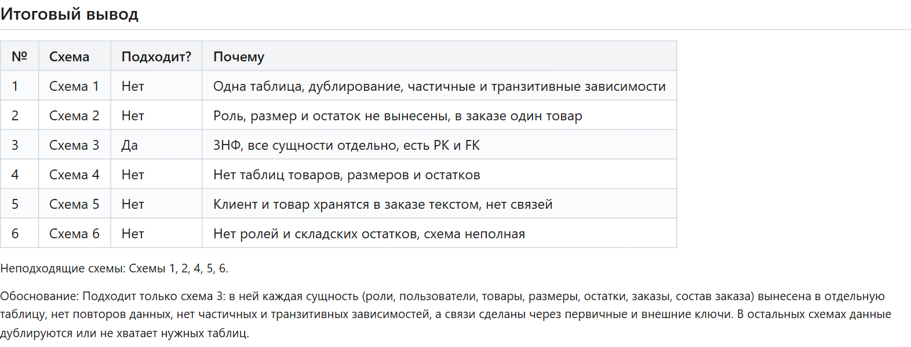

## Задание 9. Разноуровневые задания

**Уровень 1.** Подходит: нет. Это одна большая таблица: имя клиента и цена товара повторяются в каждой строке, product_name → price – транзитивная зависимость, нет отдельных таблиц и ключей.

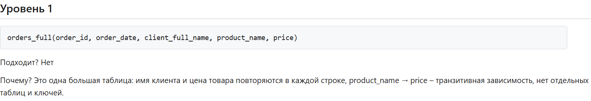

**Уровень 2.** Подходит: нет. Роль хранится строкой в users, размер и количество – в products, в заказе можно указать только один товар; нет таблиц roles, sizes, stock_items и order_items.

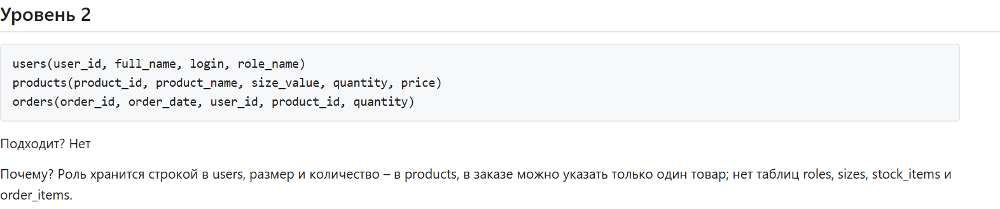

**Уровень 3.** Подходит: да. Схема в 3НФ: все сущности в отдельных таблицах, нет дублирования, связи через PK и FK.

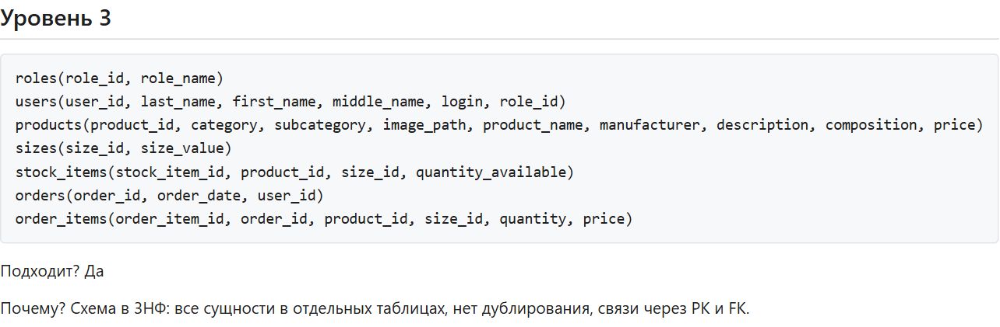

## Задание 10. Творческий уровень

```text
perfume_sales(sale_id, sale_date, buyer_full_name, buyer_phone, perfume_name,
              brand_name, brand_country, volume_ml, price)
perfumes(perfume_id, perfume_name, brand_name, brand_country, notes)
```

**Что нарушено:** Нарушены 1НФ, 2НФ и 3НФ: notes хранит несколько нот через запятую, данные покупателя и бренда повторяются в каждой продаже, brand_name → brand_country и perfume_name → price – транзитивные зависимости.

**Обоснование:** Покупателей, бренды, ароматы, объёмы и ноты нужно вынести в отдельные таблицы (buyers, brands, perfumes, volumes, perfume_notes), а в sales хранить только ссылки buyer_id и perfume_id.

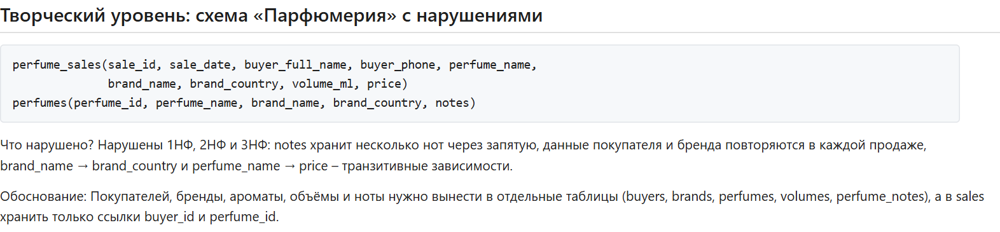

## Контрольные вопросы

**1. Что такое схема данных?**  
Схема данных – это описание структуры базы данных: какие есть таблицы, поля и связи между ними.

**2. Что такое 3НФ?**  
3НФ – таблица в 2НФ и неключевые поля не зависят друг от друга (нет транзитивных зависимостей).

**3. Что такое транзитивная зависимость?**  
Это когда неключевое поле зависит от другого неключевого поля, например product_name → price.

**4. Что такое частичная зависимость?**  
Это когда поле зависит только от части составного ключа, например order_date только от order_id.

**5. Как проверить схему на 3НФ?**  
Проверить по шагам: атомарность (1НФ), нет частичных зависимостей (2НФ), нет транзитивных зависимостей (3НФ), сущности отдельно, есть PK и FK.

**6. Почему схема 1 не подходит?**  
Потому что всё хранится в одной таблице: данные дублируются, есть частичные и транзитивные зависимости, нет ключей.

**7. Почему схема 3 подходит?**  
Потому что каждая сущность в своей таблице, нет повторов данных, есть первичные и внешние ключи – схема в 3НФ.

**8. Что означает «отдельные сущности»?**  
Каждый объект (роль, пользователь, товар, размер, заказ) хранится в своей таблице, а не вместе с другими.

**9. Зачем нужны PK и FK?**  
PK однозначно определяет запись, FK связывает таблицы между собой и не даёт сослаться на несуществующую запись.

**10. Что такое ссылочная целостность?**  
Ссылочная целостность – это когда все внешние ключи ссылаются на существующие записи, и в БД нет «висячих» ссылок.
