# Рабочая тетрадь. Пара № 10: «Сохранение ER-диаграммы в PDF. Проверка ключей и связей»

**УП.11** «Разработка, администрирование и защита баз данных»  
**Студент:** Ермилов Даниил Евгеньевич  
**Вариант 27:** «Парфюмерия»

Файлы: [ERD_mir_chasov.drawio](../docs/ERD_mir_chasov.drawio), [ERD_mir_chasov.pdf](../docs/ERD_mir_chasov.pdf), [ERD_parfumeriya.drawio](../docs/ERD_parfumeriya.drawio), [ERD_parfumeriya.pdf](../docs/ERD_parfumeriya.pdf)

Итог проверки «Мир часов»: 8 таблиц, у каждой PK (🔑), 8 FK (🔗), 7 связей 1:N, изолированных таблиц нет – ER-диаграмма правильная.

## Задание 1.1. Открытие ERD_mir_chasov.drawio

Результат: ☑

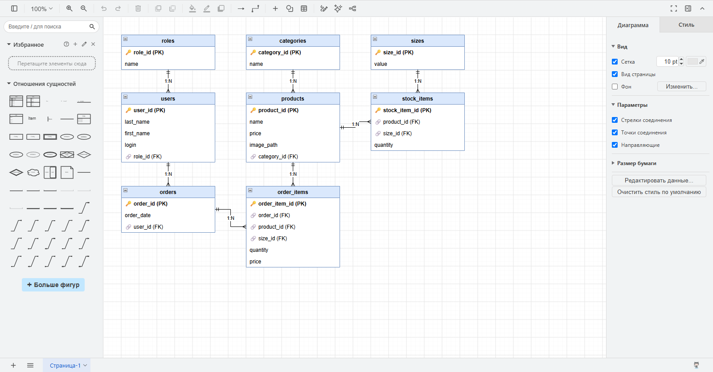

## Задание 2.1. Все таблицы на месте (8)

Результат: ☑

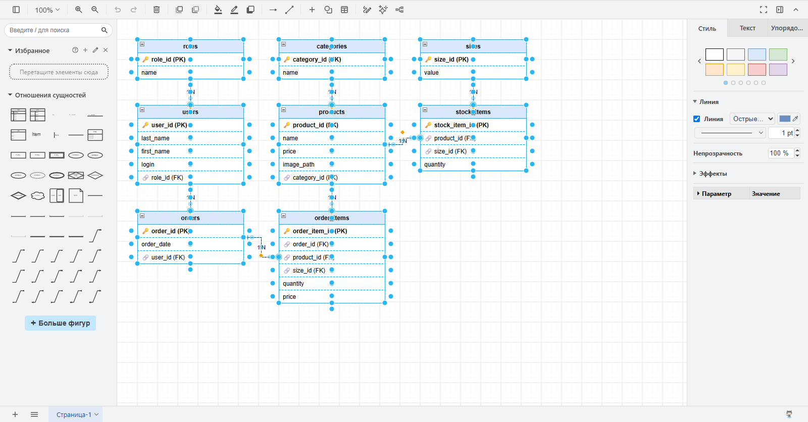

## Задание 2.2. Названия таблиц

Результат: ☑

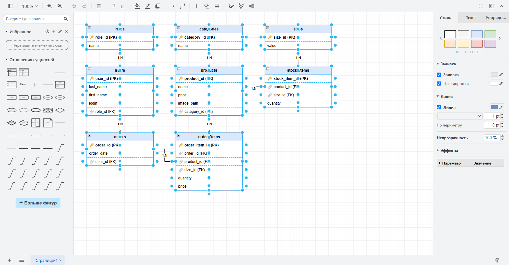

## Задание 3.1. Поиск PK

Результат: ☑

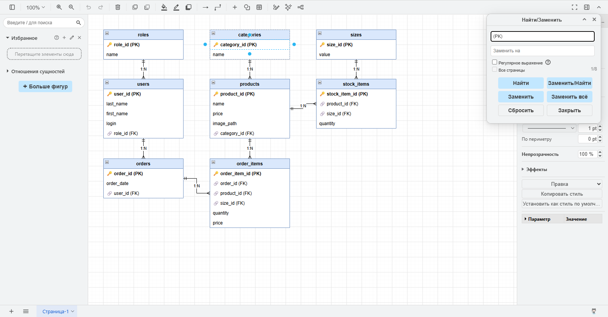

## Задание 3.2. Свойства PK (8 из 8 таблиц)

Результат: ☑

## Задание 4.1. Поиск FK

Результат: ☑

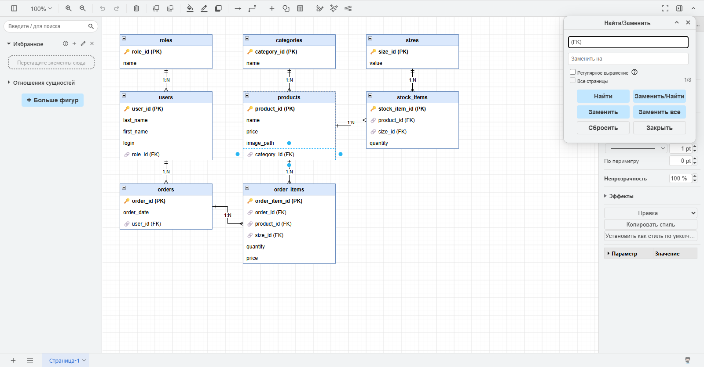

## Задание 4.2. Свойства FK (8 внешних ключей)

Результат: ☑

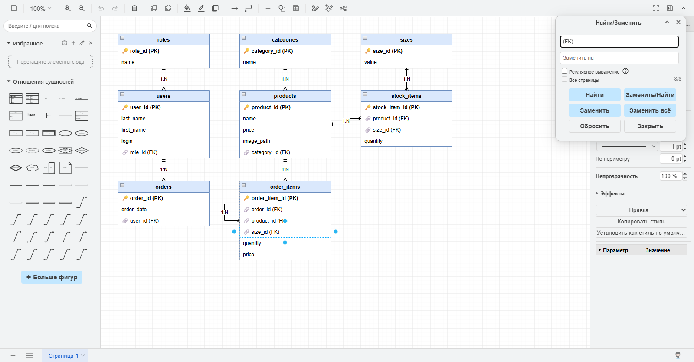

## Задание 5.1. Все связи (7, тип 1:N)

Результат: ☑

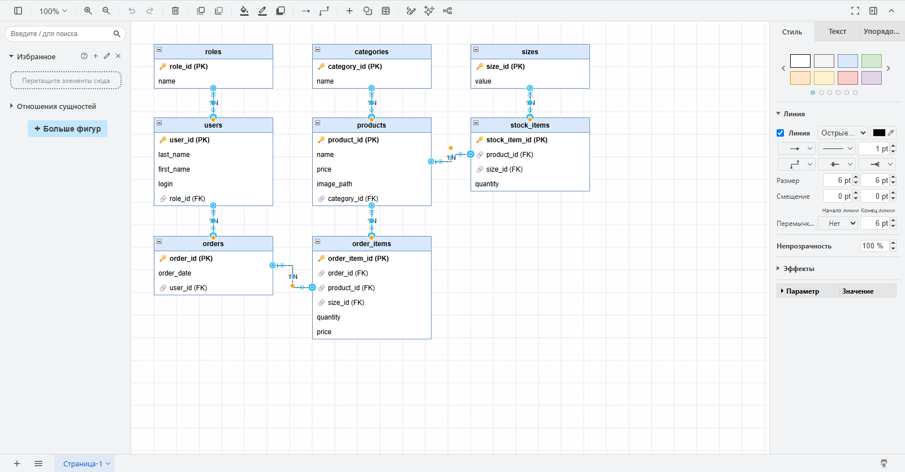

## Задание 5.2. Изолированных таблиц нет

Результат: ☑

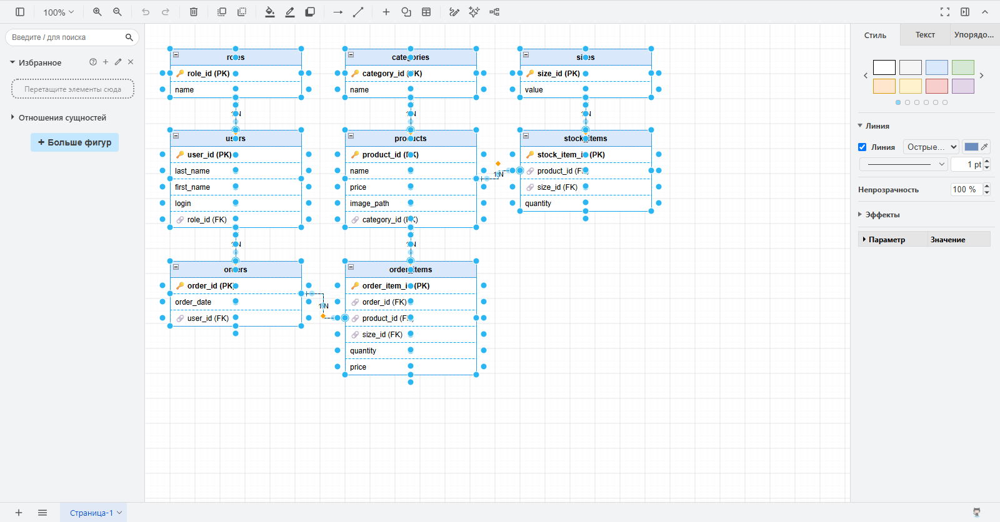

## Задание 6.1. Сохранение .drawio

Результат: ☑

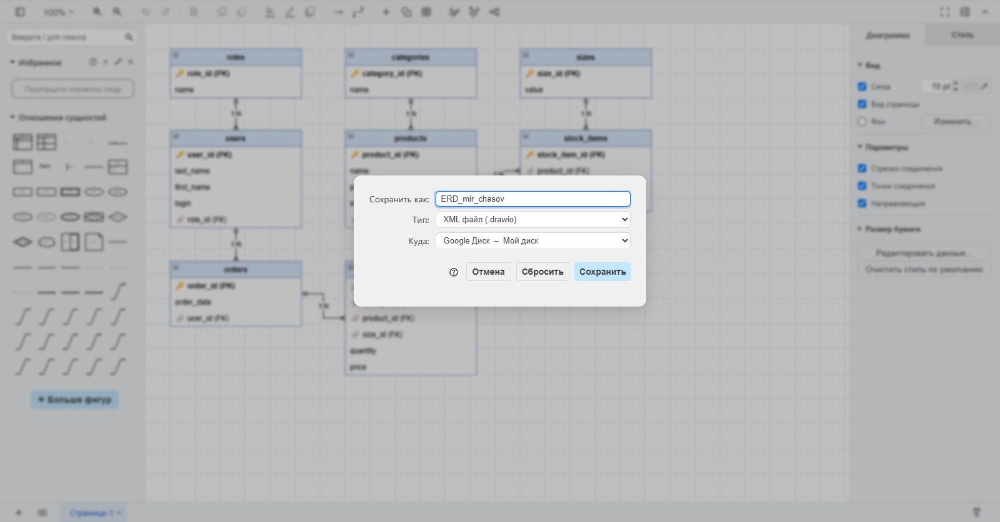

## Задание 6.2. Экспорт в PDF

Результат: ☑

## Задание 6.3. Проверка PDF

Результат: ☑

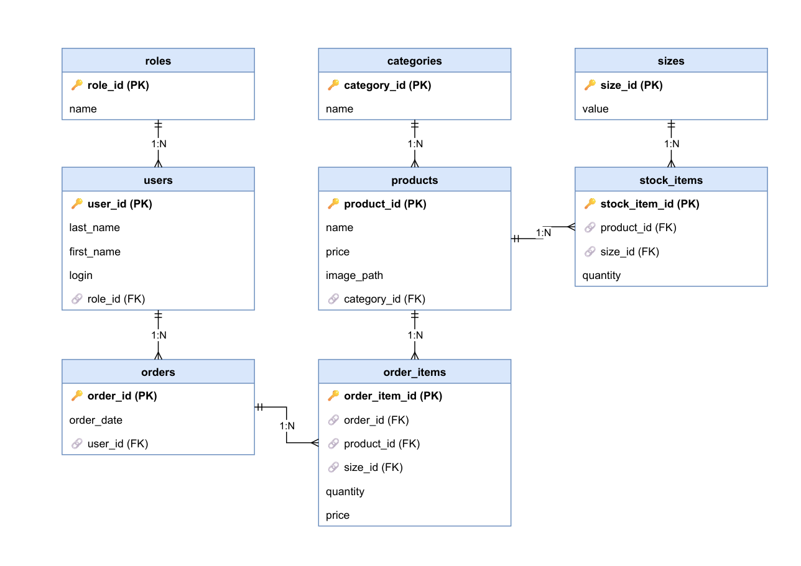

## Задание 7.1. Своя ER-диаграмма «Парфюмерия»

Результат: ☑

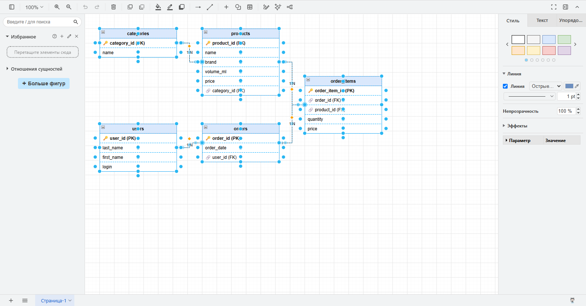

## Задание 7.2. Экспорт своей диаграммы в PDF

Результат: ☑

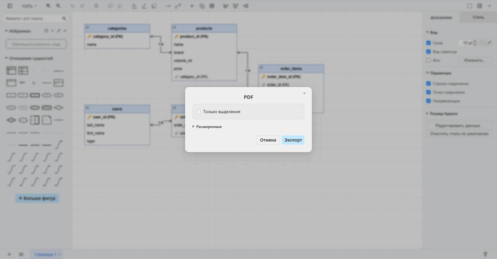

## Задание 8.1. Уровень 1

Результат: ☑

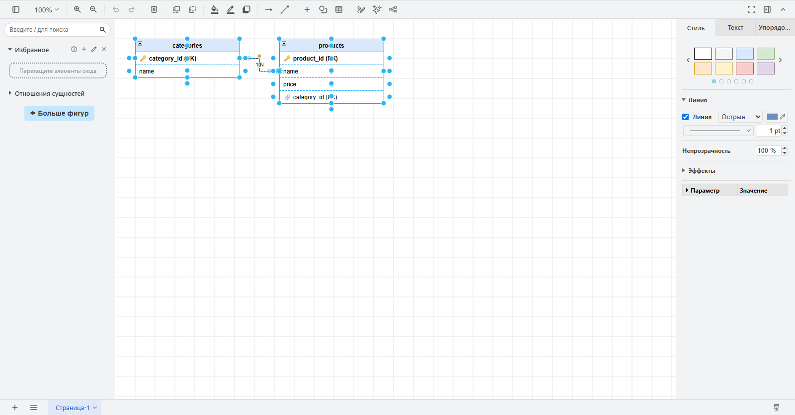

## Задание 8.2. Уровень 2

Результат: ☑

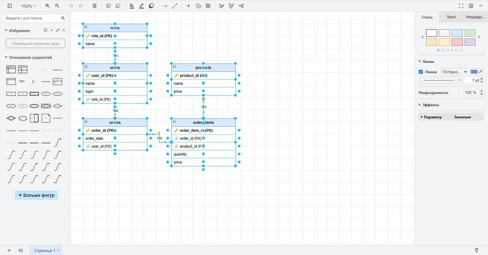

## Задание 8.3. Уровень 3

Результат: ☑

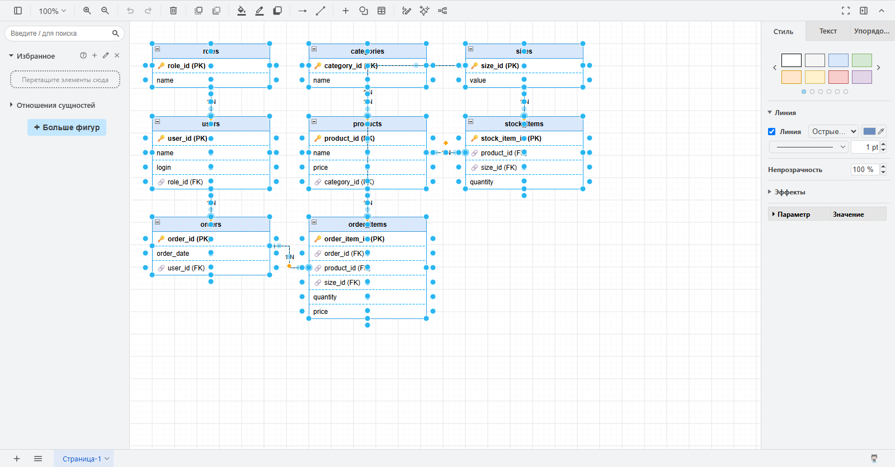

## Задание 9.1. ER-диаграмма с ошибкой

Результат: ☑

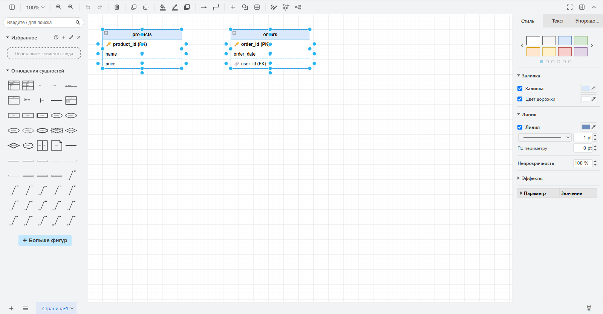

## Задание 9.1. Что не так?

Таблицы products и orders изолированы – между ними нет связи, а у заказа нет состава (какие товары в нём). Поле user_id обозначено как FK, но таблицы users на диаграмме нет, значит внешний ключ ни на что не ссылается.

**Обоснование:** Нужно добавить таблицу users (PK user_id) и связь users → orders (1:N), а также таблицу order_items (order_id FK, product_id FK, quantity, price) со связями orders → order_items и products → order_items (1:N). Тогда изолированных таблиц не будет и все FK будут ссылаться на PK.

## Контрольные вопросы

**1. Что такое PDF?**  
PDF (Portable Document Format) – формат документа, который одинаково открывается на любом устройстве.

**2. Зачем PDF для ER-диаграммы?**  
Чтобы сдать диаграмму (это требование ДЭ), распечатать её, приложить к документации и открыть на любом компьютере без Draw.io; в PDF диаграмма не изменится.

**3. Что такое PK?**  
PK – первичный ключ, уникальный идентификатор строки таблицы.

**4. Что такое FK?**  
FK – внешний ключ, поле, которое ссылается на PK другой таблицы.

**5. Какие свойства у PK?**  
PK уникальный, не NULL, один на таблицу, имеет понятное название и обозначен 🔑 на диаграмме.

**6. Какие свойства у FK?**  
FK ссылается на PK другой таблицы, имеет понятное название, обозначен 🔗, к нему проведена связь, и его тип совпадает с типом PK (INTEGER – INTEGER).

**7. Что проверять в ER-диаграмме?**  
Что все таблицы есть, у каждой есть PK, все FK обозначены, связи правильные и с указанным типом, типы ключей совпадают и нет изолированных таблиц.

**8. Что такое изолированная таблица?**  
Изолированная таблица – это таблица, у которой нет ни одной связи с другими таблицами.

**9. Какие типичные ошибки в ER-диаграмме?**  
Нет PK, нет FK, нет связи, неправильный тип связи, дублирование PK, связь без направления, изолированная таблица.

**10. Как сохранить ER-диаграмму в PDF?**  
В Draw.io: Файл → Экспорт как → PDF…, нажать «Экспорт», указать имя ERD_mir_chasov.pdf и папку docs/.
