# Рабочая тетрадь. Пара № 11: «Создание справочников: categories, sizes. CHECK-ограничения»

**УП.11** «Разработка, администрирование и защита баз данных»

**Студент:** Ермилов Даниил Евгеньевич

**Вариант 27:** «Парфюмерия»

SQL-скрипт: [08_dictionaries.sql](../src/db/08_dictionaries.sql).

## Задание 1.1. Создание БД dictionaries_db

```sql
CREATE DATABASE dictionaries_db;
```

**Результат:** ☑ БД создана.

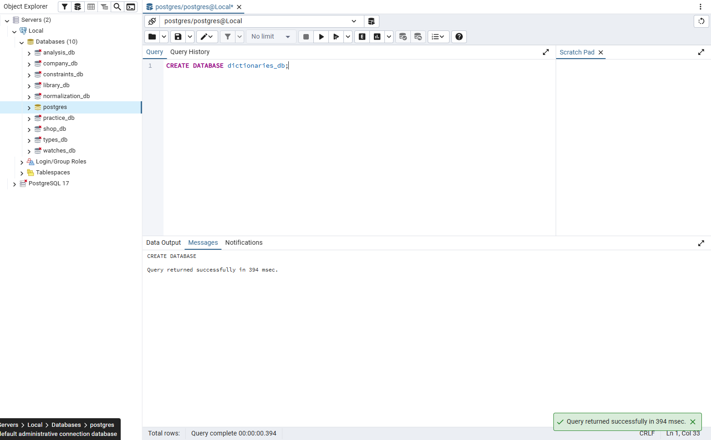

## Задание 1.2. Подключение к БД

```sql
\connect dictionaries_db
SELECT current_database();
```

**Результат:** ☑ Подключение к dictionaries_db выполнено.

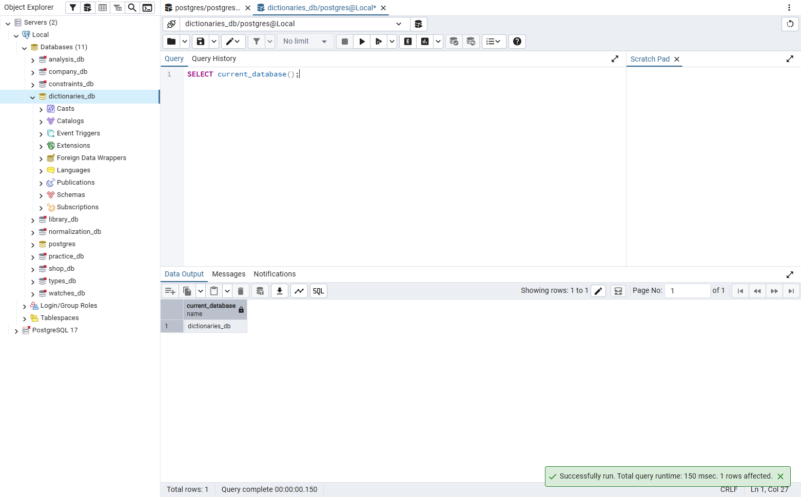

## Задание 2.1. Создание categories

```sql
CREATE TABLE categories (
    category_id SERIAL PRIMARY KEY,
    name VARCHAR(100) NOT NULL UNIQUE,
    subcategory VARCHAR(100)
);
SELECT * FROM categories;
```

**Результат:** ☑ Таблица создана.

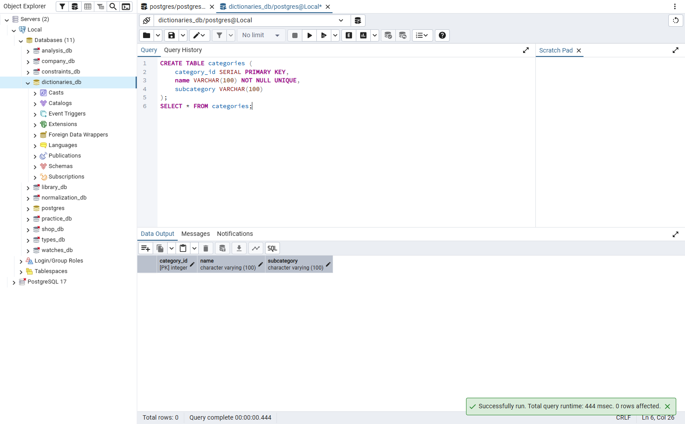

## Задание 2.2. Пять категорий

```sql
INSERT INTO categories (name, subcategory) VALUES
('Парфюмерная вода', 'Цветочные'),
('Туалетная вода', 'Цитрусовые'),
('Одеколоны', 'Древесные'),
('Парфюмерные спреи', 'Свежие'),
('Подарочные наборы', 'Ассорти');
SELECT * FROM categories ORDER BY category_id;
```

**Результат:** ☑ Добавлено 5 записей.

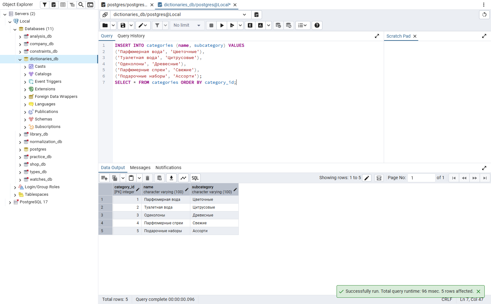

## Задание 2.3. Проверка UNIQUE

```sql
INSERT INTO categories (name) VALUES ('Парфюмерная вода');
```

**Результат:** ☑ Повторное название не добавлено: сработало UNIQUE.

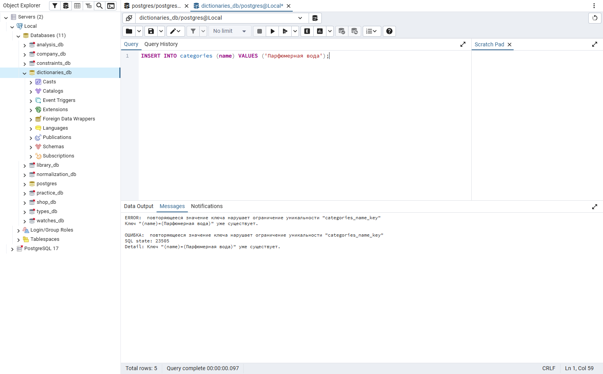

## Задание 3.1. Создание sizes

```sql
CREATE TABLE sizes (
    size_id SERIAL PRIMARY KEY,
    value NUMERIC(4,1) NOT NULL UNIQUE CHECK (value > 0)
);
SELECT * FROM sizes;
```

**Результат:** ☑ Таблица создана.

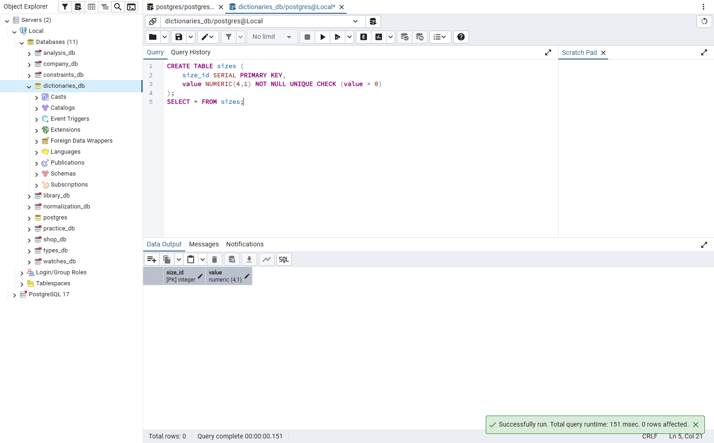

## Задание 3.2. Восемь размеров

```sql
INSERT INTO sizes (value) VALUES
(18), (19), (20), (21), (22), (23), (24), (25);
SELECT * FROM sizes ORDER BY value;
```

**Результат:** ☑ Добавлено 8 значений.

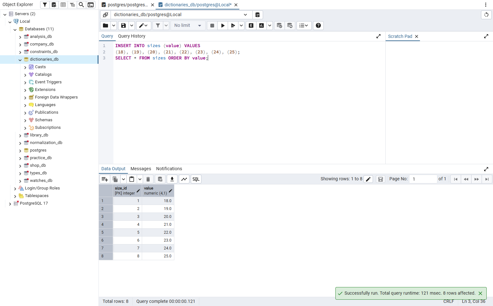

## Задание 3.3. Проверка CHECK для sizes

```sql
INSERT INTO sizes (value) VALUES (-5);
```

**Результат:** ☑ Значение −5 отклонено: CHECK требует value > 0.

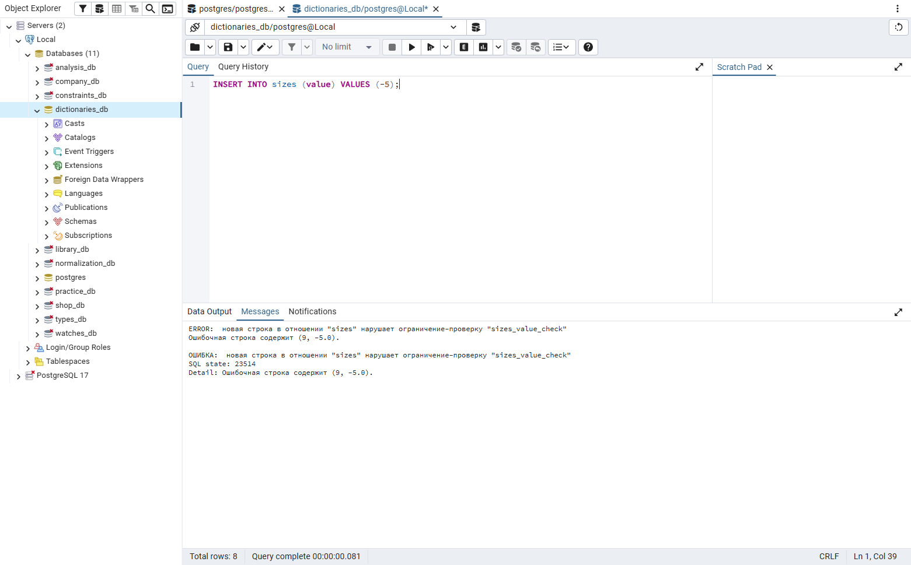

## Задание 4.1. Создание products

```sql
CREATE TABLE products (
    product_id SERIAL PRIMARY KEY,
    name VARCHAR(200) NOT NULL,
    price NUMERIC(10,2) NOT NULL CHECK (price > 0),
    quantity INTEGER NOT NULL CHECK (quantity >= 0),
    category_id INTEGER NOT NULL REFERENCES categories(category_id)
);
SELECT * FROM products;
```

**Результат:** ☑ Таблица создана с проверкой цены и количества и FK на categories.

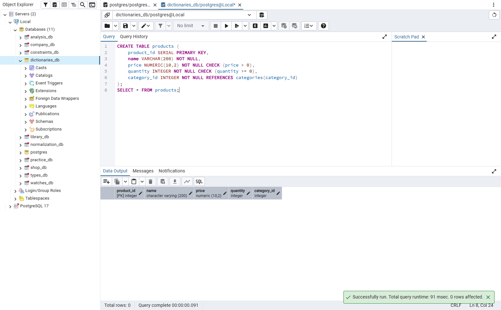

## Задание 4.2. Проверка цены

```sql
INSERT INTO products (name, price, quantity, category_id) VALUES ('Проверка цены', -100, 1, 1);
```

**Результат:** ☑ Цена −100 отклонена: CHECK требует price > 0.

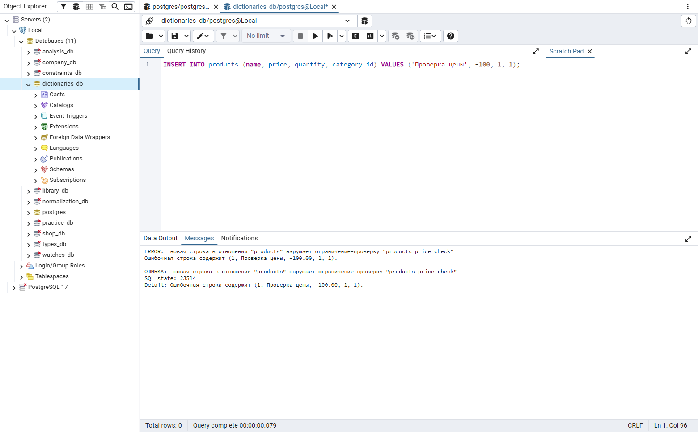

## Задание 4.3. Проверка количества

```sql
INSERT INTO products (name, price, quantity, category_id) VALUES ('Проверка остатка', 100, -5, 1);
```

**Результат:** ☑ Количество −5 отклонено: CHECK требует quantity >= 0.

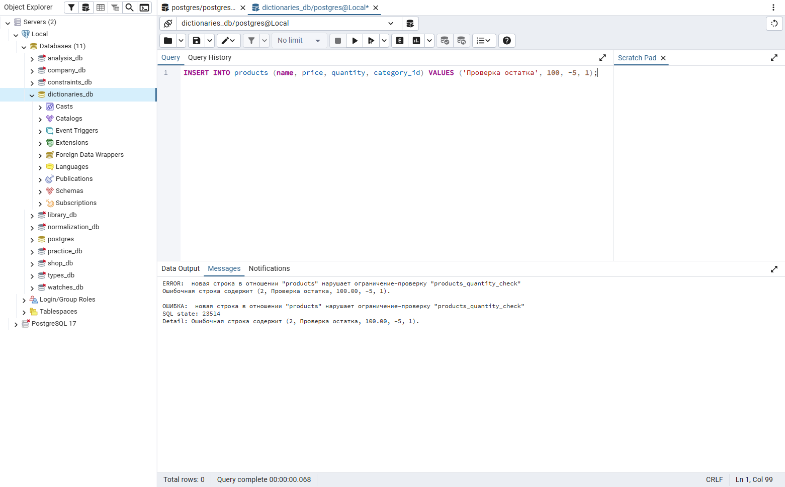

## Задание 4.4. Корректные товары

```sql
INSERT INTO products (name, price, quantity, category_id) VALUES
('Цветочный аромат', 1890.00, 8, 1),
('Свежий аромат', 1590.00, 5, 2);
SELECT * FROM products ORDER BY product_id;
```

**Результат:** ☑ Добавлено 2 товара.

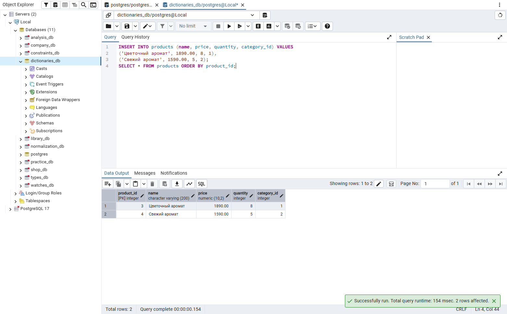

## Задание 5.1. Справочник для своей темы

```sql
CREATE TABLE fragrance_families (
    family_id SERIAL PRIMARY KEY,
    name VARCHAR(50) NOT NULL UNIQUE
);
SELECT * FROM fragrance_families;
```

**Результат:** ☑ Создан fragrance_families для темы «Парфюмерия».

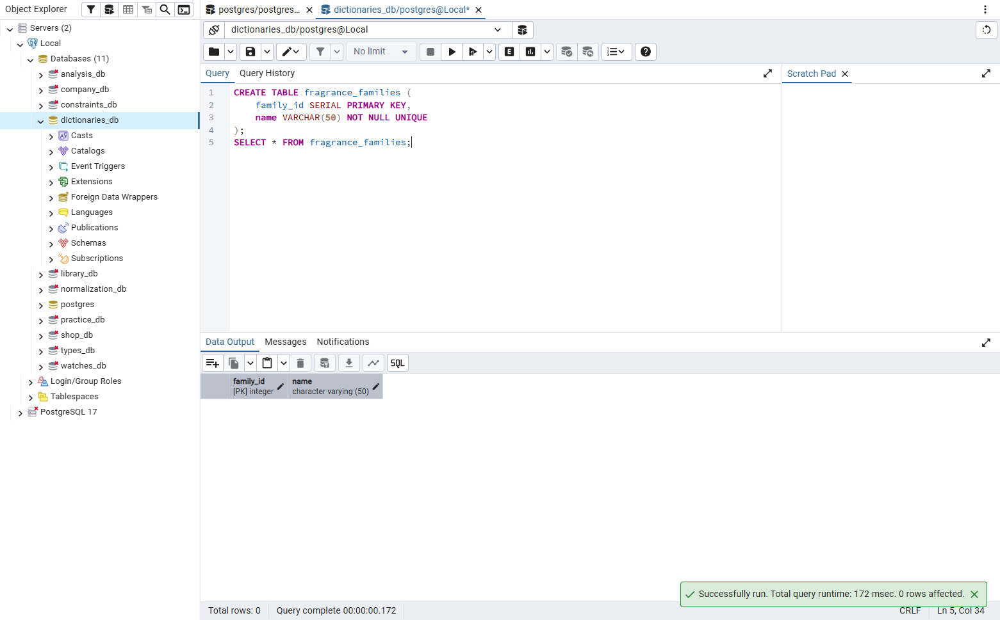

## Задание 5.2. Пять записей

```sql
INSERT INTO fragrance_families (name) VALUES
('Цветочные'), ('Цитрусовые'), ('Древесные'), ('Восточные'), ('Свежие');
SELECT * FROM fragrance_families ORDER BY family_id;
```

**Результат:** ☑ Добавлено 5 семейств ароматов.

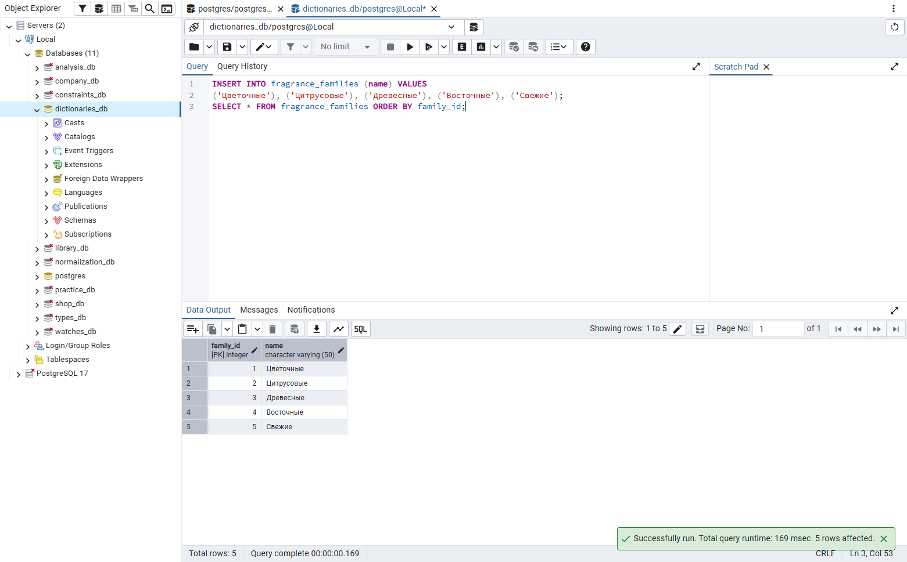

## Задание 5.3. Справочник с CHECK

```sql
CREATE TABLE bottle_volumes (
    volume_id SERIAL PRIMARY KEY,
    volume_ml INTEGER NOT NULL UNIQUE CHECK (volume_ml > 0)
);
SELECT * FROM bottle_volumes;
```

**Результат:** ☑ Создан bottle_volumes с проверкой объёма флакона.


## Задание 6.1.1. Уровень 1: statuses

```sql
CREATE TABLE statuses (
    status_id SERIAL PRIMARY KEY,
    name VARCHAR(50) NOT NULL UNIQUE
);
SELECT * FROM statuses;
```

**Результат:** ☑ Таблица создана.

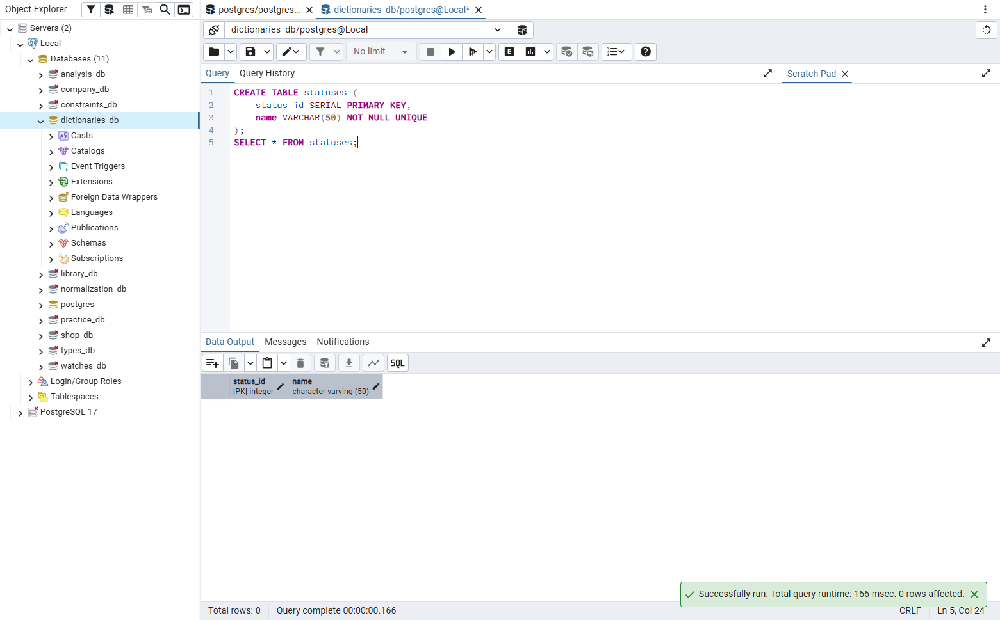

## Задание 6.1.2. Уровень 1: три статуса

```sql
INSERT INTO statuses (name) VALUES ('новый'), ('оплачен'), ('доставлен');
SELECT * FROM statuses ORDER BY status_id;
```

**Результат:** ☑ Добавлено 3 статуса.

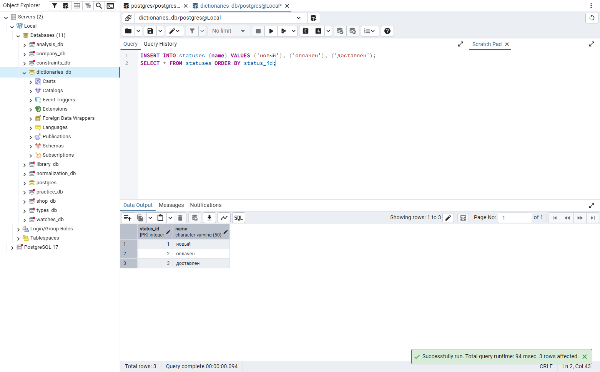

## Задание 6.2.1. Уровень 2: colors

```sql
CREATE TABLE colors (
    color_id SERIAL PRIMARY KEY,
    name VARCHAR(50) NOT NULL UNIQUE,
    code VARCHAR(7) NOT NULL CHECK (code ~ '^#[0-9A-Fa-f]{6}$')
);
SELECT * FROM colors;
```

**Результат:** ☑ Таблица создана с проверкой кода цвета.

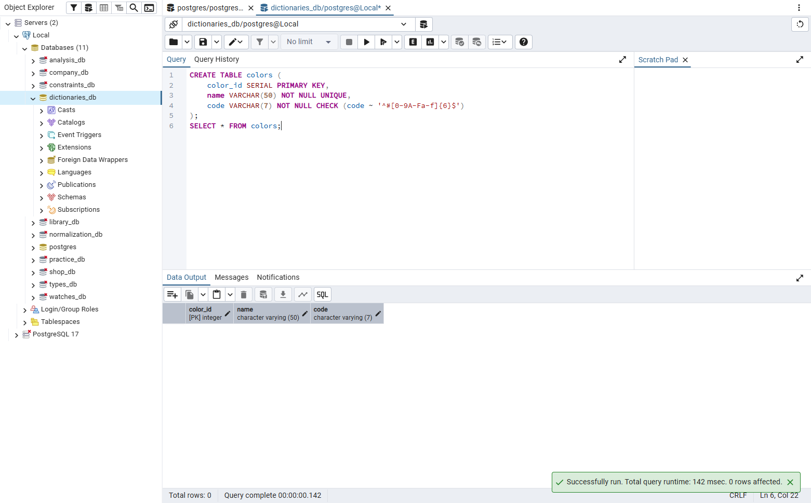

## Задание 6.2.2. Уровень 2: пять цветов

```sql
INSERT INTO colors (name, code) VALUES
('Белый', '#FFFFFF'), ('Чёрный', '#000000'), ('Розовый', '#FFC0CB'),
('Зелёный', '#008000'), ('Голубой', '#87CEEB');
SELECT * FROM colors ORDER BY color_id;
```

**Результат:** ☑ Добавлено 5 цветов.

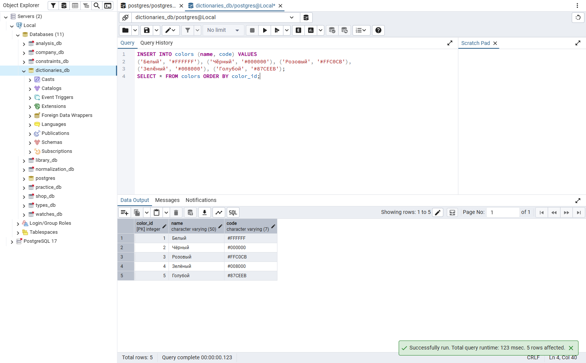

## Задание 6.3.1. Уровень 3: brands и units

```sql
CREATE TABLE brands (
    brand_id SERIAL PRIMARY KEY,
    name VARCHAR(100) NOT NULL UNIQUE,
    country VARCHAR(100) NOT NULL,
    founded_year INTEGER NOT NULL CHECK (founded_year > 1800 AND founded_year <= 2026)
);
CREATE TABLE units (
    unit_id SERIAL PRIMARY KEY,
    name VARCHAR(50) NOT NULL UNIQUE,
    short_name VARCHAR(10) NOT NULL UNIQUE CHECK (length(short_name) > 0)
);
SELECT table_name FROM information_schema.tables
WHERE table_schema = 'public' AND table_name IN ('brands', 'units');
```

**Результат:** ☑ Оба справочника созданы с CHECK.

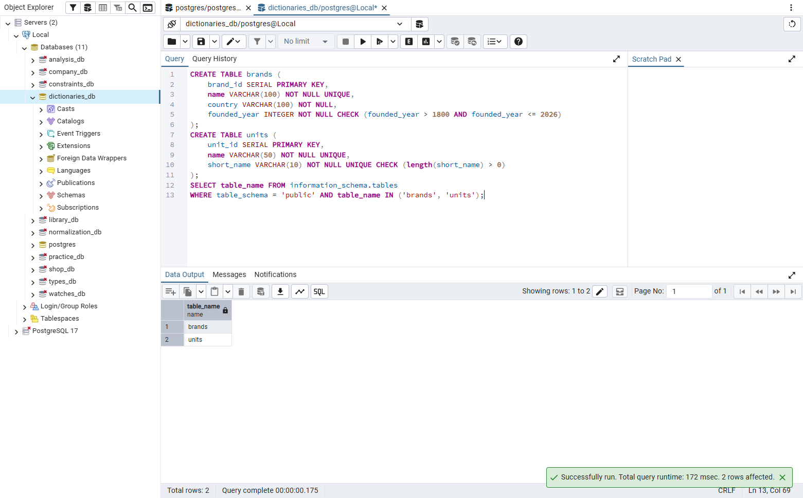

## Задание 6.3.2. Уровень 3: данные

```sql
INSERT INTO brands (name, country, founded_year) VALUES
('Северный аромат', 'Россия', 2015), ('Лёгкий ветер', 'Россия', 2020);
INSERT INTO units (name, short_name) VALUES
('Миллилитр', 'мл'), ('Штука', 'шт.');
SELECT 'brands' AS table_name, COUNT(*) FROM brands
UNION ALL SELECT 'units', COUNT(*) FROM units;
```

**Результат:** ☑ Добавлено по 2 записи в brands и units.

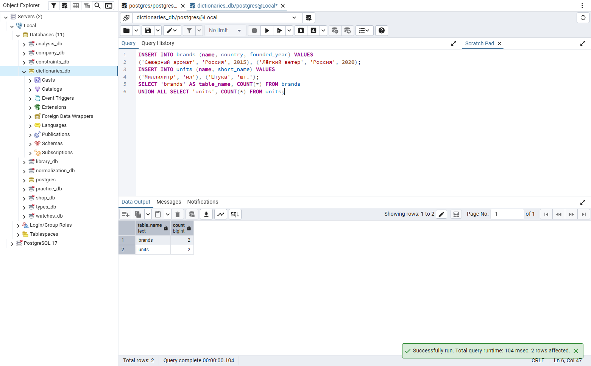

## Задание 7.1. Творческий уровень: «Кофейня»

```sql
CREATE TABLE coffee_sizes (
    coffee_size_id SERIAL PRIMARY KEY, name VARCHAR(30) NOT NULL UNIQUE,
    volume_ml INTEGER NOT NULL UNIQUE CHECK (volume_ml > 0));
CREATE TABLE roast_levels (
    roast_level_id SERIAL PRIMARY KEY, name VARCHAR(30) NOT NULL UNIQUE,
    level_number INTEGER NOT NULL UNIQUE CHECK (level_number BETWEEN 1 AND 5));
CREATE TABLE drink_types (
    drink_type_id SERIAL PRIMARY KEY, name VARCHAR(50) NOT NULL UNIQUE,
    caffeine_mg INTEGER NOT NULL CHECK (caffeine_mg >= 0));
SELECT table_name FROM information_schema.tables
WHERE table_schema = 'public' AND table_name IN ('coffee_sizes', 'roast_levels', 'drink_types');
```

**Результат:** ☑ Созданы coffee_sizes, roast_levels и drink_types с CHECK.

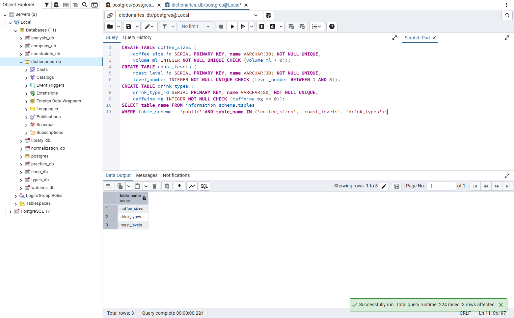

## Контрольные вопросы

1. Справочник — таблица с допустимыми значениями одного типа, например категориями товаров.
2. Они помогают не повторять данные и связывать таблицы внешними ключами.
3. CHECK проверяет заданное условие при добавлении или изменении строки.
4. Ограничения защищают таблицу от некорректных значений.
5. Для «Мир часов» нужны categories, sizes, roles, manufacturers. В моём варианте вместо размеров обуви используются объёмы флаконов.
6. Командой CREATE TABLE с полями, типами и ограничениями.
7. Командой INSERT INTO с перечнем полей и значений.
8. PostgreSQL отклонит запись с ошибкой CHECK.
9. PostgreSQL отклонит дублирующее уникальное значение.
10. PostgreSQL отклонит строку с пустым обязательным полем.
11. SERIAL — целочисленное поле с автоматическим увеличением значения.
12. PRIMARY KEY — ключ, однозначно определяющий строку таблицы.
13. NOT NULL запрещает пустое значение.
14. UNIQUE запрещает повторы.
15. Пример: CHECK (price > 0).

## Итоги пары

**Узнал:** как создавать справочники и задавать UNIQUE, CHECK, PRIMARY KEY и внешние ключи.

**Сделал:** создал БД, таблицы и записи, проверил ограничения, выполнил задания для своего варианта.

**Легко:** создать таблицы и добавить записи.

**Сложно:** составить проверку формата цветового кода.

**Повторить:** порядок создания связанных таблиц и FOREIGN KEY.

**Выполненный уровень:** повышенный.

## Домашнее задание

Повторены справочники, CHECK, PRIMARY KEY, NOT NULL, UNIQUE. В творческом задании созданы три справочника
для кофейни; в SQL-скрипте в каждый добавлено по пять записей, всего 15.
