# Рабочая тетрадь. Пара № 12: «Создание таблицы товаров products. CHECK на цену > 0»

**УП.11** «Разработка, администрирование и защита баз данных»

**Студент:** Ермилов Даниил Евгеньевич

**Вариант 27:** «Парфюмерия»

SQL-скрипт: [09_products.sql](../src/db/09_products.sql).

## Задание 1.1. Создание базы данных

```sql
CREATE DATABASE products_db;
```

**Результат:** ☑ База products_db создана.

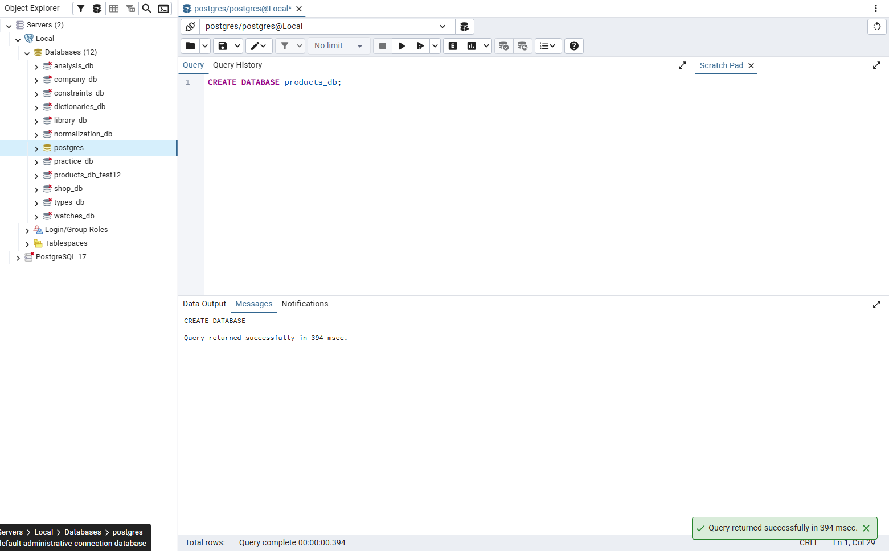

## Задание 1.2. Подключение

```sql
SELECT current_database();
```

**Результат:** ☑ Подключение к products_db выполнено.

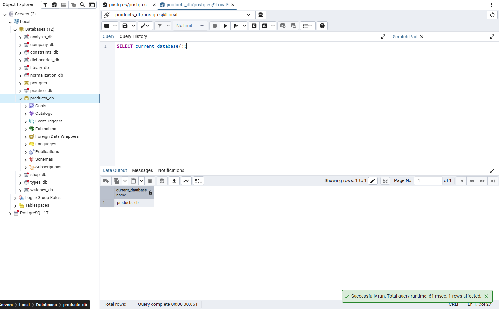

## Задание 1.3. Справочник categories

```sql
CREATE TABLE categories (
    category_id SERIAL PRIMARY KEY,
    name VARCHAR(100) NOT NULL UNIQUE
);
SELECT * FROM categories;
```

**Результат:** ☑ Таблица categories создана.

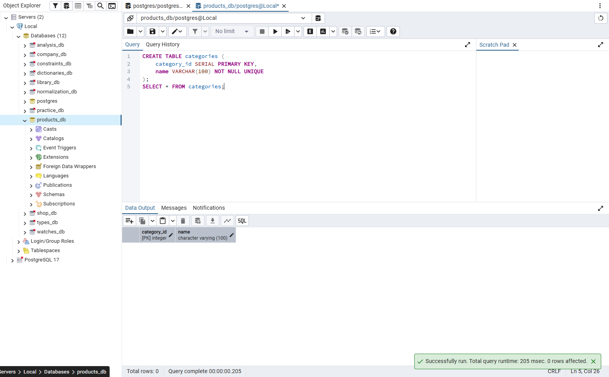

## Задание 1.4. Три категории

```sql
INSERT INTO categories (name) VALUES
('Наручные часы'), ('Спортивные часы'), ('Смарт-часы');
SELECT * FROM categories ORDER BY category_id;
```

**Результат:** ☑ Добавлено 3 категории часов.

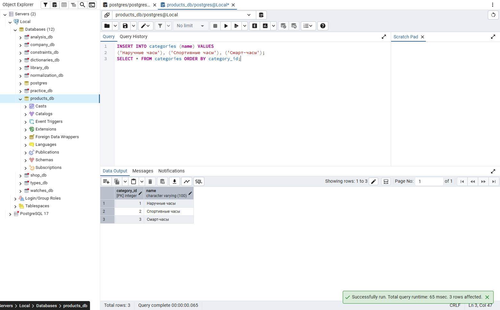

## Задание 2.1. Таблица products

```sql
CREATE TABLE products (
    product_id SERIAL PRIMARY KEY,
    category_id INTEGER REFERENCES categories(category_id),
    name VARCHAR(200) NOT NULL,
    manufacturer VARCHAR(100),
    description TEXT,
    composition TEXT,
    price NUMERIC(10,2) CHECK (price > 0),
    image_path VARCHAR(255)
);
SELECT * FROM products;
```

**Результат:** ☑ Таблица создана с CHECK для цены и FK на categories.

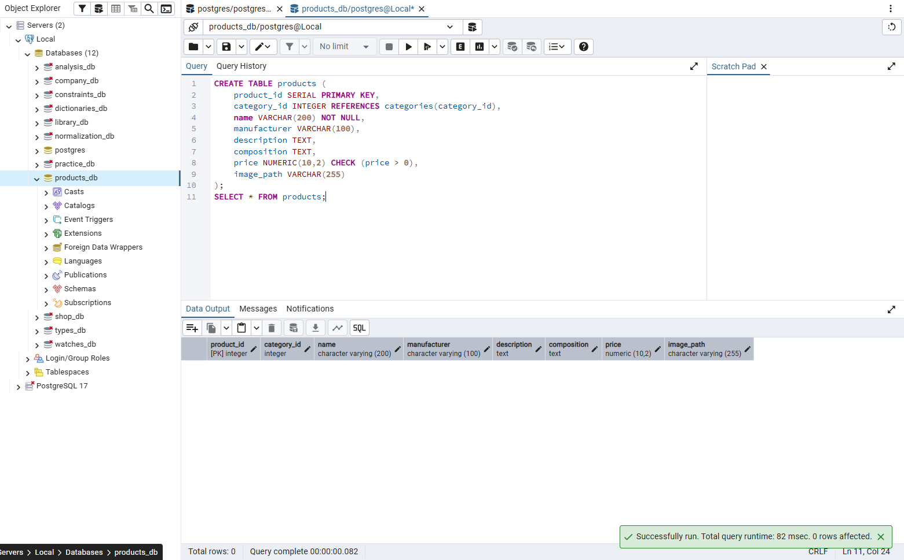

## Задание 2.2. Структура products

```sql
SELECT column_name, data_type, is_nullable
FROM information_schema.columns
WHERE table_schema = 'public' AND table_name = 'products'
ORDER BY ordinal_position;
```

**Результат:** ☑ Проверены поля и типы данных.

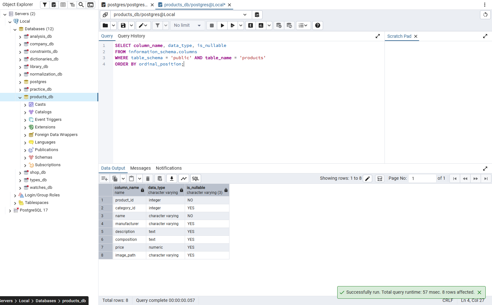

## Задание 3.1. Пять товаров

```sql
INSERT INTO products (category_id, name, manufacturer, price, image_path) VALUES
(1, 'Часы наручные «Классика»', 'Восток', 15000.00, 'watch_1.png'),
(2, 'Часы наручные «Спорт»', 'Casio', 5000.00, 'watch_2.png'),
(3, 'Смарт-часы «Техно»', 'Samsung', 25000.00, 'watch_3.png'),
(1, 'Часы наручные «Восток»', 'Восток', 12000.00, 'watch_4.png'),
(2, 'Часы наручные «Casio»', 'Casio', 7000.00, 'watch_5.png');
SELECT product_id, category_id, name, manufacturer, price FROM products ORDER BY product_id;
```

**Результат:** ☑ Вставлено 5 товаров из примера «Мир часов».

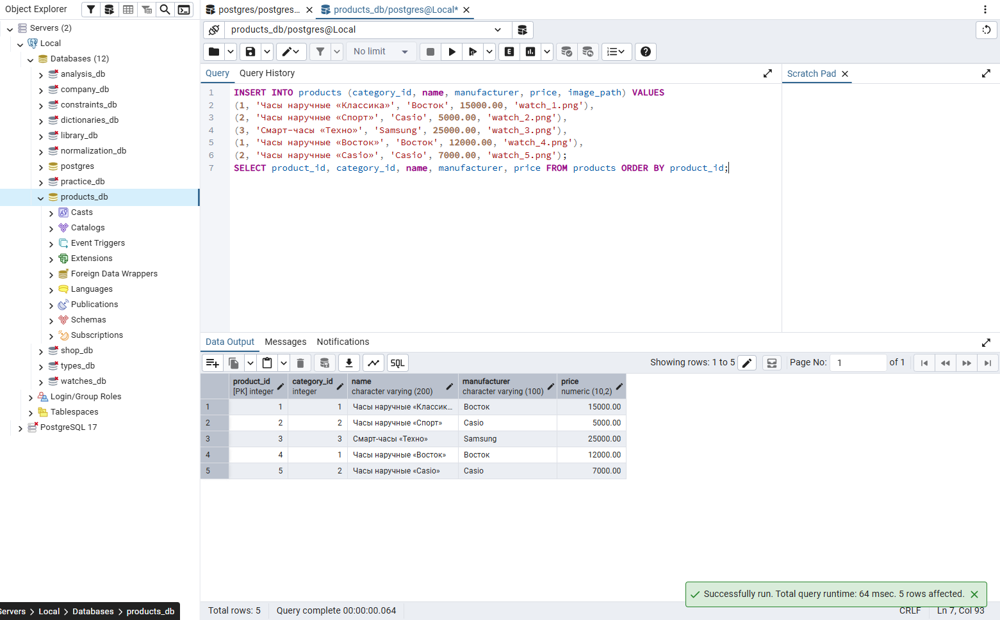

## Задание 3.2. Просмотр товаров

```sql
SELECT * FROM products ORDER BY product_id;
```

**Результат:** ☑ Все 5 записей показаны.

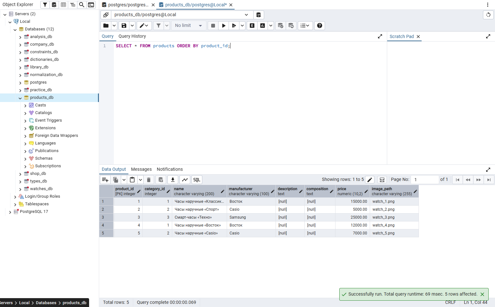

## Задание 4.1. Отрицательная цена

```sql
INSERT INTO products (category_id, name, price) VALUES (1, 'Проверка отрицательной цены', -100);
```

**Результат:** ☑ Цена −100 отклонена ограничением CHECK.

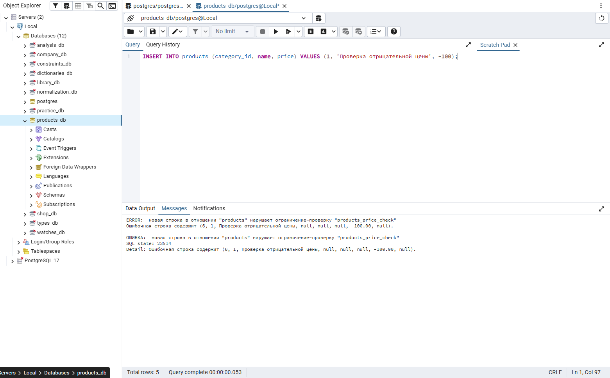

## Задание 4.2. Нулевая цена

```sql
INSERT INTO products (category_id, name, price) VALUES (1, 'Проверка нулевой цены', 0);
```

**Результат:** ☑ Цена 0 отклонена ограничением CHECK.

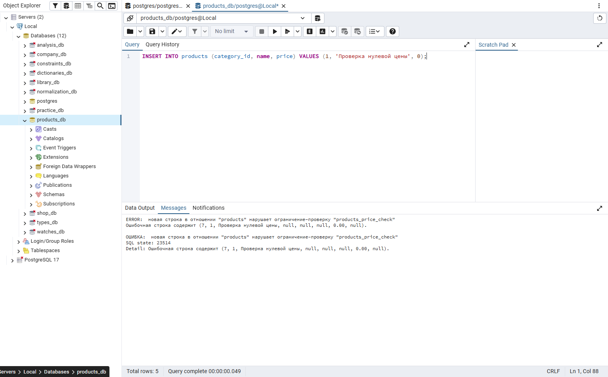

## Задание 4.3. Положительная цена

```sql
INSERT INTO products (category_id, name, price) VALUES (1, 'Часы простые', 100);
```

**Результат:** ☑ Товар с ценой 100 добавлен.

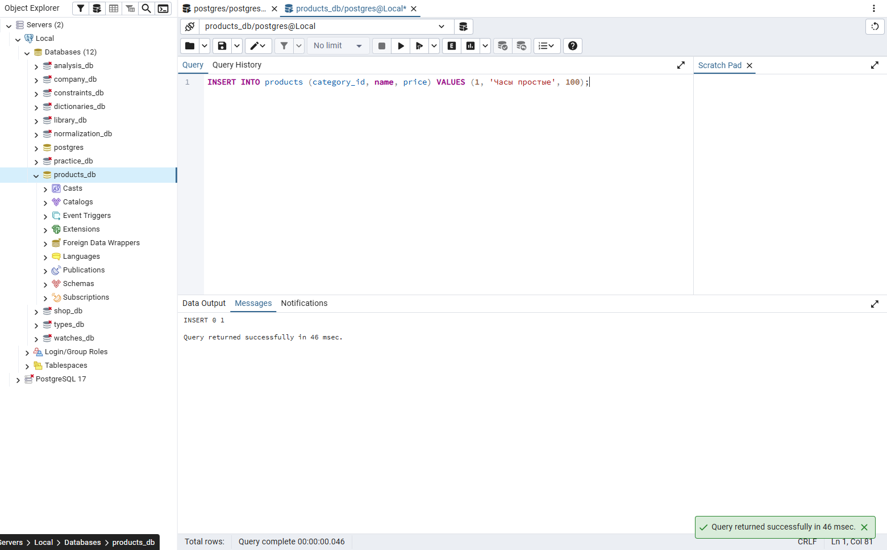

## Задание 5.1. Несуществующая категория

```sql
INSERT INTO products (category_id, name, price) VALUES (999, 'Часы без категории', 100);
```

**Результат:** ☑ Категория 999 отклонена внешним ключом.

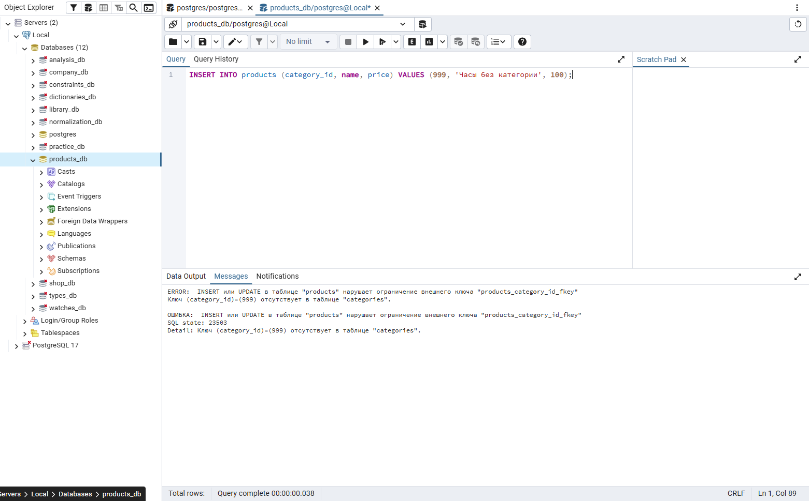

## Задание 5.2. Существующая категория

```sql
INSERT INTO products (category_id, name, price) VALUES (2, 'Часы туристические', 3200);
```

**Результат:** ☑ Товар с категорией 2 добавлен.

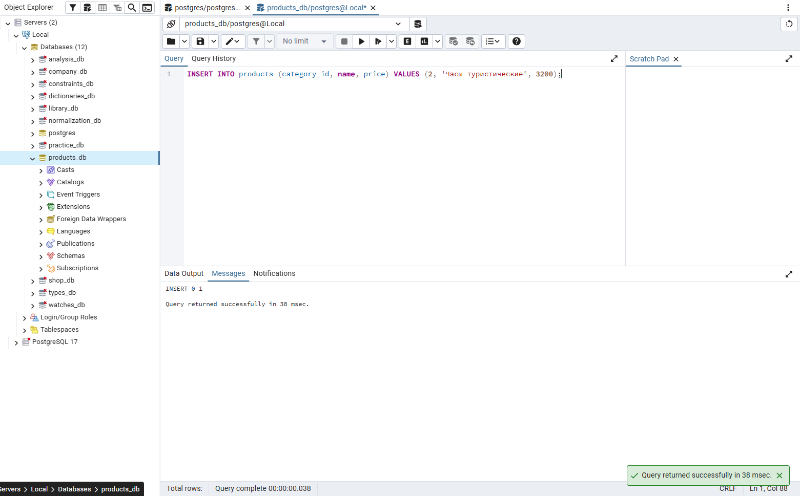

## Задание 6.1. Своя тема «Парфюмерия»

```sql
CREATE TABLE perfume_categories (
    category_id SERIAL PRIMARY KEY,
    name VARCHAR(100) NOT NULL UNIQUE
);
INSERT INTO perfume_categories (name) VALUES
('Парфюмерная вода'), ('Туалетная вода'), ('Духи');
CREATE TABLE perfume_products (
    product_id SERIAL PRIMARY KEY,
    category_id INTEGER REFERENCES perfume_categories(category_id),
    name VARCHAR(200) NOT NULL,
    manufacturer VARCHAR(100),
    description TEXT,
    composition TEXT,
    price NUMERIC(10,2) CHECK (price > 0),
    image_path VARCHAR(255)
);
SELECT * FROM perfume_products;
```

**Результат:** ☑ Созданы perfume_categories и perfume_products.

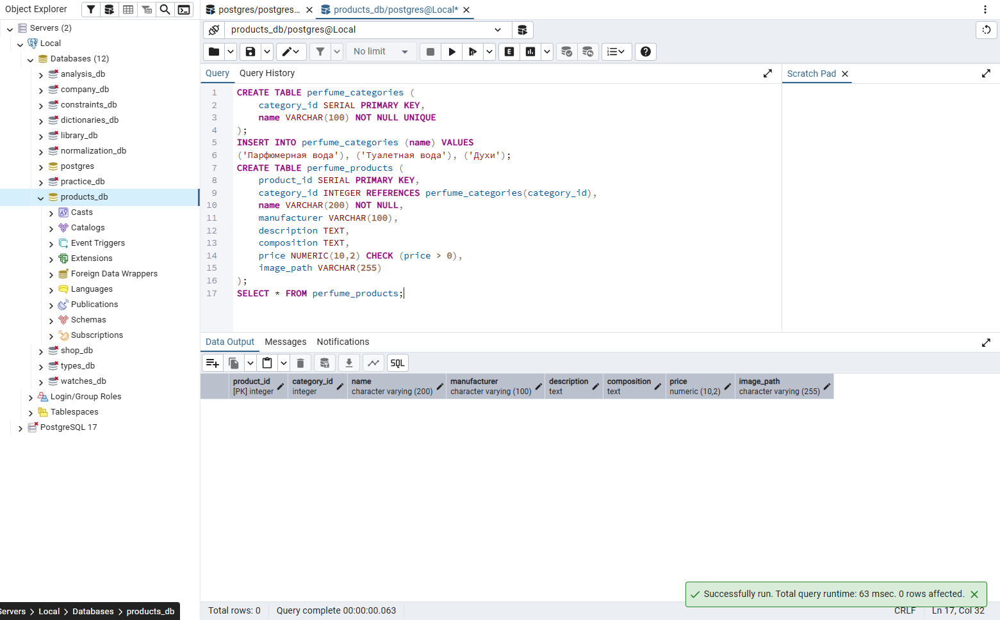

## Задание 6.2. Пять товаров для своей темы

```sql
INSERT INTO perfume_products
(category_id, name, manufacturer, description, composition, price, image_path) VALUES
(1, 'Цветочный день', 'Арома', 'Парфюмерная вода 50 мл', 'роза, жасмин', 1890.00, 'flower_day.png'),
(2, 'Свежий ветер', 'Арома', 'Туалетная вода 100 мл', 'бергамот, мята', 1590.00, 'fresh_wind.png'),
(3, 'Тёплый вечер', 'Эссенция', 'Духи 30 мл', 'ваниль, сандал', 3290.00, 'warm_evening.png'),
(1, 'Весенний сад', 'Эссенция', 'Парфюмерная вода 50 мл', 'пион, мускус', 2490.00, 'spring_garden.png'),
(2, 'Морской бриз', 'Арома', 'Туалетная вода 75 мл', 'цитрус, морские ноты', 1790.00, 'sea_breeze.png');
SELECT product_id, name, manufacturer, price FROM perfume_products ORDER BY product_id;
```

**Результат:** ☑ Добавлено 5 товаров парфюмерии.

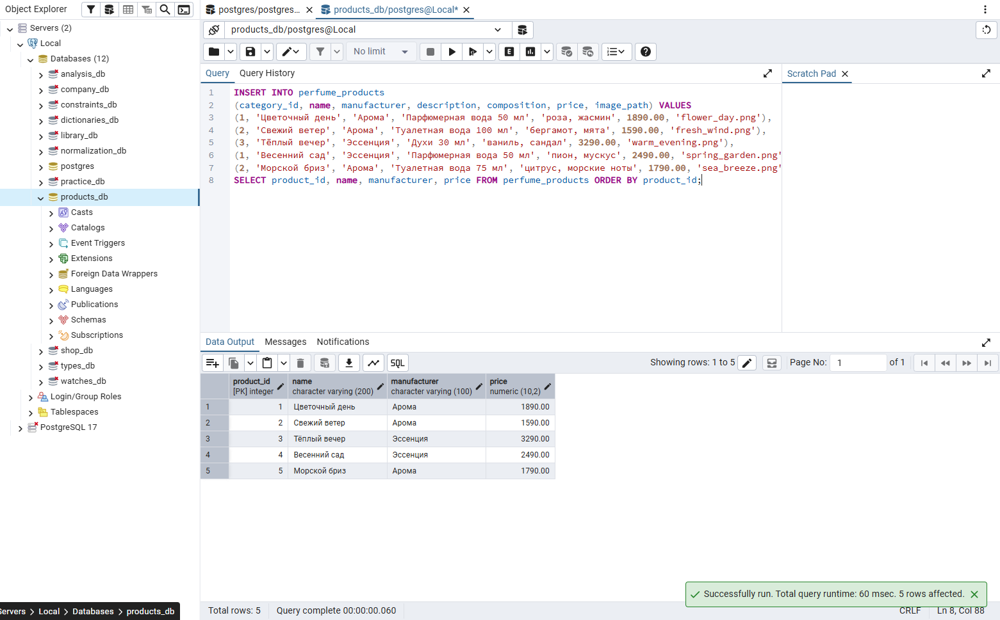

## Задание 7.1. Уровень 1

```sql
CREATE SCHEMA level1;
CREATE TABLE level1.products (
    product_id SERIAL PRIMARY KEY,
    name VARCHAR(200) NOT NULL,
    price NUMERIC(10,2) CHECK (price > 0),
    image_path VARCHAR(255)
);
SELECT column_name FROM information_schema.columns
WHERE table_schema = 'level1' AND table_name = 'products'
ORDER BY ordinal_position;
```

**Результат:** ☑ Создан вариант level1.products с 4 полями.

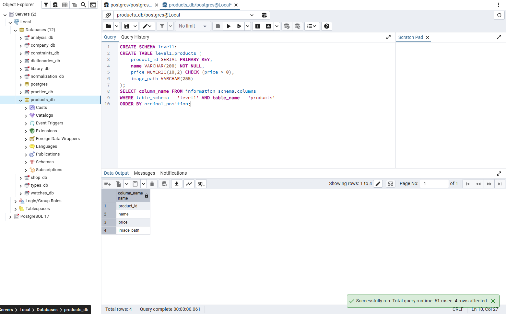

## Задание 7.2. Уровень 2

```sql
CREATE SCHEMA level2;
CREATE TABLE level2.products (
    product_id SERIAL PRIMARY KEY,
    category_id INTEGER REFERENCES public.categories(category_id),
    name VARCHAR(200) NOT NULL,
    manufacturer VARCHAR(100),
    price NUMERIC(10,2) CHECK (price > 0),
    image_path VARCHAR(255)
);
SELECT column_name FROM information_schema.columns
WHERE table_schema = 'level2' AND table_name = 'products'
ORDER BY ordinal_position;
```

**Результат:** ☑ Создан вариант level2.products с 6 полями.

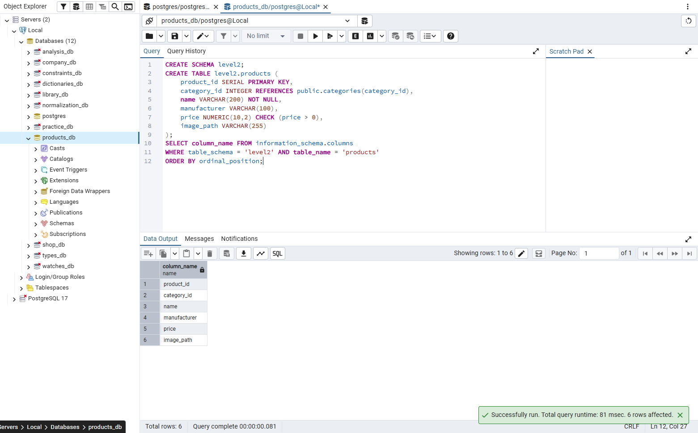

## Задание 7.3. Уровень 3

```sql
CREATE SCHEMA level3;
CREATE TABLE level3.products (
    product_id SERIAL PRIMARY KEY,
    category_id INTEGER REFERENCES public.categories(category_id),
    name VARCHAR(200) NOT NULL,
    manufacturer VARCHAR(100),
    description TEXT,
    composition TEXT,
    price NUMERIC(10,2) CHECK (price > 0),
    quantity INTEGER CHECK (quantity >= 0),
    image_path VARCHAR(255)
);
SELECT column_name FROM information_schema.columns
WHERE table_schema = 'level3' AND table_name = 'products'
ORDER BY ordinal_position;
```

**Результат:** ☑ Создан вариант level3.products со всеми 9 полями и ограничениями.

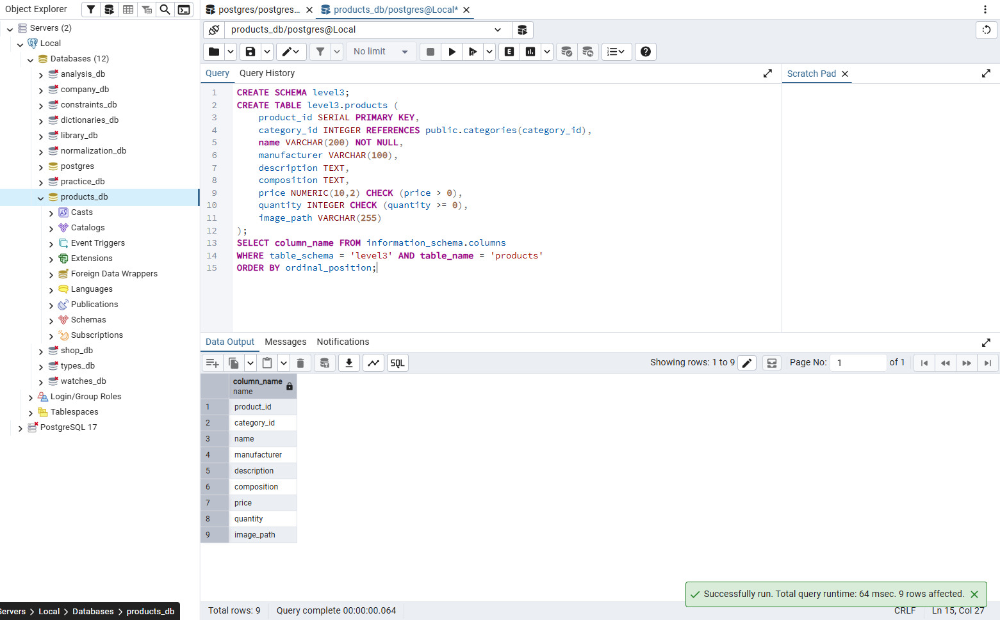

## Задание 8.1. Творческое задание

```sql
CREATE TABLE flower_products (
    product_id SERIAL PRIMARY KEY,
    name VARCHAR(200) NOT NULL,
    price NUMERIC(10,2) CHECK (price > 0),
    stem_count INTEGER CHECK (stem_count > 0)
);
SELECT * FROM flower_products;
```

**Результат:** ☑ Создана таблица flower_products с CHECK для цены и количества стеблей.

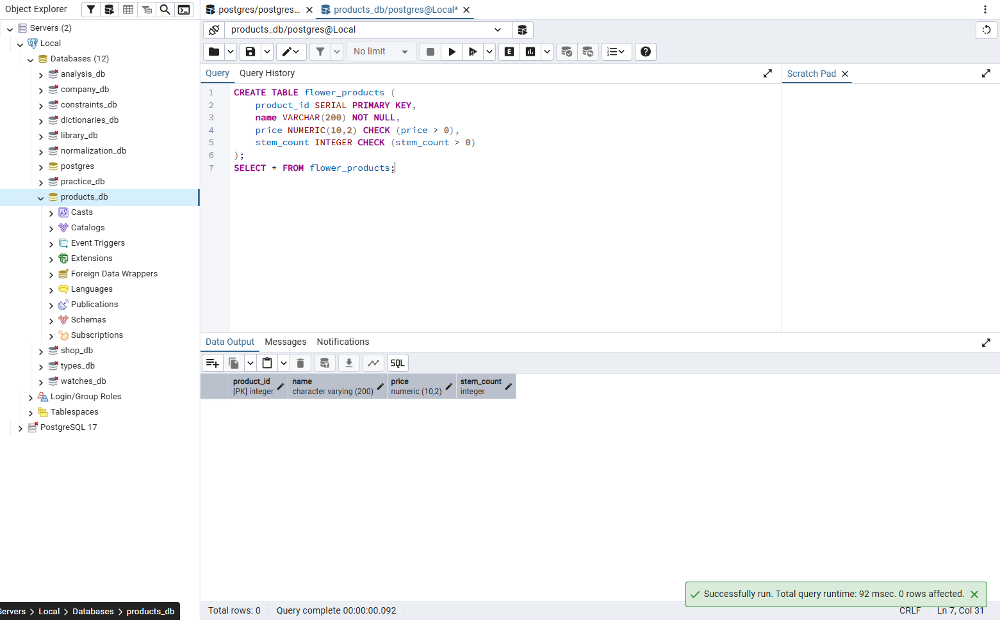

## Проверка понимания

1. PRIMARY KEY однозначно определяет строку.
2. NOT NULL запрещает пустое значение.
3. CHECK (price > 0) допускает только положительную цену.
4. FOREIGN KEY связывает поле с ключом другой таблицы.
5. Цена ≤ 0 отклоняется ограничением CHECK.
6. Несуществующая категория отклоняется внешним ключом.
7. SERIAL автоматически выдаёт очередной целый номер.
8. NUMERIC(10,2) хранит до 10 цифр, из них 2 после запятой.
9. REFERENCES указывает таблицу и поле, на которые ссылается FK.
10. CREATE TABLE products задаёт поля, типы и ограничения.

## Контрольные вопросы

1. products хранит товары каталога.
2. Поля: product_id, category_id, name, manufacturer, description, composition, price, image_path.
3. CHECK на цену проверяет условие price > 0.
4. Он защищает от нулевой и отрицательной цены.
5. FOREIGN KEY — внешний ключ на другую таблицу.
6. Он не допускает ссылки на несуществующую категорию.
7. Цена ≤ 0 не сохранится.
8. Категория 999 не сохранится, если её нет в categories.
9. SERIAL автоматически выдаёт номер строки.
10. NUMERIC(10,2) — точное десятичное число до 10 цифр с двумя знаками после запятой.
11. NOT NULL требует значение.
12. PRIMARY KEY однозначно определяет запись и запрещает NULL.
13. REFERENCES задаёт таблицу и ключ для внешней ссылки.
14. Категорию со связанными товарами PostgreSQL удалить не позволит.
15. Пример: CREATE TABLE products (product_id SERIAL PRIMARY KEY, name VARCHAR(200) NOT NULL, price NUMERIC(10,2) CHECK (price > 0));

## Итоги пары

**Узнал:** как создавать таблицу товаров и проверять CHECK и FOREIGN KEY.

**Сделал:** создал products, добавил товары, проверил ошибки и сделал таблицу для «Парфюмерии».

**Легко:** создать таблицу и добавить товары.

**Сложно:** выполнить три уровня задания с одним названием таблицы.

**Повторить:** работу внешних ключей.

**Выполненный уровень:** повышенный.

## Домашнее задание

Созданы три таблицы товаров: book_products, flower_products, coffee_products. В каждой по 5 записей, всего 15.
Для каждой таблицы есть справочник категорий и внешний ключ; для цены задан CHECK (price > 0).
Проверены отклонение нулевой цены и ссылка на отсутствующую категорию.

### Книги

```sql
CREATE TABLE book_categories (
    category_id SERIAL PRIMARY KEY, name VARCHAR(100) NOT NULL UNIQUE);
INSERT INTO book_categories (name) VALUES ('Художественная'), ('Учебная');
CREATE TABLE book_products (
    product_id SERIAL PRIMARY KEY,
    category_id INTEGER NOT NULL REFERENCES book_categories(category_id),
    name VARCHAR(200) NOT NULL,
    price NUMERIC(10,2) NOT NULL CHECK (price > 0));
INSERT INTO book_products (category_id, name, price) VALUES
(1, 'Рассказы', 350), (1, 'Повести', 420), (2, 'Алгебра', 590),
(2, 'История', 510), (1, 'Стихи', 290);
SELECT * FROM book_products;
```

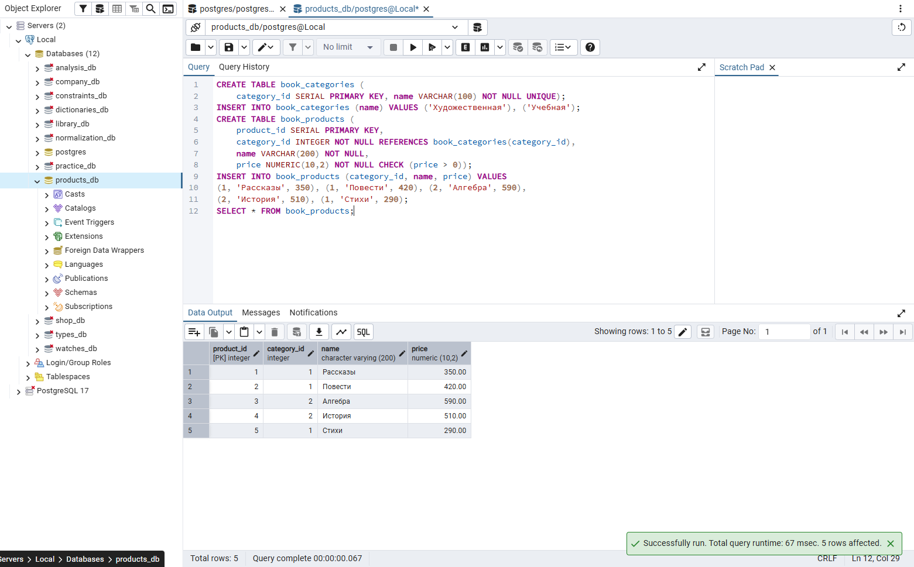

### Цветы

```sql
CREATE TABLE flower_categories (
    category_id SERIAL PRIMARY KEY, name VARCHAR(100) NOT NULL UNIQUE);
INSERT INTO flower_categories (name) VALUES ('Букеты'), ('Комнатные');
ALTER TABLE flower_products ADD COLUMN category_id INTEGER
REFERENCES flower_categories(category_id);
INSERT INTO flower_products (category_id, name, price, stem_count) VALUES
(1, 'Букет роз', 1800, 7), (1, 'Букет тюльпанов', 950, 9),
(2, 'Орхидея', 2200, 1), (2, 'Фикус', 1450, 1), (1, 'Букет ромашек', 800, 11);
SELECT * FROM flower_products;
```

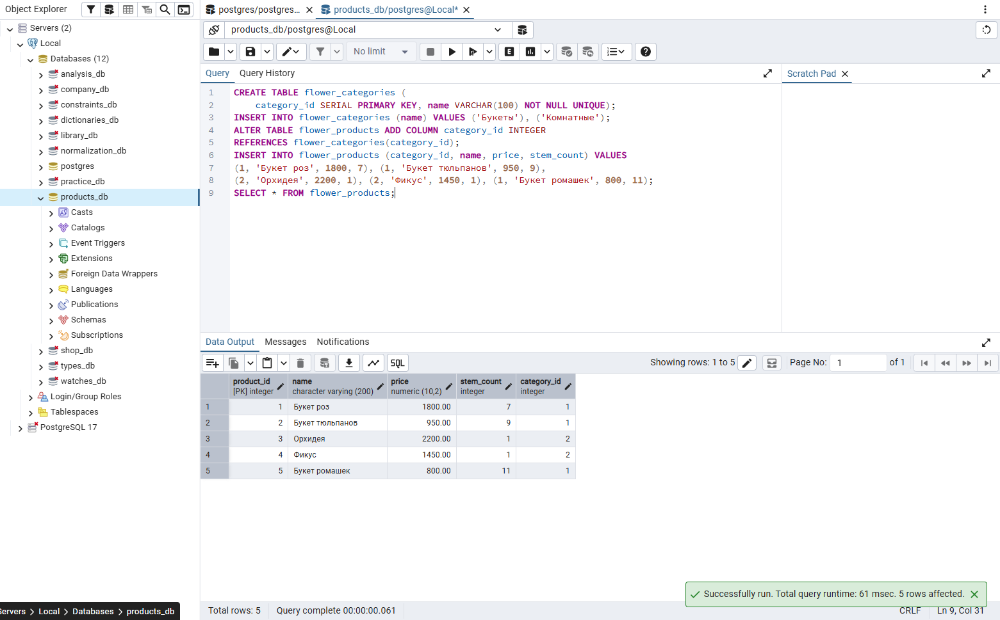

### Кофе

```sql
CREATE TABLE coffee_categories (
    category_id SERIAL PRIMARY KEY, name VARCHAR(100) NOT NULL UNIQUE);
INSERT INTO coffee_categories (name) VALUES ('Зерновой'), ('Молотый');
CREATE TABLE coffee_products (
    product_id SERIAL PRIMARY KEY,
    category_id INTEGER NOT NULL REFERENCES coffee_categories(category_id),
    name VARCHAR(200) NOT NULL,
    price NUMERIC(10,2) NOT NULL CHECK (price > 0));
INSERT INTO coffee_products (category_id, name, price) VALUES
(1, 'Арабика 250 г', 650), (1, 'Робуста 250 г', 500),
(2, 'Эспрессо 200 г', 590), (2, 'Капучино 200 г', 560), (1, 'Смесь 500 г', 990);
SELECT * FROM coffee_products;
```

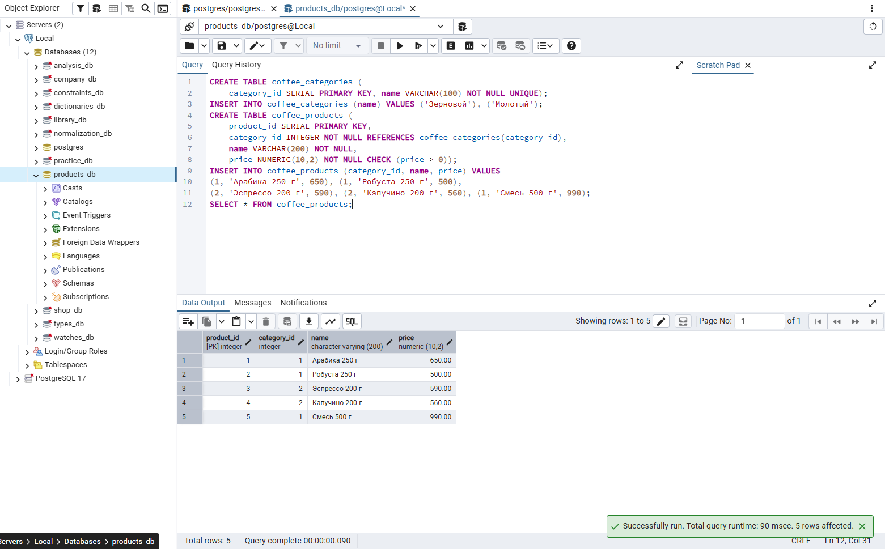

### Проверка CHECK и FK

```sql
DO $$
BEGIN
    INSERT INTO book_products (category_id, name, price) VALUES (1, 'Ошибка цены', 0);
EXCEPTION WHEN check_violation THEN RAISE NOTICE 'CHECK: цена 0 отклонена';
END $$;
DO $$
BEGIN
    INSERT INTO coffee_products (category_id, name, price) VALUES (999, 'Ошибка категории', 100);
EXCEPTION WHEN foreign_key_violation THEN RAISE NOTICE 'FK: категория 999 отклонена';
END $$;
SELECT 'books' AS theme, COUNT(*) FROM book_products
UNION ALL SELECT 'flowers', COUNT(*) FROM flower_products
UNION ALL SELECT 'coffee', COUNT(*) FROM coffee_products;
```

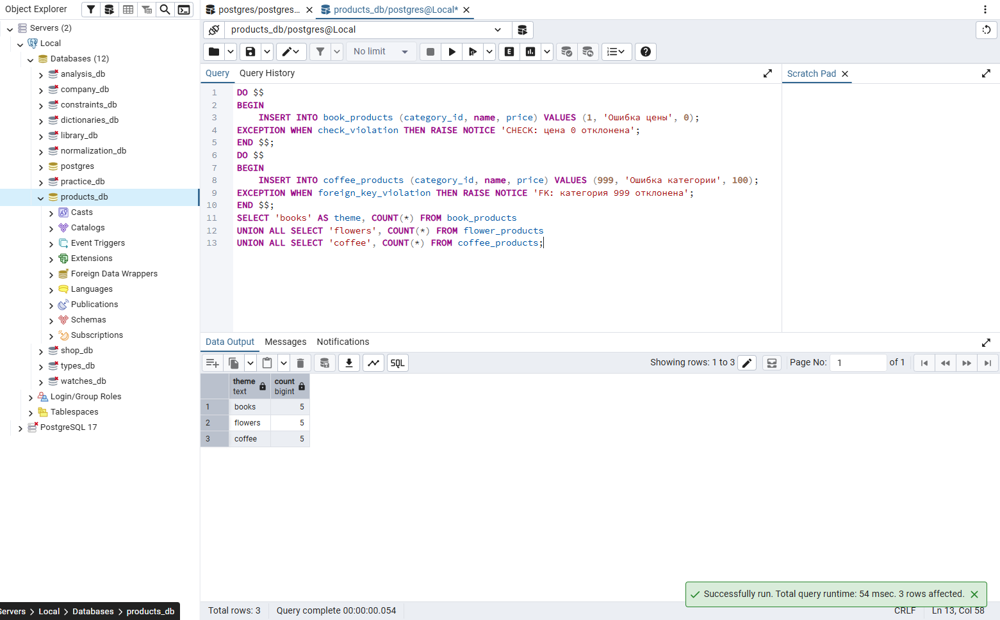
