# Рабочая тетрадь. Пара № 13: «Создание таблицы остатков stock_items. CHECK на количество ≥ 0»

**УП.11** «Разработка, администрирование и защита баз данных»

**Студент:** Ермилов Даниил Евгеньевич

**Вариант 27:** «Парфюмерия»

SQL-скрипт: [10_stock_items.sql](../src/db/10_stock_items.sql).

## Задание 1.1. База данных

```sql
CREATE DATABASE stock_db;
```

**Результат:** ☑ База stock_db создана.

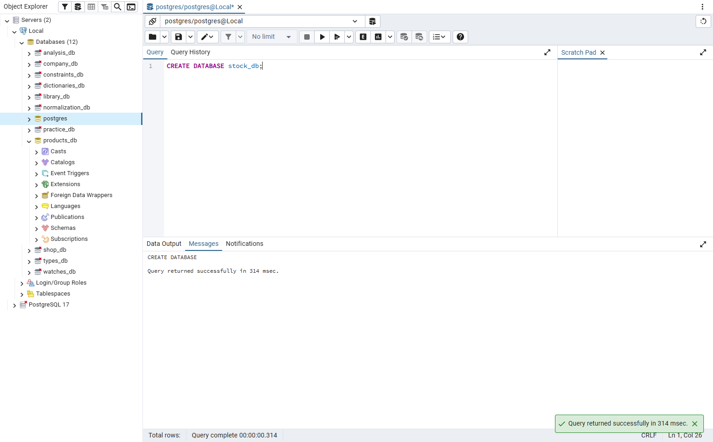

## Задание 1.2. Подключение

```sql
SELECT current_database();
```

**Результат:** ☑ Подключение к stock_db выполнено.

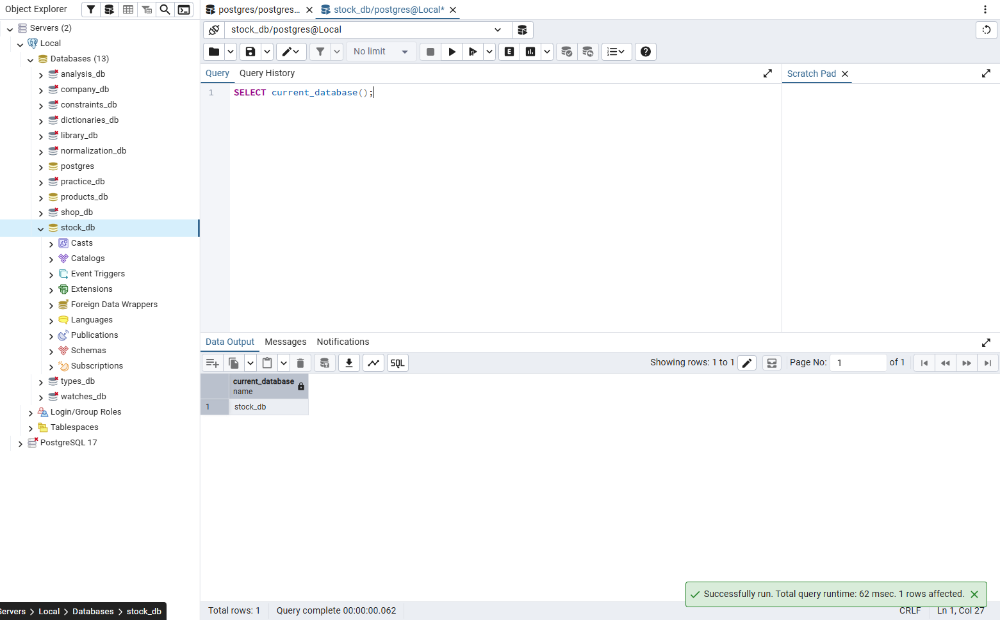

## Задание 1.3. Справочники

```sql
CREATE TABLE categories (
    category_id SERIAL PRIMARY KEY,
    name VARCHAR(100) NOT NULL UNIQUE
);
CREATE TABLE sizes (
    size_id SERIAL PRIMARY KEY,
    value INTEGER NOT NULL UNIQUE CHECK (value > 0)
);
SELECT table_name FROM information_schema.tables
WHERE table_schema = 'public' AND table_name IN ('categories', 'sizes');
```

**Результат:** ☑ Созданы categories и sizes.

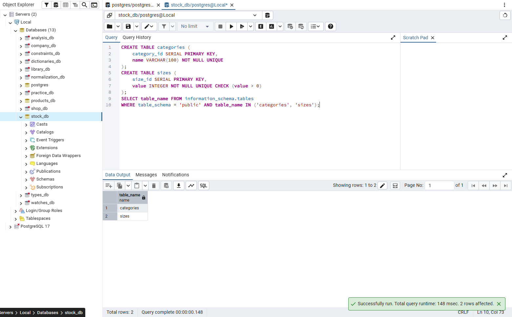

## Задание 1.4. Товары

```sql
CREATE TABLE products (
    product_id SERIAL PRIMARY KEY,
    category_id INTEGER REFERENCES categories(category_id),
    name VARCHAR(200) NOT NULL,
    price NUMERIC(10,2) CHECK (price > 0)
);
SELECT * FROM products;
```

**Результат:** ☑ Таблица products создана.

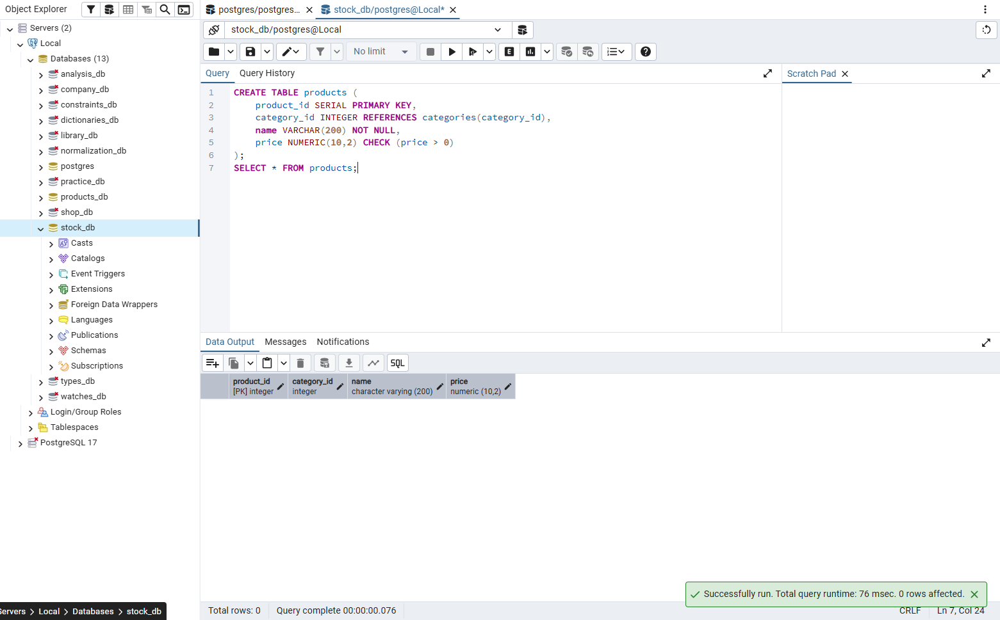

## Задание 1.5. Подготовка данных

```sql
INSERT INTO categories (name) VALUES
('Наручные часы'), ('Спортивные часы'), ('Смарт-часы');
INSERT INTO sizes (value) VALUES (38), (39), (40);
INSERT INTO products (category_id, name, price) VALUES
(1, 'Часы «Классика»', 15000.00),
(2, 'Часы «Спорт»', 5000.00);
SELECT 'categories' AS table_name, COUNT(*) FROM categories
UNION ALL SELECT 'sizes', COUNT(*) FROM sizes
UNION ALL SELECT 'products', COUNT(*) FROM products;
```

**Результат:** ☑ Добавлены 3 категории, 3 размера и 2 товара.

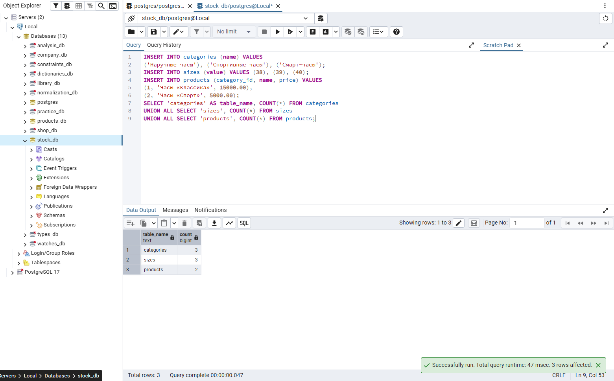

## Задание 2.1. Таблица остатков

```sql
CREATE TABLE stock_items (
    stock_item_id SERIAL PRIMARY KEY,
    product_id INTEGER REFERENCES products(product_id),
    size_id INTEGER REFERENCES sizes(size_id),
    quantity INTEGER CHECK (quantity >= 0)
);
SELECT * FROM stock_items;
```

**Результат:** ☑ Таблица stock_items создана с двумя FK и CHECK.

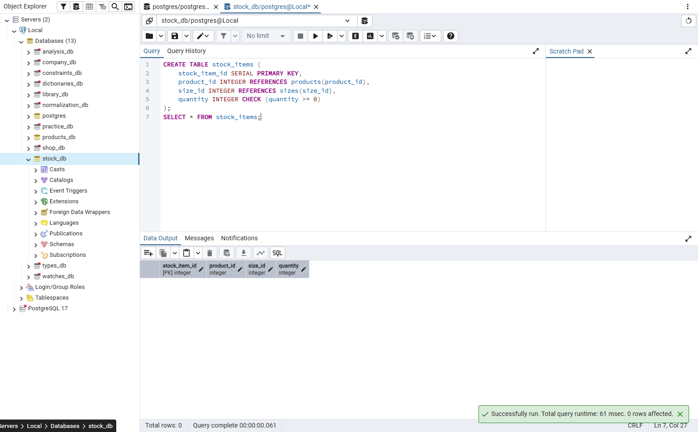

## Задание 2.2. Структура

```sql
SELECT column_name, data_type, is_nullable
FROM information_schema.columns
WHERE table_schema = 'public' AND table_name = 'stock_items'
ORDER BY ordinal_position;
```

**Результат:** ☑ Проверены четыре поля stock_items.

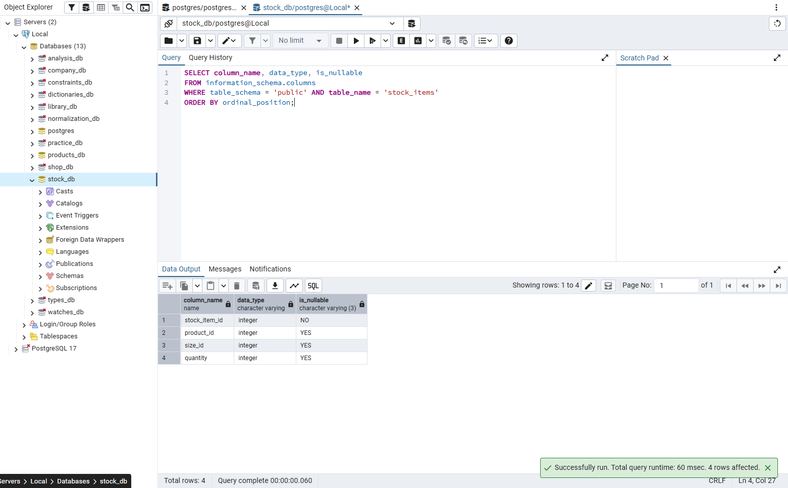

## Задание 3.1. Пять остатков

```sql
INSERT INTO stock_items (product_id, size_id, quantity) VALUES
(1, 1, 5), (1, 2, 3), (1, 3, 7), (2, 1, 10), (2, 2, 0);
SELECT * FROM stock_items ORDER BY stock_item_id;
```

**Результат:** ☑ Добавлено 5 строк из примера «Мир часов».


## Задание 3.2. Просмотр данных

```sql
SELECT * FROM stock_items ORDER BY stock_item_id;
```

**Результат:** ☑ Пять строк показаны запросом SELECT.

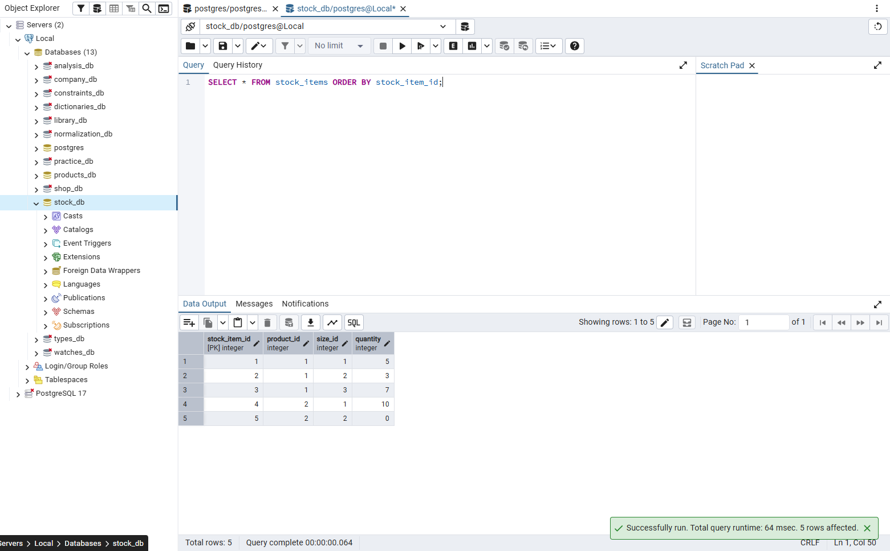

## Задание 4.1. Отрицательное количество

```sql
INSERT INTO stock_items (product_id, size_id, quantity) VALUES (1, 1, -5);
```

**Результат:** ☑ Количество −5 отклонено CHECK.


## Задание 4.2. Нулевое количество

```sql
INSERT INTO stock_items (product_id, size_id, quantity) VALUES (2, 3, 0);
```

**Результат:** ☑ Остаток 0 добавлен.

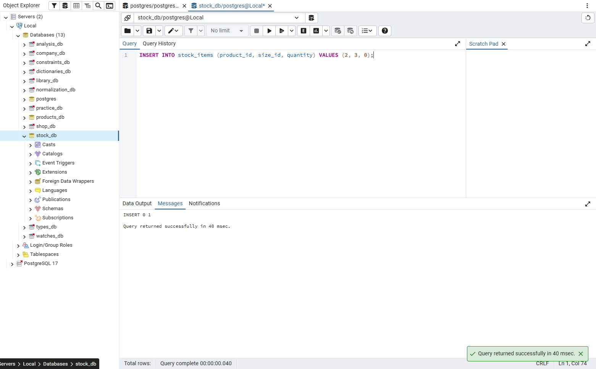

## Задание 4.3. Положительное количество

```sql
INSERT INTO stock_items (product_id, size_id, quantity) VALUES (1, 1, 100);
```

**Результат:** ☑ Остаток 100 добавлен.


## Задание 5.1. Несуществующий товар

```sql
INSERT INTO stock_items (product_id, size_id, quantity) VALUES (999, 1, 1);
```

**Результат:** ☑ Товар 999 отклонён внешним ключом.


## Задание 5.2. Несуществующий размер

```sql
INSERT INTO stock_items (product_id, size_id, quantity) VALUES (1, 999, 1);
```

**Результат:** ☑ Размер 999 отклонён внешним ключом.


## Задание 5.3. Корректные данные

```sql
INSERT INTO stock_items (product_id, size_id, quantity) VALUES (2, 3, 4);
```

**Результат:** ☑ Остаток добавлен.


## Задание 6.1. Своя тема «Парфюмерия»

```sql
CREATE TABLE perfume_products (
    product_id SERIAL PRIMARY KEY,
    name VARCHAR(200) NOT NULL,
    price NUMERIC(10,2) CHECK (price > 0)
);
CREATE TABLE bottle_volumes (
    size_id SERIAL PRIMARY KEY,
    volume_ml INTEGER NOT NULL UNIQUE CHECK (volume_ml > 0)
);
INSERT INTO perfume_products (name, price) VALUES
('Цветочный день', 1890), ('Свежий ветер', 1590),
('Тёплый вечер', 3290), ('Весенний сад', 2490), ('Морской бриз', 1790);
INSERT INTO bottle_volumes (volume_ml) VALUES (30), (50), (100);
CREATE TABLE perfume_stock_items (
    stock_item_id SERIAL PRIMARY KEY,
    product_id INTEGER REFERENCES perfume_products(product_id),
    size_id INTEGER REFERENCES bottle_volumes(size_id),
    quantity INTEGER CHECK (quantity >= 0)
);
SELECT * FROM perfume_stock_items;
```

**Результат:** ☑ Созданы perfume_products, bottle_volumes и perfume_stock_items.

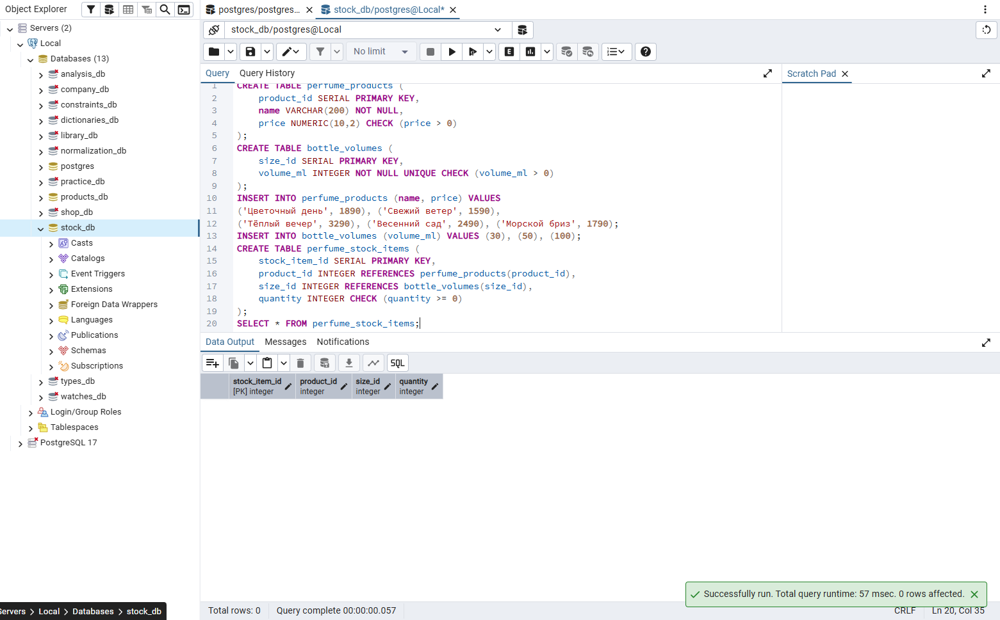

## Задание 6.2. Пять остатков парфюмерии

```sql
INSERT INTO perfume_stock_items (product_id, size_id, quantity) VALUES
(1, 2, 8), (2, 3, 5), (3, 1, 4), (4, 2, 0), (5, 3, 6);
SELECT * FROM perfume_stock_items ORDER BY stock_item_id;
```

**Результат:** ☑ Добавлено 5 строк.

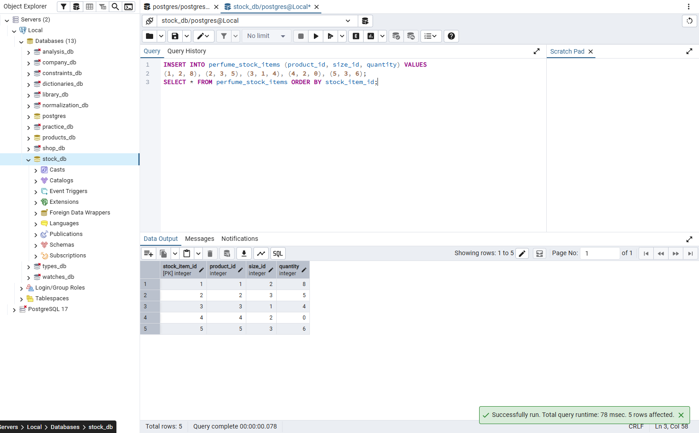

## Задание 6.3. CHECK для своей темы

```sql
INSERT INTO perfume_stock_items (product_id, size_id, quantity) VALUES (1, 2, -5);
```

**Результат:** ☑ Количество −5 отклонено.

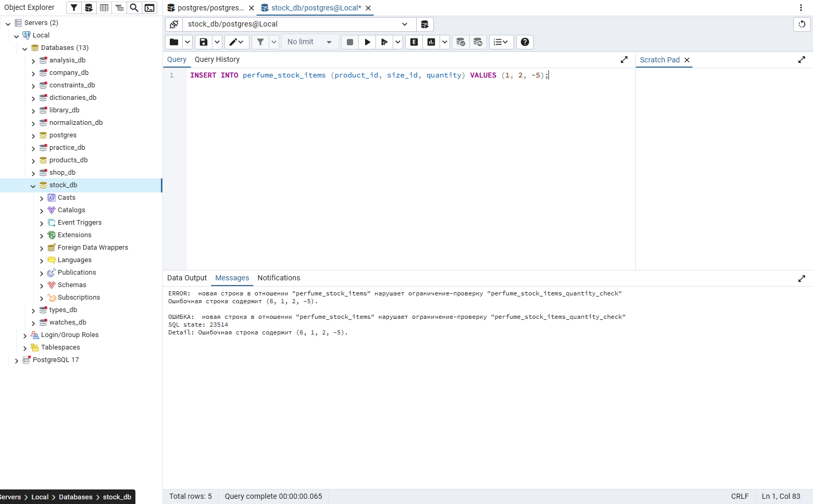

## Задание 7.1. Уровень 1

```sql
CREATE SCHEMA level1;
CREATE TABLE level1.stock_items (
    stock_item_id SERIAL PRIMARY KEY,
    product_id INTEGER REFERENCES public.products(product_id),
    quantity INTEGER CHECK (quantity >= 0)
);
SELECT column_name FROM information_schema.columns
WHERE table_schema = 'level1' AND table_name = 'stock_items'
ORDER BY ordinal_position;
```

**Результат:** ☑ Создана level1.stock_items с 3 полями.

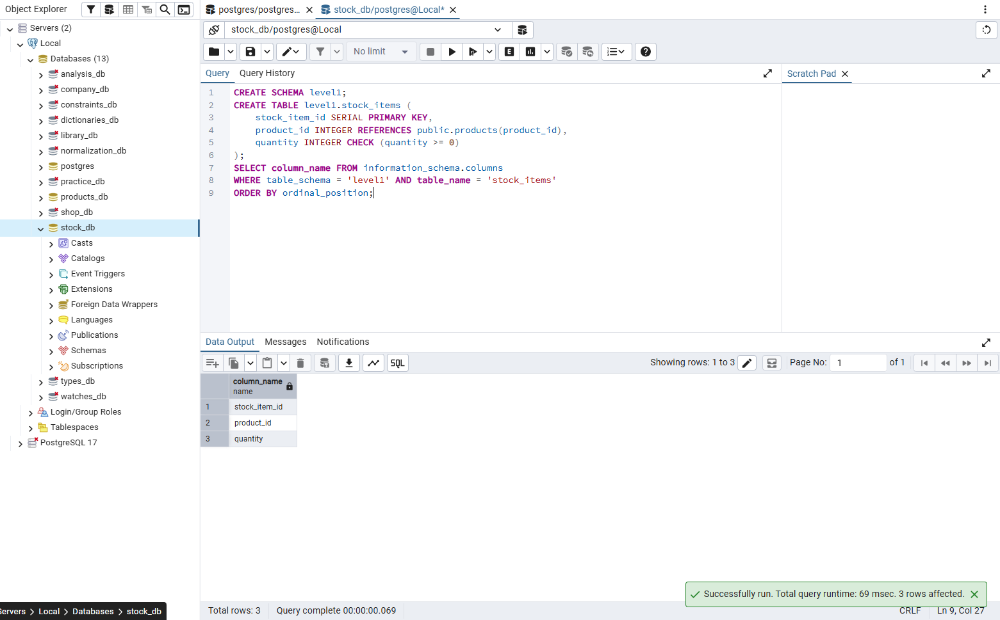

## Задание 7.2. Уровень 2

```sql
CREATE SCHEMA level2;
CREATE TABLE level2.stock_items (
    stock_item_id SERIAL PRIMARY KEY,
    product_id INTEGER REFERENCES public.products(product_id),
    size_id INTEGER REFERENCES public.sizes(size_id),
    quantity INTEGER CHECK (quantity >= 0)
);
SELECT column_name FROM information_schema.columns
WHERE table_schema = 'level2' AND table_name = 'stock_items'
ORDER BY ordinal_position;
```

**Результат:** ☑ Создана level2.stock_items с 4 полями.

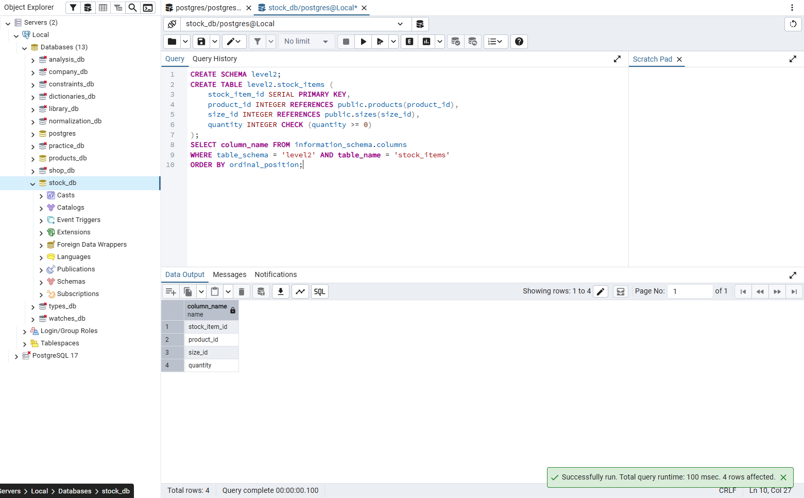

## Задание 7.3. Уровень 3

```sql
CREATE SCHEMA level3;
CREATE TABLE level3.stock_items (
    stock_item_id SERIAL PRIMARY KEY,
    product_id INTEGER REFERENCES public.products(product_id),
    size_id INTEGER REFERENCES public.sizes(size_id),
    quantity INTEGER CHECK (quantity >= 0),
    reserved INTEGER CHECK (reserved >= 0)
);
SELECT column_name FROM information_schema.columns
WHERE table_schema = 'level3' AND table_name = 'stock_items'
ORDER BY ordinal_position;
```

**Результат:** ☑ Создана level3.stock_items с 5 полями.

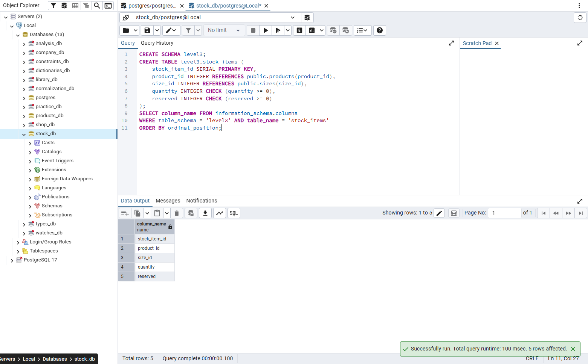

## Задание 8.1. Творческий уровень

```sql
CREATE TABLE board_games (
    game_id SERIAL PRIMARY KEY,
    name VARCHAR(100) NOT NULL
);
INSERT INTO board_games (name) VALUES ('Шахматы'), ('Лото');
CREATE TABLE game_stock (
    stock_item_id SERIAL PRIMARY KEY,
    game_id INTEGER REFERENCES board_games(game_id),
    quantity INTEGER CHECK (quantity >= 0),
    reserved INTEGER CHECK (reserved >= 0 AND reserved <= quantity)
);
SELECT * FROM game_stock;
```

**Результат:** ☑ Для настольных игр создана game_stock с проверками количества и резерва.


## Проверка понимания

1. stock_items хранит количество товара по размеру.
2. Отдельная таблица позволяет хранить несколько вариантов одного товара без повторения его данных.
3. PRIMARY KEY однозначно определяет строку.
4. FOREIGN KEY связывает остаток с существующим товаром и размером.
5. CHECK (quantity >= 0) допускает ноль и положительное количество.
6. Отрицательное количество отклоняется.
7. Несуществующий товар отклоняется внешним ключом.
8. SERIAL автоматически выдаёт номер.
9. INTEGER — тип целого числа.
10. CREATE TABLE stock_items задаёт поля, ключи и CHECK.

## Контрольные вопросы

1. stock_items хранит остаток товара по размеру.
2. Поля: stock_item_id, product_id, size_id, quantity.
3. CHECK на количество — условие quantity >= 0.
4. Оно запрещает отрицательные остатки.
5. FOREIGN KEY — ссылка на первичный ключ другой таблицы.
6. Он сохраняет правильные связи остатков с товарами и размерами.
7. Количество < 0 не сохранится.
8. Несуществующий товар не сохранится.
9. SERIAL автоматически выдаёт целый номер.
10. INTEGER хранит целое число.
11. NOT NULL требует значение.
12. PRIMARY KEY — уникальный ключ строки, не допускающий NULL.
13. REFERENCES указывает связанную таблицу и её ключ.
14. Товар со связанными остатками удалить нельзя, пока ссылки не изменены.
15. Пример: CREATE TABLE stock_items (stock_item_id SERIAL PRIMARY KEY, product_id INTEGER REFERENCES products(product_id), quantity INTEGER CHECK (quantity >= 0));

## Итоги пары

**Узнал:** как хранить остатки по товарам и размерам и проверять количество.

**Сделал:** создал stock_items, проверил CHECK и FK, сделал остатки для «Парфюмерии» и три уровня задания.

**Легко:** добавить пять остатков и проверить их выборкой.

**Сложно:** разобраться с несколькими внешними ключами.

**Повторить:** порядок создания связанных таблиц и FOREIGN KEY.

**Выполненный уровень:** повышенный.

## Домашнее задание

Созданы watch_stock, book_stock и gadget_stock. В каждой таблице 5 остатков, всего 15.
В каждой есть два внешних ключа и CHECK (quantity >= 0). Проверены отрицательное количество
и ссылки на несуществующий товар, размер или формат.

Скрипт: [homework_13.sql](../src/db/homework_13.sql).

### Мир часов: таблица

```sql
CREATE TABLE watches (
    watch_id SERIAL PRIMARY KEY, name VARCHAR(100) NOT NULL);
CREATE TABLE watch_sizes (
    size_id SERIAL PRIMARY KEY, value INTEGER NOT NULL UNIQUE);
INSERT INTO watches (name) VALUES ('Классика'), ('Спорт');
INSERT INTO watch_sizes (value) VALUES (38), (39), (40);
CREATE TABLE watch_stock (
    stock_item_id SERIAL PRIMARY KEY,
    watch_id INTEGER REFERENCES watches(watch_id),
    size_id INTEGER REFERENCES watch_sizes(size_id),
    quantity INTEGER CHECK (quantity >= 0)
);
SELECT * FROM watch_stock;
```

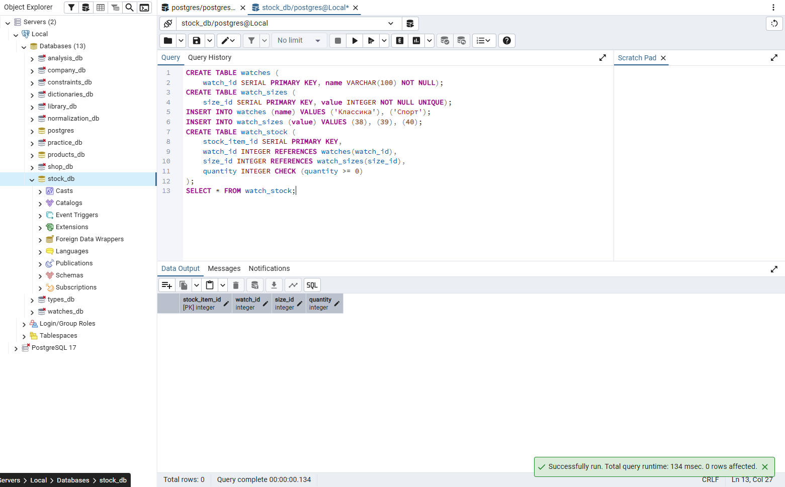

### Мир часов: пять остатков

```sql
INSERT INTO watch_stock (watch_id, size_id, quantity) VALUES
(1, 1, 5), (1, 2, 3), (1, 3, 7), (2, 1, 10), (2, 2, 0);
SELECT * FROM watch_stock ORDER BY stock_item_id;
```


### Книжный мир: таблица

```sql
CREATE TABLE books (
    book_id SERIAL PRIMARY KEY, name VARCHAR(100) NOT NULL);
CREATE TABLE book_formats (
    format_id SERIAL PRIMARY KEY, name VARCHAR(50) NOT NULL UNIQUE);
INSERT INTO books (name) VALUES ('Рассказы'), ('Повести'), ('Стихи');
INSERT INTO book_formats (name) VALUES ('Твёрдый'), ('Мягкий');
CREATE TABLE book_stock (
    stock_item_id SERIAL PRIMARY KEY,
    book_id INTEGER REFERENCES books(book_id),
    format_id INTEGER REFERENCES book_formats(format_id),
    quantity INTEGER CHECK (quantity >= 0)
);
SELECT * FROM book_stock;
```


### Книжный мир: пять остатков

```sql
INSERT INTO book_stock (book_id, format_id, quantity) VALUES
(1, 1, 10), (1, 2, 5), (2, 1, 8), (2, 2, 3), (3, 1, 0);
SELECT * FROM book_stock ORDER BY stock_item_id;
```

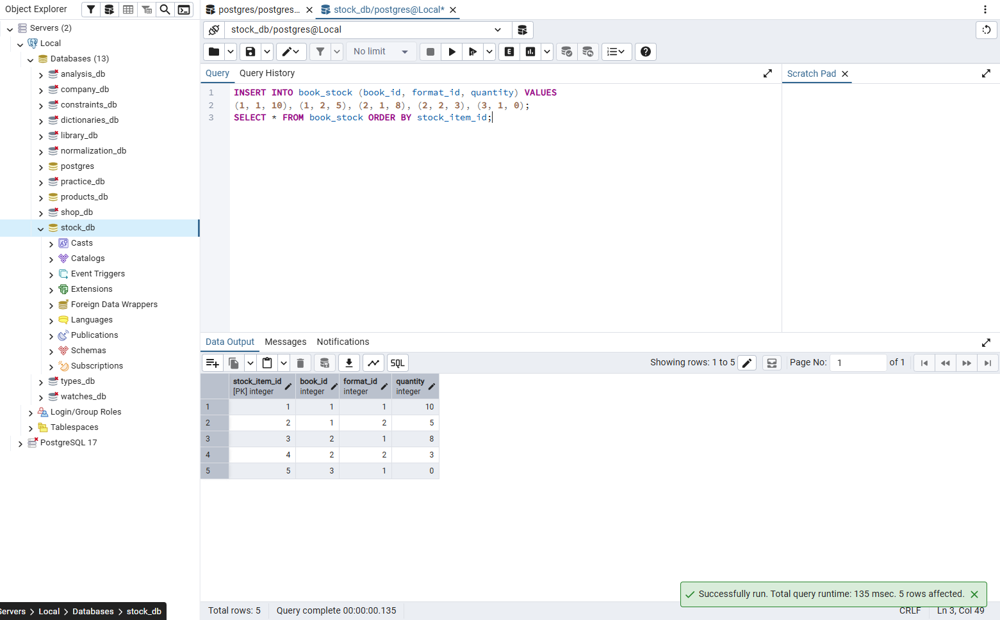

### ТехноМир: таблица

```sql
CREATE TABLE gadgets (
    gadget_id SERIAL PRIMARY KEY, name VARCHAR(100) NOT NULL);
CREATE TABLE colors (
    color_id SERIAL PRIMARY KEY, name VARCHAR(50) NOT NULL UNIQUE);
INSERT INTO gadgets (name) VALUES ('Смартфон'), ('Планшет'), ('Наушники');
INSERT INTO colors (name) VALUES ('Чёрный'), ('Белый');
CREATE TABLE gadget_stock (
    stock_item_id SERIAL PRIMARY KEY,
    gadget_id INTEGER REFERENCES gadgets(gadget_id),
    color_id INTEGER REFERENCES colors(color_id),
    quantity INTEGER CHECK (quantity >= 0)
);
SELECT * FROM gadget_stock;
```

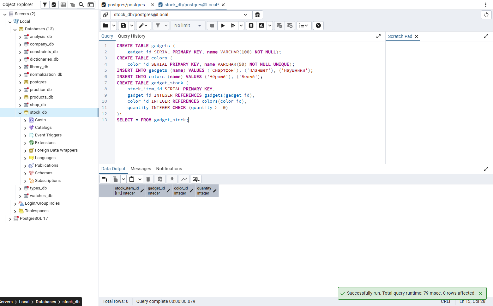

### ТехноМир: пять остатков

```sql
INSERT INTO gadget_stock (gadget_id, color_id, quantity) VALUES
(1, 1, 15), (1, 2, 10), (2, 1, 5), (2, 2, 8), (3, 1, 0);
SELECT * FROM gadget_stock ORDER BY stock_item_id;
```


### Проверка CHECK

```sql
DO $$
BEGIN
    INSERT INTO watch_stock (watch_id, size_id, quantity) VALUES (1, 1, -5);
EXCEPTION WHEN check_violation THEN RAISE NOTICE 'CHECK watch_stock: -5 отклонено';
END $$;
DO $$
BEGIN
    INSERT INTO book_stock (book_id, format_id, quantity) VALUES (1, 1, -5);
EXCEPTION WHEN check_violation THEN RAISE NOTICE 'CHECK book_stock: -5 отклонено';
END $$;
DO $$
BEGIN
    INSERT INTO gadget_stock (gadget_id, color_id, quantity) VALUES (1, 1, -5);
EXCEPTION WHEN check_violation THEN RAISE NOTICE 'CHECK gadget_stock: -5 отклонено';
END $$;
SELECT 'watch_stock' AS table_name, COUNT(*) FROM watch_stock
UNION ALL SELECT 'book_stock', COUNT(*) FROM book_stock
UNION ALL SELECT 'gadget_stock', COUNT(*) FROM gadget_stock;
```


### Проверка внешних ключей

```sql
DO $$
BEGIN
    INSERT INTO watch_stock (watch_id, size_id, quantity) VALUES (999, 1, 1);
EXCEPTION WHEN foreign_key_violation THEN RAISE NOTICE 'FK watch_stock: товар 999 отклонён';
END $$;
DO $$
BEGIN
    INSERT INTO book_stock (book_id, format_id, quantity) VALUES (1, 999, 1);
EXCEPTION WHEN foreign_key_violation THEN RAISE NOTICE 'FK book_stock: формат 999 отклонён';
END $$;
DO $$
BEGIN
    INSERT INTO gadget_stock (gadget_id, color_id, quantity) VALUES (999, 1, 1);
EXCEPTION WHEN foreign_key_violation THEN RAISE NOTICE 'FK gadget_stock: товар 999 отклонён';
END $$;
SELECT 'watch_stock' AS table_name, COUNT(*) FROM watch_stock
UNION ALL SELECT 'book_stock', COUNT(*) FROM book_stock
UNION ALL SELECT 'gadget_stock', COUNT(*) FROM gadget_stock;
```

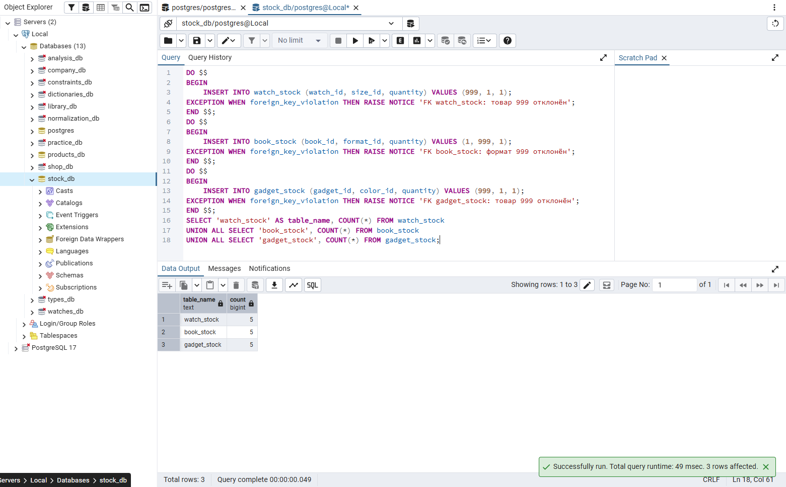
