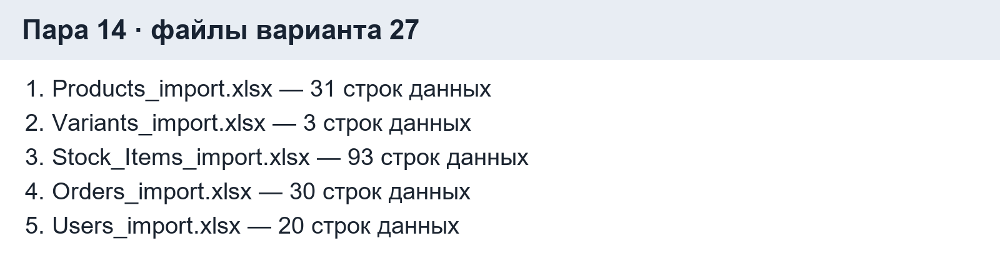
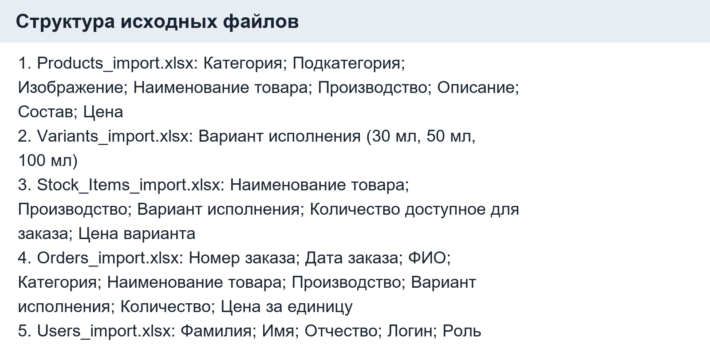
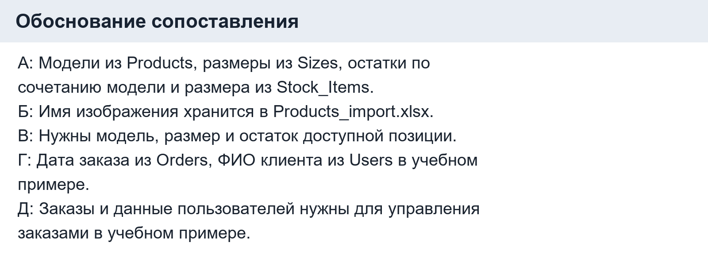
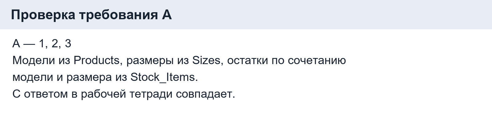
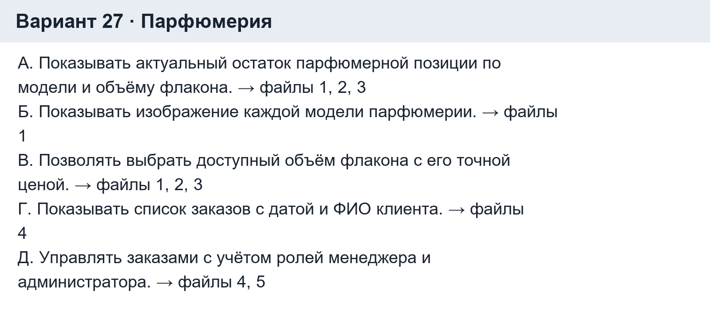
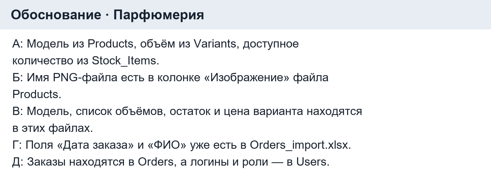

# Рабочая тетрадь. Пара 14

Ермилов Даниил Евгеньевич, 3ИП-1-24. Вариант 27 — «Парфюмерия».

## Задание 1. Подготовка

Открыты и изучены пять исходных файлов варианта 27:

| № | Файл | Строк | Колонки |
|---|---|---:|---|
| 1 | `Products_import.xlsx` | 31 | Категория; Подкатегория; Изображение; Наименование товара; Производство; Описание; Состав; Цена |
| 2 | `Variants_import.xlsx` | 3 | Вариант исполнения (30 мл, 50 мл, 100 мл) |
| 3 | `Stock_Items_import.xlsx` | 93 | Наименование товара; Производство; Вариант исполнения; Количество доступное для заказа; Цена варианта |
| 4 | `Orders_import.xlsx` | 30 | Номер заказа; Дата заказа; ФИО; Категория; Наименование товара; Производство; Вариант исполнения; Количество; Цена за единицу |
| 5 | `Users_import.xlsx` | 20 | Фамилия; Имя; Отчество; Логин; Роль |

## Задание 2. Сопоставление учебного примера

Ответ: А-1, 2, 3; Б-1; В-1, 2, 3; Г-4, 5; Д-4, 5.

| Требование | Файлы | Почему |
|---|---|---|
| А | 1, 2, 3 | Модели из Products, размеры из Sizes, остатки по сочетанию модели и размера из Stock_Items. |
| Б | 1 | Имя изображения хранится в Products_import.xlsx. |
| В | 1, 2, 3 | Нужны модель, размер и остаток доступной позиции. |
| Г | 4, 5 | Дата заказа из Orders, ФИО клиента из Users в учебном примере. |
| Д | 4, 5 | Заказы и данные пользователей нужны для управления заказами в учебном примере. |

## Задание 3. Проверка

1. А-1, 2, 3 — совпадает. Модели из Products, размеры из Sizes, остатки по сочетанию модели и размера из Stock_Items.

2. Б-1 — совпадает. Имя изображения хранится в Products_import.xlsx.

3. В-1, 2, 3 — совпадает. Нужны модель, размер и остаток доступной позиции.

4. Г-4, 5 — совпадает. Дата заказа из Orders, ФИО клиента из Users в учебном примере.

5. Д-4, 5 — совпадает. Заказы и данные пользователей нужны для управления заказами в учебном примере.

## Задание 4. Своя тема «Парфюмерия»

| Требование | Формулировка | Файлы | Почему |
|---|---|---|
| А | Показывать актуальный остаток парфюмерной позиции по модели и объёму флакона. | 1, 2, 3 | Модель из Products, объём из Variants, доступное количество из Stock_Items. |
| Б | Показывать изображение каждой модели парфюмерии. | 1 | Имя PNG-файла есть в колонке «Изображение» файла Products. |
| В | Позволять выбрать доступный объём флакона с его точной ценой. | 1, 2, 3 | Модель, список объёмов, остаток и цена варианта находятся в этих файлах. |
| Г | Показывать список заказов с датой и ФИО клиента. | 4 | Поля «Дата заказа» и «ФИО» уже есть в Orders_import.xlsx. |
| Д | Управлять заказами с учётом ролей менеджера и администратора. | 4, 5 | Заказы находятся в Orders, а логины и роли — в Users. |

Ответ: А-1, 2, 3; Б-1; В-1, 2, 3; Г-4; Д-4, 5.

## Задание 5. Разноуровневые задания

Уровень 1: список товаров — файл 1.

Уровень 2: заказать товар — файлы 1, 2, 3, 4, 5.

Уровень 3: А-1, 2, 3; Б-1; В-1, 2, 3; Г-4, 5; Д-4, 5.

## Задание 6. Творческий уровень

Требование: авторизованный пользователь ищет парфюмерию по названию, фильтрует по категории и сортирует по базовой цене.
Ответ: файл 1 — Products_import.xlsx. В нём есть название, категория и базовая цена.

## Проверка понимания

1. Функции и действия, которые должна выполнять система для пользователя.
2. Переданные заказчиком таблицы с данными для будущей системы.
3. Чтобы определить, откуда брать данные для каждой функции и как их загрузить.
4. Прочитать требование, определить нужные данные, найти колонки в файлах и записать номера файлов.
5. А — файлы 1, 2, 3: модели, размеры и остатки.
6. Б — файл 1: изображения товаров.
7. В — файлы 1, 2, 3: товар, размер и доступный остаток.
8. Г — файлы 4, 5: дата заказа и данные клиента в учебном примере.
9. Д — файлы 4, 5: заказы и пользователи в учебном примере.
10. При проектировании БД, импорте и выполнении задания демонстрационного экзамена.

## Контрольные вопросы

1. Функции и действия, которые должна выполнять система для пользователя.
2. Переданные заказчиком таблицы с данными для будущей системы.
3. Чтобы определить, откуда брать данные для каждой функции и как их загрузить.
4. Для каталога нужны Products, Sizes (или Variants) и Stock_Items.
5. Для заказов нужен Orders; для разграничения прав также Users.
6. Для пользователей нужен Users_import.xlsx.
7. Требованию А соответствуют файлы с номерами 1, 2 и 3.
8. Требованию Б соответствует файл 1.
9. Требованию Г в учебном примере соответствуют файлы 4 и 5.
10. Требованию Д в учебном примере соответствуют файлы 4 и 5.
11. Указать все нужные номера и пояснить роль каждого файла.
12. Повторить этот файл в ответах для всех связанных требований.
13. Сверить нужные поля с колонками файлов и готовым примером.
14. При анализе файлов заказчика и проектировании структуры БД.
15. Парфюмерия: Г-4, так как дата заказа и ФИО уже записаны в Orders_import.xlsx.

## Итоги

Узнал, как связывать функции программы с колонками исходных файлов.
Открыл пять таблиц, сопоставил требования учебного примера и своего варианта, объяснил выбор.
Легко было найти изображения и данные заказов. Сложнее — проверить, нужен ли файл Users для ФИО в моей теме.
Повторить связь таблиц заказов и пользователей. Выполнен уровень 3.
