# Рабочая тетрадь. Пара 15

Ермилов Даниил Евгеньевич, 3ИП-1-24. Вариант 27 — «Парфюмерия».

SQL: [12_users_orders.sql](../src/db/12_users_orders.sql).

В заданиях 1–4 выполнен учебный пример с размерами. В задании 5 использованы объёмы флаконов и исходные данные варианта 27.

## Задание 1.1. Создание базы данных orders_db

```sql
CREATE DATABASE orders_db;
```

Результат: выполнено.

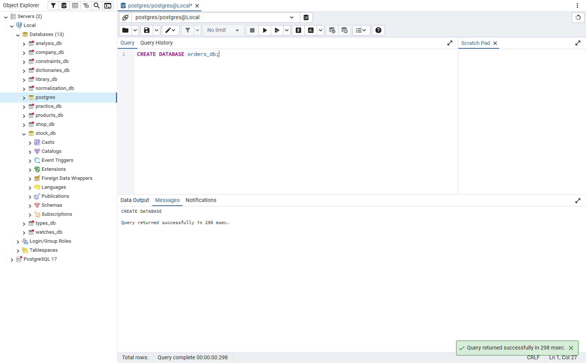

## Задание 1.2. Подключение к базе данных

```sql
SELECT current_database();
```

Результат: выполнено.

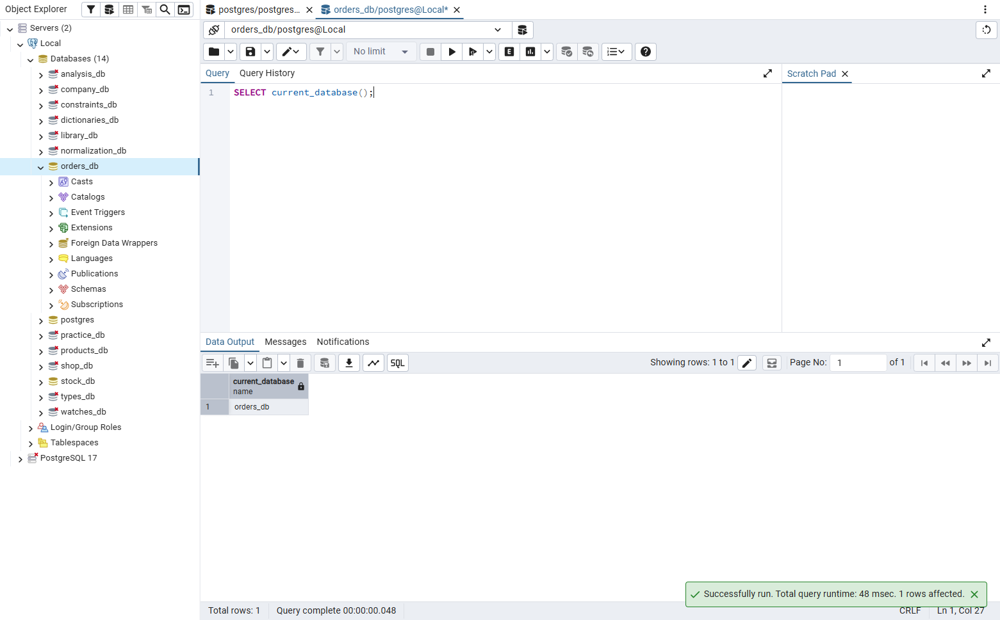

## Задание 1.3. Справочники categories, sizes, products

```sql
-- Задание 1.3. Данные для учебного примера
CREATE TABLE categories (
    category_id SERIAL PRIMARY KEY,
    name VARCHAR(100) NOT NULL UNIQUE
);
CREATE TABLE sizes (
    size_id SERIAL PRIMARY KEY,
    value INTEGER NOT NULL UNIQUE CHECK (value > 0)
);
CREATE TABLE products (
    product_id SERIAL PRIMARY KEY,
    category_id INTEGER REFERENCES categories(category_id),
    name VARCHAR(200) NOT NULL,
    price NUMERIC(10,2) CHECK (price > 0)
);
SELECT table_name FROM information_schema.tables WHERE table_schema = 'public' AND table_name IN ('categories', 'sizes', 'products') ORDER BY table_name;
```

Результат: выполнено.

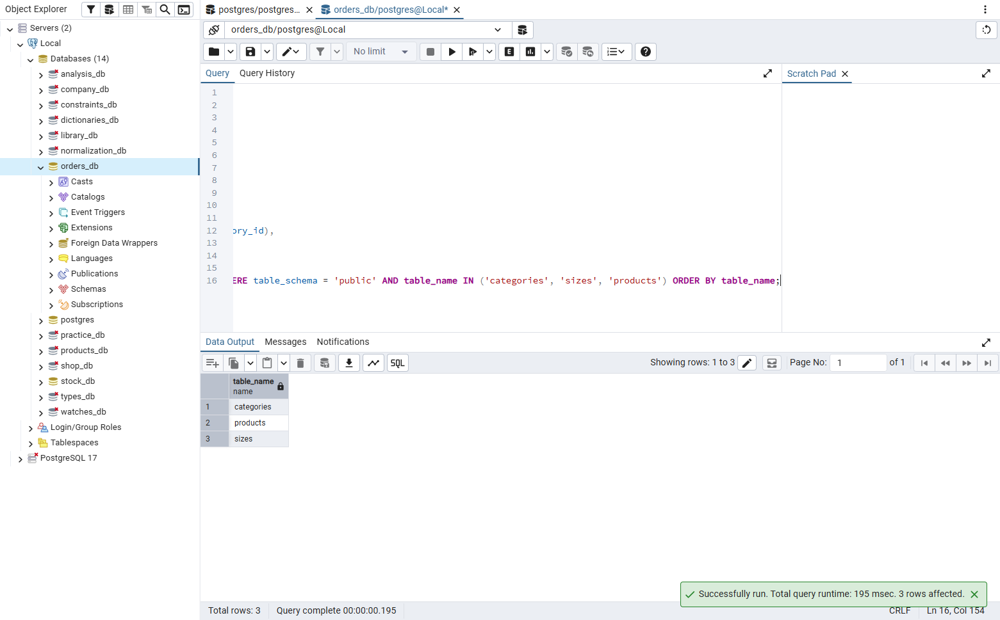

## Задание 1.4. Данные для справочников

```sql
-- Задание 1.4
INSERT INTO categories (name) VALUES
('Наручные часы'), ('Спортивные часы'), ('Смарт-часы');
INSERT INTO sizes (value) VALUES (38), (39), (40);
INSERT INTO products (category_id, name, price) VALUES
(1, 'Часы «Классика»', 2190.00),
(2, 'Часы «Спорт»', 2790.00),
(3, 'Смарт-часы', 25000.00);
SELECT COUNT(*) FROM products;
```

Результат: выполнено.

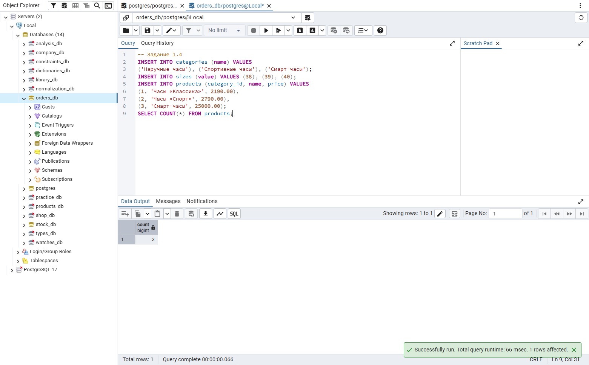

## Задание 2.1. Таблица roles

```sql
-- Задание 2.1. Роли
CREATE TABLE roles (
    role_id SERIAL PRIMARY KEY,
    name VARCHAR(50) NOT NULL UNIQUE
);
SELECT * FROM roles;
```

Результат: выполнено.

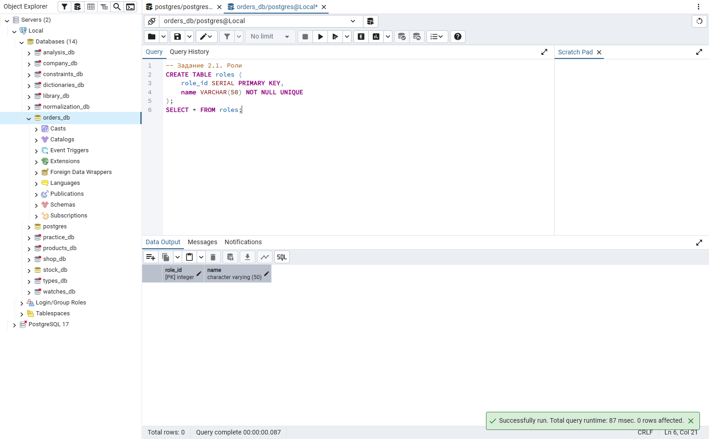

## Задание 2.2. Три роли

```sql
-- Задание 2.2
INSERT INTO roles (name) VALUES
('Администратор'), ('Менеджер'), ('Авторизованный пользователь');
SELECT * FROM roles ORDER BY role_id;
```

Результат: выполнено.

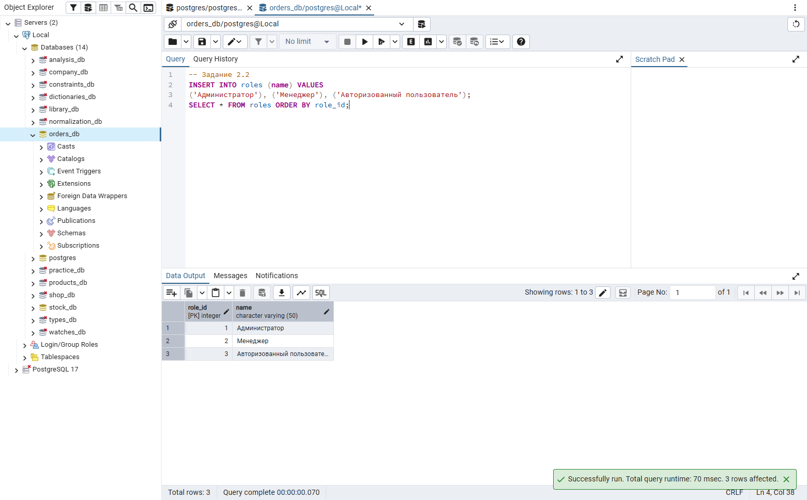

## Задание 2.3. Таблица users

```sql
-- Задание 2.3. Пользователи
CREATE TABLE users (
    user_id SERIAL PRIMARY KEY,
    last_name VARCHAR(100) NOT NULL,
    first_name VARCHAR(100) NOT NULL,
    middle_name VARCHAR(100),
    login VARCHAR(100) NOT NULL UNIQUE,
    role_id INTEGER REFERENCES roles(role_id)
);
SELECT * FROM users;
```

Результат: выполнено.

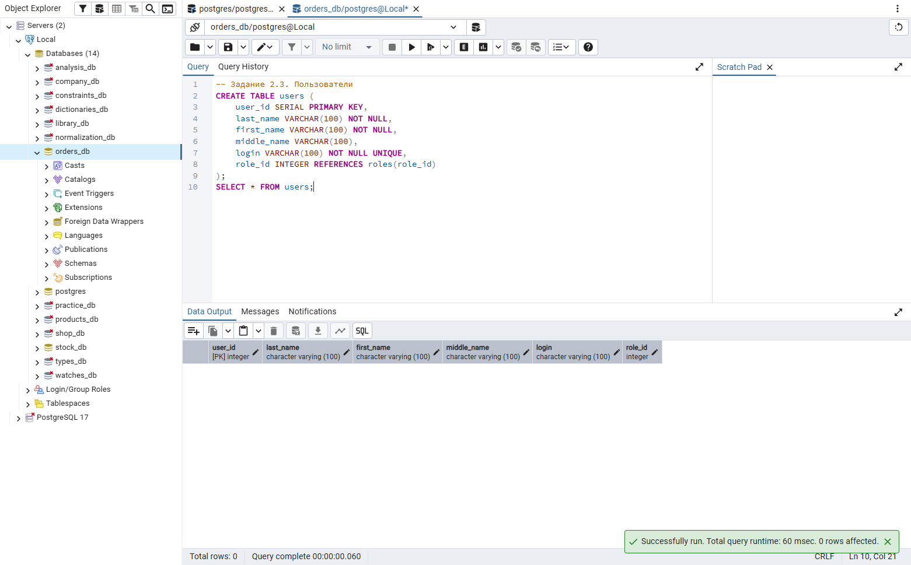

## Задание 2.4. Три пользователя

```sql
-- Задание 2.4
INSERT INTO users (last_name, first_name, login, role_id) VALUES
('Иванов', 'Иван', 'isivanov', 1),
('Петров', 'Пётр', 'papetrov', 2),
('Сидорова', 'Анна', 'asidorova', 3);
SELECT user_id, last_name, first_name, login, role_id FROM users ORDER BY user_id;
```

Результат: выполнено.

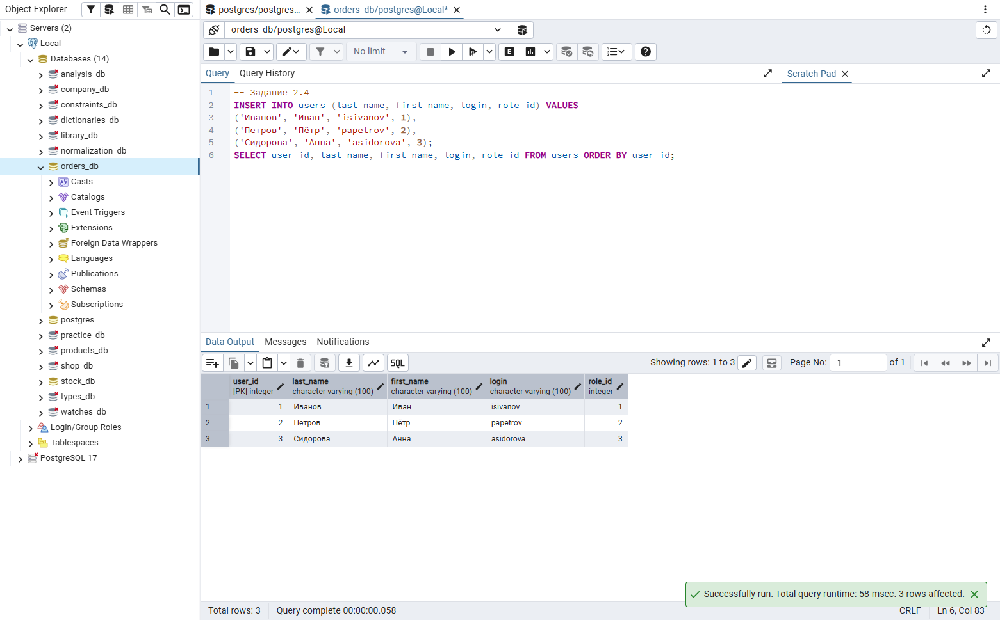

## Задание 3.1. Таблица orders

```sql
-- Задание 3.1. Заказы
CREATE TABLE orders (
    order_id SERIAL PRIMARY KEY,
    order_date DATE NOT NULL DEFAULT CURRENT_DATE,
    user_id INTEGER REFERENCES users(user_id)
);
SELECT * FROM orders;
```

Результат: выполнено.

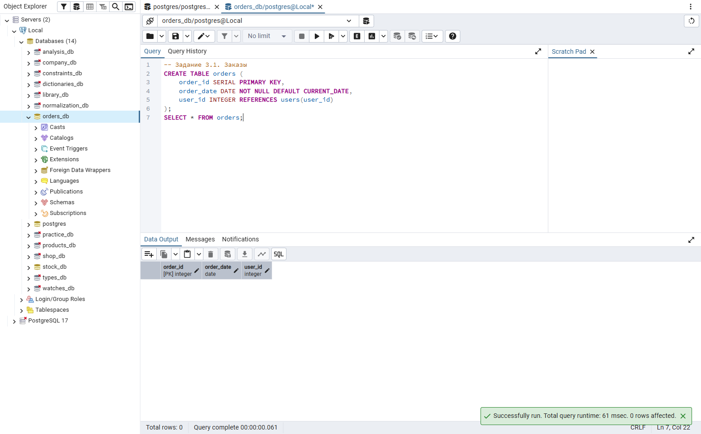

## Задание 3.2. Таблица order_items

```sql
-- Задание 3.2. Состав заказов
CREATE TABLE order_items (
    order_item_id SERIAL PRIMARY KEY,
    order_id INTEGER REFERENCES orders(order_id),
    product_id INTEGER REFERENCES products(product_id),
    size_id INTEGER REFERENCES sizes(size_id),
    quantity INTEGER CHECK (quantity > 0),
    price NUMERIC(10,2) CHECK (price > 0)
);
SELECT * FROM order_items;
```

Результат: выполнено.

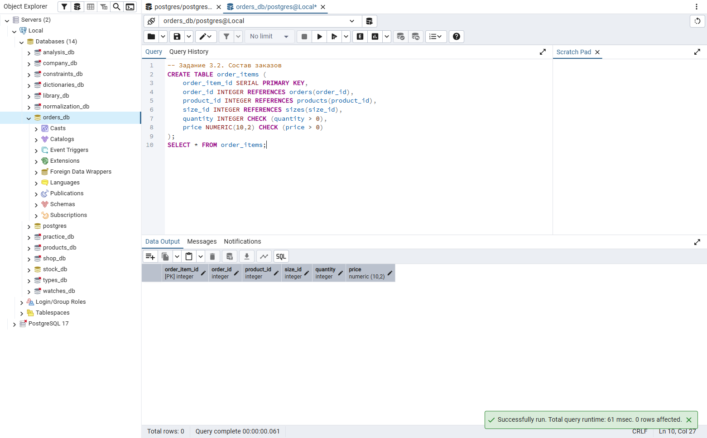

## Задание 3.3. Два заказа

```sql
-- Задание 3.3
INSERT INTO orders (order_date, user_id) VALUES
('2026-04-02', 1), ('2026-04-05', 2);
SELECT * FROM orders ORDER BY order_id;
```

Результат: выполнено.

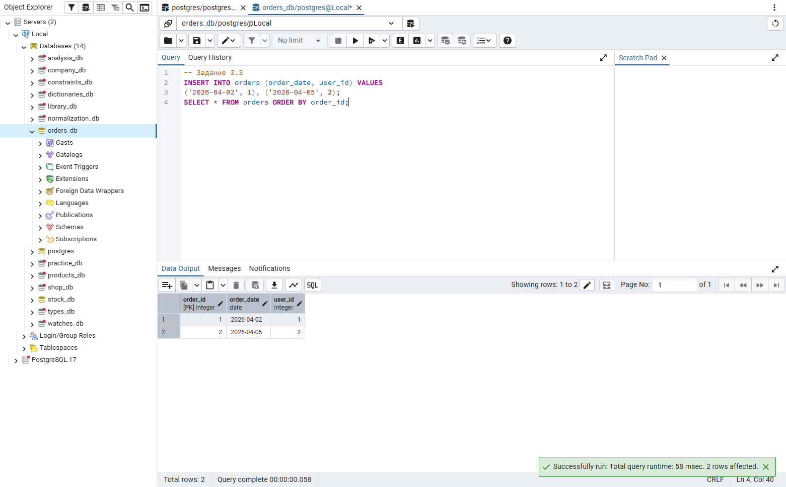

## Задание 3.4. Три позиции заказа

```sql
-- Задание 3.4
INSERT INTO order_items (order_id, product_id, size_id, quantity, price) VALUES
(1, 1, 1, 1, 2190.00),
(1, 2, 2, 1, 2790.00),
(2, 3, 3, 1, 25000.00);
SELECT * FROM order_items ORDER BY order_item_id;
```

Результат: выполнено.

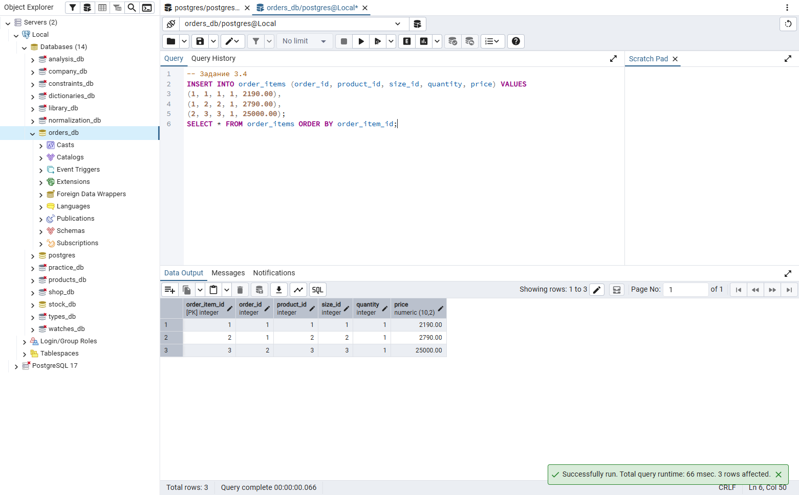

## Задание 4.1. Проверка role_id = 999

```sql
DO $$ BEGIN
    INSERT INTO users (last_name, first_name, login, role_id)
    VALUES ('Проверка', 'Роли', 'bad_role', 999);
EXCEPTION WHEN foreign_key_violation THEN
    RAISE NOTICE 'FK users -> roles: роль 999 не существует';
END $$;
SELECT COUNT(*) AS rows_after_check FROM users;
```

Результат: Пользователь не добавлен: role_id = 999 отсутствует в roles.

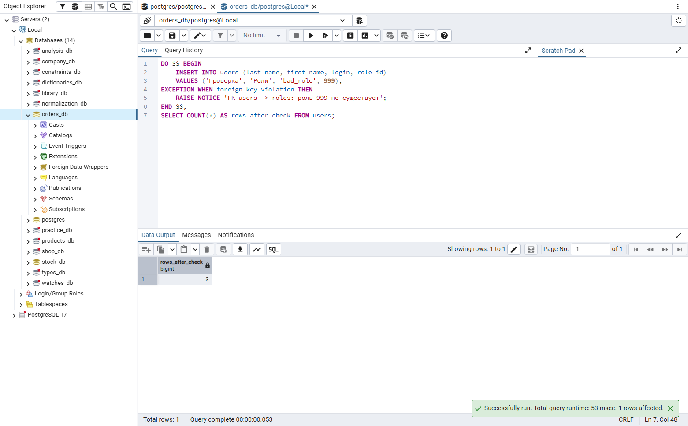

## Задание 4.2. Проверка user_id = 999

```sql
DO $$ BEGIN
    INSERT INTO orders (user_id) VALUES (999);
EXCEPTION WHEN foreign_key_violation THEN
    RAISE NOTICE 'FK orders -> users: пользователь 999 не существует';
END $$;
SELECT COUNT(*) AS rows_after_check FROM orders;
```

Результат: Заказ не добавлен: user_id = 999 отсутствует в users.

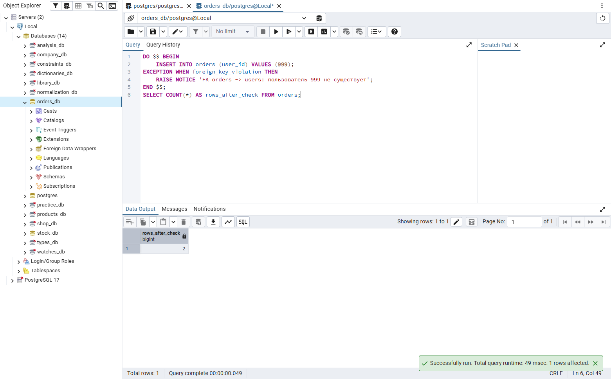

## Задание 4.3. Проверка order_id = 999

```sql
DO $$ BEGIN
    INSERT INTO order_items (order_id, product_id, size_id, quantity, price)
    VALUES (999, 1, 1, 1, 2190.00);
EXCEPTION WHEN foreign_key_violation THEN
    RAISE NOTICE 'FK order_items -> orders: заказ 999 не существует';
END $$;
SELECT COUNT(*) AS rows_after_check FROM order_items;
```

Результат: Позиция не добавлена: order_id = 999 отсутствует в orders.


## Задание 4.4. Проверка quantity = -5

```sql
DO $$ BEGIN
    INSERT INTO order_items (order_id, product_id, size_id, quantity, price)
    VALUES (1, 1, 1, -5, 2190.00);
EXCEPTION WHEN check_violation THEN
    RAISE NOTICE 'CHECK order_items: количество -5 отклонено';
END $$;
SELECT COUNT(*) AS rows_after_check FROM order_items;
```

Результат: Позиция с quantity = -5 не добавлена из-за CHECK (quantity > 0).

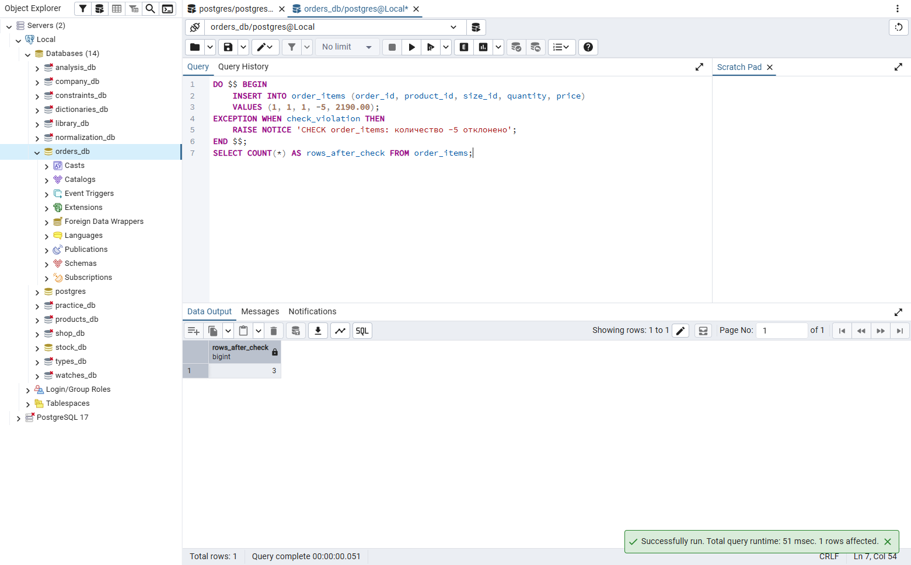

## Задание 5.1. Роли и пользователи «Парфюмерии»

```sql
-- Задание 5.1. Вариант 27 «Парфюмерия»
CREATE SCHEMA perfume15;
CREATE TABLE perfume15.roles (
    role_id SERIAL PRIMARY KEY,
    name VARCHAR(50) NOT NULL UNIQUE
);
CREATE TABLE perfume15.users (
    user_id SERIAL PRIMARY KEY,
    last_name VARCHAR(100) NOT NULL,
    first_name VARCHAR(100) NOT NULL,
    middle_name VARCHAR(100),
    login VARCHAR(100) NOT NULL UNIQUE,
    role_id INTEGER REFERENCES perfume15.roles(role_id)
);
SELECT table_name FROM information_schema.tables WHERE table_schema = 'perfume15' ORDER BY table_name;
```

Результат: выполнено.

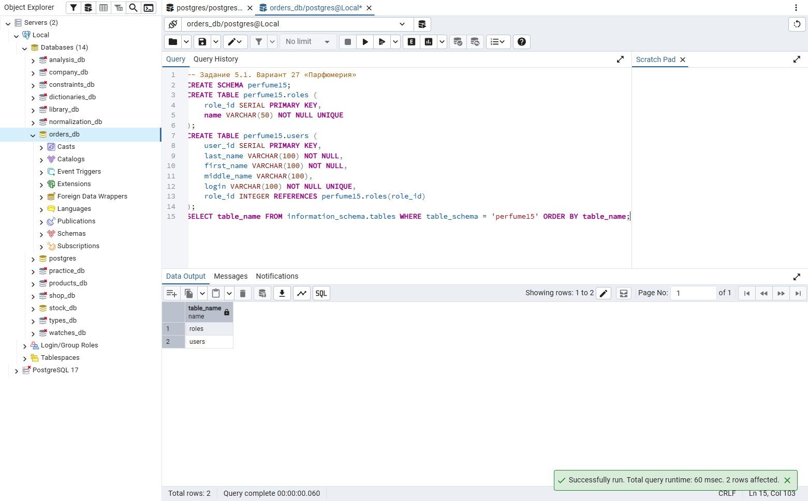

## Задание 5.2. Записи ролей и пользователей

```sql
-- Задание 5.2. Записи из Users_import.xlsx
INSERT INTO perfume15.roles (name) VALUES
('Администратор'), ('Менеджер'), ('Авторизованный пользователь');
INSERT INTO perfume15.users
    (last_name, first_name, middle_name, login, role_id) VALUES
('Иванов', 'Иван', 'Сергеевич', 'admin', 1),
('Петров', 'Пётр', 'Алексеевич', 'manager1', 2),
('Смирнова', 'Ольга', 'Викторовна', 'manager2', 2),
('Сидоров', 'Алексей', 'Иванович', 'client01', 3),
('Кузнецова', 'Анна', 'Ивановна', 'client02', 3);
SELECT login, role_id FROM perfume15.users ORDER BY user_id;
```

Результат: выполнено.

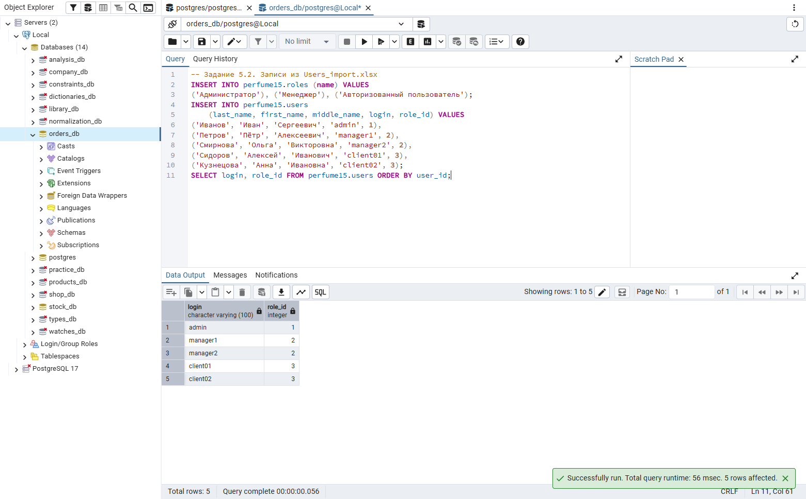

## Задание 5.3. Заказы и состав заказов

```sql
-- Задание 5.3. Справочники для ссылок, затем заказы и их строки
CREATE TABLE perfume15.products (
    product_id SERIAL PRIMARY KEY,
    name VARCHAR(200) NOT NULL,
    manufacturer VARCHAR(100) NOT NULL
);
CREATE TABLE perfume15.variants (
    variant_id SERIAL PRIMARY KEY,
    volume_ml INTEGER NOT NULL UNIQUE CHECK (volume_ml > 0)
);
INSERT INTO perfume15.products (name, manufacturer) VALUES
('Жасминовый сад', 'АромаЛайн'),
('Роза утром', 'Нота'),
('Пион', 'ПарфюмДом');
INSERT INTO perfume15.variants (volume_ml) VALUES (30), (50), (100);
CREATE TABLE perfume15.orders (
    order_id SERIAL PRIMARY KEY,
    order_date DATE NOT NULL DEFAULT CURRENT_DATE,
    user_id INTEGER REFERENCES perfume15.users(user_id)
);
CREATE TABLE perfume15.order_items (
    order_item_id SERIAL PRIMARY KEY,
    order_id INTEGER REFERENCES perfume15.orders(order_id),
    product_id INTEGER REFERENCES perfume15.products(product_id),
    variant_id INTEGER REFERENCES perfume15.variants(variant_id),
    quantity INTEGER CHECK (quantity > 0),
    price NUMERIC(10,2) CHECK (price > 0)
);
SELECT table_name FROM information_schema.tables WHERE table_schema = 'perfume15' ORDER BY table_name;
```

Результат: выполнено.

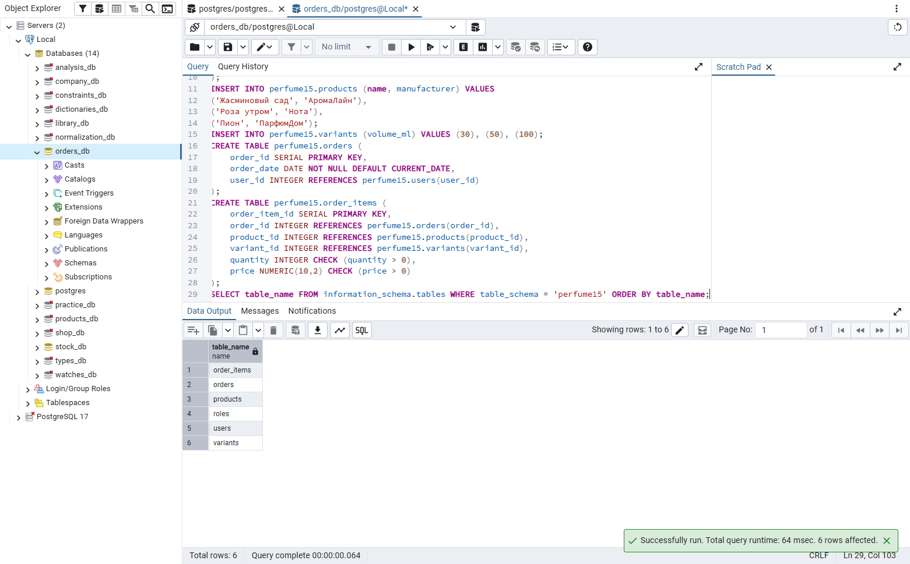

## Задание 5.4. Записи заказов и позиций

```sql
-- Задание 5.4. Первые два заказа из Orders_import.xlsx
INSERT INTO perfume15.orders (order_date, user_id) VALUES
('2026-04-04', 4), ('2026-04-06', 5);
INSERT INTO perfume15.order_items
    (order_id, product_id, variant_id, quantity, price) VALUES
(1, 1, 1, 2, 2490.00),
(1, 2, 2, 1, 3550.00),
(2, 3, 1, 1, 3190.00);
SELECT o.order_id, o.order_date, u.last_name, i.quantity, i.price FROM perfume15.orders o JOIN perfume15.users u ON u.user_id=o.user_id JOIN perfume15.order_items i ON i.order_id=o.order_id ORDER BY o.order_id, i.order_item_id;
```

Результат: выполнено.

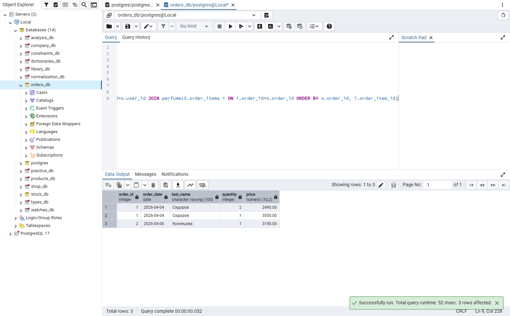

## Задание 6.1. Базовый уровень

```sql
-- Задание 6.1. Базовый уровень
CREATE SCHEMA level1_15;
CREATE TABLE level1_15.roles (
    role_id SERIAL PRIMARY KEY,
    name VARCHAR(50) NOT NULL UNIQUE
);
SELECT table_name FROM information_schema.tables WHERE table_schema = 'level1_15';
```

Результат: выполнено.

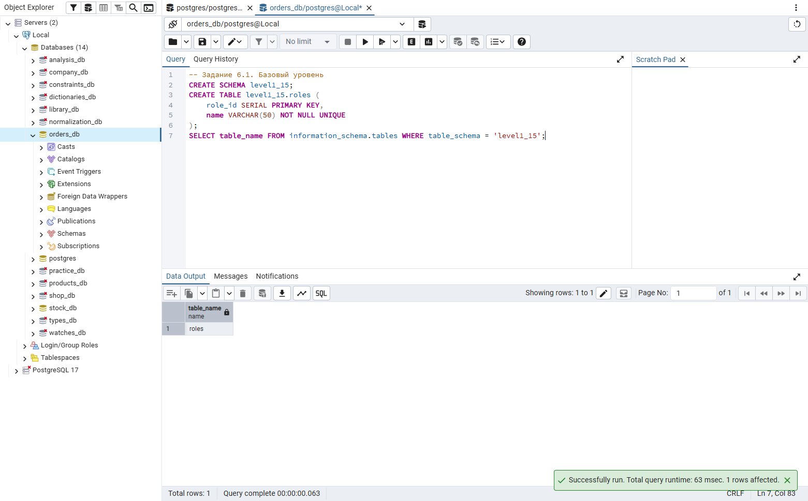

## Задание 6.2. Средний уровень

```sql
-- Задание 6.2. Средний уровень
CREATE SCHEMA level2_15;
CREATE TABLE level2_15.roles (
    role_id SERIAL PRIMARY KEY,
    name VARCHAR(50) NOT NULL UNIQUE
);
CREATE TABLE level2_15.users (
    user_id SERIAL PRIMARY KEY,
    last_name VARCHAR(100) NOT NULL,
    first_name VARCHAR(100) NOT NULL,
    login VARCHAR(100) NOT NULL UNIQUE,
    role_id INTEGER REFERENCES level2_15.roles(role_id)
);
SELECT table_name FROM information_schema.tables WHERE table_schema = 'level2_15' ORDER BY table_name;
```

Результат: выполнено.

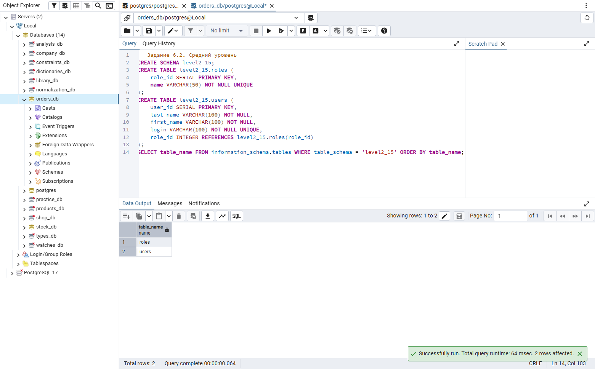

## Задание 6.3. Повышенный уровень

```sql
-- Задание 6.3. Повышенный уровень
CREATE SCHEMA level3_15;
CREATE TABLE level3_15.roles (
    role_id SERIAL PRIMARY KEY,
    name VARCHAR(50) NOT NULL UNIQUE
);
CREATE TABLE level3_15.users (
    user_id SERIAL PRIMARY KEY,
    last_name VARCHAR(100) NOT NULL,
    first_name VARCHAR(100) NOT NULL,
    login VARCHAR(100) NOT NULL UNIQUE,
    role_id INTEGER REFERENCES level3_15.roles(role_id)
);
CREATE TABLE level3_15.orders (
    order_id SERIAL PRIMARY KEY,
    order_date DATE NOT NULL DEFAULT CURRENT_DATE,
    user_id INTEGER REFERENCES level3_15.users(user_id)
);
CREATE TABLE level3_15.order_items (
    order_item_id SERIAL PRIMARY KEY,
    order_id INTEGER REFERENCES level3_15.orders(order_id),
    product_id INTEGER REFERENCES public.products(product_id),
    quantity INTEGER CHECK (quantity > 0),
    price NUMERIC(10,2) CHECK (price > 0)
);
SELECT table_name FROM information_schema.tables WHERE table_schema = 'level3_15' ORDER BY table_name;
```

Результат: выполнено.

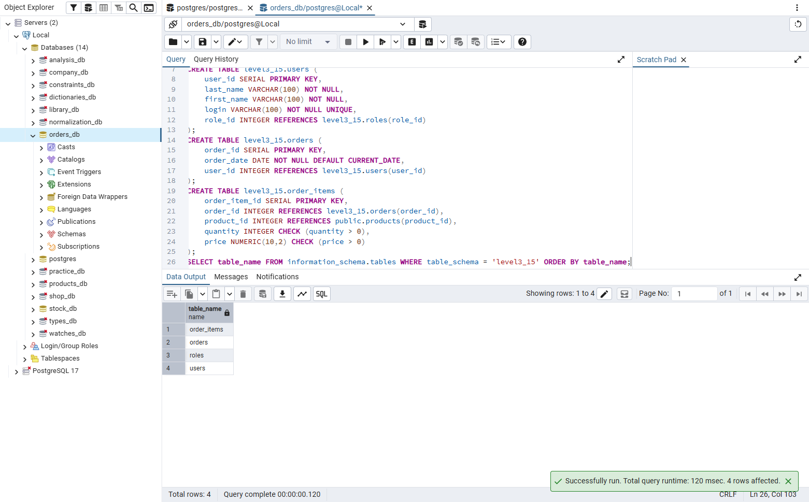

## Задание 7.1. Творческий уровень «Книжный клуб»

```sql
-- Задание 7.1. Своя предметная область «Книжный клуб»
CREATE SCHEMA creative15;
CREATE TABLE creative15.books (
    book_id SERIAL PRIMARY KEY,
    title VARCHAR(200) NOT NULL
);
CREATE TABLE creative15.roles (
    role_id SERIAL PRIMARY KEY,
    name VARCHAR(50) NOT NULL UNIQUE
);
CREATE TABLE creative15.users (
    user_id SERIAL PRIMARY KEY,
    last_name VARCHAR(100) NOT NULL,
    first_name VARCHAR(100) NOT NULL,
    login VARCHAR(100) NOT NULL UNIQUE,
    role_id INTEGER REFERENCES creative15.roles(role_id)
);
CREATE TABLE creative15.orders (
    order_id SERIAL PRIMARY KEY,
    order_date DATE NOT NULL DEFAULT CURRENT_DATE,
    user_id INTEGER REFERENCES creative15.users(user_id)
);
CREATE TABLE creative15.order_items (
    order_item_id SERIAL PRIMARY KEY,
    order_id INTEGER REFERENCES creative15.orders(order_id),
    book_id INTEGER REFERENCES creative15.books(book_id),
    quantity INTEGER CHECK (quantity > 0),
    price NUMERIC(10,2) CHECK (price > 0)
);


SELECT table_name FROM information_schema.tables WHERE table_schema = 'creative15' ORDER BY table_name;
```

Результат: выполнено.

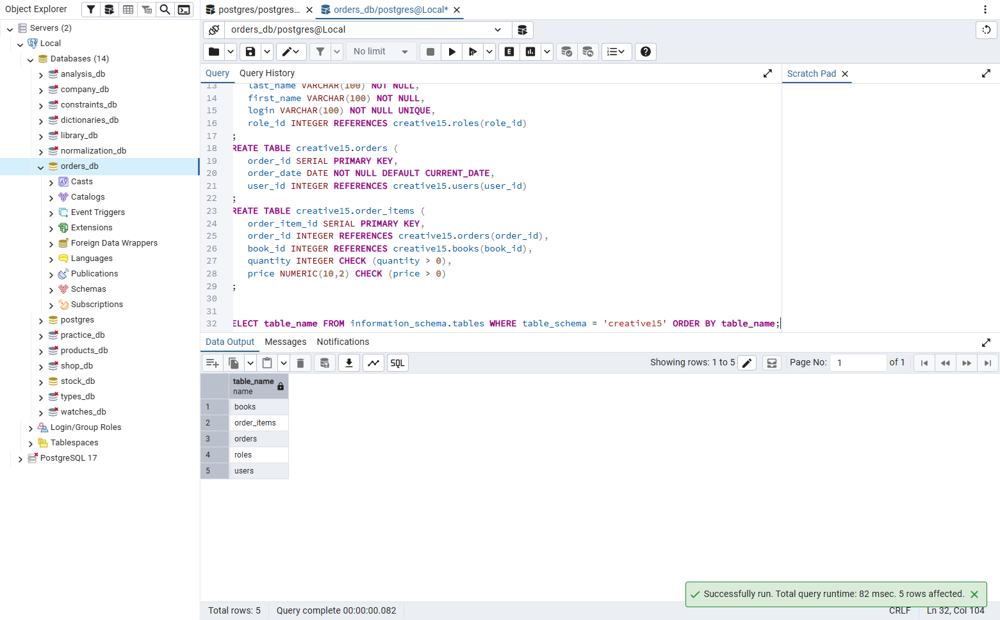

## Проверка понимания

1. Роли задают права доступа к действиям системы.
2. Пользователи входят в систему и оформляют заказы.
3. Заказ хранит дату и ссылку на клиента.
4. Состав заказа хранит товары, количество и цену на момент оформления.
5. FOREIGN KEY — внешний ключ, ссылающийся на ключ другой таблицы.
6. Он не позволяет создать запись со ссылкой на несуществующую строку.
7. PostgreSQL отклонит пользователя из-за нарушения внешнего ключа.
8. PostgreSQL отклонит заказ из-за нарушения внешнего ключа.
9. REFERENCES указывает таблицу и поле, на которые ссылается внешний ключ.
10. Сначала создать родительские таблицы, затем дочерние с REFERENCES.

## Контрольные вопросы

1. Список ролей и их идентификаторы.
2. Фамилию, имя, логин и ссылку на роль пользователя.
3. Номер, дату и ссылку на клиента.
4. Позиции заказа: товар, вариант, количество и сохранённую цену.
5. FOREIGN KEY — внешний ключ, ссылающийся на ключ другой таблицы.
6. Он не позволяет создать запись со ссылкой на несуществующую строку.
7. Запись не добавится: роли с таким ID нет.
8. Заказ не добавится: пользователя с таким ID нет.
9. REFERENCES указывает таблицу и поле, на которые ссылается внешний ключ.
10. SERIAL выдаёт очередной целочисленный идентификатор.
11. NOT NULL запрещает пустое значение.
12. UNIQUE не допускает повторов.
13. PRIMARY KEY однозначно определяет строку таблицы.
14. CHECK проверяет указанное условие, например quantity > 0.
15. users.role_id → roles.role_id; orders.user_id → users.user_id; order_items.order_id → orders.order_id.

## Итоги

Узнал, как связаны роли, пользователи, заказы и позиции заказов.
Создал таблицы для учебного примера и «Парфюмерии», вставил данные, проверил FOREIGN KEY и CHECK.
Легко было создать роли и пользователей. Сложнее — подобрать правильный порядок создания связанных таблиц.
Повторить внешние ключи и порядок вставки данных. Выполнен повышенный уровень.
