# Рабочая тетрадь. Пара 16

Ермилов Даниил Евгеньевич, 3ИП-1-24. Вариант 27 — «Парфюмерия».

SQL: [13_import_1.sql](../src/db/13_import_1.sql).

Учебный пример из тетради: 11 категорий и подкатегорий, 35 размеров, 3 приведённых товара. Для варианта 27 загружены все 4 категории, 3 объёма и 31 товар из исходных Excel-файлов.

## Задание 1. Подготовка

`Products_import.xlsx` открыт. В файле 31 товар и 8 колонок: Категория, Подкатегория, Изображение, Наименование товара, Производство, Описание, Состав, Цена.

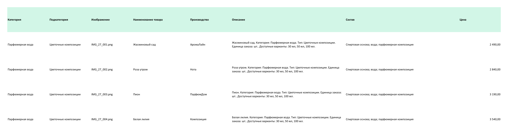

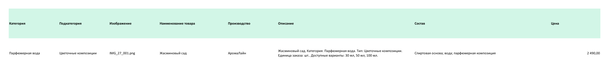

## Задание 2.1. Подготовка categories

```sql
-- Задание 2.1
CREATE TABLE categories (
    category_id SERIAL PRIMARY KEY,
    name VARCHAR(100) NOT NULL,
    subcategory VARCHAR(100) NOT NULL,
    UNIQUE (name, subcategory)
);
```

Результат: выполнено.

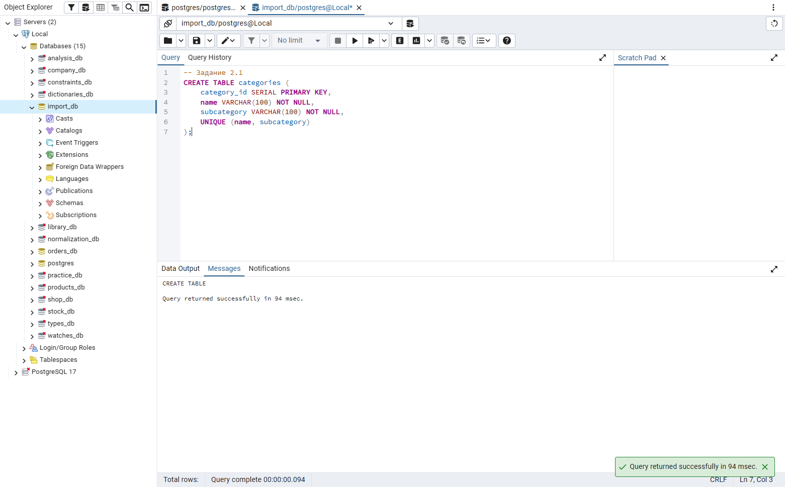

## Задание 2.2. Импорт categories

```sql
-- Задание 2.2
INSERT INTO categories (name, subcategory) VALUES
('Детская обувь', 'Кроссовки'),
('Детская обувь', 'Сапоги'),
('Детская обувь', 'Босоножки'),
('Детская обувь', 'Туфли'),
('Женская обувь', 'Сапоги'),
('Женская обувь', 'Босоножки'),
('Женская обувь', 'Туфли'),
('Женская обувь', 'Кроссовки'),
('Мужская обувь', 'Кроссовки'),
('Мужская обувь', 'Туфли'),
('Мужская обувь', 'Ботинки');
```

Результат: выполнено.

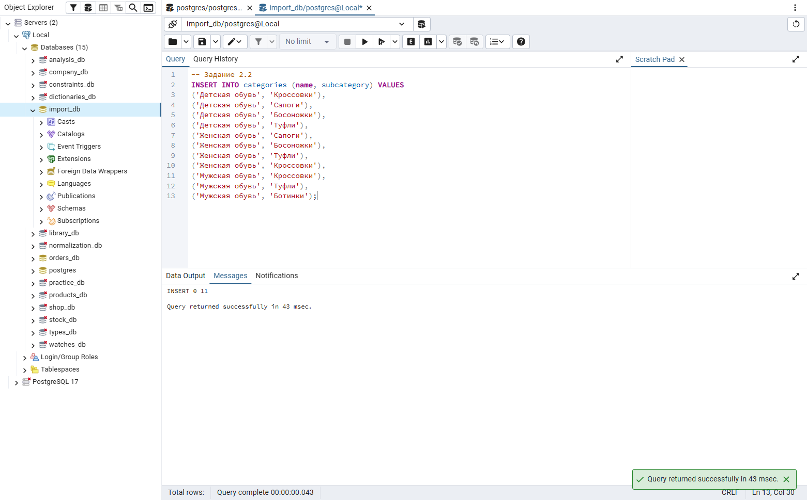

## Задание 2.3. Проверка categories

```sql
-- Задание 2.3
SELECT COUNT(*) AS categories_count FROM categories;
```

Результат: выполнено.

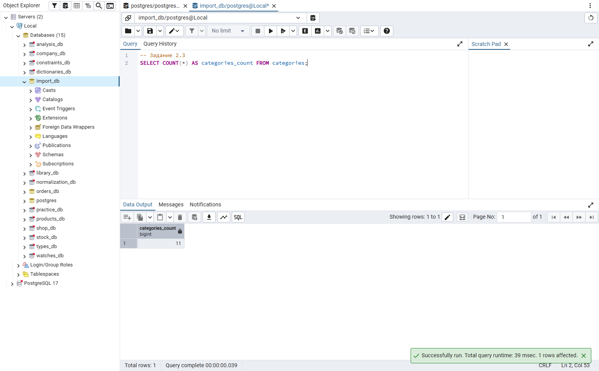

## Задание 3.1. Подготовка sizes

```sql
-- Задание 3.1
CREATE TABLE sizes (
    size_id SERIAL PRIMARY KEY,
    value NUMERIC(4,1) NOT NULL UNIQUE CHECK (value > 0)
);
```

Результат: выполнено.

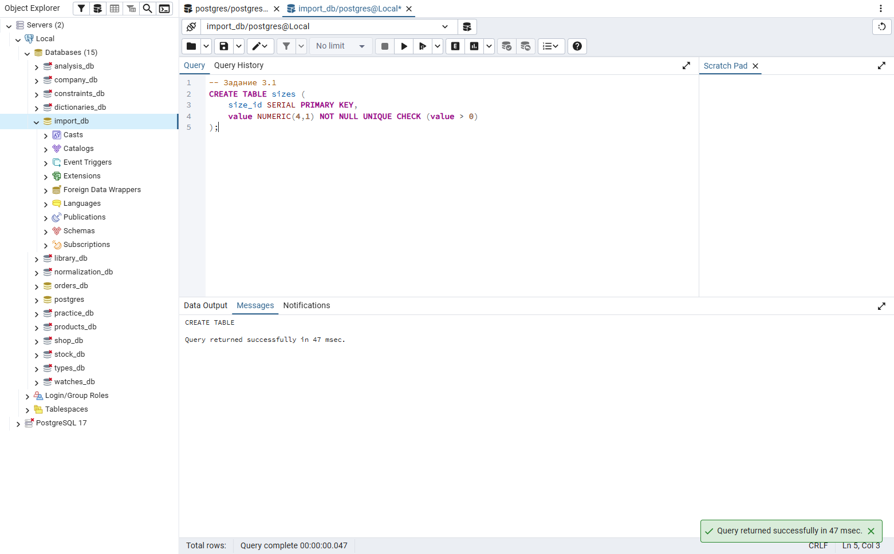

## Задание 3.2. Импорт sizes

```sql
-- Задание 3.2
INSERT INTO sizes (value) VALUES
(18),
(19),
(20),
(21),
(22),
(23),
(24),
(25),
(26),
(27),
(28),
(29),
(30),
(31),
(32),
(33),
(34),
(35),
(36),
(36.5),
(37),
(37.5),
(38),
(38.5),
(39),
(39.5),
(40),
(40.5),
(41),
(41.5),
(42),
(42.5),
(43),
(44),
(45);
```

Результат: выполнено.

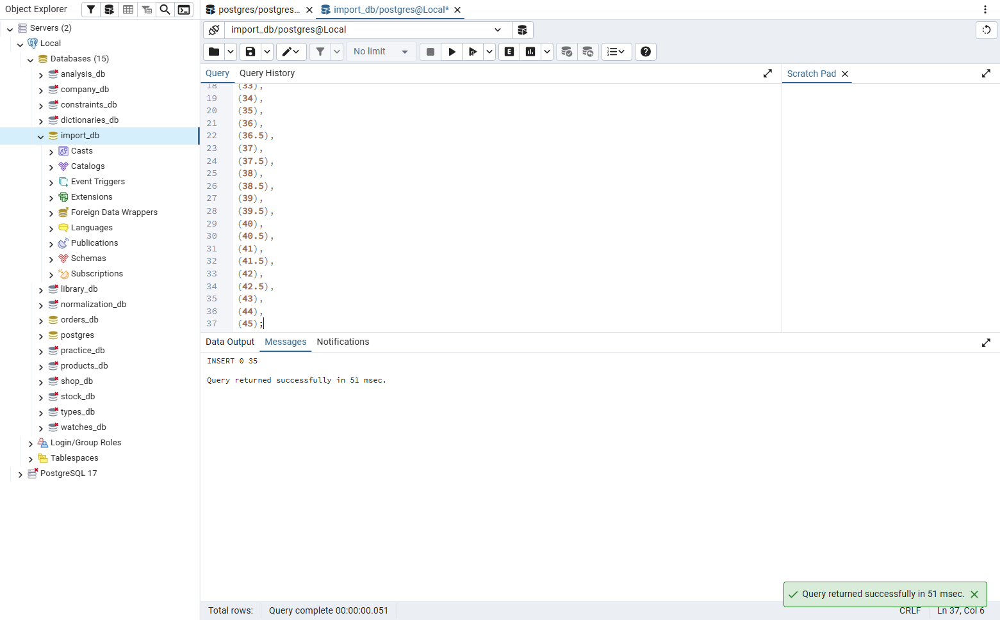

## Задание 3.3. Проверка sizes

```sql
-- Задание 3.3
SELECT COUNT(*) AS sizes_count FROM sizes;
```

Результат: выполнено.

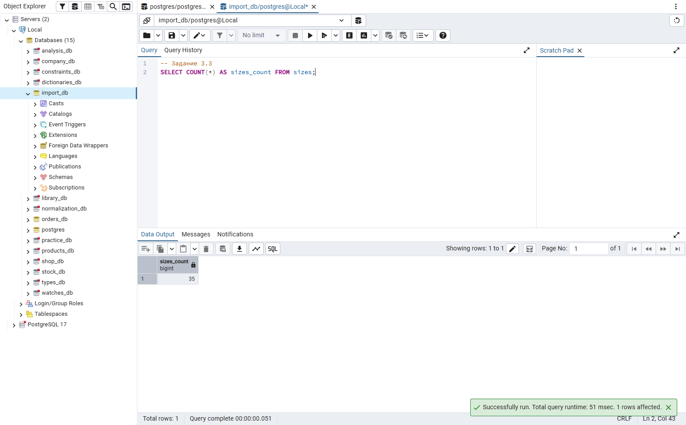

## Задание 4.1. Подготовка products

```sql
-- Задание 4.1
CREATE TABLE products (
    product_id SERIAL PRIMARY KEY,
    category_id INTEGER NOT NULL REFERENCES categories(category_id),
    image_path VARCHAR(255),
    name VARCHAR(200) NOT NULL,
    manufacturer VARCHAR(100),
    description TEXT,
    composition TEXT,
    price NUMERIC(10,2) NOT NULL CHECK (price > 0)
);
```

Результат: выполнено.

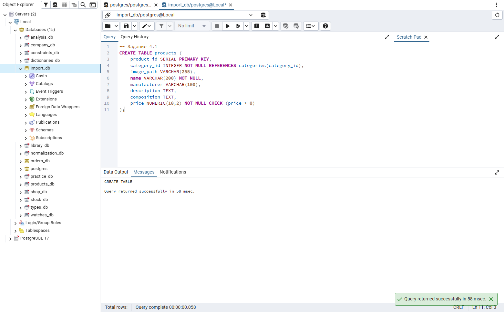

## Задание 4.2. Импорт products

```sql
-- Задание 4.2
INSERT INTO products (category_id, image_path, name, manufacturer, description, composition, price) VALUES
(1, 'IMG_KS_195217.png', 'Кроссовки детские «Звёздочка» экокожа', 'Малыш-Спорт', NULL, NULL, 2190),
(1, 'IMG_KS_195213.png', 'Кроссовки детские «Гонщик» экокожа', 'Топ-Топ', NULL, NULL, 2490),
(1, 'IMG_KS_195222.png', 'Кроссовки детские «Радуга» экокожа', 'Лапушка', NULL, NULL, 1990);
```

Результат: выполнено.

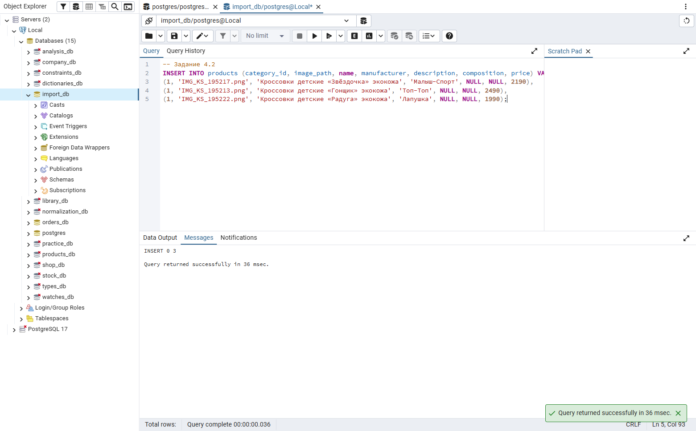

## Задание 4.3. Проверка products

```sql
-- Задание 4.3
SELECT COUNT(*) AS products_count FROM products;
```

Результат: выполнено.


## Задание 5.1. Справочники «Парфюмерии»

```sql
-- Задание 5.1
CREATE SCHEMA perfume16;
CREATE TABLE perfume16.categories (
    category_id SERIAL PRIMARY KEY,
    name VARCHAR(100) NOT NULL UNIQUE
);
CREATE TABLE perfume16.variants (
    variant_id SERIAL PRIMARY KEY,
    volume_ml INTEGER NOT NULL UNIQUE CHECK (volume_ml > 0)
);
INSERT INTO perfume16.categories (name) VALUES
('Парфюмерная вода'),
('Туалетная вода'),
('Одеколоны'),
('Парфюмерные спреи');
INSERT INTO perfume16.variants (volume_ml) VALUES
(30),
(50),
(100);
SELECT 'categories' AS table_name, COUNT(*) FROM perfume16.categories
UNION ALL SELECT 'variants', COUNT(*) FROM perfume16.variants;
```

Результат: выполнено.

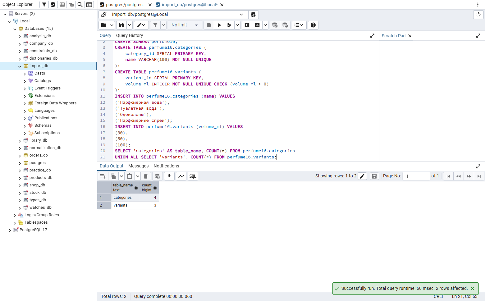

## Задание 5.2. Товары «Парфюмерии»

```sql
-- Задание 5.2
CREATE TABLE perfume16.products (
    product_id SERIAL PRIMARY KEY,
    category_id INTEGER NOT NULL REFERENCES perfume16.categories(category_id),
    subcategory VARCHAR(100),
    image_path VARCHAR(255),
    name VARCHAR(200) NOT NULL,
    manufacturer VARCHAR(100) NOT NULL,
    description TEXT,
    composition TEXT,
    price NUMERIC(10,2) NOT NULL CHECK (price > 0),
    UNIQUE (name, manufacturer)
);
INSERT INTO perfume16.products
    (category_id, subcategory, image_path, name, manufacturer, description, composition, price) VALUES
(1, 'Цветочные композиции', 'IMG_27_001.png', 'Жасминовый сад', 'АромаЛайн', 'Жасминовый сад. Категория: Парфюмерная вода. Тип: Цветочные композиции. Единица заказа: шт.. Доступные варианты: 30 мл, 50 мл, 100 мл.', 'Спиртовая основа; вода; парфюмерная композиция', 2490),
(1, 'Цветочные композиции', 'IMG_27_002.png', 'Роза утром', 'Нота', 'Роза утром. Категория: Парфюмерная вода. Тип: Цветочные композиции. Единица заказа: шт.. Доступные варианты: 30 мл, 50 мл, 100 мл.', 'Спиртовая основа; вода; парфюмерная композиция', 2840),
(1, 'Цветочные композиции', 'IMG_27_003.png', 'Пион', 'ПарфюмДом', 'Пион. Категория: Парфюмерная вода. Тип: Цветочные композиции. Единица заказа: шт.. Доступные варианты: 30 мл, 50 мл, 100 мл.', 'Спиртовая основа; вода; парфюмерная композиция', 3190),
(1, 'Цветочные композиции', 'IMG_27_004.png', 'Белая лилия', 'Композиция', 'Белая лилия. Категория: Парфюмерная вода. Тип: Цветочные композиции. Единица заказа: шт.. Доступные варианты: 30 мл, 50 мл, 100 мл.', 'Спиртовая основа; вода; парфюмерная композиция', 3540),
(1, 'Цветочные композиции', 'IMG_27_005.png', 'Фиалка', 'АромаЛайн', 'Фиалка. Категория: Парфюмерная вода. Тип: Цветочные композиции. Единица заказа: шт.. Доступные варианты: 30 мл, 50 мл, 100 мл.', 'Спиртовая основа; вода; парфюмерная композиция', 3890),
(1, 'Цветочные композиции', 'IMG_27_006.png', 'Сирень', 'Нота', 'Сирень. Категория: Парфюмерная вода. Тип: Цветочные композиции. Единица заказа: шт.. Доступные варианты: 30 мл, 50 мл, 100 мл.', 'Спиртовая основа; вода; парфюмерная композиция', 4240),
(1, 'Цветочные композиции', 'IMG_27_007.png', 'Цветочный вечер', 'ПарфюмДом', 'Цветочный вечер. Категория: Парфюмерная вода. Тип: Цветочные композиции. Единица заказа: шт.. Доступные варианты: 30 мл, 50 мл, 100 мл.', 'Спиртовая основа; вода; парфюмерная композиция', 4590),
(1, 'Цветочные композиции', 'IMG_27_008.png', 'Лепесток', 'Композиция', 'Лепесток. Категория: Парфюмерная вода. Тип: Цветочные композиции. Единица заказа: шт.. Доступные варианты: 30 мл, 50 мл, 100 мл.', 'Спиртовая основа; вода; парфюмерная композиция', 4940),
(2, 'Свежие композиции', 'IMG_27_009.png', 'Морской бриз', 'АромаЛайн', 'Морской бриз. Категория: Туалетная вода. Тип: Свежие композиции. Единица заказа: шт.. Доступные варианты: 30 мл, 50 мл, 100 мл.', 'Спиртовая основа; вода; парфюмерная композиция', 1490),
(2, 'Свежие композиции', 'IMG_27_010.png', 'Зелёный лист', 'Нота', 'Зелёный лист. Категория: Туалетная вода. Тип: Свежие композиции. Единица заказа: шт.. Доступные варианты: 30 мл, 50 мл, 100 мл.', 'Спиртовая основа; вода; парфюмерная композиция', 1740),
(2, 'Свежие композиции', 'IMG_27_011.png', 'Утренний воздух', 'ПарфюмДом', 'Утренний воздух. Категория: Туалетная вода. Тип: Свежие композиции. Единица заказа: шт.. Доступные варианты: 30 мл, 50 мл, 100 мл.', 'Спиртовая основа; вода; парфюмерная композиция', 1990),
(2, 'Свежие композиции', 'IMG_27_012.png', 'Цитрус', 'Композиция', 'Цитрус. Категория: Туалетная вода. Тип: Свежие композиции. Единица заказа: шт.. Доступные варианты: 30 мл, 50 мл, 100 мл.', 'Спиртовая основа; вода; парфюмерная композиция', 2240),
(2, 'Свежие композиции', 'IMG_27_013.png', 'Лимонный свет', 'АромаЛайн', 'Лимонный свет. Категория: Туалетная вода. Тип: Свежие композиции. Единица заказа: шт.. Доступные варианты: 30 мл, 50 мл, 100 мл.', 'Спиртовая основа; вода; парфюмерная композиция', 2490),
(2, 'Свежие композиции', 'IMG_27_014.png', 'Чистая линия', 'Нота', 'Чистая линия. Категория: Туалетная вода. Тип: Свежие композиции. Единица заказа: шт.. Доступные варианты: 30 мл, 50 мл, 100 мл.', 'Спиртовая основа; вода; парфюмерная композиция', 2740),
(2, 'Свежие композиции', 'IMG_27_015.png', 'Ветер', 'ПарфюмДом', 'Ветер. Категория: Туалетная вода. Тип: Свежие композиции. Единица заказа: шт.. Доступные варианты: 30 мл, 50 мл, 100 мл.', 'Спиртовая основа; вода; парфюмерная композиция', 2990),
(2, 'Свежие композиции', 'IMG_27_016.png', 'Прохлада', 'Композиция', 'Прохлада. Категория: Туалетная вода. Тип: Свежие композиции. Единица заказа: шт.. Доступные варианты: 30 мл, 50 мл, 100 мл.', 'Спиртовая основа; вода; парфюмерная композиция', 3240),
(3, 'Цитрусовые композиции', 'IMG_27_017.png', 'Бергамот', 'АромаЛайн', 'Бергамот. Категория: Одеколоны. Тип: Цитрусовые композиции. Единица заказа: шт.. Доступные варианты: 30 мл, 50 мл, 100 мл.', 'Спиртовая основа; вода; парфюмерная композиция', 990),
(3, 'Цитрусовые композиции', 'IMG_27_018.png', 'Лайм', 'Нота', 'Лайм. Категория: Одеколоны. Тип: Цитрусовые композиции. Единица заказа: шт.. Доступные варианты: 30 мл, 50 мл, 100 мл.', 'Спиртовая основа; вода; парфюмерная композиция', 1170),
(3, 'Цитрусовые композиции', 'IMG_27_019.png', 'Апельсин', 'ПарфюмДом', 'Апельсин. Категория: Одеколоны. Тип: Цитрусовые композиции. Единица заказа: шт.. Доступные варианты: 30 мл, 50 мл, 100 мл.', 'Спиртовая основа; вода; парфюмерная композиция', 1350),
(3, 'Цитрусовые композиции', 'IMG_27_020.png', 'Грейпфрут', 'Композиция', 'Грейпфрут. Категория: Одеколоны. Тип: Цитрусовые композиции. Единица заказа: шт.. Доступные варианты: 30 мл, 50 мл, 100 мл.', 'Спиртовая основа; вода; парфюмерная композиция', 1530),
(3, 'Цитрусовые композиции', 'IMG_27_021.png', 'Лимон', 'АромаЛайн', 'Лимон. Категория: Одеколоны. Тип: Цитрусовые композиции. Единица заказа: шт.. Доступные варианты: 30 мл, 50 мл, 100 мл.', 'Спиртовая основа; вода; парфюмерная композиция', 1710),
(3, 'Цитрусовые композиции', 'IMG_27_022.png', 'Мандарин', 'Нота', 'Мандарин. Категория: Одеколоны. Тип: Цитрусовые композиции. Единица заказа: шт.. Доступные варианты: 30 мл, 50 мл, 100 мл.', 'Спиртовая основа; вода; парфюмерная композиция', 1890),
(3, 'Цитрусовые композиции', 'IMG_27_023.png', 'Нероли', 'ПарфюмДом', 'Нероли. Категория: Одеколоны. Тип: Цитрусовые композиции. Единица заказа: шт.. Доступные варианты: 30 мл, 50 мл, 100 мл.', 'Спиртовая основа; вода; парфюмерная композиция', 2070),
(3, 'Цитрусовые композиции', 'IMG_27_024.png', 'Свежий цитрус', 'Композиция', 'Свежий цитрус. Категория: Одеколоны. Тип: Цитрусовые композиции. Единица заказа: шт.. Доступные варианты: 30 мл, 50 мл, 100 мл.', 'Спиртовая основа; вода; парфюмерная композиция', 2250),
(4, 'Для тела', 'IMG_27_025.png', 'Лёгкий цветок', 'АромаЛайн', 'Лёгкий цветок. Категория: Парфюмерные спреи. Тип: Для тела. Единица заказа: шт.. Доступные варианты: 30 мл, 50 мл, 100 мл.', 'Водная и спиртовая основа; ароматическая композиция', 690),
(4, 'Для тела', 'IMG_27_026.png', 'Тёплая ваниль', 'Нота', 'Тёплая ваниль. Категория: Парфюмерные спреи. Тип: Для тела. Единица заказа: шт.. Доступные варианты: 30 мл, 50 мл, 100 мл.', 'Водная и спиртовая основа; ароматическая композиция', 840),
(4, 'Для тела', 'IMG_27_027.png', 'Ягодная нота', 'ПарфюмДом', 'Ягодная нота. Категория: Парфюмерные спреи. Тип: Для тела. Единица заказа: шт.. Доступные варианты: 30 мл, 50 мл, 100 мл.', 'Водная и спиртовая основа; ароматическая композиция', 990),
(4, 'Для тела', 'IMG_27_028.png', 'Свежий лист', 'Композиция', 'Свежий лист. Категория: Парфюмерные спреи. Тип: Для тела. Единица заказа: шт.. Доступные варианты: 30 мл, 50 мл, 100 мл.', 'Водная и спиртовая основа; ароматическая композиция', 1140),
(4, 'Для тела', 'IMG_27_029.png', 'Мягкий цитрус', 'АромаЛайн', 'Мягкий цитрус. Категория: Парфюмерные спреи. Тип: Для тела. Единица заказа: шт.. Доступные варианты: 30 мл, 50 мл, 100 мл.', 'Водная и спиртовая основа; ароматическая композиция', 1290),
(4, 'Для тела', 'IMG_27_030.png', 'Солнечный день', 'Нота', 'Солнечный день. Категория: Парфюмерные спреи. Тип: Для тела. Единица заказа: шт.. Доступные варианты: 30 мл, 50 мл, 100 мл.', 'Водная и спиртовая основа; ароматическая композиция', 1440),
(4, 'Для тела', NULL, 'Тихий вечер', 'ПарфюмДом', 'Тихий вечер. Категория: Парфюмерные спреи. Тип: Для тела. Единица заказа: шт.. Доступные варианты: 30 мл, 50 мл, 100 мл.', 'Водная и спиртовая основа; ароматическая композиция', 1590);
SELECT COUNT(*) AS perfume_products_count FROM perfume16.products;
```

Результат: выполнено.

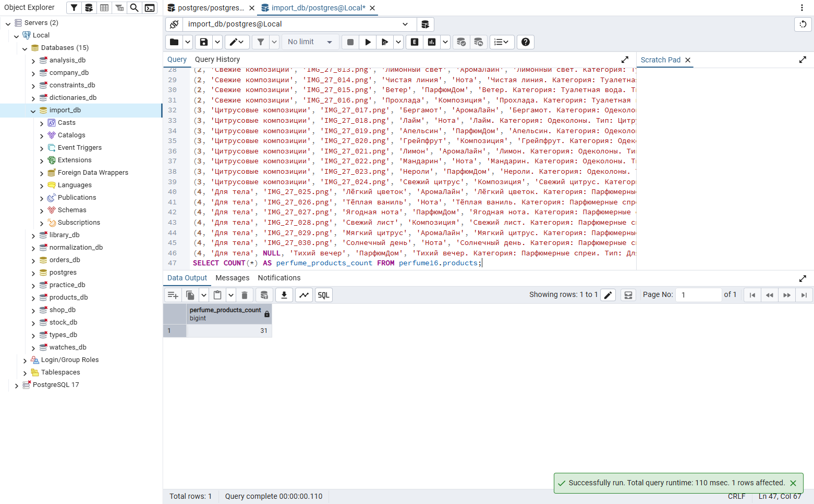

## Задание 6.1. Базовый уровень

```sql
-- Задание 6.1
CREATE SCHEMA level1_16;
CREATE TABLE level1_16.categories (
    category_id SERIAL PRIMARY KEY,
    name VARCHAR(100) NOT NULL,
    subcategory VARCHAR(100) NOT NULL,
    UNIQUE (name, subcategory)
);
INSERT INTO level1_16.categories (name, subcategory) VALUES
('Детская обувь', 'Кроссовки'),
('Детская обувь', 'Сапоги'),
('Детская обувь', 'Босоножки'),
('Детская обувь', 'Туфли'),
('Женская обувь', 'Сапоги');
SELECT COUNT(*) AS categories_count FROM level1_16.categories;
```

Результат: выполнено.

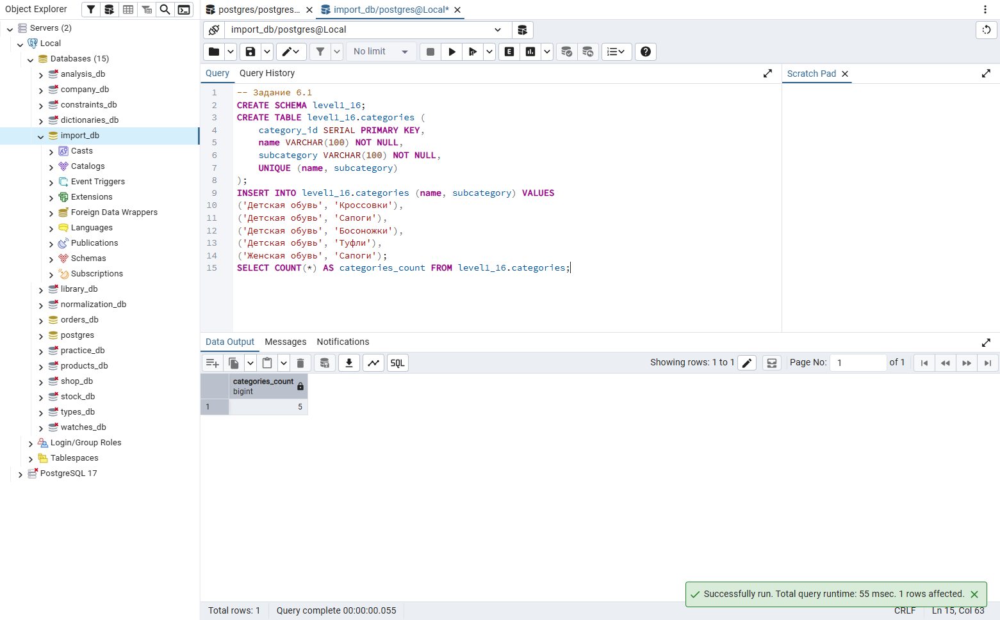

## Задание 6.2. Средний уровень

```sql
-- Задание 6.2
CREATE SCHEMA level2_16;
CREATE TABLE level2_16.categories (
    category_id SERIAL PRIMARY KEY,
    name VARCHAR(100) NOT NULL,
    subcategory VARCHAR(100) NOT NULL,
    UNIQUE (name, subcategory)
);
CREATE TABLE level2_16.sizes (
    size_id SERIAL PRIMARY KEY,
    value NUMERIC(4,1) NOT NULL UNIQUE CHECK (value > 0)
);
INSERT INTO level2_16.categories (name, subcategory) VALUES
('Детская обувь', 'Кроссовки'),
('Детская обувь', 'Сапоги'),
('Детская обувь', 'Босоножки'),
('Детская обувь', 'Туфли'),
('Женская обувь', 'Сапоги'),
('Женская обувь', 'Босоножки'),
('Женская обувь', 'Туфли'),
('Женская обувь', 'Кроссовки'),
('Мужская обувь', 'Кроссовки'),
('Мужская обувь', 'Туфли');
INSERT INTO level2_16.sizes (value) VALUES
(18),
(19),
(20),
(21),
(22),
(23),
(24),
(25),
(26),
(27);
SELECT 'categories' AS table_name, COUNT(*) FROM level2_16.categories
UNION ALL SELECT 'sizes', COUNT(*) FROM level2_16.sizes;
```

Результат: выполнено.

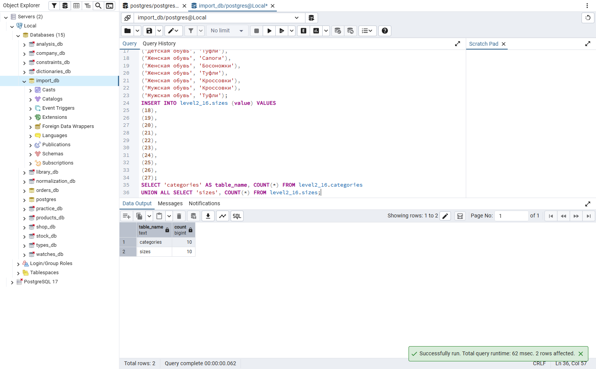

## Задание 6.3. Повышенный уровень

```sql
-- Задание 6.3
CREATE SCHEMA level3_16;
CREATE TABLE level3_16.categories (
    category_id SERIAL PRIMARY KEY,
    name VARCHAR(100) NOT NULL,
    subcategory VARCHAR(100) NOT NULL,
    UNIQUE (name, subcategory)
);
CREATE TABLE level3_16.sizes (
    size_id SERIAL PRIMARY KEY,
    value NUMERIC(4,1) NOT NULL UNIQUE CHECK (value > 0)
);
CREATE TABLE level3_16.products (
    product_id SERIAL PRIMARY KEY,
    category_id INTEGER NOT NULL REFERENCES level3_16.categories(category_id),
    image_path VARCHAR(255),
    name VARCHAR(200) NOT NULL,
    manufacturer VARCHAR(100),
    description TEXT,
    composition TEXT,
    price NUMERIC(10,2) NOT NULL CHECK (price > 0)
);
INSERT INTO level3_16.categories (name, subcategory) VALUES
('Детская обувь', 'Кроссовки'),
('Детская обувь', 'Сапоги'),
('Детская обувь', 'Босоножки'),
('Детская обувь', 'Туфли'),
('Женская обувь', 'Сапоги'),
('Женская обувь', 'Босоножки'),
('Женская обувь', 'Туфли'),
('Женская обувь', 'Кроссовки'),
('Мужская обувь', 'Кроссовки'),
('Мужская обувь', 'Туфли'),
('Мужская обувь', 'Ботинки');
INSERT INTO level3_16.sizes (value) VALUES
(18),
(19),
(20),
(21),
(22),
(23),
(24),
(25),
(26),
(27),
(28),
(29),
(30),
(31),
(32),
(33),
(34),
(35),
(36),
(36.5),
(37),
(37.5),
(38),
(38.5),
(39),
(39.5),
(40),
(40.5),
(41),
(41.5),
(42),
(42.5),
(43),
(44),
(45);
INSERT INTO level3_16.products
    (category_id, image_path, name, manufacturer, description, composition, price) VALUES
(1, 'IMG_KS_195217.png', 'Кроссовки детские «Звёздочка» экокожа', 'Малыш-Спорт', NULL, NULL, 2190),
(1, 'IMG_KS_195213.png', 'Кроссовки детские «Гонщик» экокожа', 'Топ-Топ', NULL, NULL, 2490),
(1, 'IMG_KS_195222.png', 'Кроссовки детские «Радуга» экокожа', 'Лапушка', NULL, NULL, 1990);
SELECT 'categories' AS table_name, COUNT(*) FROM level3_16.categories
UNION ALL SELECT 'sizes', COUNT(*) FROM level3_16.sizes
UNION ALL SELECT 'products', COUNT(*) FROM level3_16.products;
```

Результат: выполнено.

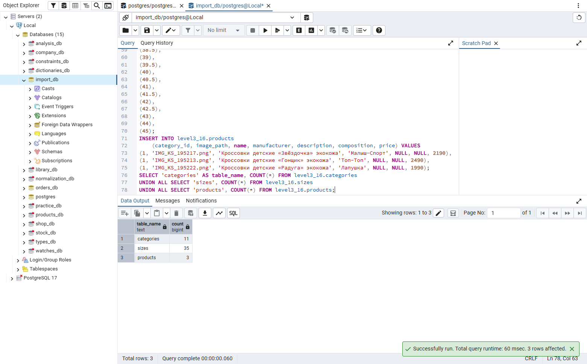

## Проверка понимания

1. Загрузка данных из внешнего файла в таблицы базы данных.
2. Чтобы быстро перенести готовые данные и не вводить каждую запись вручную.
3. В учебном примере Products_import.xlsx и Sizes_import.xlsx; в варианте 27 — Products_import.xlsx и Variants_import.xlsx.
4. Через pgAdmin/CSV, Python, SQL INSERT или подготовку данных в Excel.
5. INSERT добавляет строку или несколько строк в таблицу.
6. Выполнить SELECT COUNT(*) и посмотреть часть загруженных строк.
7. Запрос, который возвращает число строк таблицы.
8. Создать таблицу, подготовить значения, выполнить INSERT и проверить количество.
9. Сопоставить колонки файла с полями products, выполнить INSERT и проверить строки.
10. При загрузке данных заказчика и на демонстрационном экзамене.

## Контрольные вопросы

1. Загрузка данных из внешнего файла в таблицы базы данных.
2. Чтобы быстро перенести готовые данные и не вводить каждую запись вручную.
3. В учебном примере Products_import.xlsx и Sizes_import.xlsx; в варианте 27 — Products_import.xlsx и Variants_import.xlsx.
4. Через pgAdmin/CSV, Python, SQL INSERT или подготовку данных в Excel.
5. INSERT добавляет строку или несколько строк в таблицу.
6. Запрос, который возвращает число строк таблицы.
7. Выполнить SELECT COUNT(*) и посмотреть часть загруженных строк.
8. В учебном примере 11 пар категории и подкатегории; в «Парфюмерии» 4 категории.
9. В учебном примере 35 размеров; в «Парфюмерии» 3 объёма флакона.
10. В показанном примере 3 строки товаров; в исходном файле «Парфюмерии» 31 товар.
11. Создать таблицу, подготовить значения, выполнить INSERT и проверить количество.
12. Сопоставить колонки файла с полями products, выполнить INSERT и проверить строки.
13. Проверить формат и типы данных, сообщение об ошибке, откатить неудачную загрузку и повторить.
14. При подготовке базы данных предметной области и проверке импортированных строк.
15. INSERT INTO perfume16.variants (volume_ml) VALUES (30), (50), (100);

## Итоги

Узнал, как подготовить данные Excel для таблиц PostgreSQL и проверить результат импорта.
Импортировал справочники и товары учебного примера и варианта «Парфюмерия», проверил количество строк.
Легко было проверить SELECT COUNT(*). Сложнее — сохранить дробные размеры и сопоставить категории товарам.
Повторить порядок импорта связанных таблиц и проверку типов данных. Выполнен повышенный уровень.
