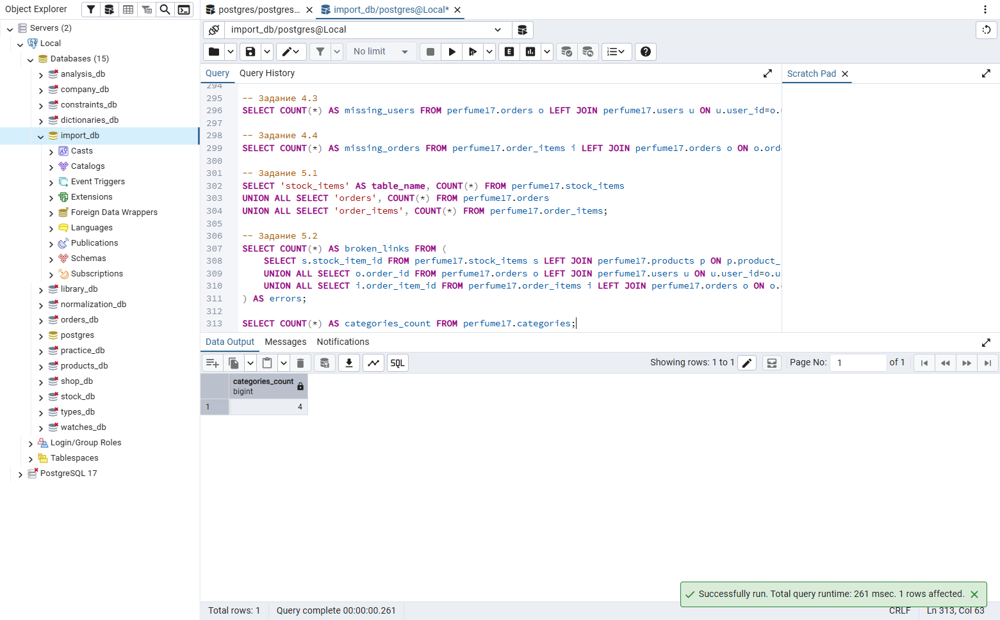
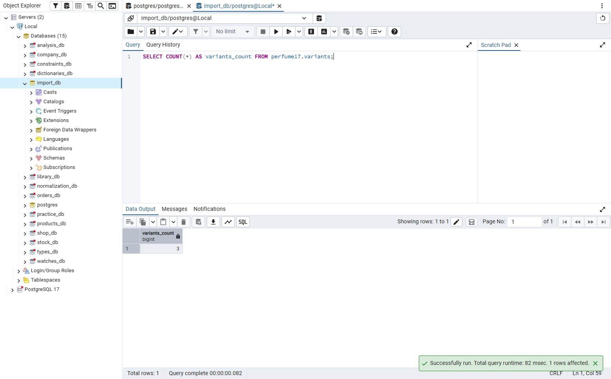
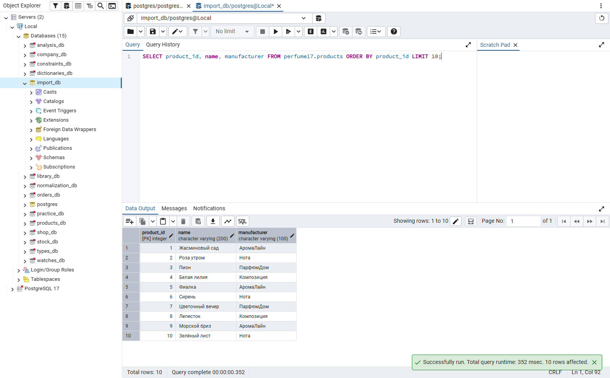
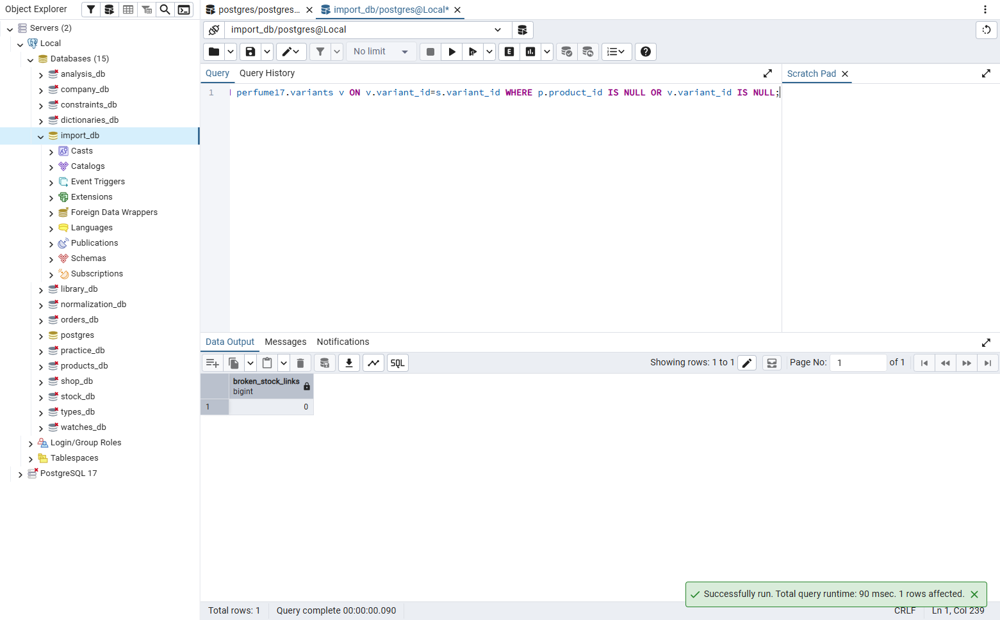
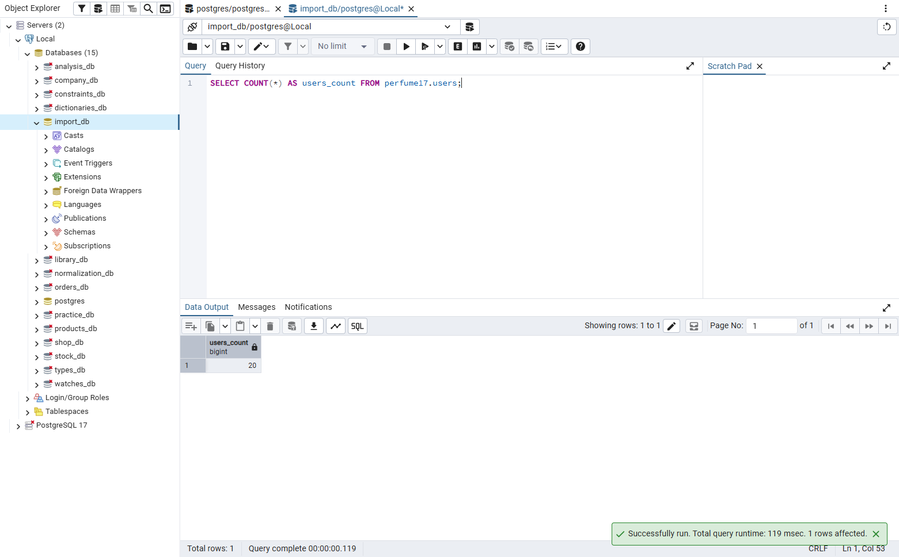
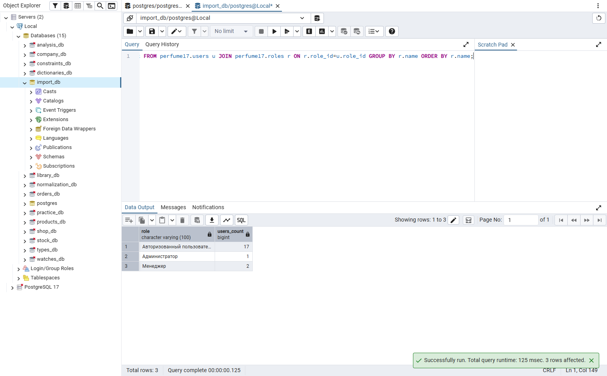
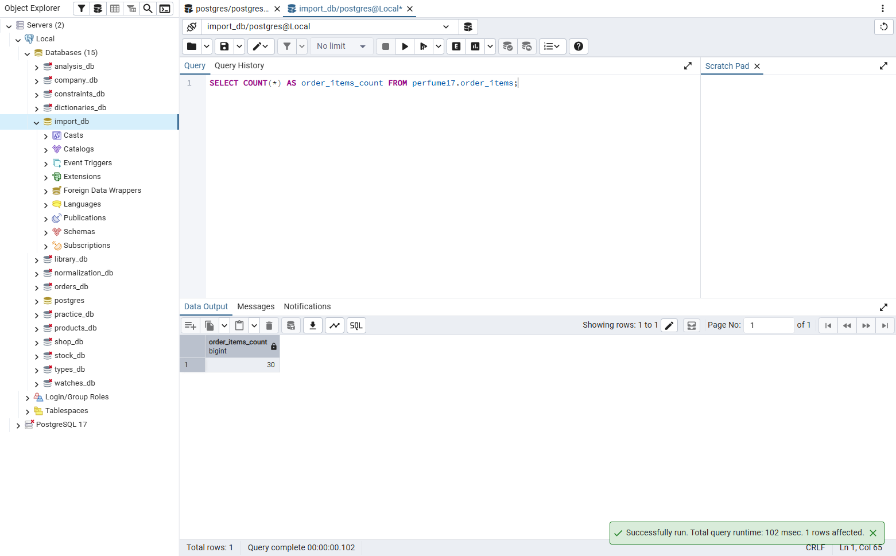
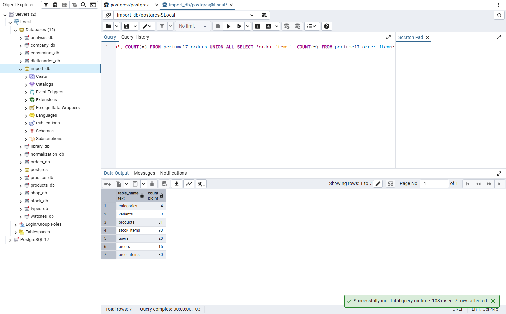
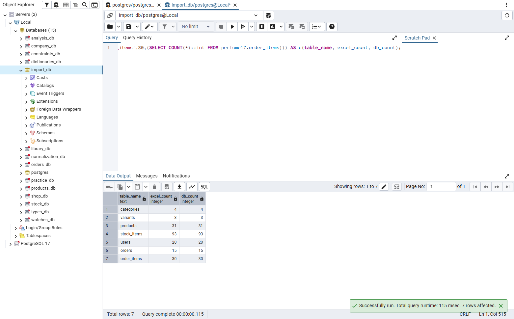

# Рабочая тетрадь. Пара 18

Ермилов Даниил Евгеньевич, 3ИП-1-24. Вариант 27 — «Парфюмерия».

## Результаты проверки

| Таблица | В исходном файле | В БД | Совпадает |
|---|---:|---:|---|
| categories | 4 | 4 | Да |
| variants (sizes в общем шаблоне) | 3 | 3 | Да |
| products | 31 | 31 | Да |
| stock_items | 93 | 93 | Да |
| users | 20 | 20 | Да |
| orders | 15 | 15 | Да |
| order_items | 30 | 30 | Да |

## Задание 1.1

```sql
SELECT COUNT(*) AS categories_count FROM perfume17.categories;
```

Результат: выполнено.



## Задание 1.2

```sql
SELECT COUNT(*) AS variants_count FROM perfume17.variants;
```

Результат: выполнено.



## Задание 2.1

```sql
SELECT COUNT(*) AS products_count FROM perfume17.products;
```

Результат: выполнено.


## Задание 2.2

```sql
SELECT product_id, name, manufacturer FROM perfume17.products ORDER BY product_id LIMIT 10;
```

Результат: выполнено.



## Задание 3.1

```sql
SELECT COUNT(*) AS stock_items_count FROM perfume17.stock_items;
```

Результат: выполнено.


## Задание 3.2

```sql
SELECT COUNT(*) AS broken_stock_links FROM perfume17.stock_items s LEFT JOIN perfume17.products p ON p.product_id=s.product_id LEFT JOIN perfume17.variants v ON v.variant_id=s.variant_id WHERE p.product_id IS NULL OR v.variant_id IS NULL;
```

Результат: выполнено.



## Задание 4.1

```sql
SELECT COUNT(*) AS users_count FROM perfume17.users;
```

Результат: выполнено.



## Задание 4.2

```sql
SELECT r.name AS role, COUNT(*) AS users_count FROM perfume17.users u JOIN perfume17.roles r ON r.role_id=u.role_id GROUP BY r.name ORDER BY r.name;
```

Результат: выполнено.



## Задание 5.1

```sql
SELECT COUNT(*) AS orders_count FROM perfume17.orders;
```

Результат: выполнено.


## Задание 5.2

```sql
SELECT COUNT(*) AS order_items_count FROM perfume17.order_items;
```

Результат: выполнено.



## Задание 6.1

```sql
SELECT 'categories' AS table_name, COUNT(*) FROM perfume17.categories UNION ALL SELECT 'variants', COUNT(*) FROM perfume17.variants UNION ALL SELECT 'products', COUNT(*) FROM perfume17.products UNION ALL SELECT 'stock_items', COUNT(*) FROM perfume17.stock_items UNION ALL SELECT 'users', COUNT(*) FROM perfume17.users UNION ALL SELECT 'orders', COUNT(*) FROM perfume17.orders UNION ALL SELECT 'order_items', COUNT(*) FROM perfume17.order_items;
```

Результат: выполнено.



## Задание 6.2

```sql
SELECT * FROM (VALUES ('categories',4,(SELECT COUNT(*)::int FROM perfume17.categories)), ('variants',3,(SELECT COUNT(*)::int FROM perfume17.variants)), ('products',31,(SELECT COUNT(*)::int FROM perfume17.products)), ('stock_items',93,(SELECT COUNT(*)::int FROM perfume17.stock_items)), ('users',20,(SELECT COUNT(*)::int FROM perfume17.users)), ('orders',15,(SELECT COUNT(*)::int FROM perfume17.orders)), ('order_items',30,(SELECT COUNT(*)::int FROM perfume17.order_items))) AS c(table_name, excel_count, db_count);
```

Результат: выполнено.



## Проверка понимания

1. Чтобы подтвердить, что данные полностью и правильно загружены в базу.
2. Запрос SELECT COUNT(*) возвращает количество строк в таблице.
3. Посчитать строки в исходном файле и сравнить результат с COUNT(*) в БД.
4. Найти пропущенные строки, дубликаты или ошибки импорта, исправить их и проверить ещё раз.
5. categories, variants, products, stock_items, users, orders и order_items.
6. Проверить ошибки загрузки, исходные строки и условия, которые могли пропустить данные.
7. Проверить дубликаты и убедиться, что импорт не запускался повторно.
8. Значения полей, типы, NULL, ограничения CHECK и внешние ключи.
9. При подготовке базы данных и перед сдачей демонстрационного экзамена.
10. Проверить количество записей и связи, сохранить скрипты и скриншоты.

## Контрольные вопросы

1. Сравнение данных в базе с исходными файлами после загрузки.
2. Она подтверждает полноту данных и помогает найти ошибки импорта.
3. Запрос, который подсчитывает все строки таблицы.
4. Сопоставить число строк в исходном файле с результатом COUNT(*) в БД.
5. Справочники, товары, остатки, пользователей, заказы и позиции заказов.
6. Найти причину расхождения, исправить данные или скрипт и повторить проверку.
7. Проверить пропущенные строки, ошибки формата и ограничения таблицы.
8. Проверить дубликаты и повторный запуск импорта.
9. Содержимое строк, типы, пустые значения, ограничения и связи между таблицами.
10. Внешний ключ, связывающий запись дочерней таблицы с родительской.
11. Ограничение, проверяющее допустимость значения при вставке или изменении.
12. Для подтверждения корректности заполнения базы в задании демонстрационного экзамена.
13. Выполнить COUNT(*), проверить связи, подготовить скрипты и доказательства выполнения.
14. В варианте «Парфюмерия» — 4 категории.
15. В варианте «Парфюмерия» — 31 товар.

## Итоги

Проверил количество строк во всех импортированных таблицах и целостность связей.
Количество записей совпало с исходными файлами, нарушенных связей не найдено.
Выполнен повышенный уровень.
