# Рабочая тетрадь. Пара 19

Ермилов Даниил Евгеньевич, 3ИП-1-24. Вариант 27 — «Парфюмерия».

## Анализ предметной области

- `categories` — категории ароматов.
- `variants` — варианты объёма флакона.
- `products` — парфюмерные товары.
- `stock_items` — остатки и цены.
- `roles` — роли пользователей.
- `users` — пользователи системы.
- `orders` — заказы покупателей.
- `order_items` — позиции заказов.

## Связи

- categories → products: 1:N.
- products → stock_items: 1:N.
- variants → stock_items: 1:N.
- roles → users: 1:N.
- users → orders: 1:N.
- orders → order_items: 1:N.
- products → order_items: 1:N.

## Нормализация задания 2.1

```sql
CREATE TABLE clients (
  client_id integer GENERATED ALWAYS AS IDENTITY PRIMARY KEY,
  client_name varchar(80) NOT NULL,
  client_phone varchar(20) UNIQUE NOT NULL
);
CREATE TABLE orders (
  order_id integer PRIMARY KEY,
  order_date date NOT NULL,
  client_id integer NOT NULL REFERENCES clients(client_id)
);
CREATE TABLE order_items (
  order_item_id integer GENERATED ALWAYS AS IDENTITY PRIMARY KEY,
  order_id integer NOT NULL REFERENCES orders(order_id),
  product_name varchar(120) NOT NULL,
  category varchar(80) NOT NULL,
  price numeric(10,2) CHECK (price > 0),
  quantity integer CHECK (quantity > 0)
);
```

## Нормализация задания 2.2

```sql
CREATE TABLE manufacturers (
  manufacturer_id integer GENERATED ALWAYS AS IDENTITY PRIMARY KEY,
  name varchar(100) UNIQUE NOT NULL,
  country varchar(80) NOT NULL
);
CREATE TABLE products (
  product_id integer PRIMARY KEY,
  name varchar(120) NOT NULL,
  manufacturer_id integer NOT NULL REFERENCES manufacturers(manufacturer_id),
  price numeric(10,2) CHECK (price > 0)
);
```

## Проверка базы

```sql
SELECT 'categories' AS table_name, COUNT(*) FROM perfume17.categories
UNION ALL SELECT 'variants', COUNT(*) FROM perfume17.variants
UNION ALL SELECT 'products', COUNT(*) FROM perfume17.products
UNION ALL SELECT 'stock_items', COUNT(*) FROM perfume17.stock_items
UNION ALL SELECT 'users', COUNT(*) FROM perfume17.users
UNION ALL SELECT 'orders', COUNT(*) FROM perfume17.orders
UNION ALL SELECT 'order_items', COUNT(*) FROM perfume17.order_items;
```

## Задание 1.1

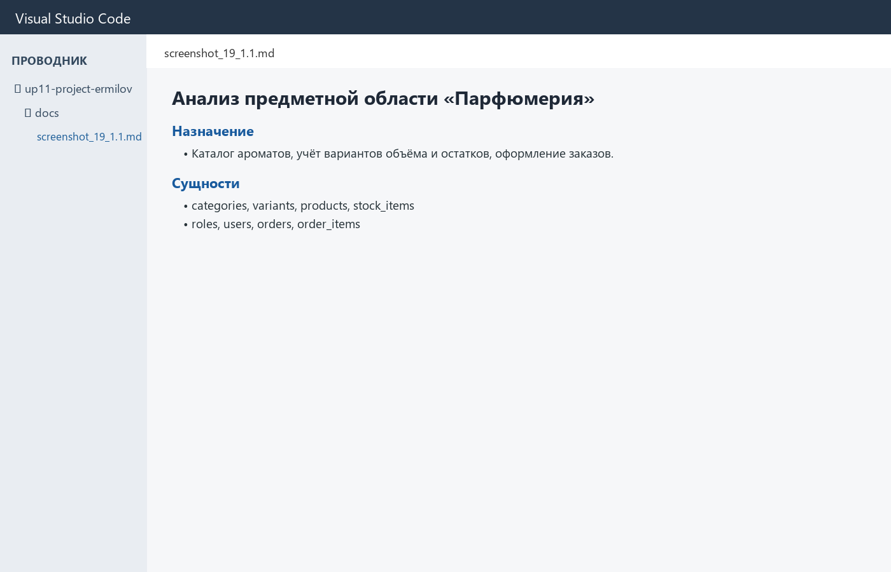

## Задание 1.2

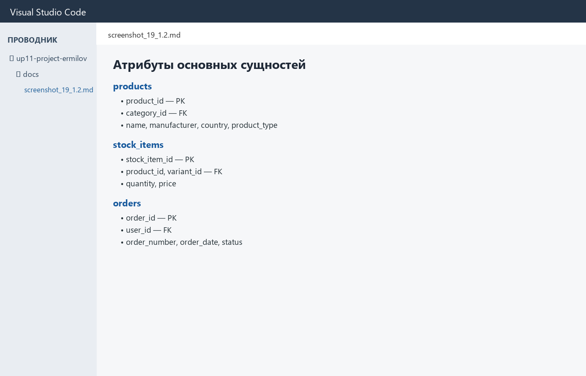

## Задание 1.3

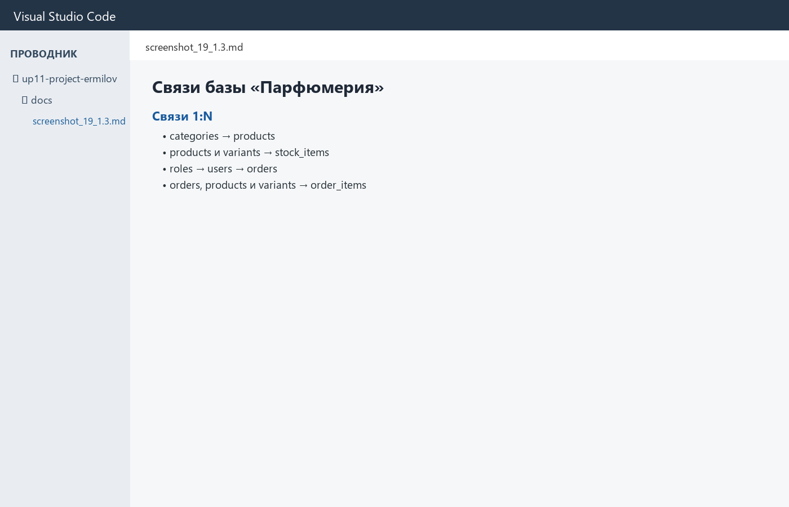

## Задание 2.1

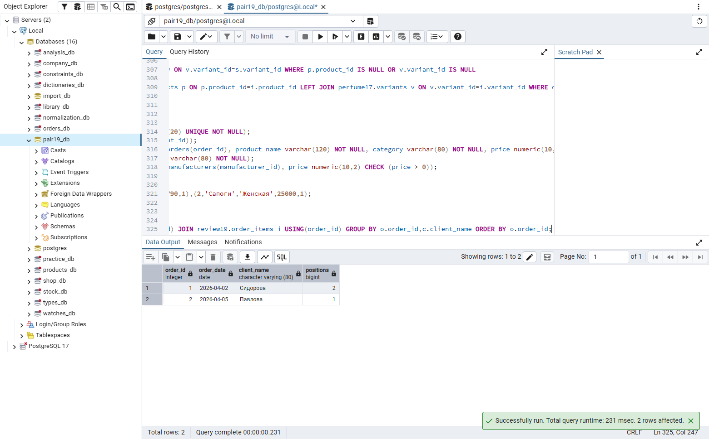

## Задание 2.2

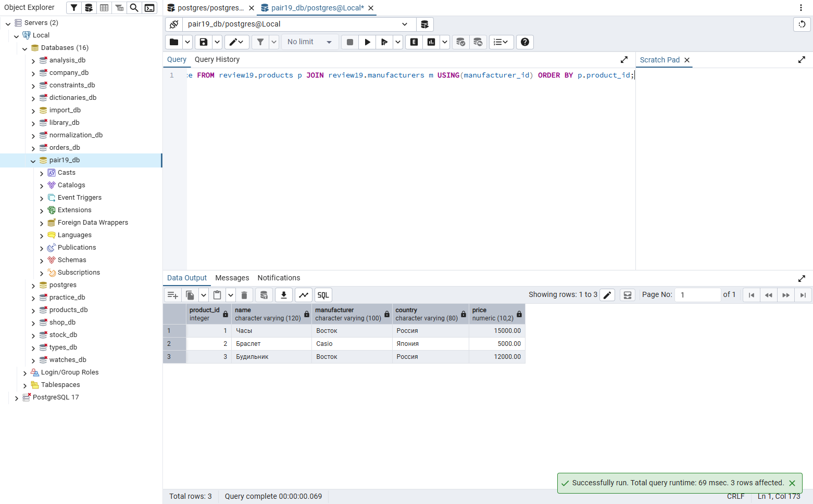

## Задание 3.1

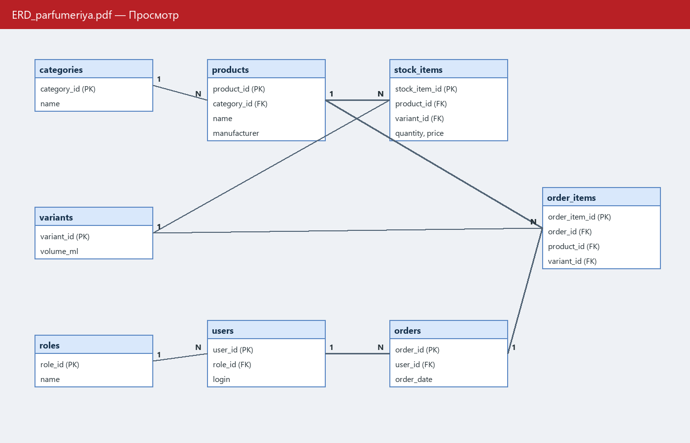

## Задание 3.2

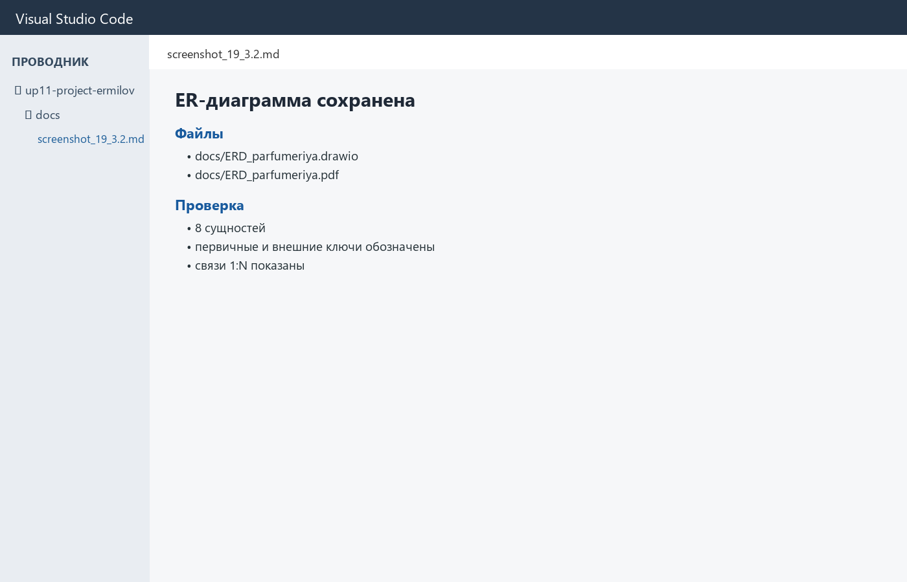

## Задание 4.1

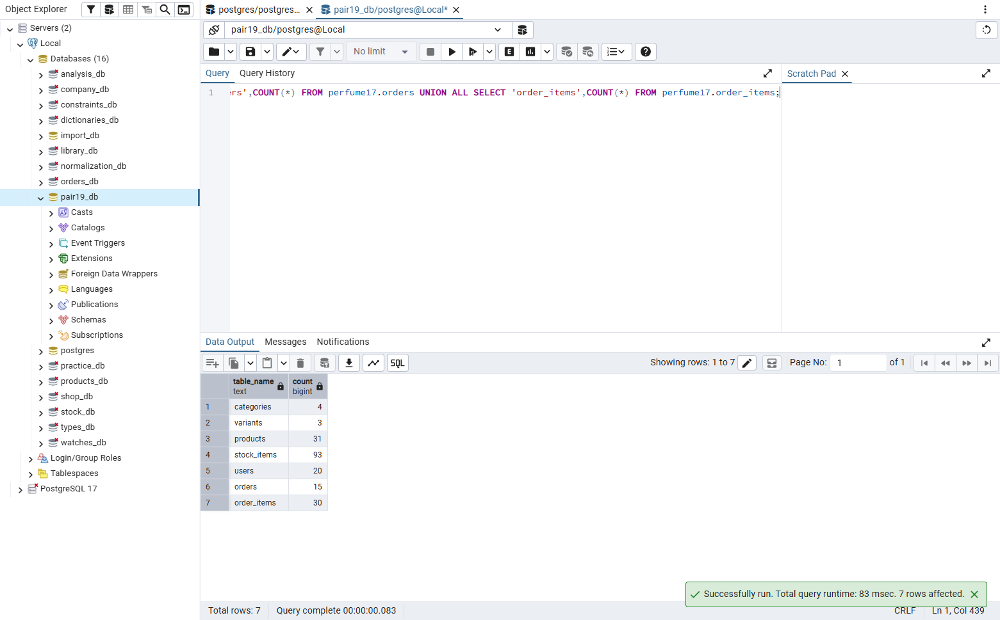

## Задание 4.2

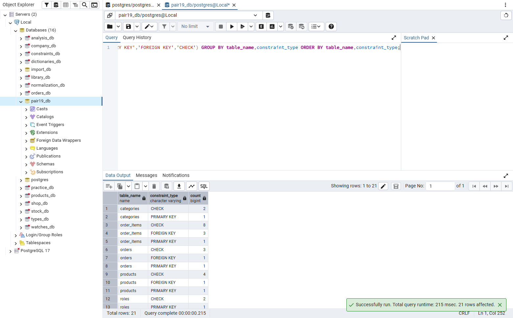

## Задание 5.1

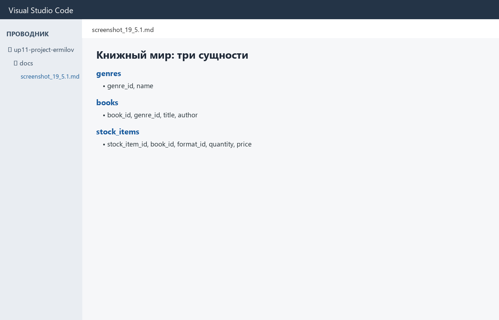

## Задание 5.2

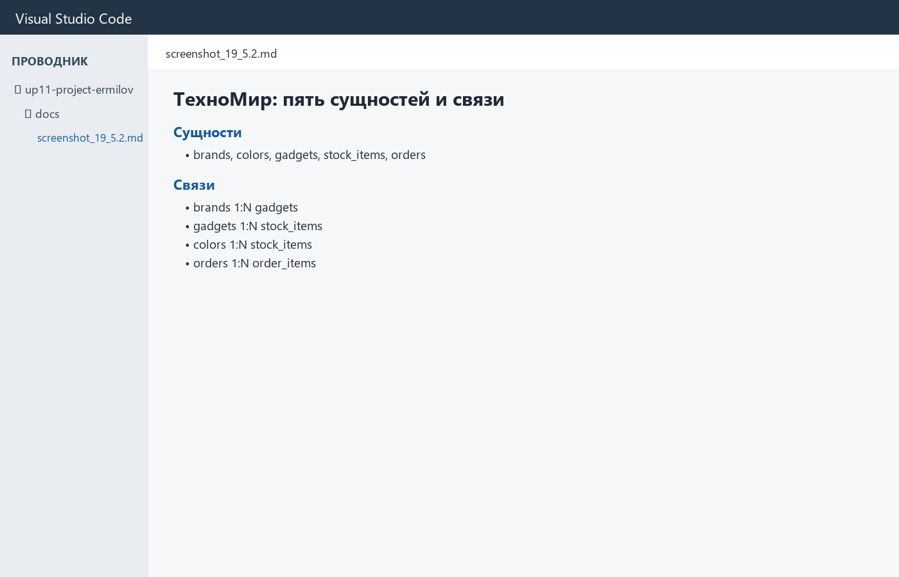

## Задание 5.3

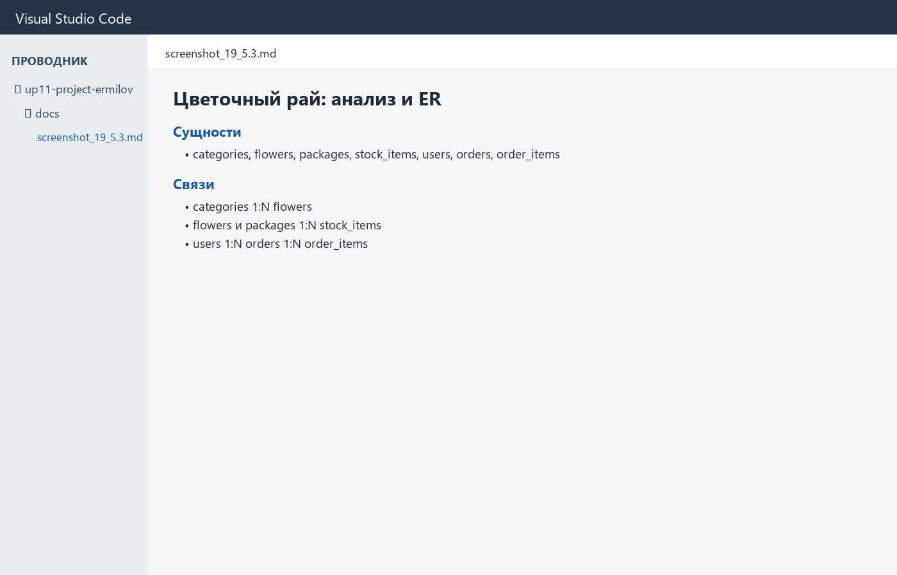

## Проверка понимания

1. Изучение объектов предметной области, их свойств, правил и связей.
2. Самостоятельный объект, сведения о котором хранятся в базе данных.
3. Свойство сущности, представленное полем таблицы.
4. Отношение между сущностями, реализованное первичными и внешними ключами.
5. Нормальная форма, в которой нет частичных и транзитивных зависимостей неключевых полей.
6. Схема сущностей базы, их атрибутов и связей.
7. Первичный ключ, однозначно определяющий строку таблицы.
8. Внешний ключ, который ссылается на первичный ключ связанной таблицы.
9. Зависимость неключевого атрибута от ключа через другой неключевой атрибут.
10. Повторить анализ, 3НФ, ER-модель, ключи, SQL-скрипты и проверку импорта.

## Контрольные вопросы

1. Изучение объектов предметной области, их свойств, правил и связей.
2. Самостоятельный объект, сведения о котором хранятся в базе данных.
3. Свойство сущности, представленное полем таблицы.
4. Отношение между сущностями, реализованное первичными и внешними ключами.
5. Нормальная форма, в которой нет частичных и транзитивных зависимостей неключевых полей.
6. Схема сущностей базы, их атрибутов и связей.
7. Первичный ключ, однозначно определяющий строку таблицы.
8. Внешний ключ, который ссылается на первичный ключ связанной таблицы.
9. Зависимость неключевого атрибута от ключа через другой неключевой атрибут.
10. Зависимость части составного ключа от неключевого атрибута.
11. Форма, в которой значения атомарны, а повторяющихся групп нет.
12. 1НФ без частичных зависимостей от составного ключа.
13. 2НФ без транзитивных зависимостей неключевых атрибутов.
14. Проверить структуру БД, ER-диаграмму, ключи, данные и работоспособность SQL-скрипта.
15. Для «Парфюмерии» выделены категории, варианты объёма, товары, остатки, роли, пользователи, заказы и позиции заказов.

## Итоги

Повторил анализ предметной области, нормализацию до 3НФ и построение ER-диаграммы.
Выполнен повышенный уровень.
