# Рабочая тетрадь. Пара 20

Ермилов Даниил Евгеньевич, 3ИП-1-24. Вариант 27 — «Парфюмерия».

Тема: повторение CREATE TABLE, PRIMARY KEY, FOREIGN KEY и CHECK.

## Задание 1.1

```sql
CREATE DATABASE review_db;
```

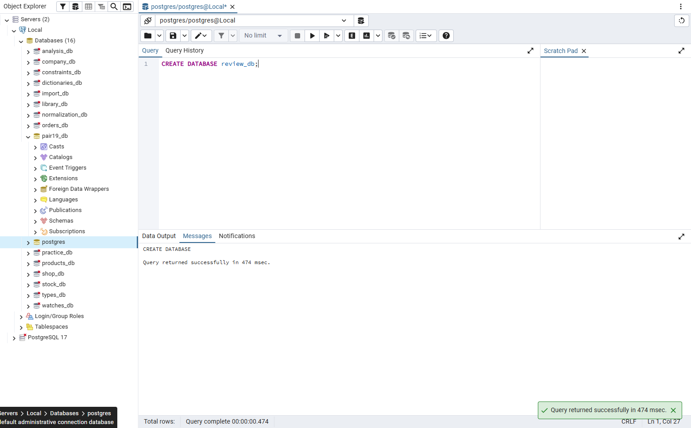

## Задание 1.2

```sql
\c review_db
```

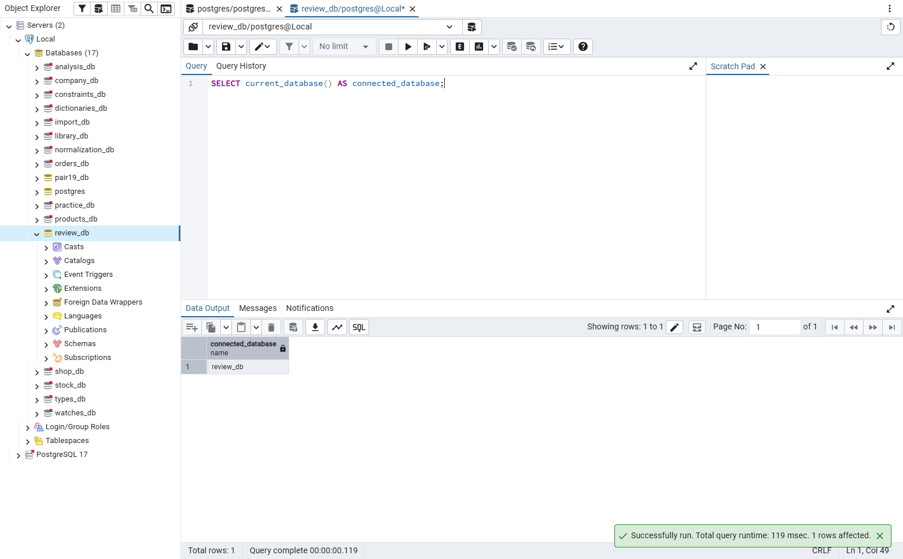

## Задание 1.3

```sql
CREATE TABLE categories (category_id SERIAL PRIMARY KEY, name VARCHAR(100) NOT NULL UNIQUE); SELECT * FROM categories;
```

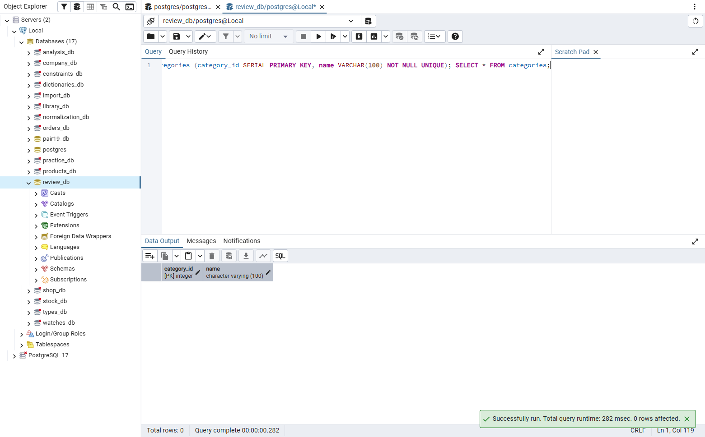

## Задание 1.4

```sql
CREATE TABLE sizes (size_id SERIAL PRIMARY KEY, value NUMERIC(4,1) NOT NULL UNIQUE CHECK (value > 0)); SELECT * FROM sizes;
```

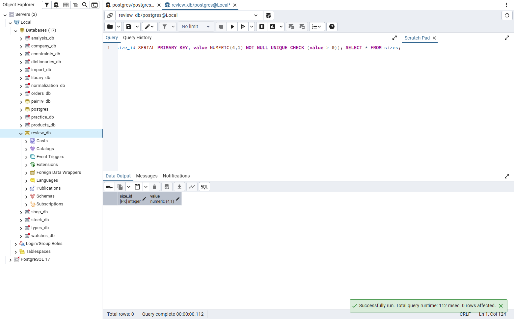

## Задание 2.1

```sql
CREATE TABLE products (product_id SERIAL PRIMARY KEY, category_id INTEGER NOT NULL REFERENCES categories(category_id), name VARCHAR(200) NOT NULL, price NUMERIC(10,2) CHECK (price > 0)); SELECT * FROM products;
```

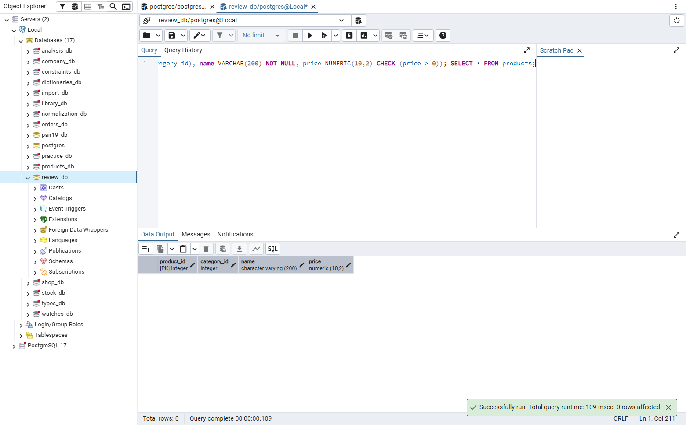

## Задание 2.2

```sql
CREATE TABLE stock_items (stock_item_id SERIAL PRIMARY KEY, product_id INTEGER NOT NULL REFERENCES products(product_id), size_id INTEGER NOT NULL REFERENCES sizes(size_id), quantity INTEGER CHECK (quantity >= 0)); SELECT * FROM stock_items;
```

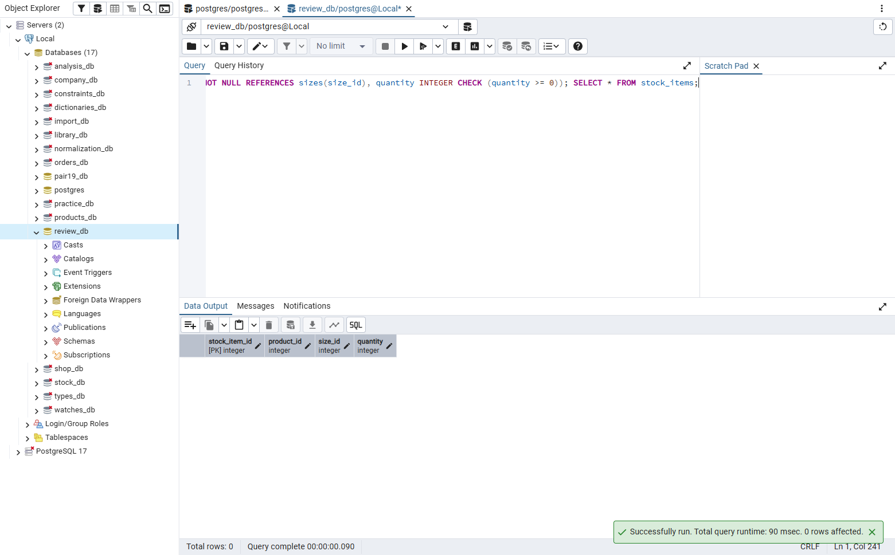

## Задание 2.3

```sql
CREATE TABLE roles (role_id SERIAL PRIMARY KEY, name VARCHAR(50) NOT NULL UNIQUE); SELECT * FROM roles;
```

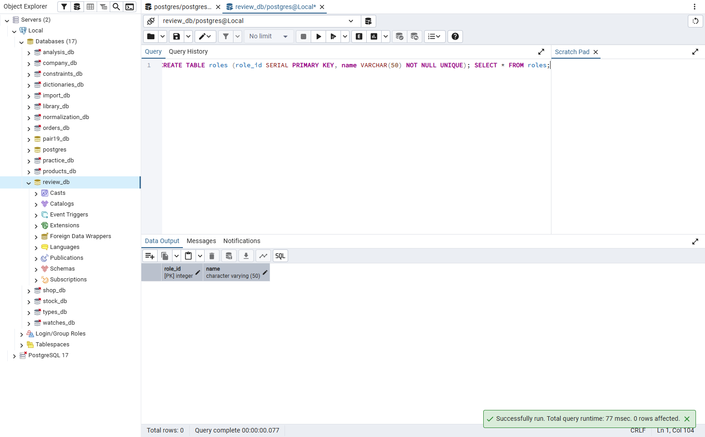

## Задание 2.4

```sql
CREATE TABLE users (user_id SERIAL PRIMARY KEY, last_name VARCHAR(100) NOT NULL, first_name VARCHAR(100) NOT NULL, login VARCHAR(100) NOT NULL UNIQUE, role_id INTEGER NOT NULL REFERENCES roles(role_id)); SELECT * FROM users;
```

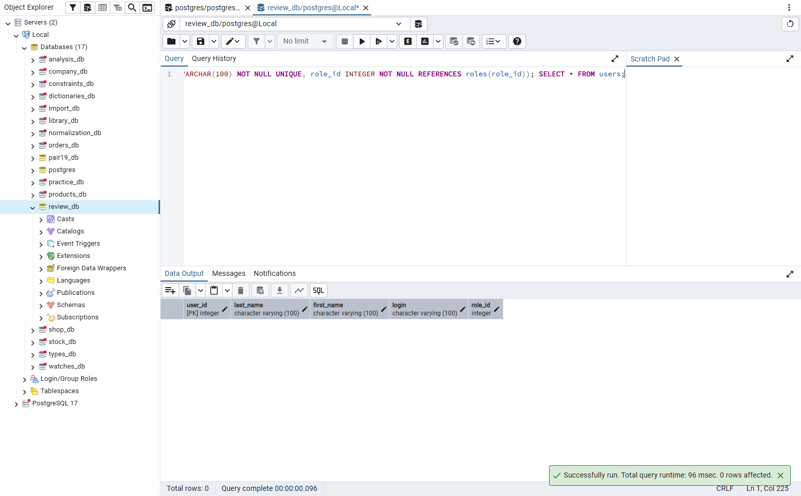

## Задание 3.1

```sql
CREATE TABLE orders (order_id SERIAL PRIMARY KEY, order_date DATE NOT NULL DEFAULT CURRENT_DATE, user_id INTEGER NOT NULL REFERENCES users(user_id)); SELECT * FROM orders;
```

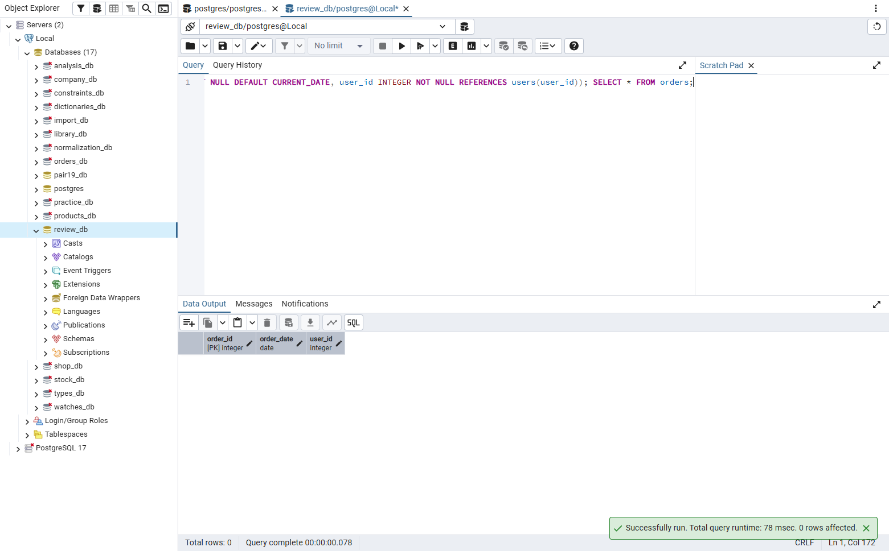

## Задание 3.2

```sql
CREATE TABLE order_items (order_item_id SERIAL PRIMARY KEY, order_id INTEGER NOT NULL REFERENCES orders(order_id), product_id INTEGER NOT NULL REFERENCES products(product_id), size_id INTEGER NOT NULL REFERENCES sizes(size_id), quantity INTEGER CHECK (quantity > 0), price NUMERIC(10,2) CHECK (price > 0)); SELECT * FROM order_items;
```

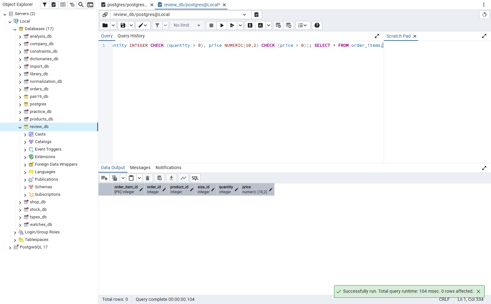

## Задание 3.3

```sql
INSERT INTO categories(name) VALUES ('Парфюмерия'); INSERT INTO sizes(value) VALUES (50); INSERT INTO products(category_id,name,price) VALUES (1,'Тестовый аромат',2500); INSERT INTO roles(name) VALUES ('client'); INSERT INTO users(last_name,first_name,login,role_id) VALUES ('Ермилов','Даниил','ermilov',1); INSERT INTO orders(user_id) VALUES (1); INSERT INTO order_items(order_id,product_id,size_id,quantity,price) VALUES (1,1,1,-5,2500);
```

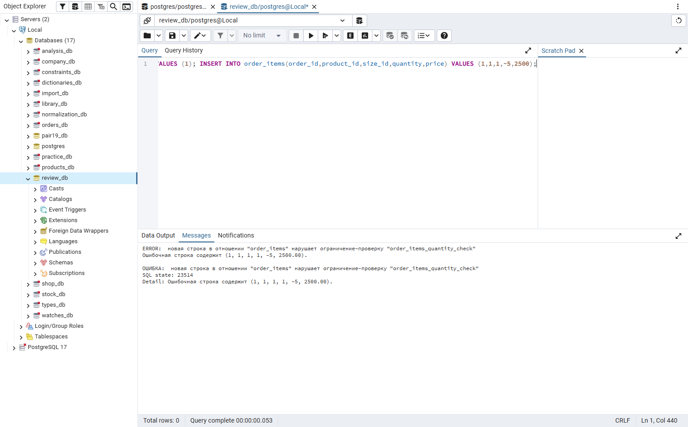

## Задание 3.4

```sql
INSERT INTO order_items(order_id,product_id,size_id,quantity,price) VALUES (999,1,1,1,2500);
```

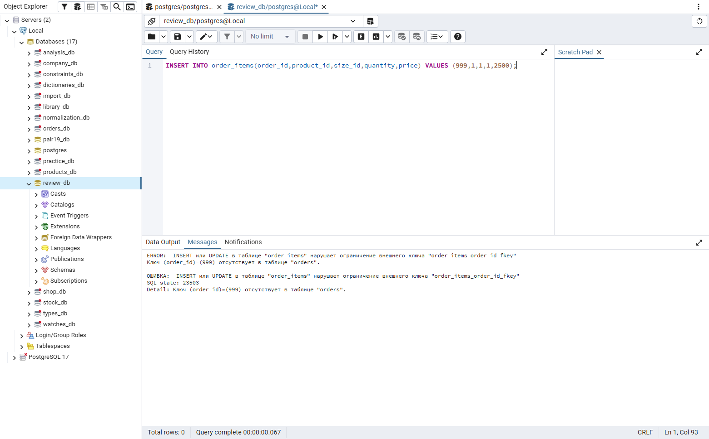

## Задание 4.1

```sql
DROP SCHEMA IF EXISTS perfume20 CASCADE;
CREATE SCHEMA perfume20;
CREATE TABLE perfume20.categories (category_id SERIAL PRIMARY KEY, name VARCHAR(100) NOT NULL UNIQUE);
CREATE TABLE perfume20.variants (variant_id SERIAL PRIMARY KEY, volume_ml INTEGER NOT NULL UNIQUE CHECK (volume_ml > 0));
CREATE TABLE perfume20.products (product_id SERIAL PRIMARY KEY, category_id INTEGER NOT NULL REFERENCES perfume20.categories, name VARCHAR(200) NOT NULL, manufacturer VARCHAR(100) NOT NULL);
CREATE TABLE perfume20.stock_items (stock_item_id SERIAL PRIMARY KEY, product_id INTEGER NOT NULL REFERENCES perfume20.products, variant_id INTEGER NOT NULL REFERENCES perfume20.variants, quantity INTEGER CHECK (quantity >= 0), price NUMERIC(10,2) CHECK (price > 0));
CREATE TABLE perfume20.roles (role_id SERIAL PRIMARY KEY, name VARCHAR(50) NOT NULL UNIQUE);
CREATE TABLE perfume20.users (user_id SERIAL PRIMARY KEY, login VARCHAR(100) NOT NULL UNIQUE, role_id INTEGER NOT NULL REFERENCES perfume20.roles);
CREATE TABLE perfume20.orders (order_id SERIAL PRIMARY KEY, order_number VARCHAR(30) NOT NULL UNIQUE, order_date DATE NOT NULL DEFAULT CURRENT_DATE, user_id INTEGER NOT NULL REFERENCES perfume20.users);
CREATE TABLE perfume20.order_items (order_item_id SERIAL PRIMARY KEY, order_id INTEGER NOT NULL REFERENCES perfume20.orders, product_id INTEGER NOT NULL REFERENCES perfume20.products, variant_id INTEGER NOT NULL REFERENCES perfume20.variants, quantity INTEGER CHECK (quantity > 0), price NUMERIC(10,2) CHECK (price > 0));
```

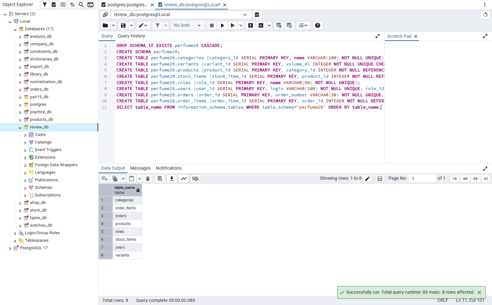

## Задание 4.2

```sql
SELECT table_name, constraint_type, COUNT(*)
FROM information_schema.table_constraints
WHERE table_schema = 'perfume20'
GROUP BY table_name, constraint_type
ORDER BY table_name, constraint_type;
```

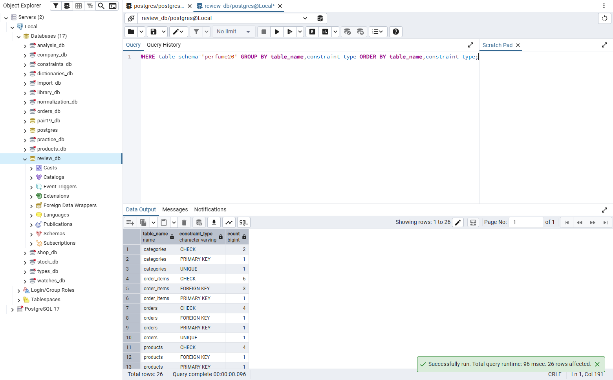

## Задание 5.1

```sql
CREATE TABLE categories (
  category_id SERIAL PRIMARY KEY,
  name VARCHAR(100) NOT NULL UNIQUE
);
```

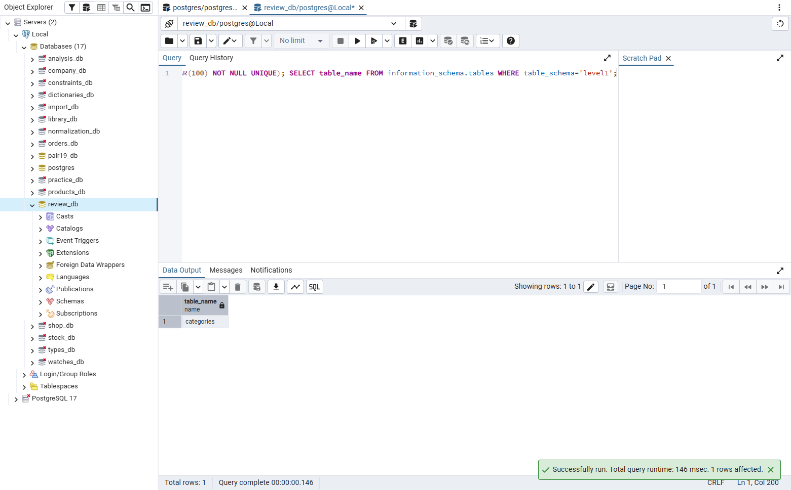

## Задание 5.2

```sql
CREATE TABLE categories (category_id SERIAL PRIMARY KEY, name VARCHAR(100) NOT NULL UNIQUE);
CREATE TABLE products (
  product_id SERIAL PRIMARY KEY,
  category_id INTEGER REFERENCES categories(category_id),
  name VARCHAR(200) NOT NULL
);
```

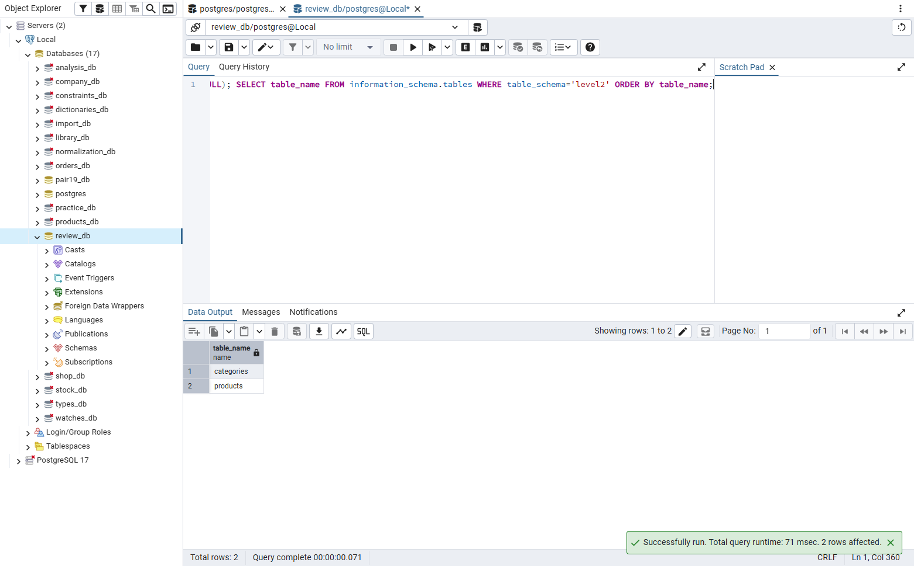

## Задание 5.3

```sql
DROP SCHEMA IF EXISTS level20 CASCADE; CREATE SCHEMA level20;
CREATE TABLE level20.categories (category_id SERIAL PRIMARY KEY, name VARCHAR(100) NOT NULL UNIQUE);
CREATE TABLE level20.sizes (size_id SERIAL PRIMARY KEY, value NUMERIC(4,1) CHECK (value > 0));
CREATE TABLE level20.products (product_id SERIAL PRIMARY KEY, category_id INTEGER REFERENCES level20.categories, name VARCHAR(200) NOT NULL);
CREATE TABLE level20.stock_items (stock_item_id SERIAL PRIMARY KEY, product_id INTEGER REFERENCES level20.products, size_id INTEGER REFERENCES level20.sizes, quantity INTEGER CHECK (quantity >= 0));
CREATE TABLE level20.roles (role_id SERIAL PRIMARY KEY, name VARCHAR(50) UNIQUE NOT NULL);
CREATE TABLE level20.users (user_id SERIAL PRIMARY KEY, login VARCHAR(100) UNIQUE NOT NULL, role_id INTEGER REFERENCES level20.roles);
CREATE TABLE level20.orders (order_id SERIAL PRIMARY KEY, user_id INTEGER REFERENCES level20.users, order_date DATE DEFAULT CURRENT_DATE);
SELECT table_name FROM information_schema.tables WHERE table_schema='level20' ORDER BY table_name;
```

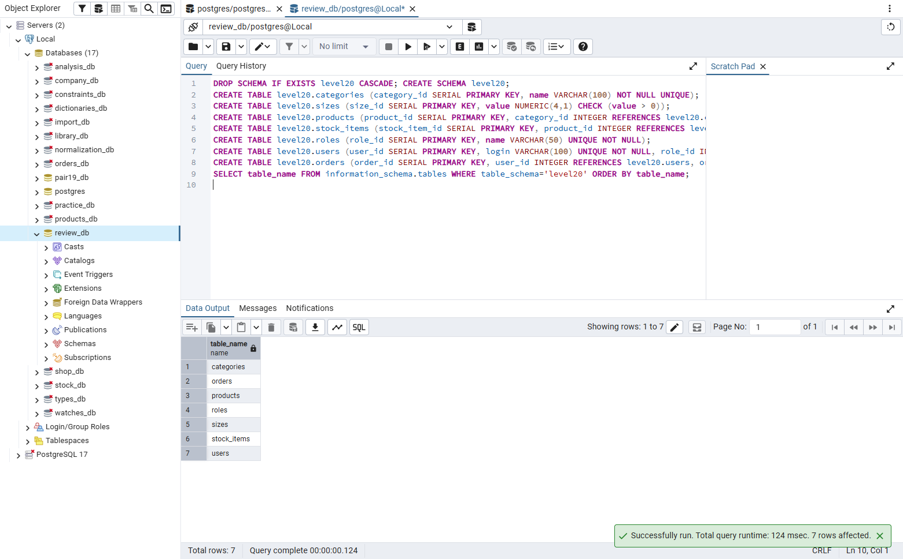

## Проверка понимания

1. Команда SQL для создания новой таблицы и определения её столбцов и ограничений.
2. Первичный ключ, который однозначно определяет каждую строку.
3. Внешний ключ, связывающий поле с первичным ключом другой таблицы.
4. Ограничение, которое разрешает только значения, удовлетворяющие условию.
5. PostgreSQL отклонит строку из-за нарушения CHECK.
6. PostgreSQL отклонит строку из-за нарушения внешнего ключа.
7. Тип, который автоматически выдаёт последовательные целые значения.
8. Указание таблицы и поля, на которые ссылается внешний ключ.
9. Ограничение, запрещающее значение NULL.
10. Ограничение, запрещающее повтор одинаковых значений.

## Контрольные вопросы

1. Команда SQL для создания новой таблицы и определения её столбцов и ограничений.
2. Первичный ключ, который однозначно определяет каждую строку.
3. Внешний ключ, связывающий поле с первичным ключом другой таблицы.
4. Ограничение, которое разрешает только значения, удовлетворяющие условию.
5. Ограничение, запрещающее NULL.
6. Ограничение уникальности значений.
7. Значение, автоматически используемое, если оно не указано.
8. Тип, который автоматически выдаёт последовательные целые значения.
9. Указание таблицы и поля, на которые ссылается внешний ключ.
10. PostgreSQL отклонит строку из-за нарушения CHECK.
11. PostgreSQL отклонит строку из-за нарушения внешнего ключа.
12. Будет ошибка UNIQUE.
13. Будет ошибка NOT NULL.
14. При создании полной структуры базы данных на демонстрационном экзамене.
15. CREATE TABLE categories (category_id SERIAL PRIMARY KEY, name VARCHAR(100) NOT NULL UNIQUE);

## Итоги

Создал таблицы, проверил первичные и внешние ключи, CHECK и структуру варианта «Парфюмерия».
Выполнен повышенный уровень.
