# Рабочая тетрадь. Пара 21

Ермилов Даниил Евгеньевич, 3ИП-1-24. Вариант 27 — «Парфюмерия».

Тема: повторение импорта данных и полного скрипта БД.

## Задание 1.1

```sql
CREATE DATABASE review_import_db;
```

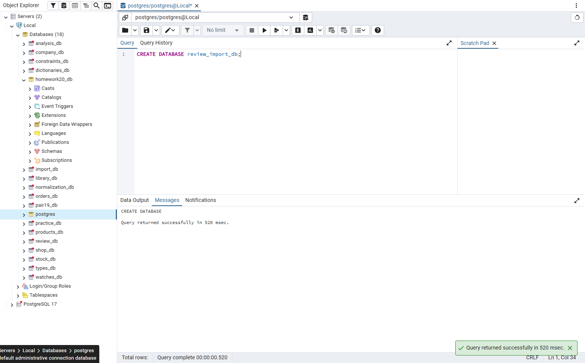

## Задание 1.2

```sql
CREATE TABLE categories (category_id SERIAL PRIMARY KEY, name VARCHAR(100) NOT NULL UNIQUE);
CREATE TABLE sizes (size_id SERIAL PRIMARY KEY, value NUMERIC(4,1) NOT NULL UNIQUE CHECK(value>0));
CREATE TABLE products (product_id SERIAL PRIMARY KEY, category_id INTEGER NOT NULL REFERENCES categories, name VARCHAR(200) NOT NULL, price NUMERIC(10,2) CHECK(price>0));
CREATE TABLE stock_items (stock_item_id SERIAL PRIMARY KEY, product_id INTEGER NOT NULL REFERENCES products, size_id INTEGER NOT NULL REFERENCES sizes, quantity INTEGER CHECK(quantity>=0));
CREATE TABLE roles (role_id SERIAL PRIMARY KEY, name VARCHAR(50) NOT NULL UNIQUE);
CREATE TABLE users (user_id SERIAL PRIMARY KEY, login VARCHAR(100) NOT NULL UNIQUE, role_id INTEGER NOT NULL REFERENCES roles);
CREATE TABLE orders (order_id SERIAL PRIMARY KEY, user_id INTEGER NOT NULL REFERENCES users, order_date DATE DEFAULT CURRENT_DATE);
CREATE TABLE order_items (item_id SERIAL PRIMARY KEY, order_id INTEGER NOT NULL REFERENCES orders, product_id INTEGER NOT NULL REFERENCES products, size_id INTEGER NOT NULL REFERENCES sizes, quantity INTEGER CHECK(quantity>0), price NUMERIC(10,2) CHECK(price>0));
```

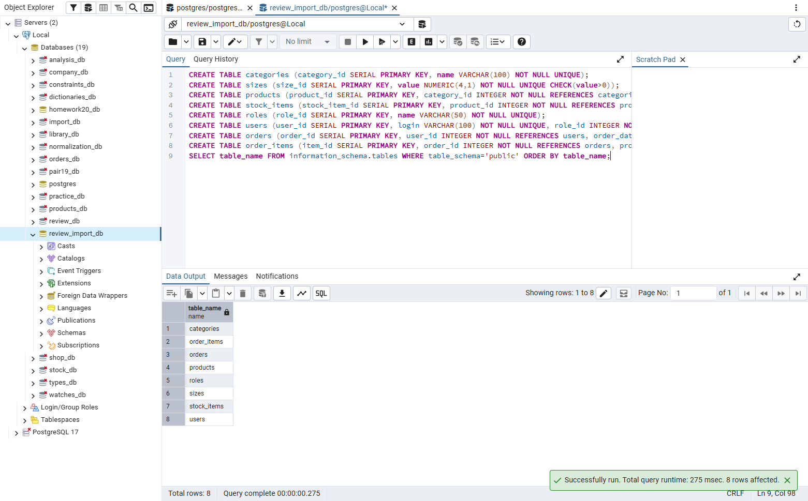

## Задание 1.3

```sql
INSERT INTO categories(name) VALUES ('Наручные'),('Аксессуары'),('Настенные');
```

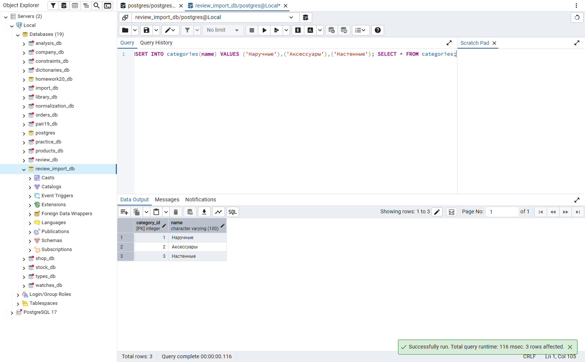

## Задание 1.4

```sql
INSERT INTO sizes(value) VALUES (38),(42),(46);
```

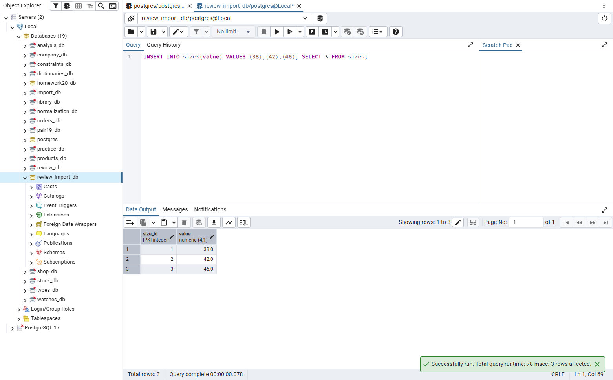

## Задание 1.5

```sql
INSERT INTO products(category_id,name,price) VALUES
(1,'Часы «Классика»',15000),
(2,'Браслет',5000),
(3,'Будильник',12000);
```

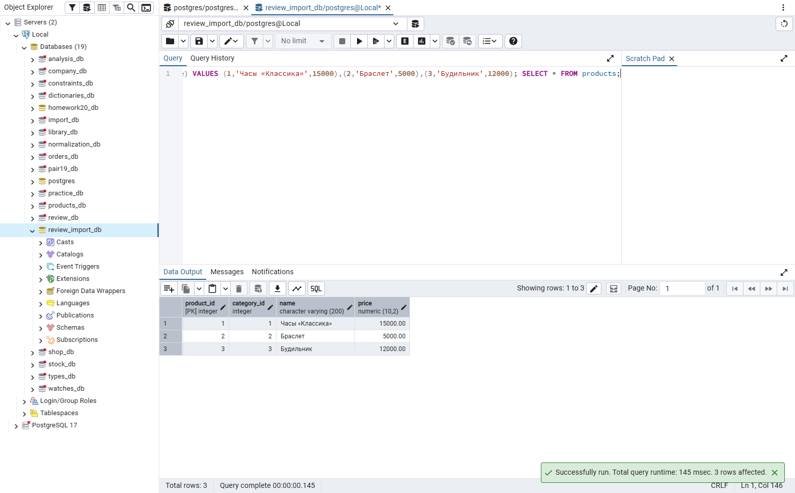

## Задание 2.1

```sql
-- Полный скрипт сохранён в src/db/mir_chasov.sql
\i src/db/mir_chasov.sql
```

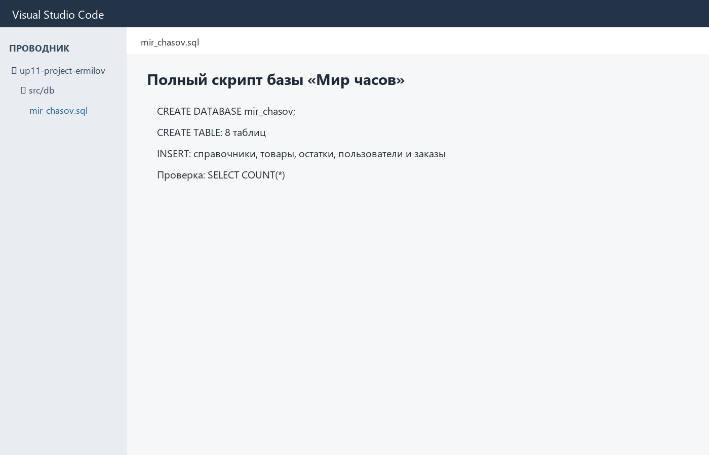

## Задание 3.1

```sql
\i src/db/mir_chasov.sql
```

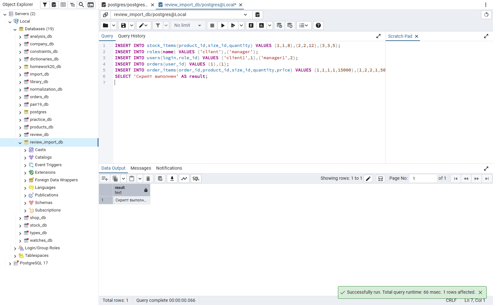

## Задание 3.2

```sql
SELECT table_name FROM information_schema.tables
WHERE table_schema='public' ORDER BY table_name;
```

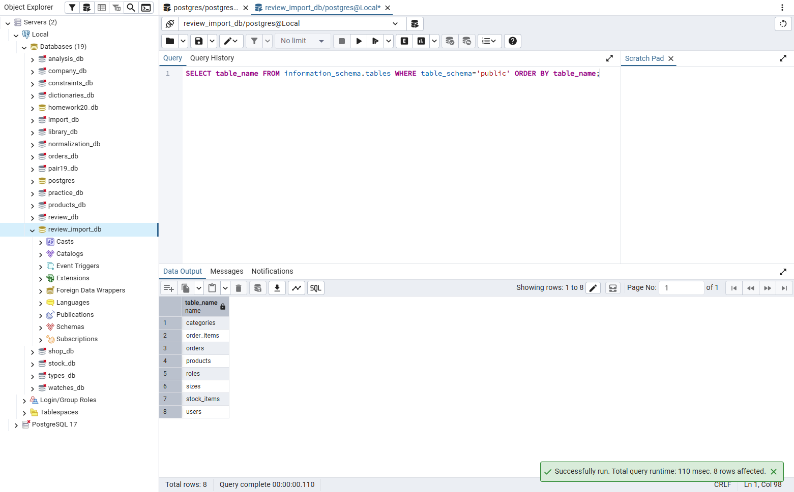

## Задание 3.3

```sql
SELECT 'categories' AS table_name,COUNT(*) FROM categories
UNION ALL SELECT 'sizes',COUNT(*) FROM sizes
UNION ALL SELECT 'products',COUNT(*) FROM products
UNION ALL SELECT 'stock_items',COUNT(*) FROM stock_items
UNION ALL SELECT 'users',COUNT(*) FROM users
UNION ALL SELECT 'orders',COUNT(*) FROM orders
UNION ALL SELECT 'order_items',COUNT(*) FROM order_items;
```

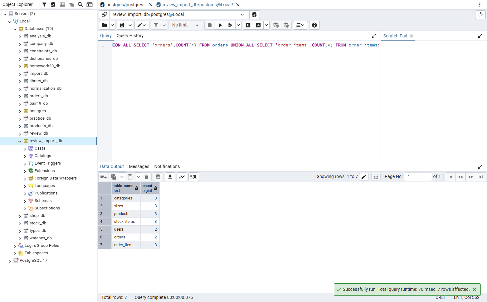

## Задание 3.4

```sql
INSERT INTO order_items(order_id,product_id,size_id,quantity,price)
VALUES (1,1,1,-5,15000);
```

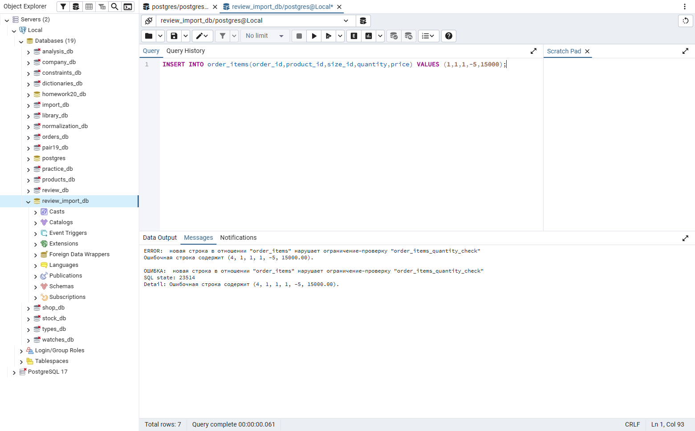

## Задание 3.5

```sql
INSERT INTO products(category_id,name,price)
VALUES (999,'Ошибка FK',1000);
```

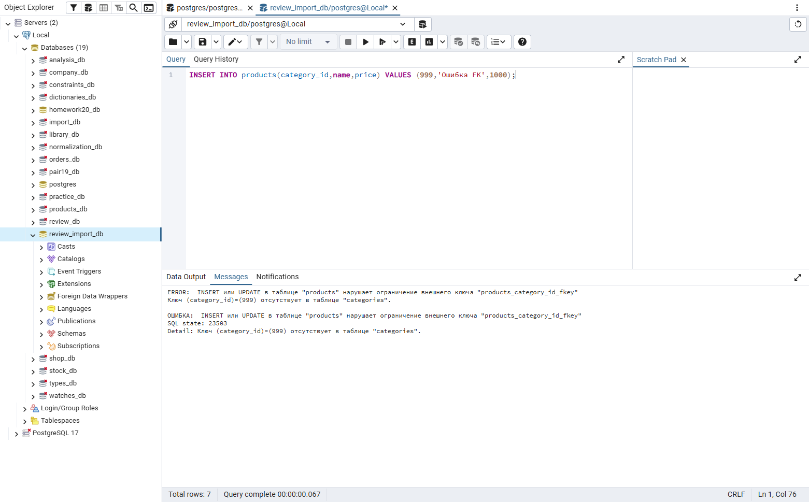

## Задание 4.1

```sql
-- Полный скрипт варианта «Парфюмерия»
\i src/db/14_import_2.sql
```

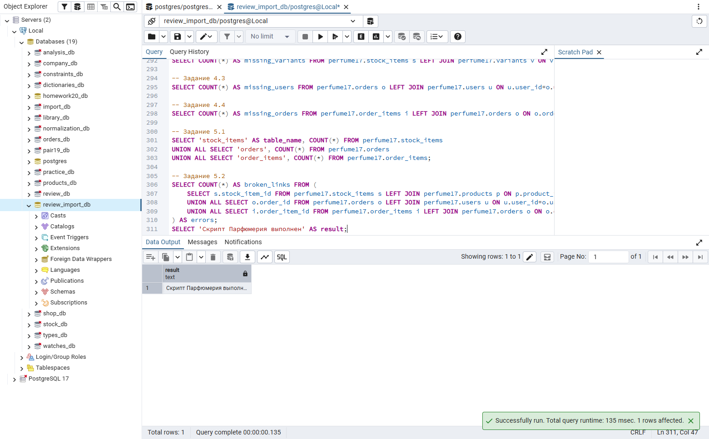

## Задание 4.2

```sql
SELECT 'categories' AS table_name,COUNT(*) FROM perfume17.categories
UNION ALL SELECT 'variants',COUNT(*) FROM perfume17.variants
UNION ALL SELECT 'products',COUNT(*) FROM perfume17.products
UNION ALL SELECT 'stock_items',COUNT(*) FROM perfume17.stock_items
UNION ALL SELECT 'users',COUNT(*) FROM perfume17.users
UNION ALL SELECT 'orders',COUNT(*) FROM perfume17.orders
UNION ALL SELECT 'order_items',COUNT(*) FROM perfume17.order_items;
```


## Задание 5.1

```sql
CREATE TABLE categories(id SERIAL PRIMARY KEY,name VARCHAR(100) UNIQUE NOT NULL);
CREATE TABLE products(id SERIAL PRIMARY KEY,category_id INTEGER REFERENCES categories,name VARCHAR(100) NOT NULL);
```

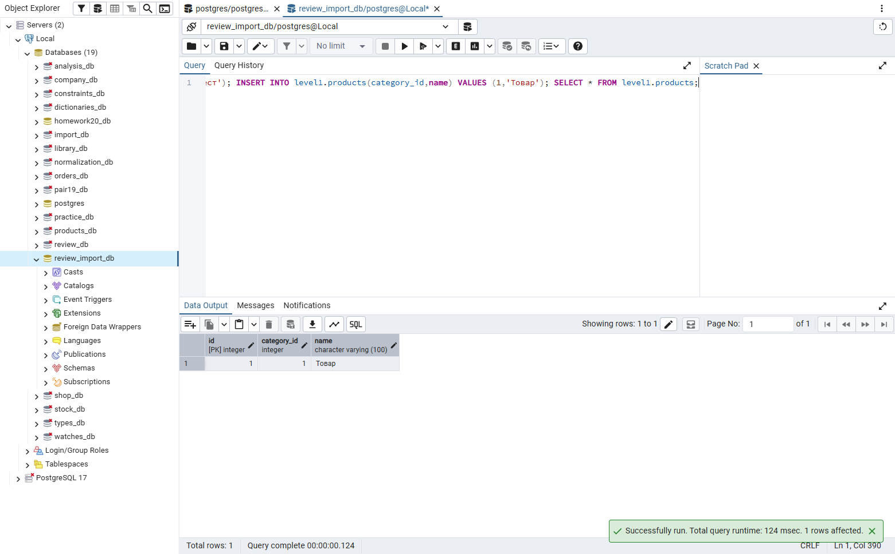

## Задание 5.2

```sql
CREATE TABLE categories(id SERIAL PRIMARY KEY,name VARCHAR(100) UNIQUE NOT NULL);
CREATE TABLE sizes(id SERIAL PRIMARY KEY,value VARCHAR(50) UNIQUE NOT NULL);
CREATE TABLE products(id SERIAL PRIMARY KEY,category_id INTEGER REFERENCES categories,name VARCHAR(100) NOT NULL);
CREATE TABLE stock_items(id SERIAL PRIMARY KEY,product_id INTEGER REFERENCES products,size_id INTEGER REFERENCES sizes,quantity INTEGER CHECK(quantity>=0));
```

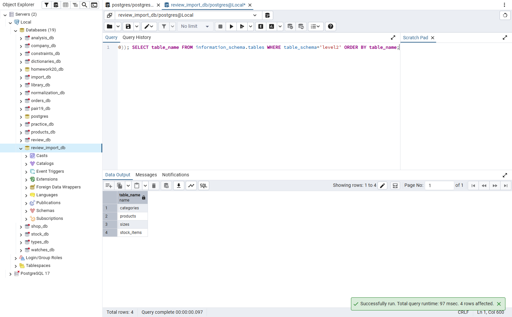

## Задание 5.3

```sql
DROP SCHEMA IF EXISTS level21 CASCADE;CREATE SCHEMA level21;
CREATE TABLE level21.categories(id SERIAL PRIMARY KEY,name VARCHAR(100) UNIQUE NOT NULL);
CREATE TABLE level21.sizes(id SERIAL PRIMARY KEY,value VARCHAR(50) UNIQUE NOT NULL);
CREATE TABLE level21.products(id SERIAL PRIMARY KEY,category_id INTEGER REFERENCES level21.categories,name VARCHAR(100) NOT NULL);
CREATE TABLE level21.stock_items(id SERIAL PRIMARY KEY,product_id INTEGER REFERENCES level21.products,size_id INTEGER REFERENCES level21.sizes,quantity INTEGER CHECK(quantity>=0));
CREATE TABLE level21.roles(id SERIAL PRIMARY KEY,name VARCHAR(50) UNIQUE NOT NULL);
CREATE TABLE level21.users(id SERIAL PRIMARY KEY,role_id INTEGER REFERENCES level21.roles,login VARCHAR(100) UNIQUE NOT NULL);
CREATE TABLE level21.orders(id SERIAL PRIMARY KEY,user_id INTEGER REFERENCES level21.users,order_date DATE DEFAULT CURRENT_DATE);
SELECT table_name FROM information_schema.tables WHERE table_schema='level21' ORDER BY table_name;
```

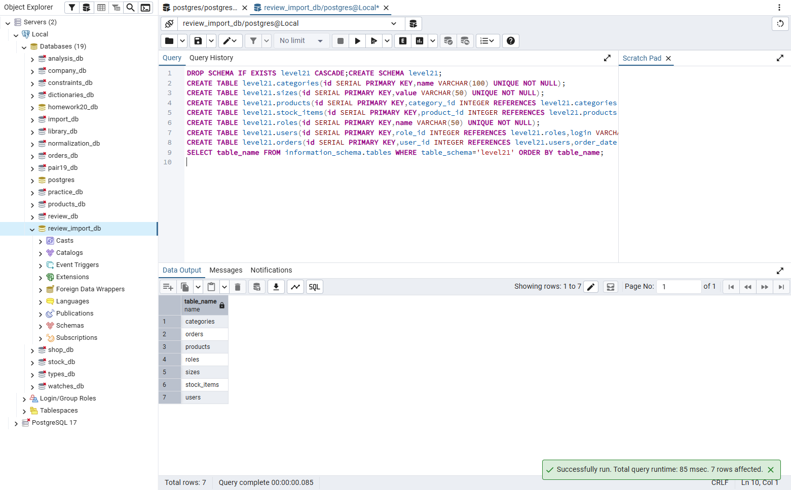

## Задание 2.2

Скрипт сохранён в `src/db/mir_chasov.sql`.

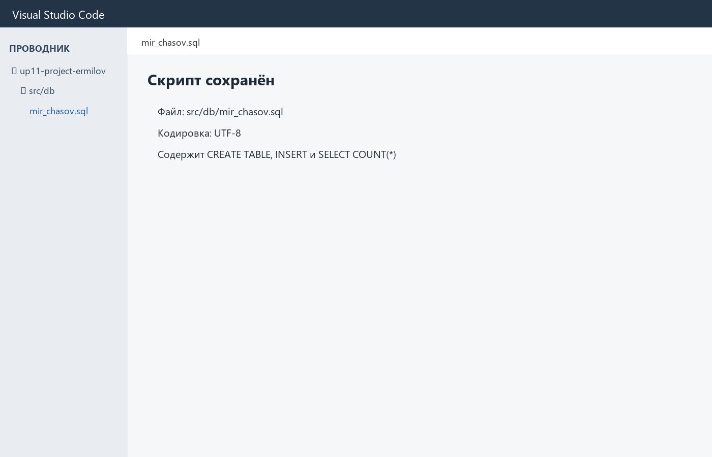

## Проверка понимания

1. Загрузка подготовленных данных из внешнего источника в таблицы базы данных.
2. SQL-файл с командами создания структуры, заполнения и проверки базы.
3. CREATE TABLE, INSERT, ограничения, связи и контрольные SELECT-запросы.
4. Чтобы восстановить, проверить или передать базу данных.
5. Запустить его с чистой базы, проверить таблицы, количество строк, CHECK и FK.
6. Команда создания таблицы.
7. Команда добавления строк в таблицу.
8. Ограничение допустимых значений.
9. Ограничение связи с родительской таблицей.
10. Рабочую тетрадь, SQL-скрипт и подтверждающие скриншоты.

## Контрольные вопросы

1. Загрузка подготовленных данных из внешнего источника в таблицы базы данных.
2. SQL-файл с командами создания структуры, заполнения и проверки базы.
3. CREATE TABLE, INSERT, ограничения, связи и контрольные SELECT-запросы.
4. Чтобы восстановить, проверить или передать базу данных.
5. Запустить его с чистой базы, проверить таблицы, количество строк, CHECK и FK.
6. Команда создания таблицы.
7. Команда добавления строк в таблицу.
8. Ограничение допустимых значений.
9. Ограничение связи с родительской таблицей.
10. Запрос, возвращающий количество строк таблицы.
11. Первичный ключ, однозначно определяющий строку.
12. Автоматически увеличиваемое целое значение.
13. Указание таблицы и поля для внешнего ключа.
14. Для создания и проверки полной базы на демонстрационном экзамене.
15. CREATE TABLE categories(id SERIAL PRIMARY KEY,name VARCHAR(100) UNIQUE NOT NULL); INSERT INTO categories(name) VALUES ('Парфюмерия');

## Итоги

Создал и проверил полный скрипт базы, импорт данных, CHECK и внешние ключи.
Выполнен повышенный уровень.
