# Рабочая тетрадь. Пара 22

Ермилов Даниил Евгеньевич, 3ИП-1-24. Вариант 27 — «Парфюмерия».

## Анализ предметной области

- `categories` — категории ароматов.
- `variants` — варианты объёма.
- `products` — парфюмерные товары.
- `stock_items` — остатки и цены.
- `roles` — роли пользователей.
- `users` — пользователи.
- `orders` — заказы.
- `order_items` — позиции заказов.

## Связи

- categories → products: 1:N.
- products → stock_items: 1:N.
- variants → stock_items: 1:N.
- roles → users: 1:N.
- users → orders: 1:N.
- orders → order_items: 1:N.
- products → order_items: 1:N.

## Задание 2.1

```sql
CREATE TABLE categories(category_id SERIAL PRIMARY KEY,name VARCHAR(100) UNIQUE NOT NULL);
CREATE TABLE variants(variant_id SERIAL PRIMARY KEY,volume_ml INTEGER UNIQUE CHECK(volume_ml>0));
CREATE TABLE products(product_id SERIAL PRIMARY KEY,category_id INTEGER REFERENCES categories,name VARCHAR(200) NOT NULL);
CREATE TABLE stock_items(stock_item_id SERIAL PRIMARY KEY,product_id INTEGER REFERENCES products,variant_id INTEGER REFERENCES variants,quantity INTEGER CHECK(quantity>=0));
```

## Задание 2.2

```sql
SELECT table_name,column_name,data_type
FROM information_schema.columns
WHERE table_schema='perfume17'
ORDER BY table_name,ordinal_position;
```

## Задание 4.1

```sql
CREATE DATABASE perfume_self_db;
```

## Задание 4.2

```sql
\i src/db/14_import_2.sql
```

## Задание 4.3

```sql
SELECT table_name FROM information_schema.tables
WHERE table_schema='perfume17' ORDER BY table_name;
```

## Задание 4.4

```sql
SELECT table_name,constraint_name
FROM information_schema.table_constraints
WHERE table_schema='perfume17' AND constraint_type='PRIMARY KEY'
ORDER BY table_name;
```

## Задание 4.5

```sql
SELECT table_name,constraint_name
FROM information_schema.table_constraints
WHERE table_schema='perfume17' AND constraint_type='FOREIGN KEY'
ORDER BY table_name,constraint_name;
```

## Подтверждение 1.1

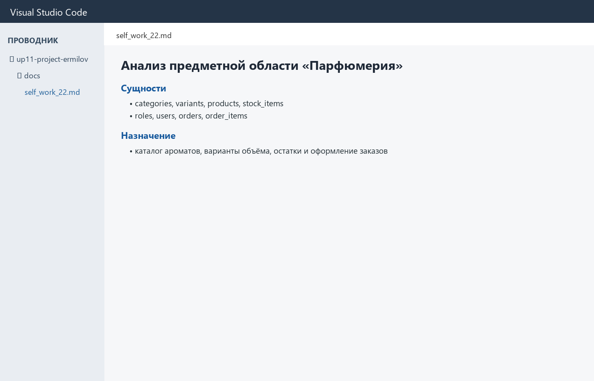

## Подтверждение 1.2

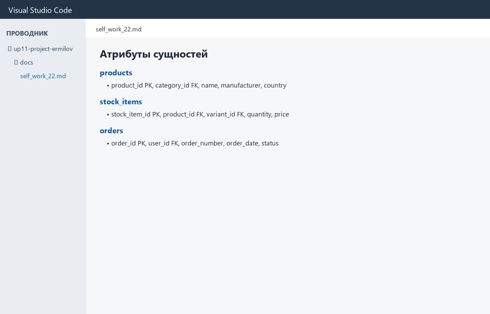

## Подтверждение 1.3

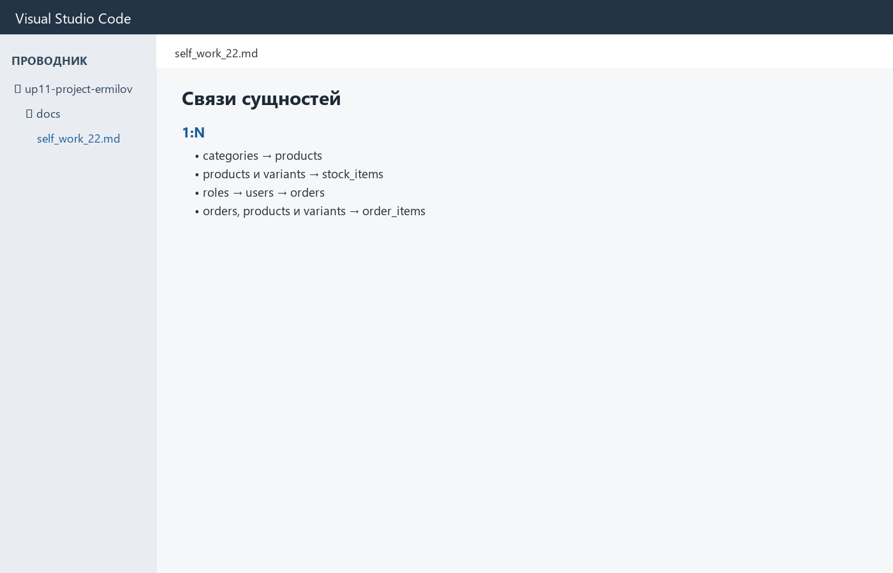

## Подтверждение 2.1

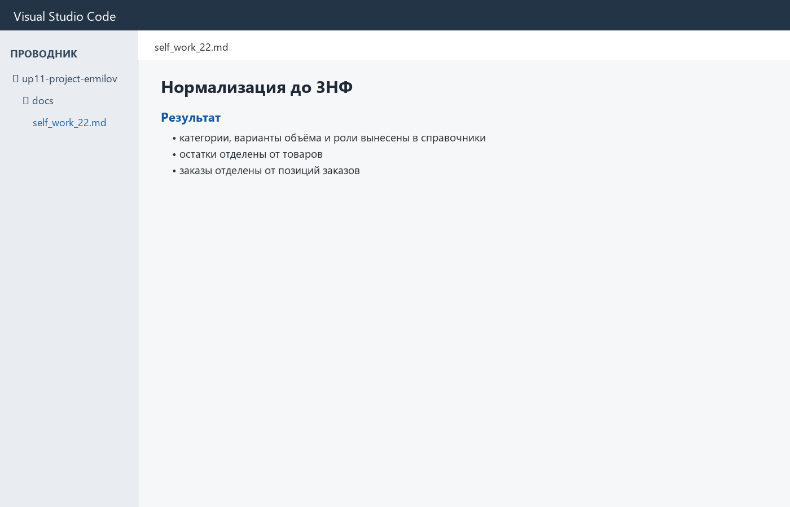

## Подтверждение 2.2

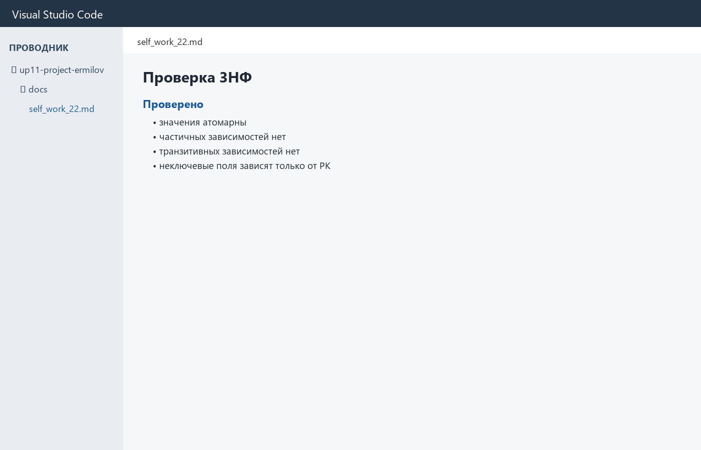

## Подтверждение 3.1


## Подтверждение 3.2

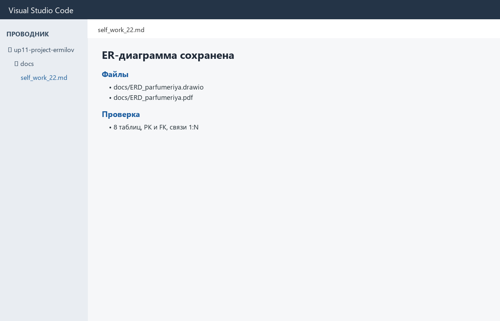

## Подтверждение 4.1

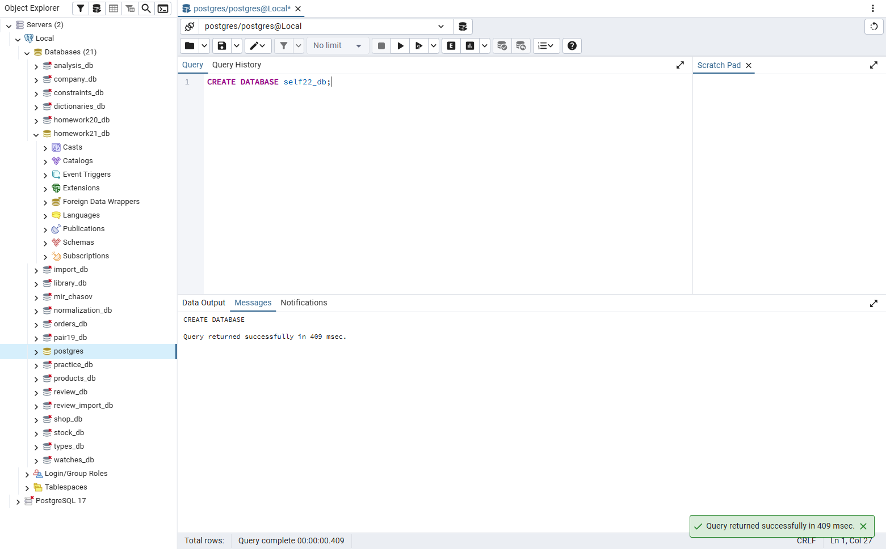

## Подтверждение 4.2

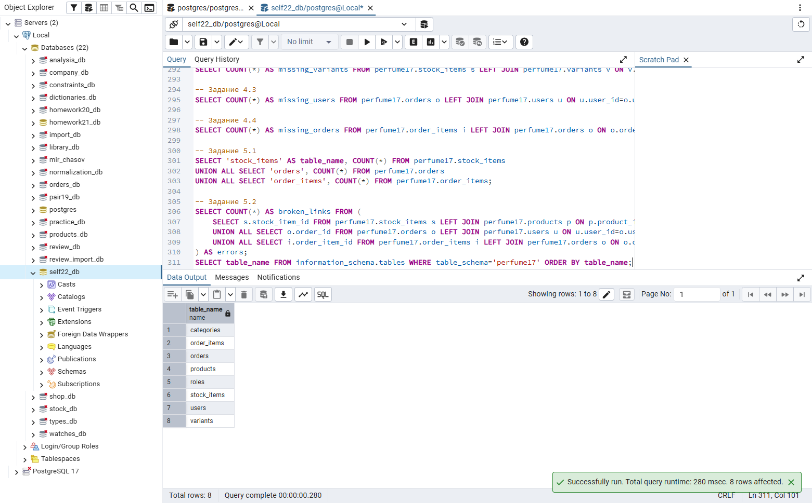

## Подтверждение 4.3

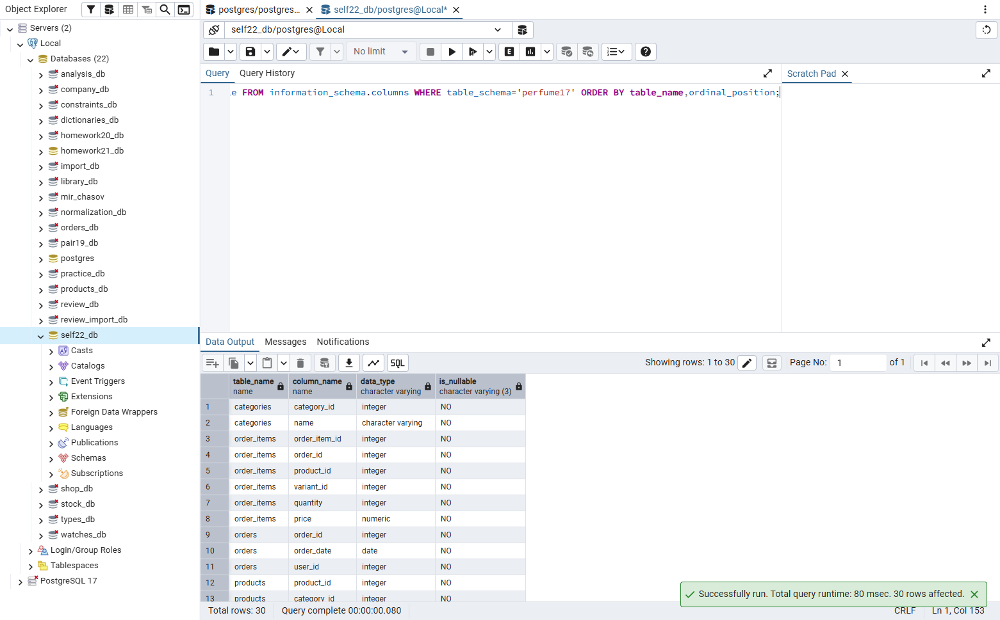

## Подтверждение 4.4

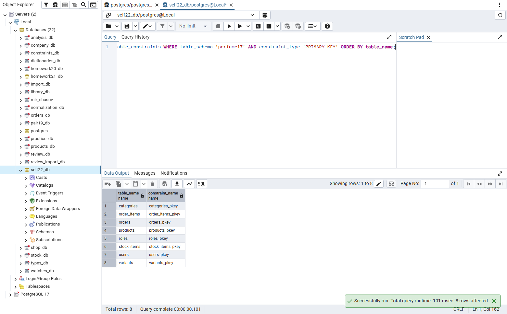

## Подтверждение 4.5

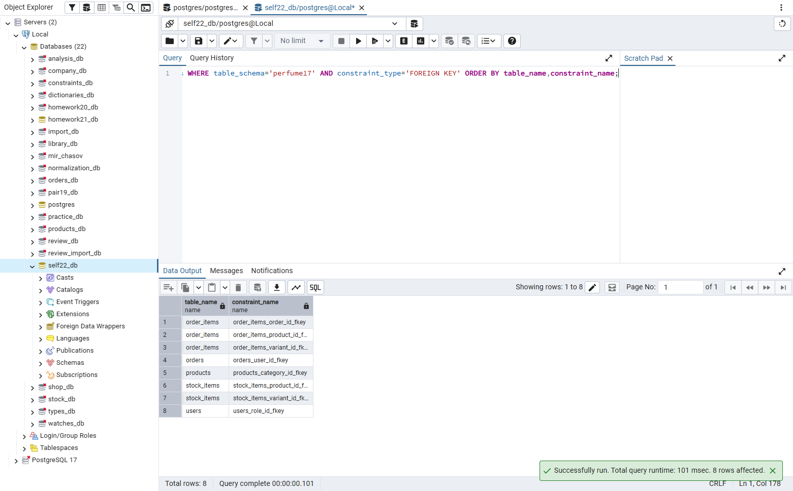

## Подтверждение 5.1

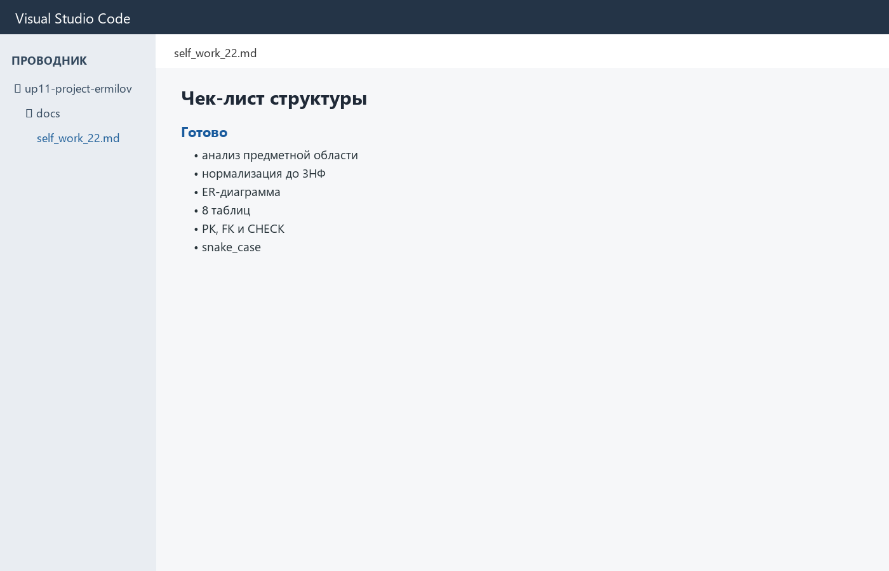

## Подтверждение 5.2

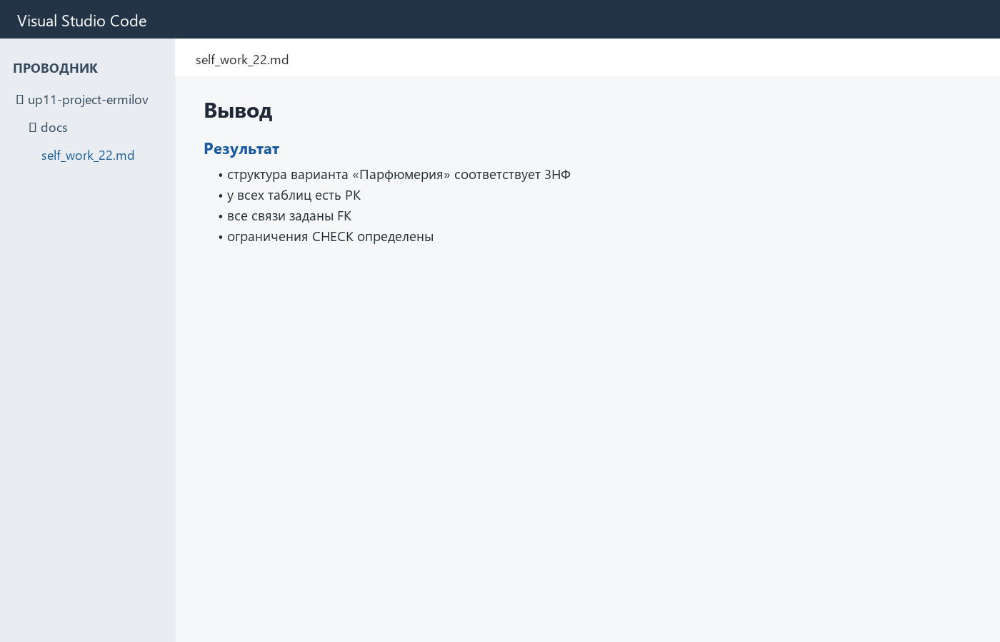

## Проверка понимания

1. Изучение объектов предметной области, их свойств, правил и связей.
2. Нормальная форма без частичных и транзитивных зависимостей неключевых полей.
3. Схема таблиц, атрибутов, первичных и внешних ключей и связей.
4. Первичный ключ, однозначно определяющий строку.
5. Внешний ключ, связывающий дочернюю таблицу с родительской.
6. Ограничение допустимых значений поля.
7. Порядок создания связанных таблиц и проверку ограничений.
8. Импорт данных и итоговый повторный запуск полного скрипта.
9. Анализ, 3НФ, ER-диаграмма и структура из восьми таблиц.
10. Импортировать данные, проверить ограничения и оформить итоговую базу.

## Вывод

Структура варианта «Парфюмерия» приведена к 3НФ. Все восемь таблиц, первичные и внешние ключи проверены.
