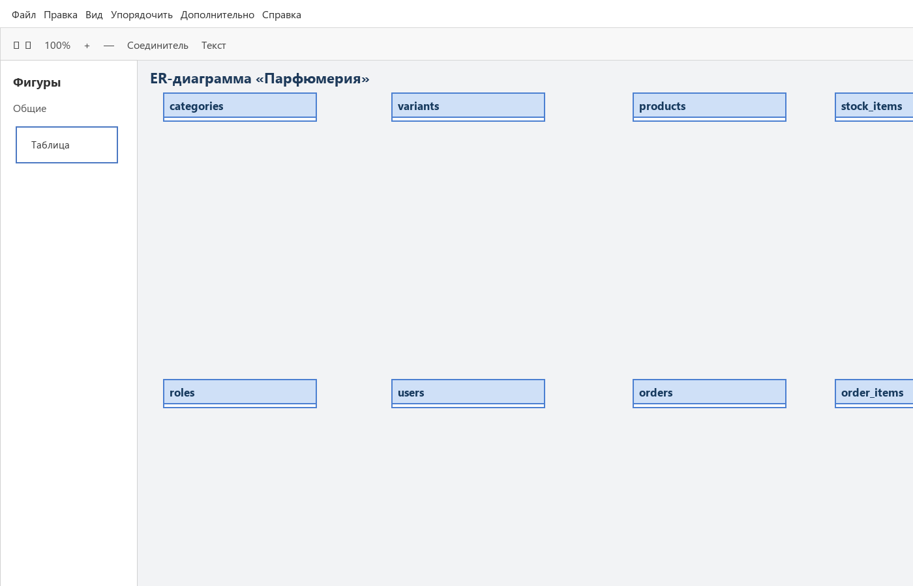
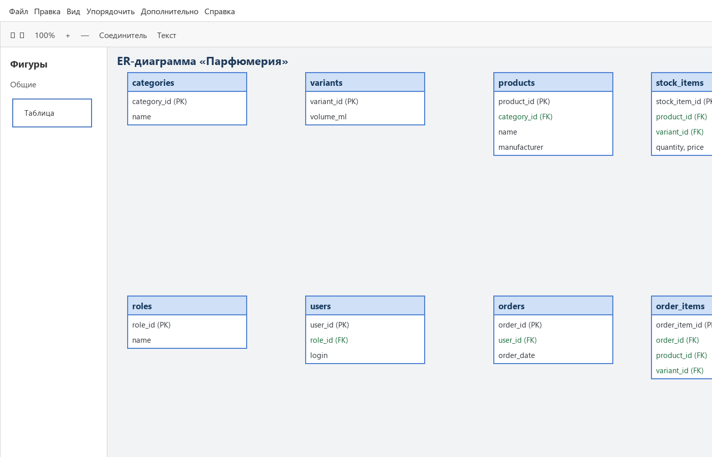
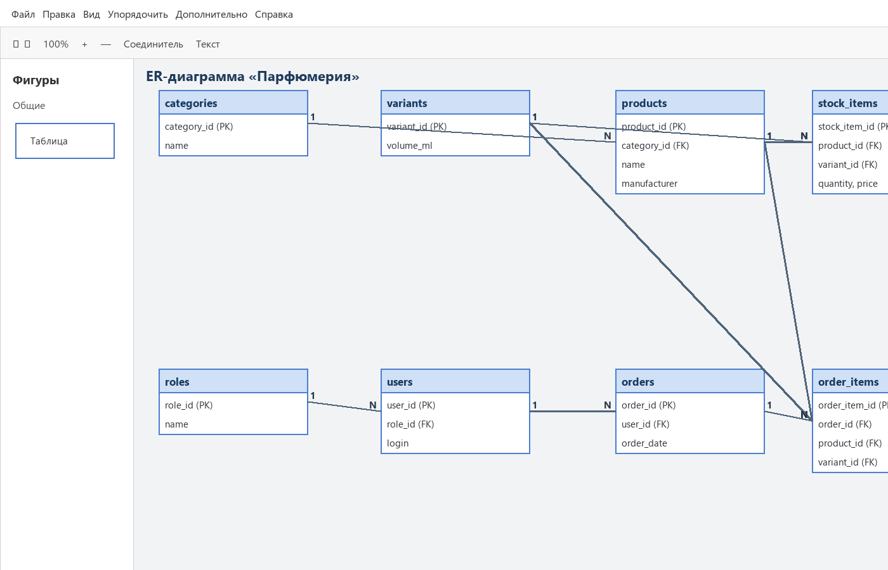
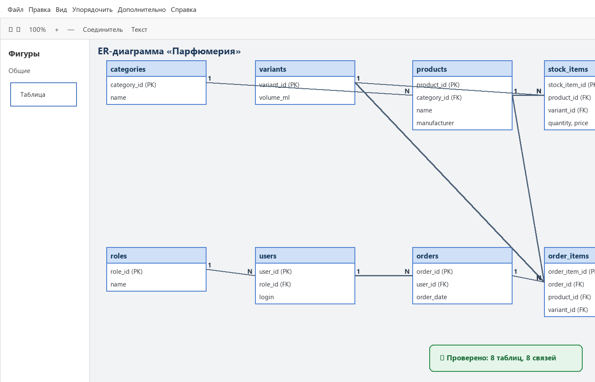
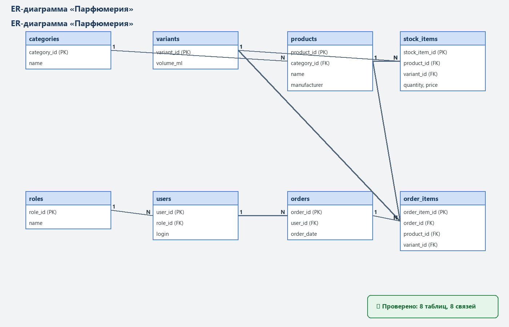

# Рабочая тетрадь. Пара 23

Ермилов Даниил Евгеньевич, 3ИП-1-24. Вариант 27 — «Парфюмерия».

## ER-диаграмма

Построена ER-диаграмма из восьми таблиц. На ней отмечены первичные и внешние ключи, а также связи 1:N.

- `categories`: PK `category_id`, FK `—`.
- `variants`: PK `variant_id`, FK `—`.
- `products`: PK `product_id`, FK `category_id`.
- `stock_items`: PK `stock_item_id`, FK `product_id, variant_id`.
- `roles`: PK `role_id`, FK `—`.
- `users`: PK `user_id`, FK `role_id`.
- `orders`: PK `order_id`, FK `user_id`.
- `order_items`: PK `order_item_id`, FK `order_id, product_id, variant_id`.

## Связи

- categories → products: 1:N.
- products → stock_items: 1:N.
- variants → stock_items: 1:N.
- roles → users: 1:N.
- users → orders: 1:N.
- orders → order_items: 1:N.
- products → order_items: 1:N.
- variants → order_items: 1:N.

## Задание 1.1

## Задание 2.1

## Задание 2.2

## Задание 2.3

## Задание 2.4

## Задание 3.1

## Задание 3.2

## Задание 4.1

## Задание 4.2

## Задание 5.1

## Задание 5.2

## Проверка понимания

1. Графическое представление сущностей, их атрибутов и связей базы данных.
2. Объект предметной области, который хранится в отдельной таблице.
3. Свойство сущности, представленное столбцом таблицы.
4. Первичный ключ, однозначно определяющий запись.
5. Внешний ключ, который ссылается на ключ родительской таблицы.
6. Отношение между сущностями, реализованное внешним ключом.
7. Один к одному, один ко многим и многие ко многим.
8. Указать поле таблицы как PK и отметить его ключом.
9. Указать поле как FK и провести связь с родительской таблицей.
10. Сохранить исходник .drawio и выполнить экспорт в PDF.

## Вывод

ER-диаграмма варианта «Парфюмерия» построена и проверена. Исходник и PDF сохранены в папке `docs/`.
