# Рабочая тетрадь. Пара 24

Ермилов Даниил Евгеньевич, 3ИП-1-24. Вариант 27 — «Парфюмерия».

Тема: самостоятельная работа по импорту данных и полному скрипту базы.

## Задание 1.1

```sql
SELECT table_name FROM information_schema.tables
WHERE table_schema='perfume17' ORDER BY table_name;
```

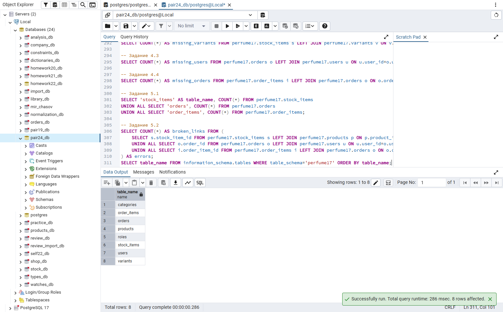

## Задание 1.2

```sql
SELECT 'categories' AS table_name, COUNT(*) FROM perfume17.categories
UNION ALL SELECT 'variants', COUNT(*) FROM perfume17.variants
UNION ALL SELECT 'roles', COUNT(*) FROM perfume17.roles;
```

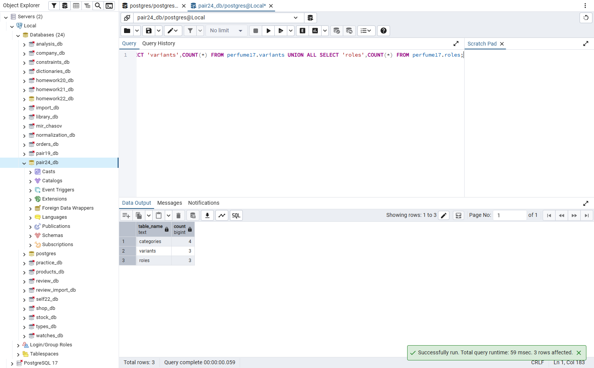

## Задание 1.3

```sql
SELECT COUNT(*) AS products FROM perfume17.products;
```

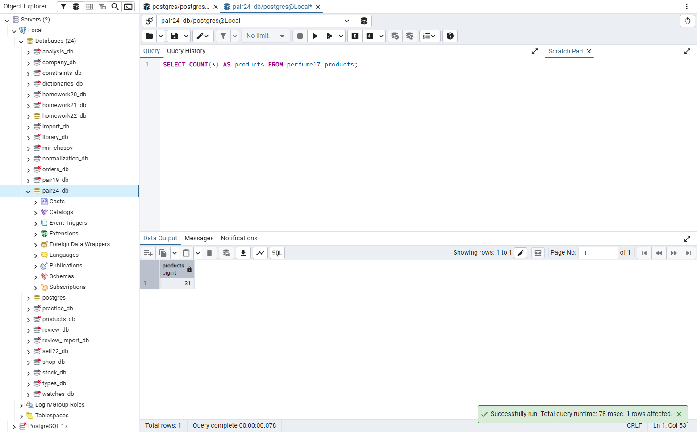

## Задание 1.4

```sql
SELECT COUNT(*) AS stock_items FROM perfume17.stock_items;
```


## Задание 1.5

```sql
SELECT COUNT(*) AS users FROM perfume17.users;
```

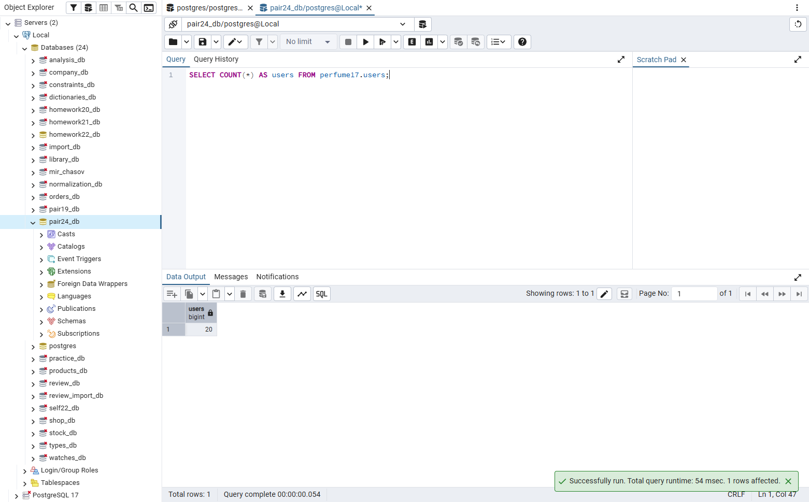

## Задание 1.6

```sql
SELECT 'orders' AS table_name, COUNT(*) FROM perfume17.orders
UNION ALL SELECT 'order_items', COUNT(*) FROM perfume17.order_items;
```

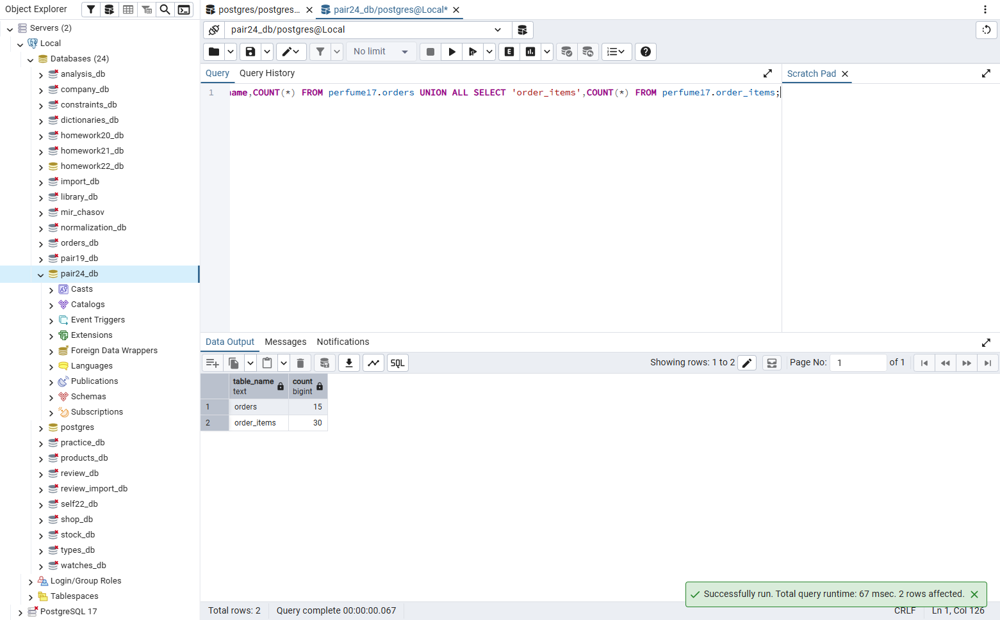

## Задание 2.1

```sql
SELECT 'categories' table_name,COUNT(*) FROM perfume17.categories
UNION ALL SELECT 'variants',COUNT(*) FROM perfume17.variants
UNION ALL SELECT 'products',COUNT(*) FROM perfume17.products
UNION ALL SELECT 'stock_items',COUNT(*) FROM perfume17.stock_items
UNION ALL SELECT 'users',COUNT(*) FROM perfume17.users
UNION ALL SELECT 'orders',COUNT(*) FROM perfume17.orders
UNION ALL SELECT 'order_items',COUNT(*) FROM perfume17.order_items;
```


## Задание 2.2

```sql
SELECT COUNT(*) AS broken_links
FROM perfume17.order_items i
LEFT JOIN perfume17.orders o ON o.order_id=i.order_id
LEFT JOIN perfume17.products p ON p.product_id=i.product_id
LEFT JOIN perfume17.variants v ON v.variant_id=i.variant_id
WHERE o.order_id IS NULL OR p.product_id IS NULL OR v.variant_id IS NULL;
```

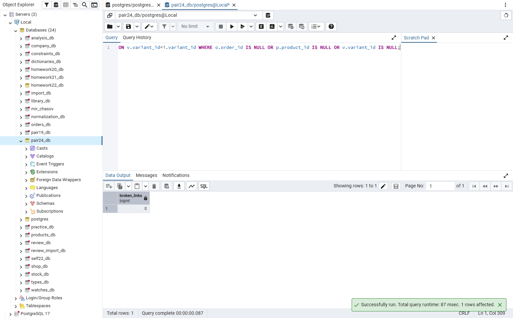

## Задание 3.1

```sql
-- Полный скрипт варианта «Парфюмерия»
\i src/db/14_import_2.sql
```

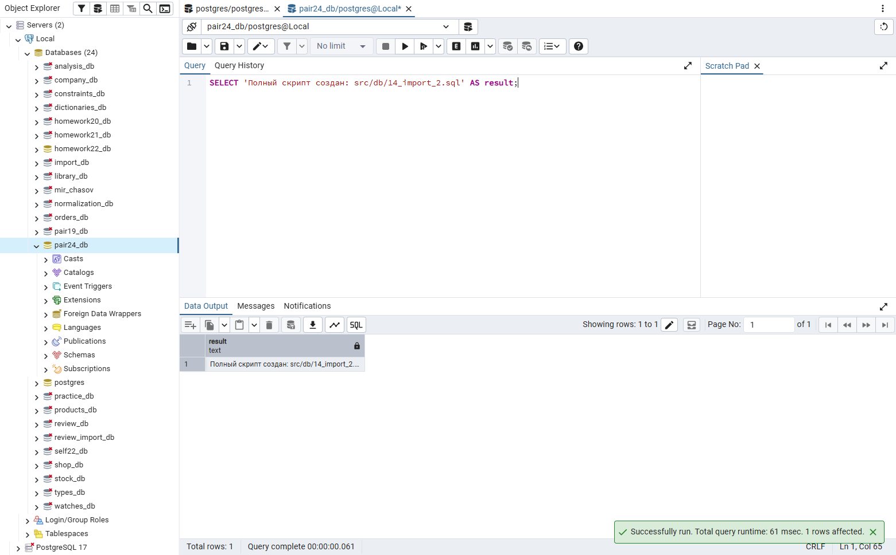

## Задание 3.2

Скрипт сохранён в `src/db/14_import_2.sql`.

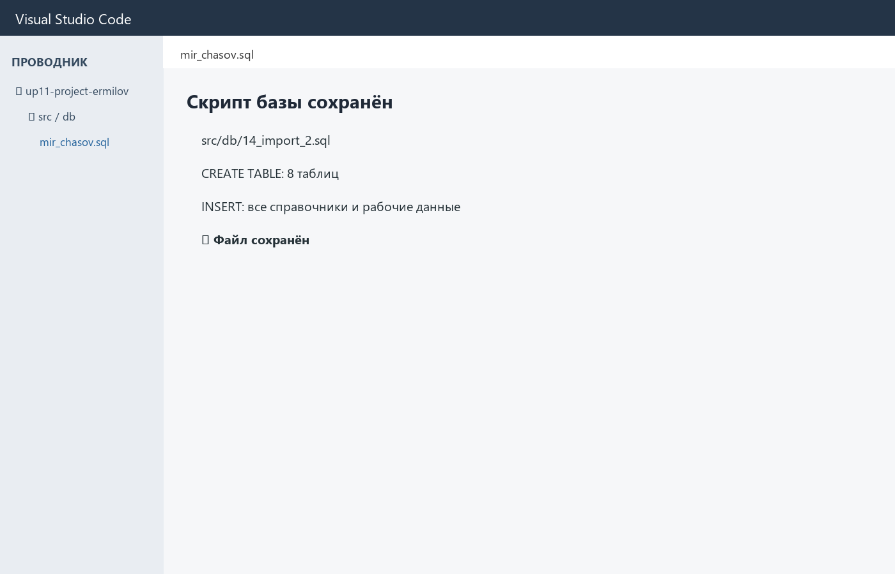

## Задание 4.1

```sql
DROP SCHEMA IF EXISTS perfume17 CASCADE;
\i src/db/14_import_2.sql
```

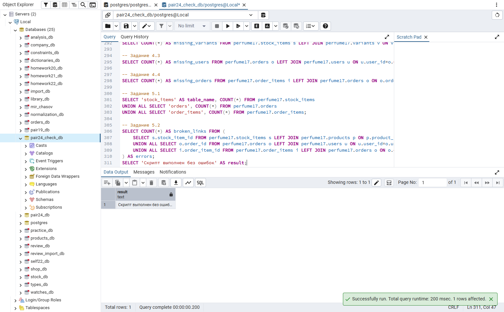

## Задание 4.2

```sql
SELECT table_name FROM information_schema.tables
WHERE table_schema='perfume17' ORDER BY table_name;
```

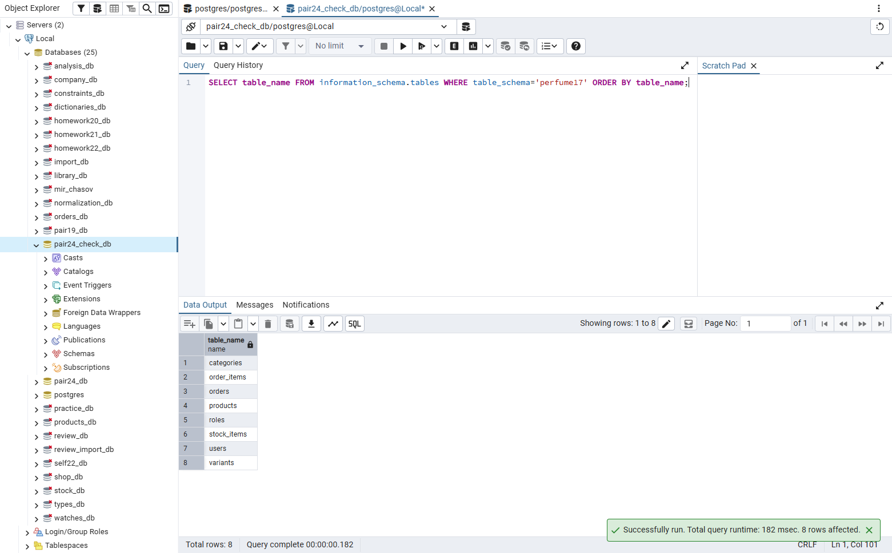

## Задание 4.3

```sql
SELECT table_name, row_count FROM (
 SELECT 'categories' table_name,COUNT(*) row_count FROM perfume17.categories
 UNION ALL SELECT 'variants',COUNT(*) FROM perfume17.variants
 UNION ALL SELECT 'products',COUNT(*) FROM perfume17.products
 UNION ALL SELECT 'stock_items',COUNT(*) FROM perfume17.stock_items
 UNION ALL SELECT 'users',COUNT(*) FROM perfume17.users
 UNION ALL SELECT 'orders',COUNT(*) FROM perfume17.orders
 UNION ALL SELECT 'order_items',COUNT(*) FROM perfume17.order_items
) q ORDER BY table_name;
```

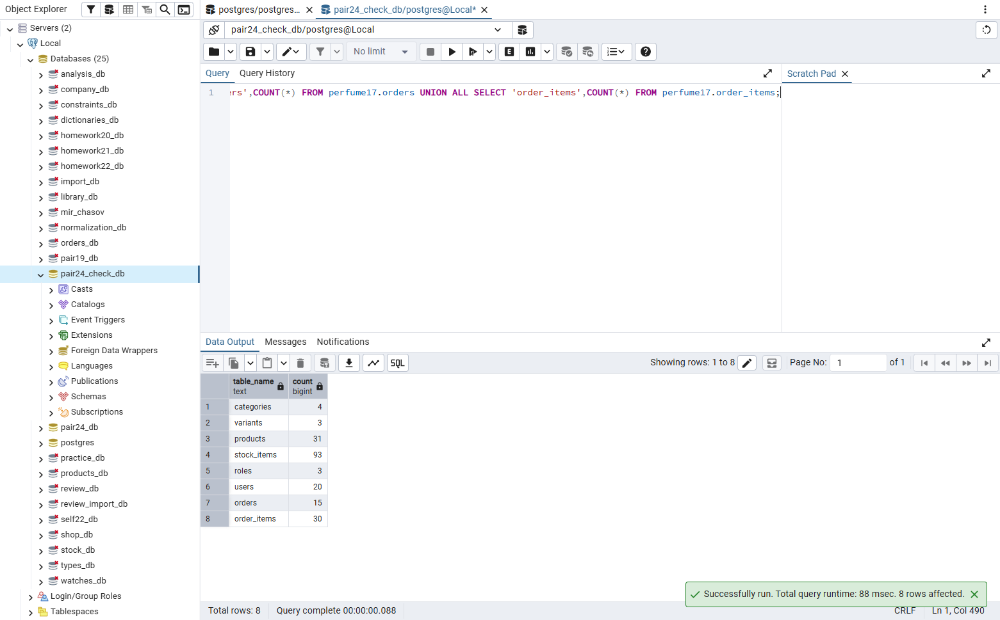

## Задание 5.1

Чек-лист заполнен: импорт, проверка COUNT и повторный запуск выполнены.

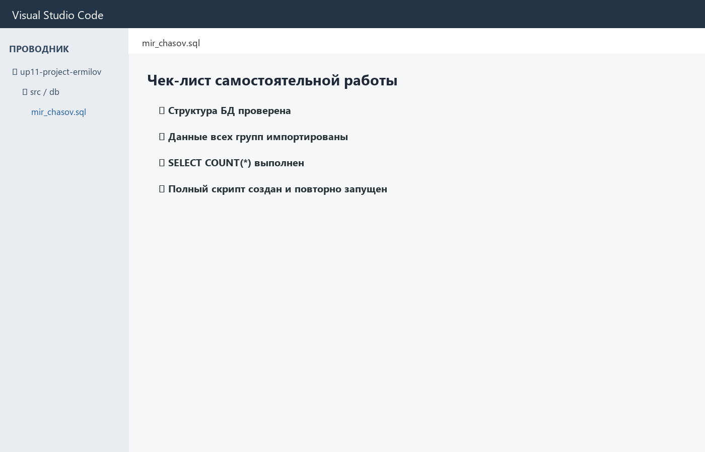

## Задание 5.2

База «Парфюмерия» полностью создана и проверена.

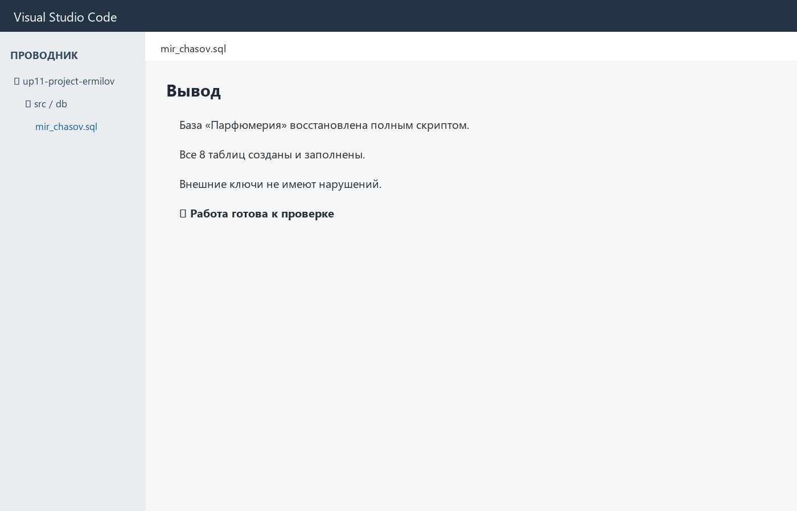

## Проверка понимания

1. Загрузка подготовленных данных из внешнего источника в таблицы базы данных.
2. SQL-файл с командами создания структуры, заполнения и проверки базы.
3. CREATE TABLE, INSERT, ограничения, связи и контрольные SELECT-запросы.
4. Чтобы воспроизвести, проверить или перенести базу данных.
5. Сравнить количество строк в источнике и таблицах с помощью COUNT(*).
6. Запустить его в чистой базе и проверить таблицы, строки и ограничения.
7. Запрос, который возвращает количество строк.
8. Ограничение допустимых значений поля.
9. Внешний ключ, связывающий дочернюю таблицу с родительской.
10. Рабочую тетрадь, полный SQL-скрипт и подтверждающие скриншоты.

## Вывод

Полный скрипт варианта «Парфюмерия» повторно запущен. Все восемь таблиц созданы, данные импортированы, количество строк и внешние ключи проверены.
